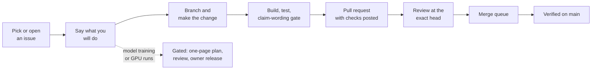

# Contributing to UOR-R4

UOR-R4 is open research into a language model that uses geometry instead of a transformer's dense
arithmetic ([README](README.md)). It is pre-alpha: no milestone is complete and no model holds a
useful conversation yet. Most code is written by AI research labs under the owner's direction, but
outside contributions are welcome and do not need any lab tooling. This page tells you how to build
and test the code, what kind of change is welcome, and why work on the model itself is gated.



*The path of an outside contribution. Anything that trains or evaluates the model on a GPU takes the
gated branch.*

## For outside contributors

### Build and test

Rust 1.97.1 is pinned by `rust-toolchain.toml` and selected by rustup. From the repository root:

```sh
cargo check --locked -p uor-r4-discrete --lib
cargo test --locked -p uor-r4-discrete --lib
cargo run -q --locked -p xtask -- figures
```

The first two build and test the active model crate, [`crates/uor-r4-discrete`](crates/uor-r4-discrete/README.md);
the third regenerates the documentation figures. None of them runs a model. Run focused tests for the
crate you change (`cargo test --locked -p <crate>`); there is no blanket full-suite requirement. You
do not need a GPU, the research harness or any lab access to contribute: a maintainer runs those
gates for you.

### The claim-wording gate

Every pull request that touches documentation must pass:

```sh
cargo run -q --locked -p uor-r4-claim-wording -- .
```

It scans `docs/`, the crate READMEs and the root README for words of certainty such as "machine-verified" or "provably equivalent", which are not allowed on a line that does not also link the proof or certificate.
Beyond the gate, write the way the project's evidence rules require
([charter](CHARTER.md) §4.6, [formal vocabulary](docs/formal_vocabulary.md)):

- Say "measured X on Y against Z", and label each claim as **proof**, **measurement** or **hypothesis**.
- `NOT_RUN` is not a pass. A passing test shows code does what it says; it is not a trained capability.
- Make no frontier, general-prose, reasoning or energy-saving claims. The model is pre-alpha.

### Find something to work on

The [roadmap](docs/roadmap/README.md) lists every known gap between today and the alpha, one planned issue each. Its "Start here" table lists the items anyone can take now, and the same items carry the `help wanted` label on GitHub. Each issue says why it matters, what is missing, when it is done, how to start and which rules apply. To take one, comment on the issue so it can be assigned to you, then open a PR that says `Closes #N` when the item is done, or `References #N` when it is partial. If you find a gap the roadmap does not list, open an issue and a maintainer will add it as an item.

Also welcome:

- **Documentation and claim-wording fixes**: a wrong number, a broken link, an unclear page. Open an issue first for anything larger than a typo.
- **Reproducing a recorded result**, including a negative one, and reporting any discrepancy. Public inputs are in the HF dataset [`caseyallard/uor-r4-data`](https://huggingface.co/datasets/caseyallard/uor-r4-data), with checksums.
- **Tooling and CI** that do not touch the model path.

Code is Rust first, building on the uor-foundation crates; do not add a Python model implementation or
dependency ([charter](CHARTER.md) §3.11). Never commit model weights, corpora, binaries or secrets
(§3.13).

### Model work is gated

The model is owned by the milestone issues, M1 to M4
([#2029](https://github.com/UOR-Foundation/uor-r4/issues/2029) to
[#2032](https://github.com/UOR-Foundation/uor-r4/issues/2032)); M5 to M8
([#2033](https://github.com/UOR-Foundation/uor-r4/issues/2033) to
[#2036](https://github.com/UOR-Foundation/uor-r4/issues/2036)) depend on a served model. M5, M6 and M8 have not started; M7's browser engine exists, with no model to load.
Training is held. Any GPU training or evaluation, and any run a milestone claim rests on,
needs a one-page pre-registration, a review by someone who did not write it, and a release typed by
the owner ([charter](CHARTER.md) §4.5, §5.1). The model must also obey the technical rules: geometry
only, no softmax or other squashing function, no matrix multiplication, research compute on GPUs and
an integer-only served model (§3). Roadmap items marked "held" wait for that release; items marked
"ready" can start now.

**GPU runs by outside contributors (owner, 20 Oct 2026).** You may run a GPU step on your own GPU, never a CPU. Attach the hardware specs (GPU model and memory, driver and CUDA version, CPU and RAM) to the PR with the results. When your hardware is not equivalent to the project baseline, an RTX 5090, a maintainer re-runs the step on the baseline under the same FIT after you submit the PR, so a different GPU is not a reason to wait.

### How to send a change

1. **Ask first.** Comment on the milestone issue, or on the tracker
   [#2028](https://github.com/UOR-Foundation/uor-r4/issues/2028), saying what you will do. A
   maintainer will say within a day whether the work is wanted; "not now" is a normal answer.
2. **Branch.** One short-lived branch per change. `main` is the single source of truth; a branch is
   only a delivery step.
3. **Check.** Build, run the focused tests and the claim-wording gate, and paste the results into the
   pull request.
4. **Open a pull request.** Stage only the paths you changed. Write `References #N` for partial work
   and `Closes #N` only when the issue's acceptance is fully met.
5. **Review and merge.** A review at the exact head commit, then the merge queue. A pull request is
   not complete until its merge is verified on a fresh `main`. When `main` moves, merge it into your
   branch rather than force-pushing.

If your change produces a research result, record it as one row in its research line's notebook
([`docs/research/notebook/`](docs/research/notebook/README.md)): date, what ran, the number, the bar,
the verdict and a link to the artifact (§5.6). [STATUS](STATUS.md) and [ROADMAP](ROADMAP.md) change
only when a milestone's state changes, and the README only when a capability, headline result or
command changes; none of them is a log.

## For AI labs

AI research labs (currently Kimi as project manager, Claude, Codex and DeepSeek) work under the
[charter](CHARTER.md), the single rule book, and onboard through [AGENTS.md](AGENTS.md). In short:
set `UOR_LAB`, pick work from [NOW.md](docs/integration/NOW.md), post a one-line intent note on the
owning issue and claim the branch (§5.3). GPU pods are rented only through `scripts/pod/uor-pod`,
within at most 4 pods and $8 per hour across all labs (§5.4). The owner types every owner release
personally; labs stage the commands and never type one (§5.1). Deliver through the full path in
§5.5, then delete the branch and worktree and run `scripts/storage/uor-hygiene --apply`. The research
harness is described in [docs/harness/README.md](docs/harness/README.md).

## Proposing a change to the rules

Open an issue that describes the change and how it helps the project goal. Only the owner changes the
charter; accepted changes are recorded in [docs/rules/changes.md](docs/rules/changes.md).

## License

By contributing you agree your contribution is licensed under the [MIT license](LICENSE).
