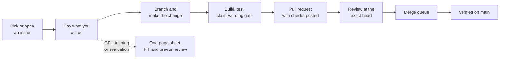

# Contributing to UOR-R4

UOR-R4 is open research into a language model that uses geometry and exact memory instead of a
transformer's dense arithmetic ([README](README.md)). It is pre-alpha: **M1 is complete (1 of 8),
and no model holds a useful conversation yet.** Most code is written by AI research labs under the
owner's direction, but outside contributions are welcome and need no lab tooling.



*The delivery path for an outside contribution. GPU model work also needs its registered sheet and reviews.*

## For outside contributors

### Build and test

Rust 1.97.1 is pinned by `rust-toolchain.toml` and selected by rustup. From the repository root:

```sh
cargo check --locked -p uor-r4-discrete --lib
cargo test --locked -p uor-r4-discrete --lib
cargo run -q --locked -p xtask -- figures
```

The first two build and test the active discrete model crate; the third checks or regenerates
 documentation figures. None runs a model. Run focused tests for the crate you change
(`cargo test --locked -p <crate>`); there is no blanket full-suite requirement. You do not need a
GPU, the research harness or lab access: a maintainer runs those gates for you.

### Write claims that can be checked

Every pull request that touches documentation must pass:

```sh
cargo run -q --locked -p uor-r4-claim-wording -- .
```

The gate scans `docs/`, crate READMEs and the root README for certainty phrases such as
"machine-verified" or "provably equivalent" without a linked proof. Other root and web files need
the same discipline even though the gate does not scan them.

- Say "measured X on Y against Z", and label claims **proof**, **measurement** or **hypothesis**.
- `NOT_RUN` is not a pass. A passing test shows code does what it says; it is not trained capability.
- M1's six-bar result is real, but it is not useful chat, M2, an alpha release or permission to make
  frontier/general-prose/reasoning/energy-saving claims.

### Find something to work on

The [roadmap](docs/roadmap/README.md) lists documented gaps, one planned issue each. Its "Start
here" table lists items anyone can take, and those items carry `help wanted`. Each issue says why
it matters, what is missing, when it is done, how to start and which rules apply. Comment on the
issue before starting, then open a PR that says `Closes #N` only when the item's acceptance is fully
met, or `References #N` for partial work. New gaps become new item files through a PR.

Also welcome:

- **Documentation and claim-wording fixes:** a wrong number, broken link or unclear page. Open an
  issue first for anything larger than a typo.
- **Reproducing a recorded result**, including a negative one, and reporting discrepancies. Public
  inputs are in [`caseyallard/uor-r4-data`](https://huggingface.co/datasets/caseyallard/uor-r4-data), with checksums.
- **Tooling and CI** that do not touch the model path.

Code is Rust first, building on the uor-foundation crates; do not add a Python model implementation
or dependency. Never commit model weights, corpora, binaries or secrets ([charter](CHARTER.md) §3.11, §3.13).

### Model work is gated

M1 is complete; M2 and M3 are in progress; M4–M8 are not started. M7 has a browser engine and Studio
harness on a synthetic stand-in, but no accepted model bundle. GPU training or evaluation, and any
run a milestone claim rests on, needs a one-page pre-registration with a non-author **TEST FITNESS:
FIT** review and the lab's own whole-project pre-run review (D67). The D41 donor pass is the named
exception that still needs the owner at dispatch; there is no blanket owner release for every run.

The model must also obey the technical rules: geometry only, no softmax or other squashing, no dense
matrix multiplication, research compute on GPUs, and an integer-only served artifact. Roadmap items
marked "held" have their named dependency; "ready" items can start when their prerequisites are met.

**GPU runs by outside contributors (owner, 20 Oct 2026).** You may run a GPU step on your own GPU,
never a CPU. Attach the hardware specs (GPU model and memory, driver and CUDA version, CPU and RAM)
to the PR. When the hardware is not equivalent to the RTX 5090 baseline, a maintainer re-runs the
step on the baseline under the same FIT after you submit the PR; different hardware is not a reason
to wait.

### How to send a change

1. **Ask first.** Comment on the milestone issue or tracker
   [#2028](https://github.com/UOR-Foundation/uor-r4/issues/2028), saying what you will do.
2. **Branch.** One short-lived branch per change; `main` is the single source of truth.
3. **Check.** Build, run focused tests and claim-wording, and paste the results into the PR.
4. **Open a pull request.** Stage only the paths you changed. Use `References #N` for partial work
   and `Closes #N` only when the item's acceptance is fully met.
5. **Review and merge.** A review at the exact head, then the merge queue. A PR is not complete
   until its merge is verified on fresh `main`. Merge main forward rather than force-pushing.

If your change produces a research result, record one row in its research line's notebook: date,
what ran, number, bar, verdict and artifact link (§5.6). Current plan/status belongs in
[PLAN.md](PLAN.md) and the rendered [STATE.md](STATE.md); the README changes only when a capability,
headline result or command changes, not as a log.

## For AI labs

AI research labs (Kimi as project manager, Claude, Antigravity and DeepSeek; Codex has left the
registry) work under [CHARTER.md](CHARTER.md), the single rule book, and onboard through
[AGENTS.md](AGENTS.md). Set `UOR_LAB`, pick work from [PLAN.md](PLAN.md), post a one-line intent note
on the owning issue and claim the branch (§5.3). GPU pods go only through `scripts/pod/uor-pod`,
within at most 4 pods and $8 per hour across all labs (§5.4). Deliver through the full path in §5.5,
then delete the branch and worktree and run `scripts/storage/uor-hygiene --apply`. The research
harness is described in [docs/harness/README.md](docs/harness/README.md).

## Proposing a change to the rules

Open an issue that describes the change and how it helps the project goal. Only the owner changes
the charter; accepted changes are recorded in [docs/rules/changes.md](docs/rules/changes.md).

## License

By contributing you agree your contribution is licensed under the [MIT license](LICENSE).
