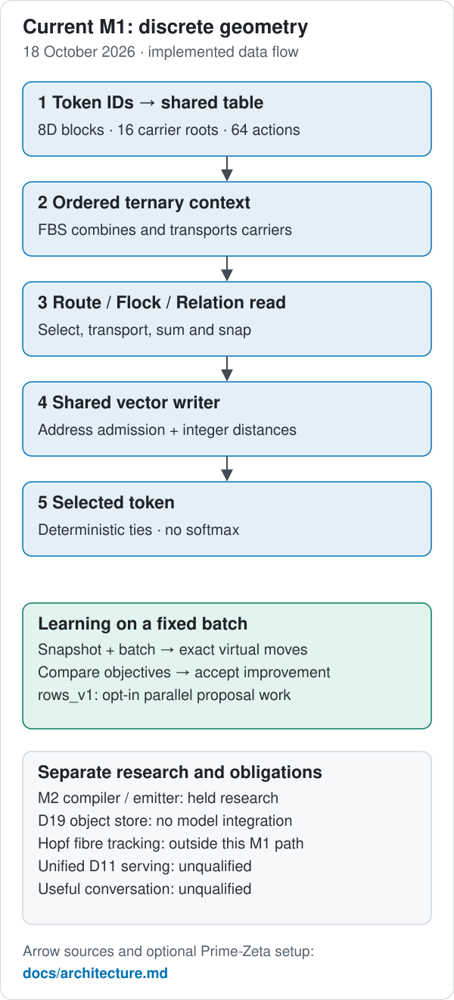
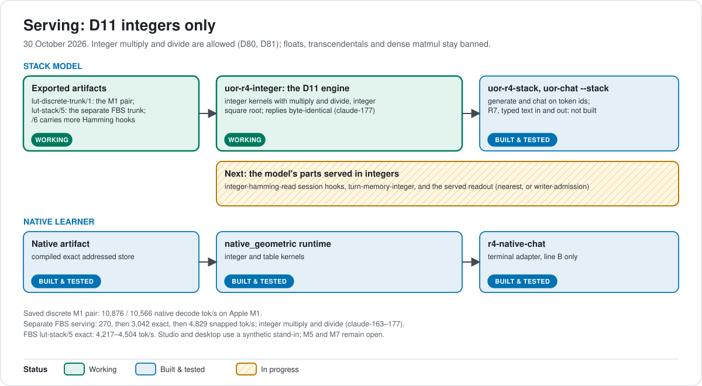
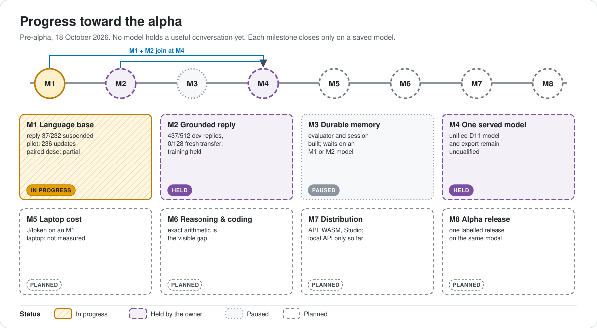
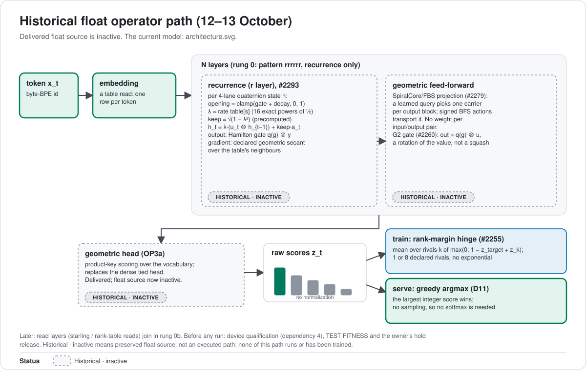

# UOR-R4 Geometric Language Model

*An open research project: can geometry replace a transformer's run-time machinery in a language
model that runs on a laptop?*

[](LICENSE)
[](rust-toolchain.toml)
[](STATUS.md)
[](#where-we-are)
[](https://github.com/UOR-Foundation/uor-r4/commits/main)
[](https://huggingface.co/caseyallard/uor-r4-geometric-214m)

**Contents:** [What works today](#what-works-today-and-what-does-not) · [The question](#the-question) ·
[Architecture](#architecture) · [Where we are](#where-we-are) · [Current path](#the-current-path-discrete-geometric-learning) ·
[Rules](#rules-the-project-works-under) · [Mechanisms](#mechanisms-under-test) · [Results](#results-so-far) ·
[Bookkeeping](#bookkeeping-where-things-are-recorded) · [Quick start](#quick-start) ·
[Models and data](#models-and-data) · [Acknowledgements](#acknowledgements)

**Pre-alpha, 18 October 2026.** We are building a local language model whose state, memory and
next-token choice are geometric instead of a transformer's dense attention. **0 of 8 milestones
are complete, and no model here holds a useful conversation yet.** What exists is a working
integer substrate — a shared token-vector table, ordered context, Route/Flock/Relation reads and
a shared writer in [`crates/uor-r4-discrete`](crates/uor-r4-discrete/README.md) — plus a scoped
diagnostic pilot that learned 236 vector updates. The latest paired attention attempt stopped at
its pre-registered Q1 admission gate in both arms: a configured admission collapse, not an
accuracy result or a mechanism verdict
([record](docs/labs/attention-rows-q1-diagnosis-2026-10-18/README.md)). The registered interpretation of the four finished K16-A/R trajectories is now complete: **`OCCUPANCY_COLLAPSE_TRIGGERED`**, no KEEP; admission arm **A**; fresh transfer **NOT_TRIGGERED** (seal kept). Final DATA and late operator archives are verified; normal close is complete (pod released 00:38:29Z, down 00:38:33Z; after-down closure custody 131,072 B/MD5 `9f7368ac…`), while final rental accounting remains pending. The Q4 census correction stands: initial aliasing binds at initialization only and is not the sole final-ranking cause.

## What works today, and what does not

| Works today | Does not work yet |
|---|---|
| An integer 8D carrier with 16 roots and 64 signed actions | Useful conversation, general prose, reasoning or coding |
| Route, Flock and Relation reads | Any unified served model |
| The shared input/carry/output writer | Any measured laptop energy figure |
| The D19 exact byte store, with no model integration claimed | Running the current model in a browser |
| 25/25 admitted CUDA construction controls and 1,085 finite parity cases | |
| A D11 integer WASM runtime for the historical stack ([#2654](https://github.com/UOR-Foundation/uor-r4/pull/2654)) | |

The left column is tested substrate; the right column is what would make it a language model.
Neither column is a claim of measured language quality.

The K16-A/R admission redirect on `rows_v1`, seeds1/2 is complete. The injective attention test was the next step, but its pre-flight stopped at **B3_init 127/3,847 < 500** and net G-Cap 127 < 500, so the run was not dispatched: `INSTRUMENT_UNREACHABLE`, not a mechanism negative, and nothing trained. The owner selected the address-structured injective-cell successor: a placement-only 256×16 pre-flight (sheet now FIT; 32-cell compact parked as fallback). Its zero-update five-arm pre-flight ran on 2026-10-19 with Casey's chat approval: A8 reached **B3_init 1,351/3,847 ≥ 500** and net G-Cap 1,351 > 500, and its gain over both P8 and the shuffled S8 control clears the one-sided floors. P8 reproduced 427/127 exactly. Nothing was trained. Next is the A8 training-dose sheet ([address-cells pre-flight record](docs/labs/address-cells-preflight-2026-10-19/README.md)). See also the [injective pre-flight record](docs/labs/injective-preflight-and-c2-qualify-2026-10-19/README.md) and [timing/qualification record](docs/labs/k16-rows-timing-source-2026-10-18/README.md).
At protected source `21224b446`, the declared construction, finite controls,
G-Pre, C-R1..C-R6 and two checkpoint-0 A/R timing cells passed, with 100 timed
samples plus one excluded warmup per cell. A shared-library fresh-init companion
supplies the timing state; its all-state-except-source comparison with G-Pre
passes without equating the two compiled graphs.
[Qualification and timing record](docs/labs/k16-rows-qualification-2026-10-18/README.md).
DATA and late operator custody have verified cloud readbacks. The
[sealed packet request6254373730](https://github.com/UOR-Foundation/uor-r4/issues/2029#issuecomment-6254373730)
received [Claude ACCEPT6254417234](https://github.com/UOR-Foundation/uor-r4/issues/2029#issuecomment-6254417234). The
[owner's relayed gated release6254435225](https://github.com/UOR-Foundation/uor-r4/issues/2029#issuecomment-6254435225)
covers four unchanged A/R×seed1/2 trajectories.
[Kimi PM dispatch6254457591](https://github.com/UOR-Foundation/uor-r4/issues/2029#issuecomment-6254457591)
is issued as gated-start. [Claude census PASS6254480425](https://github.com/UOR-Foundation/uor-r4/issues/2029#issuecomment-6254480425)
posts raw/net1,986 on all four roles, above1,941; the scientific start gate is
cleared. The3,119-byte census report is retrieved and hash-verified from its
durable cloud object; no further census wait remains. Training has since completed all four trajectories; the lease was released at 00:38:29Z and brought down at 00:38:33Z, with after-down closure custody complete (131,072 B/MD5 `9f7368ac…`). Final rental accounting remains pending.
The [later owner delegation6251237195](https://github.com/UOR-Foundation/uor-r4/issues/2029#issuecomment-6251237195)
keeps PM dispatch and actual owner training release separate. The
[owner Q4 timing waiver6251027125](https://github.com/UOR-Foundation/uor-r4/issues/2029#issuecomment-6251027125)
removes the two Q4 cells and importer from the critical path.

Start with the [one-page current plan](docs/integration/NOW.md), the [illustrated geometry](docs/geometry.md),
[documentation hub](docs/README.md), [current status](STATUS.md), or [contributor guide](CONTRIBUTING.md).
[D37](docs/integration/DECISIONS.md#d37--floating-point-is-legal-in-offline-training-only-d32s-learning-path-float-ban-is-revised)
allows offline floating-point training, while retaining the matmul/GEMM and
softmax/squashing prohibitions and GPU-only model compute. D11 integer serving
is a separate export and qualification obligation.

## The question

Transformers spend most of their run-time work on dense matrix products and softmax attention. This
project asks whether a language model can carry its state, read its past and choose its next token
through **geometry** instead, and run on an M1-class laptop with no floating point and no multiplier
instruction at serving time ([D11](docs/integration/DECISIONS.md#d11--native-multiplier-free-transformerless-serving-for-every-lab-d10-superseded)).

"Geometry" here means concrete, exact structures:

- **State and transport:** quaternion (R4/S³) foundations; exact signed actions on 8D blocks in current M1.
- **Exact structure:** the 120 unit icosians (the 600-cell), exact golden coefficients `Z[φ]` with their one-half coordinate scale, and the [reduced-metric icosian E8 construction](docs/geometry.md#3-the-120-icosians-the-600-cell-and-e8).
- **Addressing:** prime (UOR) addresses, SpiralCore signed transport, fixed zeta-zero phases.

The answer is recorded either way. Architectural priority is not a measured advantage, and the
project keeps the two apart.

## Architecture

The current M1 path carries tokens through **8D blocks** drawn from a **16-root
carrier orbit**, with **64 exact signed transport actions**. Four blocks give width 32.
Ordered ternary FBS plans preserve context order. Route transports one selected
carrier per block; Flock/Relation combine transported carriers by sums and snaps.
All reads use the same vector format as the output writer.

<picture>
  <source media="(max-width: 600px)" srcset="docs/figures/architecture-narrow.svg">
  
</picture>

Every arrow is traced in the [architecture source map](docs/architecture.md).
The [discrete crate guide](crates/uor-r4-discrete/README.md) names the actual entry points,
selected Cargo graph and validation boundaries.

- **Language base (M1):** active discrete source, a completed diagnostic pilot and
  preserved partial attention dose. [Current evidence](STATUS.md).
- **Grounded memory (M2/M3):** retained compiler/emitter research is held. Its
  437/512 development replies and 0/128 fresh-transfer result retain their
  [frozen-adapter scope](docs/labs/m2-pooled-rank-2026-10-10/README.md).
  The [D19 object store](crates/uor-r4-object-store/README.md) is a separate byte-storage
  prototype, with no model integration claimed.
- **Serving (M4):** D11 targets integer/table execution without a multiplier instruction.
  Core and integer currently select fixed geometry/support modules; historical model
  executors are preserved outside that selected build. A unified served model remains unqualified.



The wider [geometry foundations](docs/geometry.md) include quaternions, icosians,
exact golden coefficients, Hopf observations and prime/zeta addressing. Each has a
specific mathematical role; inclusion in the research programme does not imply it
runs in the current M1 kernel or has measured predictive advantage.

## Where we are

**0 of 8 milestones complete.** Each closes only when its acceptance is met on a saved model.
Live tracker: [#2028](https://github.com/UOR-Foundation/uor-r4/issues/2028).

Final four-role execution and custody are recorded in the [canonical result](docs/labs/k16-four-role-execution-2026-10-18/README.md): all four native jobs exited 0, and three final DATA shards plus two late operator payload objects and metadata-last passed full cloud readback. Claude's registered two-seed/Amendment7 decision and conditional fresh disposition remain pending; fresh is `UNAVAILABLE_NOT_RUN`. Normal close and final resource accounting are not yet recorded. These archives are additional to the prior qualification custody.

| Milestone | Issue | Status | Headline now → target |
|---|---|---|---|
| M1 Language base | [#2029](https://github.com/UOR-Foundation/uor-r4/issues/2029) | K16 qualification gates/timing passed; DATA/operator custody verified; Claude ACCEPT; PM dispatch ISSUED_GATED_START; four-init census POSTED_PASS; report custody verified; K16-A/seed1 COMPLETED 16,404/407 (exit 0 20:58:35Z; report fa863063, final 6936cf99); R-seed1 COMPLETED 16,404/130 (exit 0 22:02:38Z; report 2c0ccad5, eval bb6885e8); A-seed2 COMPLETED 16,404/410 (exit 0 22:39:16Z; report 3d4d17fe, final eval d7976a0b); R-seed2 COMPLETED 16,404/129 (exit 0 23:16:56Z; report 6ed5d05d, final eval 0dfd6fa5); registered outcome call `OCCUPANCY_COLLAPSE_TRIGGERED`, no KEEP, arm A; fresh NOT_TRIGGERED | D39 interim: injective codebook + Q4 target admission ≥ 4,894; historical reply37/232 SUSPENDED under R14. Qualification is not a learned result or M1 closure |
| M2 Grounded reply from exact memory | [#2030](https://github.com/UOR-Foundation/uor-r4/issues/2030) | held | 437/512 development replies (above 256), but 0/128 on fresh transfer |
| M3 Durable conversation memory | [#2031](https://github.com/UOR-Foundation/uor-r4/issues/2031) | paused | evaluator and session built; waits on an M1 or M2 model |
| M4 One served model (D11 and a CLI) | [#2032](https://github.com/UOR-Foundation/uor-r4/issues/2032) | held | unified D11 model/export unqualified |
| M5 Laptop cost | [#2033](https://github.com/UOR-Foundation/uor-r4/issues/2033) | not started | energy per token on an M1: not measured |
| M6 Reasoning and coding | [#2034](https://github.com/UOR-Foundation/uor-r4/issues/2034) | not started | exact arithmetic is the visible gap |
| M7 Distribution (API, WASM, Studio) | [#2035](https://github.com/UOR-Foundation/uor-r4/issues/2035) | runtime delivered; model bundle not integrated | local API only; the D11 WASM runtime and zero-matmul audit gate landed ([#2654](https://github.com/UOR-Foundation/uor-r4/pull/2654); [record](docs/labs/wasm-serving-runtime-2026-10-18/README.md)), but the selected model bundle is not yet reachable |
| M8 Alpha release | [#2036](https://github.com/UOR-Foundation/uor-r4/issues/2036) | not started | owner decision |



Per-lab measured position: [STATUS.md](STATUS.md). Plan of record:
[NOW.md](docs/integration/NOW.md); [ROADMAP.md](ROADMAP.md) and
[project-track.md](docs/integration/project-track.md) retain longer details and history.

## The current path: discrete geometric learning

The active D32 model uses integer E8 carriers, SpiralCore signed transport,
ordered ternary FBS and one shared input/carry/output vector writer. Learning
enumerates exact geometric moves and accepts a move only when its fixed-batch
integer objective improves. No floating-point model computation, gradient,
softmax or hidden matrix product is admitted on this active discrete path
(D37 permits offline float training through new pre-registrations; softmax and
matmul stay banned everywhere).

The first scoped D33 pilot completed 1,640 batches with 236 accepted vector
updates on one RTX 5090. On the pinned 14,287-target development set, top-1
correct moved 17 → 82 and top-8 173 → 1,169; the aggregate loss increased.
The count reference remains ahead, and this partial pilot does not establish
useful language quality. Its artifacts are preserved and the pod is deleted.
That pilot release is consumed; the separately released attention successor is tracked in [STATUS](STATUS.md). M2 remains held. [Measurements, limitations and next step](docs/labs/a2-pilot-2026-10-14/README.md).

| Active component | Delivered scope | Record |
|---|---|---|
| Discrete carrier, shared writer and flock read | 25 admitted CUDA construction controls; the pilot uses Route read and does not train flock gates | [integration](docs/labs/discrete-flock-writer-integration-2026-10-13/README.md), [driver](docs/labs/discrete-driver-cost-2026-10-13/README.md) |
| Pinned admission, checkpoints and diagnostics | Exact binary/config/data/review/release binding, recovery snapshots, sensitivity and coverage/collision counters | [admission](docs/labs/discrete-admission-2026-10-14/README.md) |
| Paired Relation attention dose | Original owner-stopped before Q1; separate rows Dose2 stopped at 4,096 batches in both arms with admission 2,034 → 225/205. Configured admission collapse; no efficacy hypothesis or treatment win | [Dose2 record](docs/labs/attention-rows-q1-diagnosis-2026-10-18/README.md), [scientific review](https://github.com/UOR-Foundation/uor-r4/issues/2029#issuecomment-6248429872) |
| Row-parallel proposal path | 1,085 finite parity cases, zero updates; ~56× proposal microbenchmark, `timing.qualified=false` | [attempt 3 JSON](docs/labs/counterfactual-rows-parity-2026-10-18/evidence/attempt3/rows-parity.json) |
| Seed-1 diagnostic learning pilot | Complete; mixed DEV measurements; bars/guard undecided and fresh transfer unavailable | [result](docs/labs/a2-pilot-2026-10-14/README.md) |

<details>
<summary>Earlier operator phase — historical source scopes, superseded by D32 (`dormant` float source)</summary>

The owner's rules of 12 October ([D23–D25](#rules-the-project-works-under)) prohibited softmax, sigmoid,
tanh, softplus and dense matrix products anywhere a model executes, in training as well as serving.
The following table and figures retain that earlier operator-phase snapshot (**`dormant`** pre-D32 floating-point source preserved inactive under [D32](docs/integration/DECISIONS.md#d32--discrete-geometric-substrate-ternaryhammingquaternion-computation-no-floating-point-in-model-computation-including-learning) §4–§5, not a mechanism negative under [D22](docs/integration/DECISIONS.md#d22--a-negative-closes-a-configuration-never-a-mechanism-five-closures-reopened));
they do not authorize its floating-point training path under D32.
[D37](docs/integration/DECISIONS.md#d37--floating-point-is-legal-in-offline-training-only-d32s-learning-path-float-ban-is-revised)
(18 October 2026) revised that freeze: these float source scopes are re-registrable as offline float sheets — fresh FIT and owner release, a separately scanned module, a D11 integer export with the export gap, and the softmax/matmul bans unchanged — never as the serving form. See [the D37 re-registration set](docs/mechanisms/README.md#re-registrable-under-d37-no-discrete-successor).



| Step | Replaces | Status | Record |
|---|---|---|---|
| G2 Hamilton gate: the gate rotates the value, `q(g) ⊗ u` | the SwiGLU sigmoid | **`dormant`** (source, tested in F32/BF16; preserved inactive under D32; `G1` rectified-square gate is **`archived-negative (D22 scope: withdrawn non-geometric gate under D25)`**) — re-registrable as an offline float sheet under [D37](docs/integration/DECISIONS.md#d37--floating-point-is-legal-in-offline-training-only-d32s-learning-path-float-ban-is-revised) (fresh FIT + owner release; separately scanned module; D11 integer export with export gap; softmax/matmul bans unchanged) | [#2260](https://github.com/UOR-Foundation/uor-r4/pull/2260), [gate ops](docs/labs/gate-ops-2026-10-12/README.md) |
| SpiralCore/FBS projection: select one carrier, transport by signed BFS | dense projections | **`dormant`** in F32/BF16 form (source, tested; preserved inactive under D32; discrete integer form is **`active`** in [`discrete-geometric-learning.md`](docs/mechanisms/discrete-geometric-learning.md)) — re-registrable as an offline float sheet under [D37](docs/integration/DECISIONS.md#d37--floating-point-is-legal-in-offline-training-only-d32s-learning-path-float-ban-is-revised) (fresh FIT + owner release; separately scanned module; D11 integer export with export gap; softmax/matmul bans unchanged) | [#2279](https://github.com/UOR-Foundation/uor-r4/pull/2279), [record](docs/labs/spiralcore-fbs-projection-2026-10-12/README.md), [brief](docs/mechanisms/spiralcore-fbs-projection.md) |
| Geometric recurrence gates: clamped opening, exact rate table, Hamilton output gate | sigmoid, `exp`, softplus, GELU | **`dormant`** (source, tested in F32/BF16; preserved inactive under D32) — re-registrable as an offline float sheet under [D37](docs/integration/DECISIONS.md#d37--floating-point-is-legal-in-offline-training-only-d32s-learning-path-float-ban-is-revised) (fresh FIT + owner release; separately scanned module; D11 integer export with export gap; softmax/matmul bans unchanged) | [#2293](https://github.com/UOR-Foundation/uor-r4/pull/2293), [record](docs/labs/recurrence-geometric-gates-2026-10-13/README.md) |
| Rank-margin objective: a hinge over declared rivals on raw scores | softmax cross-entropy | **`dormant`** in F32 form (source, tested; preserved inactive under D32; discrete integer token+address hinge is **`active`** in [`discrete-geometric-learning.md`](docs/mechanisms/discrete-geometric-learning.md)) — re-registrable as an offline float sheet under [D37](docs/integration/DECISIONS.md#d37--floating-point-is-legal-in-offline-training-only-d32s-learning-path-float-ban-is-revised) (fresh FIT + owner release; separately scanned module; D11 integer export with export gap; softmax/matmul bans unchanged) | [#2255](https://github.com/UOR-Foundation/uor-r4/pull/2255), [record](docs/labs/d23-learning-law-design-2026-10-12/README.md), [brief](docs/mechanisms/rank-margin-objective.md) |
| Geometric head (OP3a): addressed raw-distance scoring through the shared token table | the dense tied head | **`dormant`** in F32 form (implemented; earlier source receipts retained; repaired compiled boundary passes 31 finite controls at `1f1547bfd`, preserved inactive under [#2370](https://github.com/UOR-Foundation/uor-r4/pull/2370) / D32; discrete integer writer is **`active`**) — re-registrable as an offline float sheet under [D37](docs/integration/DECISIONS.md#d37--floating-point-is-legal-in-offline-training-only-d32s-learning-path-float-ban-is-revised) (fresh FIT + owner release; separately scanned module; D11 integer export with export gap; softmax/matmul bans unchanged) | [head/writer](docs/labs/geometric-head-shared-writer-2026-10-13/README.md), [D29 boundary](docs/labs/d29-vendor-boundary-2026-10-13/README.md) |
| Device qualification: stored or analytic expected values, no CPU reference | the CPU-referenced parity gate | **`dormant`** float scope (repaired D29 source's **31 mandatory controls PASS** at `1f1547bfd` on RTX4090; failed setup attempts retained, preserved inactive under [#2370](https://github.com/UOR-Foundation/uor-r4/pull/2370); discrete 25-control qualification is **`active`** at [#2400](https://github.com/UOR-Foundation/uor-r4/pull/2400)) — re-registrable as an offline float sheet under [D37](docs/integration/DECISIONS.md#d37--floating-point-is-legal-in-offline-training-only-d32s-learning-path-float-ban-is-revised) (fresh FIT + owner release; separately scanned module; D11 integer export with export gap; softmax/matmul bans unchanged) | [finite FIT sheet](docs/harness/prep/m1-d29-vendor-finite-2026-10-13.md), [#2370](https://github.com/UOR-Foundation/uor-r4/pull/2370) |
| Rung 0: the first lawful training run (2 arms × 2 seeds, ≤ $4) | — | **`dormant`** float sheet (Amendment6 independent FIT; **held**/frozen under D32 §5, finite source qualification recorded; superseded on the active path by the discrete D33/D5 sheets) — re-registrable as an offline float sheet under [D37](docs/integration/DECISIONS.md#d37--floating-point-is-legal-in-offline-training-only-d32s-learning-path-float-ban-is-revised) (fresh FIT + owner release; separately scanned module; D11 integer export with export gap; softmax/matmul bans unchanged) | [sheet](docs/harness/prep/m1-rank-margin-rung0-2026-10-13.md), [discrete pilot](docs/labs/a2-pilot-2026-10-14/README.md) |
| Rung 0b: starling / rank-table reads with a rank-consistent gradient | softmax attention | **`dormant`** in F32/F64 form (after rung 0; preserved inactive under D32; discrete `ReadSpec::Flock` is **`active`** in [#2395](https://github.com/UOR-Foundation/uor-r4/pull/2395)/[#2400](https://github.com/UOR-Foundation/uor-r4/pull/2400)) — re-registrable as an offline float sheet under [D37](docs/integration/DECISIONS.md#d37--floating-point-is-legal-in-offline-training-only-d32s-learning-path-float-ban-is-revised) (fresh FIT + owner release; separately scanned module; D11 integer export with export gap; softmax/matmul bans unchanged) | [brief](docs/mechanisms/starling-read.md), [rung0b source](docs/labs/starling-rung0b-source-2026-10-13/README.md) |

The diagrams and table retain the earlier operator snapshot; their dates are historical. The selected native API excludes historical core/integer model executors, teachers, LUT engines and exporters from compilation. Source/checkpoint lineage binds the masked TRAIN count reference separately from the DEV diagnostic oracle. "Source, tested" labels retain their named source/control scope. The repaired dependency graph separately passed the 31 finite controls at `1f1547bfd`; that historical result establishes neither trained language quality nor D11 serving. Pictures of the earlier operators:
[the geometry page](docs/geometry.md#the-compliant-next-token-path).

</details>

## Rules the project works under

| Rule | What it says |
|---|---|
| [D11](docs/integration/DECISIONS.md#d11--native-multiplier-free-transformerless-serving-for-every-lab-d10-superseded) | Serving uses adds, subtracts, shifts, compares and table reads: no floating point, no multiplier instruction, no transformer backbone. |
| [D22](docs/integration/DECISIONS.md#d22--a-negative-closes-a-configuration-never-a-mechanism-five-closures-reopened) | A negative result closes a configuration, never a mechanism. Decisive runs use ≥ 2 seeds or ≥ 200 fresh rows and a pre-registered bar reviewed `TEST FITNESS: FIT` before compute. |
| [D23](docs/integration/DECISIONS.md#d23---no-softmax-anywhere-in-the-active-project) | No softmax anywhere: training, serving, sampling, objectives, teachers, comparators, renamed or table forms. |
| [D24](docs/integration/DECISIONS.md#d24---no-cpu-model-compute-and-no-gpu-on-non-decisive-work) | No CPU model compute; no GPU on work that cannot change a decision. |
| [D25](docs/integration/DECISIONS.md#d25---geometric-operator-phase-and-current-lab-direction) | No softplus, sigmoid or tanh, and no dense matrix multiplication, in training or serving. The constraint set is frozen until the first lawful run reports. |
| [D26](docs/integration/DECISIONS.md#d26---vastai-is-the-default-provider-for-new-pods) | GPU pods are rented on Vast.ai through `scripts/pod/uor-pod`, within ≤ 4 pods and ≤ $8/h; Runpod is an emergency backup only. |
| [D27](docs/integration/DECISIONS.md#d27---rust-first-and-the-uor-foundation-ecosystem-as-the-shared-floor) | Rust is the default for all new code, tooling included; the uor-foundation crates are the shared floor. |
| [D28](docs/integration/DECISIONS.md#d28---no-transformer-comparisons-until-the-native-system-works-end-to-end) | No transformer or neural-network comparisons, baselines, teachers or graders until the owner declares the native system works end to end. |
| [D29](docs/integration/DECISIONS.md#d29--no-banned-mechanism-in-any-compiled-or-loaded-module-vendor-runtime-content-counts) | No banned mechanism in any compiled or loaded module (cuBLAS/cuDNN/NVRTC banned; prebuilt `nvcc` modules only; NVRTC was removed from the module set by #2344; historical kernels quarantined as source evidence). |
| [D30](docs/integration/DECISIONS.md#d30--hard-substrate-rules-no-matmul-or-softmax-anywhere-no-wrapper-laundering-rust-only-gpu-only-heavy-compute-pod-kernel-builds) | Hard substrate rules: no matmul or softmax anywhere (no wrapper laundering), Rust only, GPU-only heavy compute, pod kernel builds; retired mechanisms archived as evidence, never deleted, never active. |
| [D31](docs/integration/DECISIONS.md#d31--no-result-is-ruled-out-on-an-instrument-technicality) | No result is ruled out on an instrument technicality; qualifications run all registered controls in one pass. |
| [D32](docs/integration/DECISIONS.md#d32--discrete-geometric-substrate-ternaryhammingquaternion-computation-no-floating-point-in-model-computation-including-learning) | Discrete geometric substrate: ternary/Hamming/quaternion computation on SpiralCore/E8/FBS, no floating point in model computation including learning (with the October 14 offline complex-plane zeta-zero exception for `Snapshot.table` construction). |
| [D33](docs/integration/DECISIONS.md#d33--delegated-d4-execution-for-the-rung-0-a2-pilot-claude-runs-owner-release-after-his-posted-review) | Scoped delegation for the completed rung-0 A2 seed-1 diagnostic pilot only; all other training and M2 holds remain owner-personal and HELD. |
| [D34](docs/integration/DECISIONS.md#d34--revised-attentionmemory-sequence-accepted-reranker-first-relational-read-plus-a-separate-d19-object-store-crate) | Reranker-first relational read (`ReadSpec::Relation`, `relation-off ≡ Flock`, copy-successor target) plus a separate D19 exact object-store crate (`uor-r4-object-store`); `C6`/`G64` energy controller unselected. |
| [D37](docs/integration/DECISIONS.md#d37--floating-point-is-legal-in-offline-training-only-d32s-learning-path-float-ban-is-revised) | Floating point is legal in offline training only (forward, gradients, optimizer). Softmax/squashing and matmul stay banned; serving stays D11 integer, with a reported export gap; the zeta exception is unchanged; archived float sheets need re-registration. |

Rust interlocks `uor-harness ratchet d23` and `uor-harness ratchet d25` ratchet the source tree.
The D29 selected dependency/PTX checks additionally inspect the compiled boundary; lexical ratchets
alone do not certify that a scalar loop is geometric. All decisions: [DECISIONS.md](docs/integration/DECISIONS.md).

## Mechanisms under test

One page per novel mechanism: the idea, where it lives, what has been tried and what a fair test needs.
Index: [docs/mechanisms/](docs/mechanisms/README.md). Post-D30/D32 status labels distinguish:
- **`active`** — on the current D32 discrete geometric substrate (`crates/uor-r4-discrete`), D32 Oct 14 offline Prime-Zeta constructor, implemented `ReadSpec::Relation` reranker, or separate D19 `uor-r4-object-store` line;
- **`dormant`** — open geometric mechanisms under [D12](docs/integration/DECISIONS.md#d12--gates-promote-never-kill-reopen-geometric-candidates-port-the-native-engines-mechanisms-keep-a-geometric-toolbox)/[D22](docs/integration/DECISIONS.md#d22--a-negative-closes-a-configuration-never-a-mechanism-five-closures-reopened) or pre-D32 floating-point / held M2 source preserved inactive as evidence under [D29](docs/integration/DECISIONS.md#d29--no-banned-mechanism-in-any-compiled-or-loaded-module-vendor-runtime-content-counts)/[D30](docs/integration/DECISIONS.md#d30--hard-substrate-rules-no-matmul-or-softmax-anywhere-no-wrapper-laundering-rust-only-gpu-only-heavy-compute-pod-kernel-builds)/[D32](docs/integration/DECISIONS.md#d32--discrete-geometric-substrate-ternaryhammingquaternion-computation-no-floating-point-in-model-computation-including-learning) — `dormant` is not dead: [D37](docs/integration/DECISIONS.md#d37--floating-point-is-legal-in-offline-training-only-d32s-learning-path-float-ban-is-revised) (18 October 2026) makes a float-form mechanism re-registrable as an offline float sheet with fresh FIT and owner release, and [the no-discrete-successor set](docs/mechanisms/README.md#re-registrable-under-d37-no-discrete-successor) lists the mechanisms whose only route back is that sheet;
- **`archived-negative (D22 scope)`** — specific tested configurations (recipe, key, softmax/matmul/host coupling, or solver encoding) closed or prohibited under D18/D21/D22/D23/D24/D25/D30, which close only the tested configuration and never the underlying geometric mechanism.

| Mechanism | Milestone | Where it stands |
|---|---|---|
| [Discrete SpiralCore/FBS learning and shared writer](docs/mechanisms/discrete-geometric-learning.md) | M1, M2, M4 | **`active`** — shared integer carrier/read/writer and scoped learning driver. The [D33 pilot](docs/labs/a2-pilot-2026-10-14/README.md) completed 236 vector updates; the [original paired attention dose](docs/labs/attention-dose1-strategic-stop-2026-10-18/README.md) was owner-stopped before Q1. The separate `rows_v1` Dose2 reached the registered Q1 admission-collapse stop in both arms; [STATUS](STATUS.md) tracks its diagnostic result and consumed release. Earlier [25-control qualification and serial proposal costs](docs/labs/discrete-driver-cost-2026-10-13/README.md) retain their source scope; [rows attempt3](docs/labs/counterfactual-rows-parity-2026-10-18/evidence/attempt3/rows-parity.json) is finite parity and proposal timing, not whole-training speed. |
| [Prime-rank indexing and complex-plane zeta-phase routing](docs/mechanisms/prime-zeta-complex-routing.md) | M1, M4 | **`active`** (standalone offline `Snapshot.table` constructor under D32 Oct 14 addendum; 17+6 CUDA construction controls PASS at `912a8a069` after FIT #2433 and owner release; frozen D5 `discrete_init` xorshift default unchanged; learned attribution **`dormant`**/held) / **`archived-negative (D22 scope: retired continuous float `get_word_vector` baseline superseded by D30/D32)`**. Evidence: [construction record](docs/labs/prime-zeta-construction-2026-10-14/README.md), [prep sheet](docs/harness/prep/m1-prime-zeta-complex-routing-2026-10-14.md) |
| [Finite relational head (`ReadSpec::Relation` reranker)](docs/mechanisms/finite-relational-head.md) | M1, M4 | **`active`** — implemented Relation reranking, interleaved learning and checkpoint/preflight runner. [Battery3](docs/labs/attention-preflight-2026-10-17/README.md) completed nine Relation qualification controls with zero applies; the original paired dose has [preserved pre-Q1 partials](docs/labs/attention-dose1-strategic-stop-2026-10-18/README.md). The rows Dose2 also stopped for configured admission collapse in both arms; no registered efficacy hypothesis fires. See [STATUS](STATUS.md) for the scientific review and sealed-fresh boundary. The [D34 design](docs/labs/finite-relational-head-design-2026-10-14/README.md) retains its design-stage scope; the M2 discriminator and unselected `C6`/`G64` controller remain separate. |
| [SpiralCore/FBS projection](docs/mechanisms/spiralcore-fbs-projection.md) | M1, M2 | **`dormant`** in pre-D32 F32/BF16 form (prior floating form preserved inactive under D32; discrete integer SpiralCore/FBS transport is **`active`** in [`discrete-geometric-learning.md`](docs/mechanisms/discrete-geometric-learning.md)). Evidence: [projection record](docs/labs/spiralcore-fbs-projection-2026-10-12/README.md), [D29 boundary](docs/labs/d29-vendor-boundary-2026-10-13/README.md) ([#2370](https://github.com/UOR-Foundation/uor-r4/pull/2370)) |
| [Rank-margin objective](docs/mechanisms/rank-margin-objective.md) | M1 | **`dormant`** in pre-D32 F32 form (prior floating objective preserved; discrete integer `8*token_hinge + width*address_hinge` successor is **`active`** in [`discrete-geometric-learning.md`](docs/mechanisms/discrete-geometric-learning.md)). Evidence: [law design](docs/labs/d23-learning-law-design-2026-10-12/README.md), [D29 boundary](docs/labs/d29-vendor-boundary-2026-10-13/README.md), [float sheet](docs/harness/prep/m1-rank-margin-rung0-2026-10-13.md) |
| [Starling read](docs/mechanisms/starling-read.md) (~7 neighbours on the 600-cell) | M4 | **`dormant`** in pre-D32 float/rung-0b `starling_native` form (served softmax-free; its float gradient is rung 0b, preserved inactive under D32; discrete `ReadSpec::Flock` is **`active`** in [#2395](https://github.com/UOR-Foundation/uor-r4/pull/2395)/[#2400](https://github.com/UOR-Foundation/uor-r4/pull/2400)) / **`archived-negative (D22 scope: pre-D23 Rungs 1–3, pivot and softmax-surrogate configurations #2222–#2249)`**. Evidence: [rung0b source](docs/labs/starling-rung0b-source-2026-10-13/README.md), [murmuration design](docs/labs/murmuration-design-2026-10-13/README.md), [rung 1](docs/labs/starling-read-2026-10-11/README.md), [rung 2](docs/labs/starling-anneal-2026-10-11/README.md), [rung 3](docs/labs/starling-content-2026-10-11/README.md), [pivot](docs/labs/starling-pivot-2026-10-11/README.md), [surrogate](docs/labs/starling-surrogate-2026-10-12/README.md), [branch archive](docs/history/branch-archive/INDEX.md) |
| [Flock / rank-table reads](docs/mechanisms/flock-rank-reads.md) | M4 | **`dormant`** in pre-D32 stack/LUT form (reopened by D22 §5; discrete `ReadSpec::Flock` is **`active`** in [#2395](https://github.com/UOR-Foundation/uor-r4/pull/2395)/[#2400](https://github.com/UOR-Foundation/uor-r4/pull/2400)) / **`archived-negative (D22 scope: earlier M4 measurements #2140/#2144/#2153/#2160 from a softmax-trained host stack)`**. Evidence: [softmax-free read](docs/labs/softmax-free-read-2026-10-10/README.md), [discrete flock](docs/labs/discrete-flock-writer-integration-2026-10-13/README.md) |
| [E8 orbit memory](docs/mechanisms/e8-orbit-memory.md) | M4 | **`dormant`** (source; rung 1 half-MLP KEEP and iterate in historical pre-D30/D32 float form; no discrete/D11 served form yet) / **`archived-negative (D22 scope: full-MLP replacement configuration at +0.116 BPB)`**. Evidence: [E8 orbit memory](docs/labs/e8-orbit-memory-2026-10-11/README.md) |
| [Exact addressed memory](docs/mechanisms/exact-addressed-memory.md) | M1, M3 | **`dormant`** in model/read path (reopened by D22 §5(c); `stack_memory.rs` product-key memory trained in historically in pre-D30/D32 float form; separate D19 `uor-r4-object-store` crate is **`active`** per D34 outside attention). Evidence: [addressed memory](docs/labs/addressed-memory-2026-10-10/README.md), [addressed read](docs/labs/addressed-read-2026-10-11/README.md) |
| [Invariant-addressed read](docs/mechanisms/invariant-addressed-read.md) | M1 | **`dormant`** on spanning-tree router line (source; discrete query-addressed `ReadSpec::Route` is **`active`** in [#2379](https://github.com/UOR-Foundation/uor-r4/pull/2379)/[#2400](https://github.com/UOR-Foundation/uor-r4/pull/2400)) / **`archived-negative (D22 scope: `read_lineage` scorer configurations and M1 router campaign cancelled at 2/3 seeds under D23/D24 for softmax/host fallback)`**. Evidence: [geometric read](docs/labs/geometric-read-2026-10-11/README.md), [D24 archive note](docs/integration/DECISIONS.md#d24---no-cpu-model-compute-and-no-gpu-on-non-decisive-work) |
| [Read binding](docs/mechanisms/read-binding.md) | M1 | **`dormant`** (KEEP in the historical pre-D23 float form across 3 seeds; preserved inactive under D30/D32; reopened by D22 §5(e)) / **`archived-negative (D22 scope: single-seed late bolt-on configuration #2155)`**. Evidence: [powered record](docs/labs/read-binding-powered-2026-10-11/README.md), [bolt-on record](docs/labs/read-binding-2026-10-10/README.md) |
| [Pointer with an identity key](docs/mechanisms/pointer-identity-key.md) | M1 | **`archived-negative (D22 scope: 6-token preceding-context soft pointer / sigmoid+softmax mixture in #2123/#2128/#2133/#2145/#2161, banned in executed paths by D23/D25/D30)`** / **`dormant`** as a true entity-address key (reopened by D22 §5(d), untested; discrete copy-successor targeted by **`active`** D34 [`finite-relational-head.md`](docs/mechanisms/finite-relational-head.md)). Evidence: [pointer identity](docs/labs/pointer-identity-2026-10-10/README.md), [frozen route](docs/evidence/routed_pointer_frozen_2026-10-09.txt) |
| [Spin-native weights](docs/mechanisms/spin-native-weights.md) | M4 | **`dormant`** (quaternion weights and 2-bit-mantissa residual icosian pairs KEEP in historical float/matmul form; dense contraction inactive under D25/D30/D32) / **`archived-negative (D22 scope: coarse single-icosian post-hoc/STE snap configurations)`**. Evidence: [quaternion weights](docs/labs/quaternion-weights-2026-10-11/README.md), [icosian QAT](docs/labs/icosian-qat-2026-10-11/README.md), [icosian pair](docs/labs/icosian-pair-2026-10-11/README.md), [2-bit mantissa](docs/labs/icosian-mantissa-2026-10-11/README.md), [activation snap](docs/labs/activation-snap-2026-10-11/README.md) |
| [Unified geometric carrier credit](docs/mechanisms/unified-geometric-carrier-credit.md) | M2 | **`dormant`** (source; M2 training/rental held; pre-D32 float shared-writer boundary passes 31 controls at `1f1547bfd` and is preserved inactive under D32; discrete shared writer is **`active`** in [`discrete-geometric-learning.md`](docs/mechanisms/discrete-geometric-learning.md)) / **`archived-negative (D22 scope: fixed 128-update 0/512 endpoints OFF1001/ON1001/OFF2001 and blocked #2246 softmax sampled-choice producer)`**. Evidence: [audit](docs/labs/unified-geometric-integration-2026-10-11/AUDIT.md), [bound content](docs/labs/native-bound-content-2026-10-11/README.md), [whole-path impl](docs/labs/whole-path-implementation-2026-10-12/README.md), [recovery](docs/labs/whole-path-recovery-2026-10-12/README.md), [head/writer](docs/labs/geometric-head-shared-writer-2026-10-13/README.md), [D29 boundary](docs/labs/d29-vendor-boundary-2026-10-13/README.md) |
| [Protected legal construction](docs/mechanisms/protected-legal-construction.md) | M2 | **`dormant`** (reopened by D22 §5(a), deferred by 11 Oct owner pivot; not active on M2; discrete counterfactual move selection is **`active`** on M1 in [`discrete-geometric-learning.md`](docs/mechanisms/discrete-geometric-learning.md)) / **`archived-negative (D22 scope: residual-feedback #2079–#2121 and float-LU singular-pivot MIP encodings #2125/#2132/#2134)`**. Evidence: [direct legal construction](docs/labs/direct-legal-construction-2026-10-09/README.md), [branch archive](docs/history/branch-archive/INDEX.md#deferred-numerical-sources-11-october) |
| [Ternary / XOR arithmetic](docs/mechanisms/ternary-xor-arithmetic.md) and its [evidence sheet](docs/mechanisms/ternary-xor-evidence-factsheet.md) | M4, M5 | **`dormant`** as a dense contraction proposal (assessed, not adopted under D25/D30 because a dense ternary sum still touches every weight per token; ternary FBS/gates and Hamming popcount are **`active`** routing/gate components in [`discrete-geometric-learning.md`](docs/mechanisms/discrete-geometric-learning.md)). Evidence: [brief](docs/mechanisms/ternary-xor-arithmetic.md), [fact sheet](docs/mechanisms/ternary-xor-evidence-factsheet.md), [D11 serving](docs/labs/d11-serving-2026-10-10/README.md) |

## Results so far

Every number holds only at its exact artifact, data, operator and budget. Rows marked **historical**
come from the pre-D23 float form (softmax reads and head, dense products): they are preserved **`dormant`** or **`archived-negative (D22 scope)`** evidence of what
was measured, not a path that runs today.

| Result | Value | Scope |
|---|---|---|
| M1 memory and replies (29M chat line, frozen panels) | v5 memory **20/40**; open reply panel **37/232** acceptable | historical (**`dormant`** pre-D23/D30 float base); [mixture dose](docs/labs/mixture-dose-2026-10-10/README.md) |
| Read binding, powered (3 seeds against matched controls) | wrong-value failures **47 → 30** of 120; **KEEP** | historical (**`dormant`** pre-D23/D30 float form); [record](docs/labs/read-binding-powered-2026-10-11/README.md) |
| Native grounded learner | **437/512** development replies (from 177); **0/128** on fresh transfer: panel fitting | training held (**`dormant`** Line-B learner; **`archived-negative (D22 scope: frozen-upstream adapter panel-fitting configuration)`**); [record](docs/labs/m2-pooled-rank-2026-10-10/README.md) |
| 19.9M chat stack | 0.877550 BPB float / 0.886838 served multiplier-free (11.9 MB) | historical (**`dormant`** pre-D23/D30 float/LUT stack; 512 windows); [record](docs/labs/d11-serving-2026-10-10/README.md) |
| D11 integer engine | bit-exact with its float reference on 3,072 targets | engine property, not model quality (**`dormant`** pre-D29 exported stack executor; [record](docs/labs/d11-serving-2026-10-10/README.md)) |
| 214M Plan A base | FineWeb dev NLL 2.90 → 2.073 | historical (**`dormant`** pre-D23/D30 float checkpoint; rewrite and summarize usable, code and arithmetic wrong) |

<details>
<summary><b>All results, negatives and retractions</b></summary>

| Result | Value | Scope |
|---|---|---|
| Sealed 8M stack | 1.1199 BPB (Kneser-Ney 5-gram: 1.2803) | historical sealed report (**`dormant`** pre-D23 float form) |
| Product-key memory trained into the M1 stack (`memory_layers=`) | layer 4, 64 sub-keys 19/40 (2 seeds); layer 8 (a read layer) 20/40 with wrong-value failures 17 → 10 | historical (**`dormant`** pre-D23 float form); [record](docs/labs/addressed-memory-2026-10-10/README.md) |
| Addressed read (product-key at the answer layer) | wrong-value 47 → 34 of 120, headline flat; −90 % per-token compute on that layer, +36.9 M parameters | historical (**`dormant`** pre-D23 float form); [record](docs/labs/addressed-read-2026-10-11/README.md) |
| Criterion 2, 29M M1 artifacts served under D11 | 1.20138 BPB against a ≤ 0.90 target; engine bit-exact | historical (**`archived-negative (D22 scope: 29M M1 Criterion-2 configuration)`**) |
| v4 memory panel (`exact` check) | 31/40 at 214M, 26/40 at 96M | historical (**`dormant`** pre-D23 float form; one seed each) |
| Softmax-free flock reads (2 seeds each) | Δ BPB against softmax: learned rank tables +0.0172 to +0.0185; fixed rank +0.040; Hamming rank +0.259 | historical (**`archived-negative (D22 scope: reads trained beside a softmax stack on host)`**; mechanism **`dormant`**/reopened by D22 §5); [record](docs/labs/softmax-free-read-2026-10-10/README.md) |
| Trained VSA codes in the native learner | held-out BPB improves 0.014–0.023; icosian-root-only codes collapse token identity | **`dormant`** (trained Mode 1/2 VSA in held Line-B learner) / **`archived-negative (D22 scope: Mode 0 disconnected hash and icosian-root-only code configurations)`**; [record](docs/labs/vsa-native-test-2026-10-09/README.md) |
| MQAR toy (1.37M) | 0.99919 in-class vs 0.2534 control | synthetic (**`dormant`** pre-D23 float probe; advantage confined to a learning-rate band) |

**Negatives and retractions, kept as evidence (`archived-negative (D22 scope)` configurations).**

- D0 stack against a matched transformer control: 1.998 vs 2.011 NLL, parity (**`archived-negative (D22 scope: D0 configuration)`**). No tested geometric
  mechanism has yet beaten a matched ordinary control.
- Larger is not always better: a 214M SmolTalk-mixture stack scored 1.0966 BPB against 0.9607 for a
  7.16M chat-only stack on the same panel (**`archived-negative (D22 scope: 214M SmolTalk-mixture recipe)`**).
- Fine-tune levers of Steps 5–12 (knowledge corpus, dialogue recall, gate supervision, phase binding,
  constant learning rate, abstention) were null or rejected (**`archived-negative (D22 scope: bolted-on fine-tune configurations)`**).
- The native learner's 437/512 is panel fitting: 0/128 on fresh literal-bank transfer (**`archived-negative (D22 scope: frozen-upstream adapter configuration)`**; [record](docs/labs/m2-pooled-rank-2026-10-10/README.md)).
- Track A1 stopped (D18, **`archived-negative (D22 scope: single reusable-state recursive attention configuration)`**); the transformer-conversion track is parked after its parity failure (#1518, **`archived-negative (D22 scope: D10 converted-backbone track)`**);
  complete-roadmap claims of 8 September were retracted by audit.
- The starling ladder's recall results (#2222–#2249) learned through softmax teachers and are inactive
  evidence under D23 (**`archived-negative (D22 scope: softmax-teacher/surrogate starling configurations)`**; [archived branches](docs/history/branch-archive/INDEX.md)).

Sources: [current state](docs/integration/current-state.md), [evidence index](docs/integration/EVIDENCE.md),
[mechanism admissibility](docs/integration/mechanism-admissibility-2026-10.md).

</details>

## Bookkeeping: where things are recorded

| What | Where |
|---|---|
| What is true now, newest first | [docs/integration/current-state.md](docs/integration/current-state.md) |
| Owner decisions D0–D39 | [docs/integration/DECISIONS.md](docs/integration/DECISIONS.md) |
| Live tracker and milestone issues | [#2028](https://github.com/UOR-Foundation/uor-r4/issues/2028), #2029–#2036 |
| One dated record per completed unit | `docs/labs/<topic>-<date>/README.md` |
| Pre-registrations and their `TEST FITNESS` verdicts | [docs/harness/prep/](docs/harness/prep/) and the milestone issue |
| Who holds which branch, what each lab is doing, what ran | the research harness: [docs/harness/](docs/harness/README.md) |
| Unmerged, superseded or negative source | [docs/history/branch-archive/](docs/history/branch-archive/INDEX.md) (patches with sha256) |
| Compute spend and pods | `scripts/pod/uor-pod log`, the compute board [#2037](https://github.com/UOR-Foundation/uor-r4/issues/2037) |
| Results and artifacts | iCloud (MD5-verified `cloud-store`) and the private HF store; public release on Hugging Face |
| How the README and figures are kept current | [docs/bookkeeping.md](docs/bookkeeping.md) |

## How the project is run

The owner, Casey Allard, sets direction and holds the decisions on spending, holds and mechanism stops.
The work is done by AI research labs that share one repository and one harness:

Labs coordinate through renewable claims and review roles in the [shared protocol](docs/labs/protocol.md).
Current ownership and reviewer availability belong on the live issue and harness, rather than
in permanent contributor navigation. Independent review checks exact source and evidence scope.

Every unit follows the same cadence: claim a branch in the harness, pre-register any compute and get a
`TEST FITNESS: FIT` review, deliver through a protected PR with checks run at its exact head, write the
dated record and current-state entry, merge, then delete the branch on both sides.
`origin/main` is the only source of truth. Full procedure: [CONTRIBUTING.md](CONTRIBUTING.md); rules for
agents: [AGENTS.md](AGENTS.md); the PM's operating rules: [pm-rules.md](docs/harness/pm-rules.md); the shared
harness: [docs/harness/README.md](docs/harness/README.md).

## Quick start

Rust 1.97.1 is pinned by `rust-toolchain.toml`. Training data and trained artifacts are not in the
repository (see [Models and data](#models-and-data)). Model compute runs on GPU pods only (D24).

```sh
cargo check --locked -p uor-r4-discrete --lib
cargo test --locked -p uor-r4-discrete --lib
cargo run -q --locked -p xtask -- figures
cargo run -q --locked -p uor-r4-claim-wording -- .
```

These source, host-metadata and documentation checks execute no model. Rust1.97.1
is pinned. Device qualification and model execution require CUDA, the admitted
runner, an exact pre-registration and the applicable scoped release. See the
[discrete crate guide](crates/uor-r4-discrete/README.md) before using its CLI.

New lab: set `UOR_LAB`, then run the harness onboarding ([docs/harness/ONBOARD-PROMPT.md](docs/harness/ONBOARD-PROMPT.md)).
GPU work goes through `scripts/pod/uor-pod` ([docs/labs/compute.md](docs/labs/compute.md)); never rent by hand.

<a id="models-and-data"></a>
<details>
<summary><b>Models and data</b></summary>

Released publicly on Hugging Face (9 October 2026). These checkpoints are **historical**: trained before
D23–D25 in the float form. The labs' working store stays private.

**[caseyallard/uor-r4-geometric-214m](https://huggingface.co/caseyallard/uor-r4-geometric-214m)**: four 214M
geometric-stack checkpoints, with configs, sanitized run reports and the byte-BPE tokenizer.

| Checkpoint | What it is | Result |
|---|---|---|
| `base-tinystories/` | Step 8 base: TinyStories, TinyDialogues and chat-v0-p2 | TinyStories val NLL 1.032 |
| `base-planA/` | the base above, continued for 1.84B SmolLM-Corpus tokens | FineWeb dev NLL 2.90 → 2.073 |
| `chat-planA-b8/` | Plan A base plus an assistant fine-tune (173M-token mix, 8k steps) | rewrite and summarize usable; code and arithmetic wrong |
| `chat-smoltalk-b16/` | Step 8 base plus the same fine-tune mix (16k steps) | rewrite and summarize usable |

**[datasets/caseyallard/uor-r4-data](https://huggingface.co/datasets/caseyallard/uor-r4-data)**: the
project-generated data: the tokenizer, the memory-dialogue sets (`mw-balp`, `mw-orcp`) with the fine-tune
manifest, the dev split, the conversational panels, and TinyStories tokenized for the native learner.

| Source | Used for | License |
|---|---|---|
| [SmolLM-Corpus](https://huggingface.co/datasets/HuggingFaceTB/smollm-corpus) (FineWeb-Edu, Cosmopedia-v2) | Plan A pretraining | ODC-BY |
| [TinyStories](https://huggingface.co/datasets/roneneldan/TinyStories) | 8M–214M ladder pretraining | CDLA-Sharing-1.0 |
| [TinyDialogues](https://huggingface.co/datasets/styfeng/TinyDialogues) | 214M Step 8 pretraining | MIT |
| [SmolTalk](https://huggingface.co/datasets/HuggingFaceTB/smoltalk) and [UltraChat 200k](https://huggingface.co/datasets/HuggingFaceH4/ultrachat_200k) (as `chat-v0-p2`) | chat pretraining share and the assistant fine-tune | Apache-2.0 / MIT |
| Project-generated memory dialogues (`mw-balp`, `mw-orcp`, dialogue-recall) | memory fine-tunes, recall panels | MIT (this project) |

Third-party text is not republished. SmolLM2 weights (Apache-2.0) were used only as an offline comparator,
never on a serving path, and no new comparator runs are permitted (D23).

</details>

<details>
<summary><b>Repository map</b></summary>

| Path | Purpose |
|---|---|
| [`crates/uor-r4-discrete`](crates/uor-r4-discrete/README.md) | active integer SpiralCore/FBS model, Route/Flock/Relation reads, shared writer and scoped learning driver |
| [`crates/uor-r4-core`](crates/uor-r4-core) | selected fixed geometry, tokenizer and exact-storage support via `native_support.rs`; historical learner/model sources preserved inactive |
| [`crates/uor-r4-training`](crates/uor-r4-training) | native-only geometric CUDA stack, shared vector writer/store and train/evaluate CLI; historical teacher/export/experiment modules excluded |
| [`crates/uor-r4-integer`](crates/uor-r4-integer) | selected fixed H4 geometry and report metadata; historical D11 model/CLI source retained inactive, compliant serving remains an obligation |
| [`crates/uor-r4-harness`](crates/uor-r4-harness) | the Rust research harness (`uor-harness onboard`) |
| [`crates/uor-r4-api`](crates/uor-r4-api) | typed compile and engine APIs; the `r4-native-chat` CLI |
| [`crates/uor-r4-tokenizer`](crates/uor-r4-tokenizer) | byte-level BPE engine and tokenizer identity |
| [`crates/uor-r4-object-store`](crates/uor-r4-object-store) | D19 exact byte storage prototype: Showcase-compatible records, bounded reconstruction and token occurrence bindings; no model integration |
| [`crates/uor-r4-lut`](crates/uor-r4-lut), [`crates/uor-r4-simd`](crates/uor-r4-simd) | LUT selected format/grid metadata facade (**`active`**); historical comparator/SIMD model source preserved **`dormant`** outside the native training graph |
| [`crates/uor-r4-router`](crates/uor-r4-router) | reusable routing plus historical paths |
| `crates/uor-r4-graph-*` | the frozen R4G1 graph format, compiler, runtime, certifier and CLI |
| [`crates/uor-r4-proof-model`](crates/uor-r4-proof-model), [`crates/uor-r4-naf`](crates/uor-r4-naf), [`crates/uor-r4-workbench`](crates/uor-r4-workbench) | proof specification, the UOR-NAF slice, the bounded research reference |
| [`crates/repo-model`](crates/repo-model), [`crates/repo-conformance`](crates/repo-conformance), [`xtask`](xtask) | claim registries, honesty gates, `cargo xtask` repository tasks (including `figures`) |
| [`scripts/`](scripts) | the harness CLI, pod tooling (`scripts/pod/`), storage hygiene, interlocks |
| [`docs/`](docs) | decisions, current state, lab records, mechanism briefs, the geometry page, history |

The [project map](docs/PROJECT_MAP.md) covers every crate and directory.

**Repository statistics, 18 October 2026** (mostly multi-agent lab work, not a count of human contributors):
2,130 merged PRs (1,000 in the last 30 days); about 1.97M lines of Rust; 9,704 `#[test]` functions;
decisions D0 to D39; 12 open issues. Git history was consolidated on 18 October, so a commit count since
9 June is not comparable to the earlier snapshot.

</details>

## Acknowledgements

- **Alex Flom** (UOR Foundation, [@afflom](https://github.com/afflom)): the upstream UOR framework, addressing and Lean sources this project builds on, and review of its early design.
- **Ari** (UOR, [@auser](https://github.com/auser)): migrated the transformerless engine into this workspace and authored the R4G1/graph-compiler design and early certify measurement work.
- **Maura** (UOR, [@maurathat](https://github.com/maurathat)): UOR contributions including uor-addr, and a README correction here (PR #235).
- **Mark (N3mesis)**: geometry research in [NEMESIS-Theory](https://github.com/markrnd87-cmd/NEMESIS-Theory), the octonion/Fano and structure-carrying criteria that informed the substrate reviews.
- **Matthew**: author of SpiralCore (the v63 Cl(0,6) octonion operator convention and the v68/v69 material), whose signed transport is now the trunk's projection.
- **Gerrit** (DarkUnicorn, [LinkedIn](https://www.linkedin.com/in/gerrit-b%C3%B6hme-36b3a9413)): author of GoldSnnail and goldworm-coder, reviewed as external sources for state-layout patterns and evaluation ideas.
- **Wil Dahn** ([W33-Theory](https://github.com/wilcompute/W33-Theory)): theory discussions on the high-level geometry and its allowed pathing; author of the W(3,3) corpus reviewed by the labs.
- **John Haines**: theory discussions on the high-level geometry and its allowed pathing.
- **Ron Brazil**: theory discussions, engineering design, and research and development work.
- **Adam De Delva** ([LinkedIn](https://www.linkedin.com/in/adamdedelva/)): vision, relationships, unending support, product analysis, promotion, and commercialization efforts.
- **Yassine Amraoui** ([LinkedIn](https://www.linkedin.com/in/amraoui-yassine/)): research and development work.
- **Andrew Kadziolka**: development integration, assessment, analysis and conceptual design.
- **Yazan Barakat** ([@Cyborg-Hawk-AI](https://github.com/Cyborg-Hawk-AI)): research and development work on the WebAssembly D11 integer serving runtime (#1172, PR #2654).
- **The AI research labs** (Kimi, Claude, Codex, DeepSeek), which do most implementation under the owner's direction; owner and principal investigator Casey Allard.

## Citation and license

Cite the software with [CITATION.cff](CITATION.cff) (GitHub's "Cite this repository" button reads it). No
paper is claimed. [MIT](LICENSE); third-party research and dependencies keep their own licenses.
