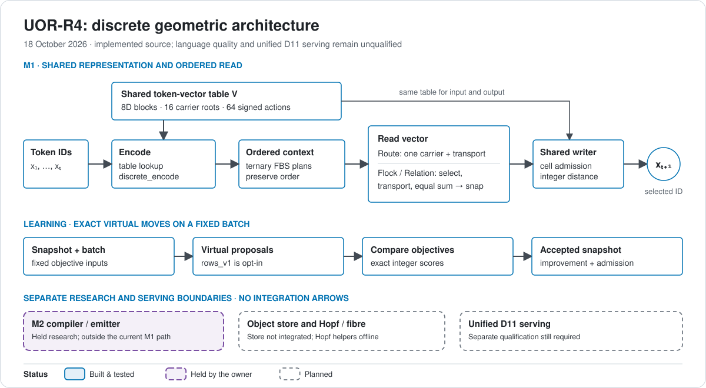
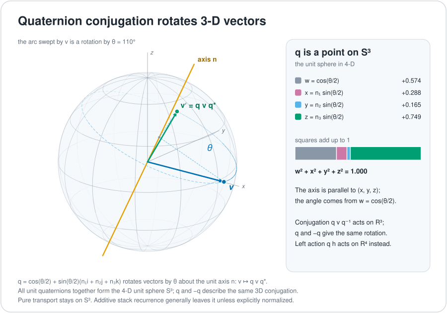
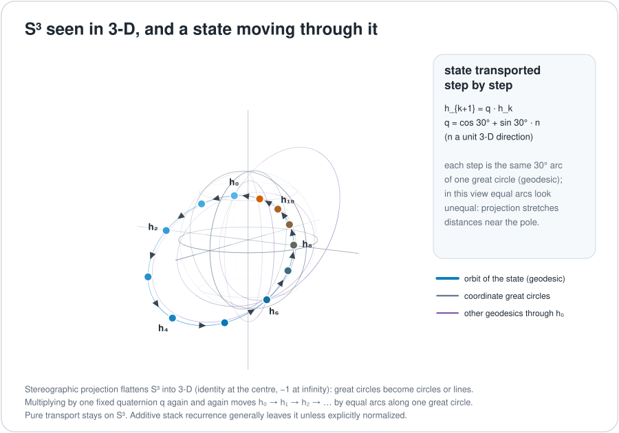
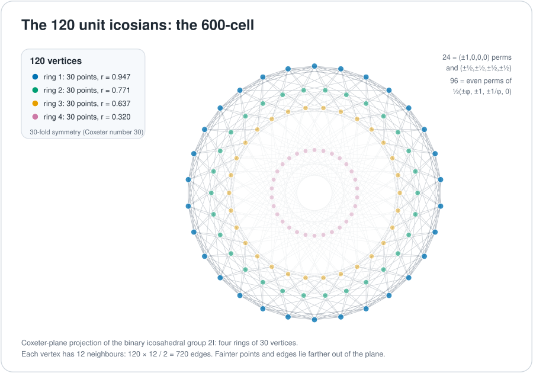
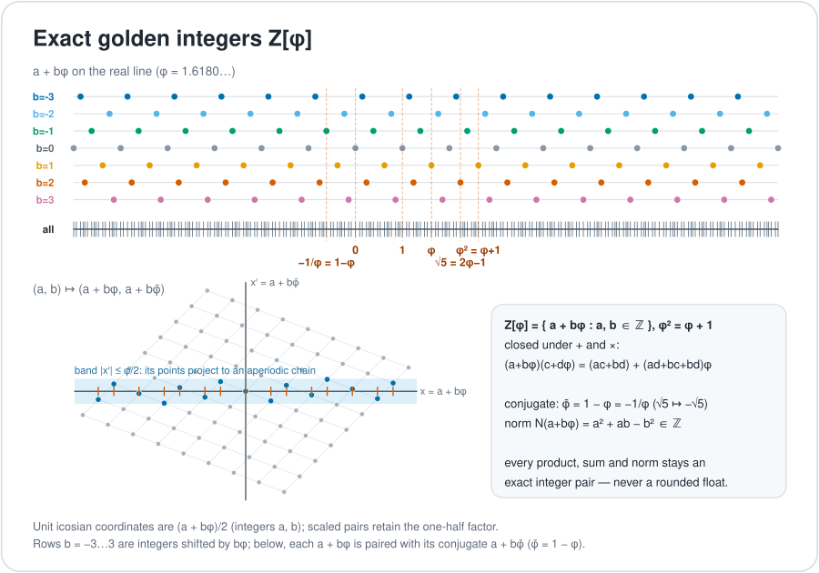
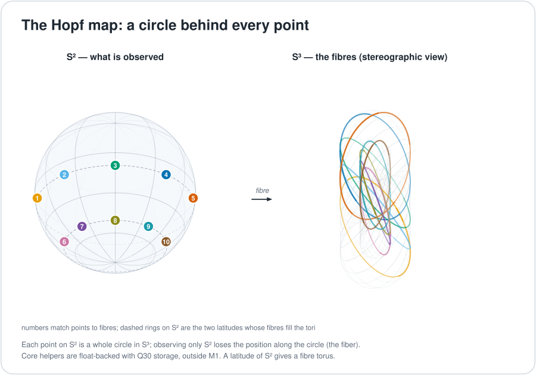
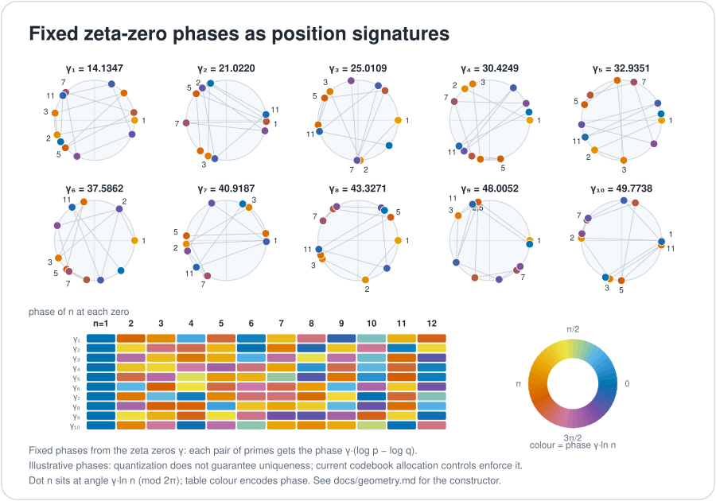
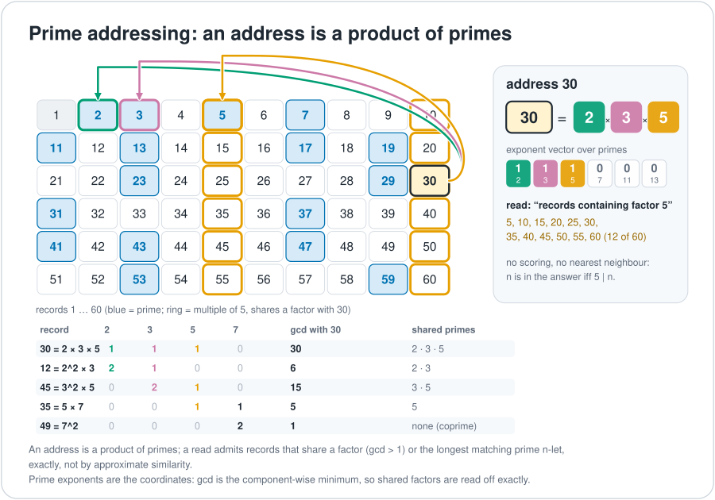
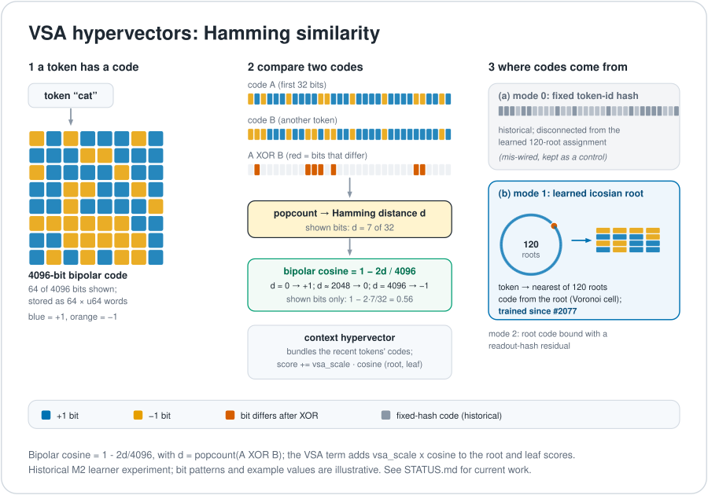
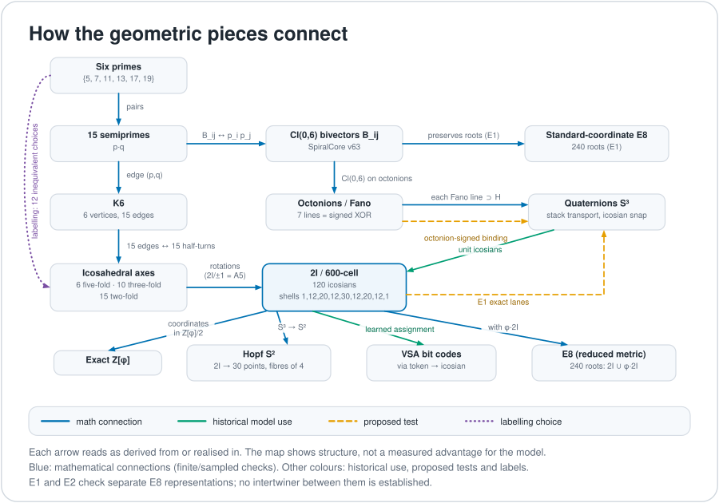

> Archived on 20 Oct 2026; superseded by `docs/geometry/README.md`. Links are retargeted for this folder; the exact original is in git history at 00fa2935e2df3f12a454c888f2854a3939697cb3.

# The geometry, illustrated

Geometry is the project's research foundation: exact state and transport,
addressed memory and learned selection. This guide separates the current
integer M1 computation from wider mathematical structures and retained experiments.
Read the [architecture source map](../docs/architecture.md) alongside the figures.
Tap a mathematical figure to open its vector original for zooming; the prose
spells out the same distinctions on small screens.

Geometry is pre-alpha: no model here holds a useful conversation yet, and live numbers are in
[`STATUS.md`](../STATUS.md). [D37](../docs/integration/DECISIONS.md#d37--floating-point-is-legal-in-offline-training-only-d32s-learning-path-float-ban-is-revised)
permits floats only in offline training; the active discrete path and D11 serving stay integer.

<picture>
  <source media="(max-width: 600px)" srcset="figures/architecture-narrow.svg">
  
</picture>

## The compliant next-token path

1. **Input:** a token ID selects blocks from `Snapshot.table`.
2. **Context:** ordered ternary FBS plans preserve context order for the read.
3. **Read:** Route selects one carrier per block and transports it without
   summing or snapping. Flock ranks eligible nodes, transports, sums and snaps;
   Relation adds finite relational reranking before the Flock selection.
4. **Shared writer:** product-address admission and exact distances select a token
   using the same table. The writer is implemented.
5. **Learning:** compare virtual exact moves on a fixed batch and accept objective
   improvements through the admitted driver. `rows_v1` parallelizes proposal work.

Source for each step is in the [architecture table](../docs/architecture.md#follow-one-token).
Each block is **8D**; four blocks give **width32**. The carrier has **16 roots**,
acted on by **64 signed transport actions** ([build.rs](../crates/uor-r4-discrete/build.rs)).
These three counts describe different objects. The orbit is not full E8 coverage.

The earlier float operator path, including G2 Hamilton gates, geometric recurrence
and the delivered OP3a head, is preserved in the
[operator record](../archive/labs/operator-phase-2026-10-12/README.md),
[head record](../archive/labs/geometric-head-shared-writer-2026-10-13/README.md) and
[historical geometry tour](../archive/history/geometry-float-form-2026-10.md).
Its earlier sheets are inactive pending D37 re-registration/FIT. It is not the
current discrete token path. The dated [operator diagram](../docs/figures/geometry/operators.svg)
illustrates those retained operators.

## 1. Quaternions and rotation

A quaternion has four real components. Unit quaternions form S³. For a pure
imaginary vector v, **q v q⁻¹** is a rotation of R³; q and −q give the same 3D
rotation. **Left multiplication q h** is instead a norm-preserving linear action
on the full quaternion space R⁴. It does not identify q and −q as the same action.

The retained stack's `quaternion_scan` uses left multiplication, then additive
input injection ([geometric_stack.rs](../crates/uor-r4-training/src/geometric_stack.rs)).
Current M1 instead executes signed actions on 8D carrier blocks. The quaternion
picture explains part of the research lineage, not a literal 4D state for that kernel.

## 2. Rotation preserves norm; additive recurrence need not

The figure's pure transport orbit stays on S³ when its initial state and
transport quaternion are unit. The retained float recurrence is

    h_t = λ_t (u_t · h_{t−1}) + √(1−λ_t²) a_t

Even with unit inputs this sum generally has a nonzero cross term in its squared
norm. It need not lie on S³; λ² + (1−λ²) = 1 alone does not normalize it.
The rotation preserves the norm of the transported term. Any unit-state claim
for the combined state needs an explicit normalization or further conditions.
Current M1 Flock/Relation reads sum transported vectors and snap back to the finite carrier;
Route instead transports one selected carrier per block without summing or snapping
in [`discrete.cu`](../crates/uor-r4-discrete/src/discrete.cu).

## 3. The 120 icosians, the 600-cell and E8

The binary icosahedral group 2I contains 120 unit quaternions, closed under
multiplication. These are the H4 roots and vertices of the 600-cell. This full
120-element structure is distinct from the current M1 16-root orbit.
The figure retains the historical icosian-snap toolbox construction: its
120 vertices form four projected rings of 30, with 12 neighbours per vertex
and 720 edges. Snapping a learned rotation to this codebook describes the
retained experiment, rather than the current M1 read or learning path.

The shorthand `E8 = H4 ⊕ φH4` refers here to an **icosian construction with a
specified reduced metric**, not an independent Cartesian product of two H4
states. Let x·y = a + bφ in the quaternion coordinates. The construction uses
`⟨x,y⟩ = 2a`, the rational-part bilinear form, on the 240 elements `2I ∪ φ·2I`.
In the eight rational coefficient coordinates these have rank8, norm2, E8
inner-product counts and reflection closure. The executable finite checks are
in [`verify_connections.py`](../docs/figures/geometry/verify_connections.py) (E2); the
[primary construction paper](https://pmc.ncbi.nlm.nih.gov/articles/PMC4786034/)
explains the reduced inner product.

Check E1 separately verifies preservation of the standard-coordinate E8 root set
by the specified signed matrices. E2 verifies the reduced-metric icosian root
system. These checks do not supply an intertwiner between the two representations;
the action-preservation claim across that missing map remains unestablished.

The retained [`anchors.rs`](../crates/uor-r4-core/src/native_geometric/anchors.rs)
stores `[a0,…,a3,b0,…,b3]` and a Galois companion for one H4 root. Its header
explicitly says this invertible coefficient representation does **not** establish
an orthogonal Euclidean E8 embedding or independent extra state. The present
carrier generation has its own concrete basis and orbit in `build.rs`.

Retained experiments include [icosian snap](../archive/labs/icosian-qat-2026-10-11/README.md),
[spin-native weights](../docs/mechanisms/spin-native-weights.md) and
[E8 orbit memory](../docs/mechanisms/e8-orbit-memory.md). Their positive or negative
results concern those configurations; they do not settle the full geometry programme.

## 4. Exact golden coefficients

φ² = φ + 1, so `Z[φ] = {a+bφ : a,b integers}` supports exact pair arithmetic.
The unit icosian coordinates are **(a+bφ)/2**, in `½ Z[φ]`; the factor one-half
must be retained. Scaled integer pairs can represent them without rounding.
[`anchors.rs`](../crates/uor-r4-core/src/native_geometric/anchors.rs) documents
this scale explicitly; its norm numerators have denominator4.

Fixed [`ZPhi` arithmetic](../crates/uor-r4-core/src/prime_route_attention.rs)
and exact anchor orientation tables support the research. Equality addresses
for complete tuples are not semantic distances between class numbers.

## 5. Hopf observation and the kept fibre

The Hopf map S³ → S² identifies circles of points. For a unit quaternion
(a,b,c,d), `UnitS3Q30::hopf` computes
`(2(ac+bd), 2(bc−ad), a²+b²−c²−d²)` after decoding Q30 storage
to `f64`, then normalizes and requantizes the result to Q30. Q30 names the
storage representation here, not integer execution of the Hopf map.
A common complex phase changes the fibre position while leaving the S² image
unchanged. The image alone is not an invertible representation of the input.

[`prime_route_attention.rs`](../crates/uor-r4-core/src/prime_route_attention.rs)
provides `rotate_common_fiber` and `SpinTorsionState { s3, fiber, torsion }`.
`rotate_common_fiber` also decodes to `f64`, uses `libm::sin`/`cos`, and
normalizes/requantizes the rotated point. These are float-backed, offline
fixed-geometry utilities, not an integer model execution path. Hopf fibre
tracking is **not wired into the
current discrete M1 read**. The retained M2
[Hopf metric](../crates/uor-r4-core/src/native_geometric/hopf_metric.rs) is separate research.

## 6. Prime-Zeta construction and dimensions

The imaginary parts γ of fixed zeta zeros define phase frequencies. Using a
finite table of these constants does not require proving the Riemann hypothesis.

The current optional offline [`prime_zeta.rs`](../crates/uor-r4-discrete/src/prime_zeta.rs)
constructor uses **four complex channels per block (C⁴)**, θ = γ·ln(p), then:

1. Realifies into two 4-real tuples: `(Re0,Im0,Re1,Im1)` and `(Re2,Im2,Re3,Im3)`.
2. Normalizes each with `UnitS3Q30::from_r4` and quantizes to Q30.
3. Applies the fixed coordinate permutation and exact integer alignment scores
   against the **16-root 8D carrier**.
4. Allocates under writer-cell quotas and, when capacity permits, full-vector
   uniqueness controls. The output is `Snapshot.table`.

Thus C⁴ becomes **R⁴ + R⁴ per block**, not C⁸ or R¹⁶ per block. Allocation
controls are part of the assignment; it is not simply an unconstrained nearest-root snap.
See the [construction record](../archive/labs/prime-zeta-construction-2026-10-14/README.md)
and [mechanism brief](../docs/mechanisms/prime-zeta-complex-routing.md).

The retained M2 learner instead accumulates fixed phase bins as policy inputs
([engine.rs](../crates/uor-r4-core/src/native_geometric/addressed_attention/engine.rs)).
That historical use is distinct from current codebook initialization and does
not establish learned M1 attribution to zeta phases.

## 7. Prime addressing and exact memory

Assigning token identities distinct primes makes shared factors exact. A product
of distinct primes records a set; sequence order and multiplicity need explicit
additional representation. Exact identity is not a semantic metric.

Current M1 uses explicit token IDs and ordered BinderPlan context, plus the
optional prime-addressed initializer above. Flock and Relation rank finite
context nodes and transport payloads before the shared writer. A bounded kept-K
list bounds retained contributions, **not selection cost**: the kernel scans
eligible nodes, and Relation adds graph scans. The writer also scans vocabulary
occupancy and admitted-cell tokens. See the [cost/source discussion](../docs/architecture.md#dimensions-and-cost).

The retained [addressed memory](../docs/mechanisms/exact-addressed-memory.md),
[pointer identity](../docs/mechanisms/pointer-identity-key.md) and
[native learner](../crates/uor-r4-core/src/native_geometric/addressed_attention/engine.rs)
remain research foundations with their own artifact-bound evidence. The
[D19 object store](../crates/uor-r4-object-store/README.md) preserves exact bytes
separately; it is not silently integrated into the M1 token path.

## 8. VSA hypervectors and Hamming similarity

**What it is.** Each token has a 4096-bit bipolar hypervector (64 × `u64` words, bit set = +1, clear =
−1). Two codes are compared with an XOR and a popcount, which gives a Hamming distance d; the bipolar
cosine is 1 − 2d/4096. A context hypervector bundles the codes of the recent tokens. The similarity is
a statistic of the code bits; it is only as meaningful as the way the codes were assigned.

**What the model does with it.** In the native prose learner (line B) the VSA term adds
`vsa_scale · similarity` to the root and leaf scores. Three code modes exist. Mode 0 is a fixed token-id
hash (historical; it is disconnected from the learned 120-root assignment, which is why it was
described as mis-wired). Mode 1 derives each code from the learned icosian-root assignment (a token's
nearest of the 120 roots, a Voronoi cell over the learned embeddings), and since PR #2077 these codes
are trainable and refresh during training. Mode 2 binds the root code with a readout-hash residual.

**Status.** Built and tested. The native VSA test is done: trained codes improve held-out BPB by
0.014–0.023, and codes built from icosian roots alone collapse token identity
([record](../archive/labs/vsa-native-test-2026-10-09/README.md); a historical float-form measurement). VSA is not
tied to SpiralCore (next section).
- **Post-D30/D32/D34 label:** **`active`** for discrete ternary/E8 Hamming distance as one routing factor alongside SpiralCore/FBS geometry in `crates/uor-r4-discrete` ([D32](../docs/integration/DECISIONS.md#d32--discrete-geometric-substrate-ternaryhammingquaternion-computation-no-floating-point-in-model-computation-including-learning), [discrete-geometric-learning.md](../docs/mechanisms/discrete-geometric-learning.md), [finite-relational-head.md](../docs/mechanisms/finite-relational-head.md)); **`dormant`** for trained Mode 1/2 VSA codes in the held Line B native prose learner (`crates/uor-r4-core/src/native_geometric/vsa_codes.rs`, [record](../archive/labs/vsa-native-test-2026-10-09/README.md)) and dense ternary/XOR weight contractions ([ternary-xor-arithmetic.md](../docs/mechanisms/ternary-xor-arithmetic.md), [evidence sheet](../docs/mechanisms/ternary-xor-evidence-factsheet.md)); **`archived-negative (D22 scope)`** for Mode 0 disconnected token-id hash and icosian-root-only VSA codes without token-identity preservation ([record](../archive/labs/vsa-native-test-2026-10-09/README.md)).

## 9. What carries route history (and what SpiralCore is)

| Question | Answer | Where |
| --- | --- | --- |
| What carries route order? | Current M1 uses ordered FBS plans and composed 8D signed transport. The retained float stack uses noncommuting quaternion recurrence; these are distinct implementations. | `crates/uor-r4-discrete`, `geometric_stack.rs` |
| What tracks accumulated phase? | `hopf_metric.rs` tracks a cumulative U(1) holonomy phase and a geodesic distance (Line B only, **`dormant`** in held M2 learner; `SpinTorsionState` in `prime_route_attention.rs` uses Q30 storage with float-backed Hopf/fibre helpers outside M1). Under the D32 Oct 14 addendum, `crates/uor-r4-discrete/src/prime_zeta.rs` uses offline complex-plane zeta-zero phases to construct `Snapshot.table` (**`active`**, [#2473](https://github.com/UOR-Foundation/uor-r4/pull/2473)/[#2477](https://github.com/UOR-Foundation/uor-r4/pull/2477), [brief](../docs/mechanisms/prime-zeta-complex-routing.md)). | `native_geometric/`, `prime_route_attention.rs`, `uor-r4-discrete/src/prime_zeta.rs` |
| What are chirality and polarity? | Exact signs on Z[φ] (**`active`** fixed integer tables in `native_geometric/anchors.rs`). Line B only. | `native_geometric/` |
| What is SpiralCore? | `spiralcore_operator.rs` reproduces the SpiralCore v63 octonion/Cl(0,6) convention exactly: the oriented Fano cycles (124)(235)(346)(457)(561)(672)(713), 15 bivectors ↔ 15 semiprimes, and a 64-state composition table. **Since #2279 its signed BFS action is the trunk's projection** (`spiralcore_fbs.rs`, **`dormant`** in pre-D32 F32/BF16 form, [brief](../docs/mechanisms/spiralcore-fbs-projection.md); **`active`** in discrete integer/CUDA form in `crates/uor-r4-discrete` [#2379](https://github.com/UOR-Foundation/uor-r4/pull/2379)/[#2395](https://github.com/UOR-Foundation/uor-r4/pull/2395)/[#2400](https://github.com/UOR-Foundation/uor-r4/pull/2400), [discrete brief](../docs/mechanisms/discrete-geometric-learning.md), [discrete record](../archive/labs/discrete-geometric-learning-2026-10-13/README.md)). One anchor orbit holds 16 roots and 64 signed operator states, and an output block's carrier is moved by the composed edge history. The orientation in Mark (N3mesis)'s later substrate sketch is different and inconsistent, and it must not replace this canonical table (see the review in section 10). | `uor-r4-core/src/spiralcore_operator.rs`, `uor-r4-discrete/src/{lib.rs,discrete.cu}`, `uor-r4-training/src/spiralcore_fbs.rs` |
| What was tried earlier? | Recursive geometric attention over earlier tokens (A1) was stopped on 1 October (D18) because a reusable state erased order (**`archived-negative (D22 scope)`**; under D22 that closes the configuration, not the mechanism). A route-holonomy read and an octonion-signed binding remain **`dormant`** designs (see [Historical research designs](#historical-research-designs)). | #2029 |

## 10. How the geometric pieces connect

Several foundations connect through the binary icosahedral group 2I and
the specified octonion/Clifford constructions. Each correspondence below has its own
metric, convention or labelling assumptions. Every link below
is investigated by finite exact enumerations and sampled numerical consistency checks in
[`figures/geometry/verify_connections.py`](../docs/figures/geometry/verify_connections.py) (29 checks, with differing evidence scopes).
These checks support the stated identities within their enumerated or sampled domains;
they are not 29 general mathematical proofs and do not establish predictive value. Whether
any of these links helps the model is the subject of the pre-registered experiments on M1
[#2029](https://github.com/UOR-Foundation/uor-r4/issues/2029). The SpiralCore material is credited to
Matthew (SpiralCore v63/v69); the octonion and Fano material to Mark (N3mesis, NEMESIS-Theory).

| From | To | Map | Forced or chosen | Where in code | Used by |
| --- | --- | --- | --- | --- | --- |
| Six-prime registry {5, 7, 11, 13, 17, 19} | 15 semiprimes p·q | products of distinct pairs | forced | `spiralcore_operator.rs` | SpiralCore control; trunk projection (**`dormant`** float #2279; **`active`** discrete `uor-r4-discrete` #2379/#2400) |
| 15 semiprimes | 15 edges of K6 | edge (p, q); unique factorisation | forced | `verify_connections.py` | — |
| 15 edges of K6 | 15 half-turn axes of the icosahedral group | each half-turn fixes exactly one pair of the 6 five-fold axes | forced, once the six axes carry the six labels | v69 AXIS2 | pre-registered E1 (**`dormant`**) |
| Six primes | six five-fold axes | a labelling | **chosen**: 720 labellings, 12 inequivalent under rotation | `verify_connections.py` prints its choice | — |
| Semiprimes p_i·p_j | Cl(0,6) bivectors B_ij | B_ij·B_jk = −B_ik, mirroring p_i p_j · p_j p_k → p_i p_k; the B_ij generate a group of order 64 that maps onto the 32 square-free even prime products (kernel ±1) | forced | `spiralcore_operator.rs` | SpiralCore control; trunk projection (**`dormant`** float #2279; **`active`** discrete `uor-r4-discrete` #2379/#2400) |
| Cl(0,6) bivectors | octonions | Cl(0,6) acting on the octonions through the 7 Fano lines (124)(235)(346)(457)(561)(672)(713) | forced | `spiralcore_operator.rs`, `cd_space.rs` | control (**`active`**); pre-registered octonion-signed binding (**`dormant`**) |
| Fano plane | XOR on 3-bit indices | after relabelling, every line is {a, b, a⊕b}, so the octonion product is a signed XOR (168 relabellings) | forced (up to relabelling) | `verify_connections.py` | pre-registered binding (**`dormant`**), historical sign-bit/rank-table proposal (**`dormant`**; **`archived-negative (D22 scope)`** parallel-to-softmax float run), distinct from current Flock/Relation |
| Octonions | quaternions | each Fano line spans a copy of the quaternions; the octonions are alternative and norm-multiplicative, and 168 of 210 ordered unit triples are non-associative (exactly the non-collinear ones) | forced | `cd_space.rs` | stack transport (**`active`** in `uor-r4-discrete`; **`dormant`** in float `geometric_stack.rs`) |
| Quaternions (S³) | 2I, the 120 unit icosians | the finite subgroup of S³; closed, order 120; shells 1, 12, 20, 12, 30, 12, 20, 12, 1 from every element; 720 edges (shell 1) | forced | `geometric_stack.rs` (icosian snap) | stack (**`dormant`** float snap), pre-registered E1 (**`dormant`**) |
| 2I | icosahedral rotations | 2I/±1 = A5 (60 rotations), acting 2-transitively on the six five-fold axes | forced | `verify_connections.py` | — |
| 2I | exact Z[φ] | icosian coordinates lie in Z[φ]/2 | forced | `ZPhi { a, b }` | **`active`** fixed integer arithmetic (`uor-r4-core`); **`dormant`** held Line B learner |
| Cl(0,6) bivectors | Standard-coordinate E8 | the signed matrices preserve the 240 standard-coordinate roots (check E1), independently of the reduced-metric icosian realization | forced for the specified coordinates | `verify_connections.py` E1, `spiralcore_operator.rs` | current M1 uses a 16-root orbit in this coordinate convention |
| 2I ∪ φ·2I | E8 | 240 roots under the reduced rational-part metric defined in section3, not ordinary quaternion Euclidean distance (check E2); no intertwiner to the E1 signed-action representation is established | forced | E8 notes in `AGENTS.md`, `uor-r4-discrete` | current M1 separately uses a 16-root standard-coordinate carrier; no basis bridge to this icosian realization is asserted; **`dormant`** float E8 orbit memory ([brief](../docs/mechanisms/e8-orbit-memory.md)) |
| 2I | Hopf S² | S³ → S² maps the 120 icosians onto one orbit of 30 points, every fibre of size 4 (a two-fold-type orbit, not literally the axes of the chosen frame) | forced | `prime_route_attention.rs`, `hopf_metric.rs` | float-backed offline Hopf utility with Q30 storage, outside current M1; **`dormant`** held Line B learner |
| 2I | VSA bit codes | the learned token → icosian-root assignment builds the codes | learned | `vsa_codes.rs` (since #2077) | **`dormant`** in held Line B learner (trained VSA helps); **`archived-negative (D22 scope)`** Mode 0 & root-only codes ([record](../archive/labs/vsa-native-test-2026-10-09/README.md)) |

**Cautions for anyone building on this.**
1. **Half-turns don't compose like bivectors.** Two half-turns whose K6 edges share a vertex multiply to an order-5 rotation, never a half-turn. The prime ↔ half-turn match is a correspondence of sets, not of products.
2. **Labelling primes to axes is a choice.** A design that routes primes through icosian rotations must say which of the 12 inequivalent labellings it uses.

**October 9 substrate review.** Mark (N3mesis)'s supplied *Octonian Substrate Architecture*
and discussion PDFs motivate separating state, algebra, routing and identity. Their literal
positive cycles (123)(145)(167)(246)(257)(347)(356), however, fail alternativity and quadratic
norm multiplicativity: `(e1 + e2)(e4 + e7) = 0` despite factor norms 2 and 2. Fano incidence
is not a complete sign convention. The canonical Rust table above remains unchanged; an
alternative convention needs a signed basis correspondence, not just the same seven lines.
For the draft's XOR labelling specifically, an exhaustive search of all 2⁷ = 128 orientations of
those seven lines finds 16 that give a valid octonion algebra (norm multiplicativity holds). One of
them reverses three of the draft's lines: (123)(145)(167)(246)(527)(437)(536).
The sample store route also discards a coordinate after right multiplication and projection,
and its packing function returns empty bytes. A pre-route embed/project inverse does not
establish post-route preservation. Modular `ZMod(2^256)` coefficients are neither the real
normed division algebra nor a replacement for exact `Z[φ]` pairs. These findings concern the
supplied draft, not a negative language experiment or retirement of octonion binding.
The [full review and executable counterexamples](../archive/labs/octonion-substrate-review-2026-10-09/README.md)
record the exact documents, source, decisions and limits. The 29 connection checks above
continue to concern the repository's specified structures, not certification of external PDFs.

A further fact: the icosahedron's five orthogonal frames of two-fold axes form a *synthematic total* of
K6, five perfect matchings that together cover all 15 edges.

## Historical research designs

Three integer-only, softmax-free designs follow from the connections above. They have figures and full
descriptions on the [archived page](../archive/history/geometry-float-form-2026-10.md#11-pre-registered-mechanisms-not-yet-measured).
Under D22 each needs its own pre-registration and a `TEST FITNESS: FIT` review before compute.

- **Exact icosian holonomy lanes** (**`dormant`** design; earlier single reusable-state recursive attention A1 configuration is **`archived-negative (D22 scope)`** under [D18](../docs/integration/DECISIONS.md#d18--one-retrieval-question-for-114-october-track-b-cost-and-memory-port-work-parked-with-re-entry-conditions) / [D22](../docs/integration/DECISIONS.md#d22--a-negative-closes-a-configuration-never-a-mechanism-five-closures-reopened)). A lane state is a product in the 120-element group, updated by a
  120 × 120 table. Earlier positions are ranked by the shell index of the relative product.
- **Octonion-signed binding** (**`dormant`** design; the inconsistent N3mesis draft cycle orientation is **`archived-negative (D22 scope)`** as a draft convention defect in [octonion substrate review](../archive/labs/octonion-substrate-review-2026-10-09/README.md), while the canonical v63 Fano table in `spiralcore_operator.rs` is **`active`**). On the Fano plane, e_a · e_b = ±e_(a⊕b): a signed XOR whose sign depends
  on operand order, unlike plain XOR.
- **Hamming-rank read** is a historical sign-bit/popcount design with fixed rank-table weights. The [historical float configuration](../docs/mechanisms/flock-rank-reads.md) trained beside a softmax stack measured +0.259 BPB against softmax; that result closes only that configuration. It is not the current discrete Flock/Relation algorithm.

Current [`flock_vector`](../crates/uor-r4-discrete/src/discrete.cu) orders candidates
by relation score descending, L1 displacement ascending, coordinate Hamming
ascending, recency descending and node ascending. In Flock mode the relation
scores are zero. It **equally sums** the selected transported roots and snaps the
sum to a carrier root; it does not use the historical fixed rank-table weights.
Relation adds its graph reranking before this same selection/aggregation path.
The [architecture map](../docs/architecture.md) traces those implemented reads, while the
[starling](../docs/mechanisms/starling-read.md) and [rank-table](../docs/mechanisms/flock-rank-reads.md)
briefs retain their distinct historical designs and measurements.

## Serving without multiplication

Under D11 a served kernel has no floating point and no multiplier instruction. A product of two
runtime values is read from a table instead: build the sixteen multiples (0..15) of one operand by
repeated addition, index that table with the radix-16 digits of the other operand, and combine the
results with shifts and adds. For example, to compute 37 × 43: the table holds 0, 37, 74, …, 555.
Write 43 as hex 0x2B, digits 2 and 11. Then 37 × 43 = (T[2] << 4) + T[11] = (74 << 4) + 407 = 1184 +
407 = 1591. A 4-bit weight is a single digit, so one product is one table read. Division is restoring
long division, square root is digit-by-digit, and the kernels are kept opaque to the optimiser so that
an add chain is not folded back into a multiply. Products are taken modulo 2⁶⁴ or 2¹²⁸ to match the
earlier integer engine. Code: `crates/uor-r4-integer/src/stack/kernels.rs` (`stack_mul_u64`,
`stack_div_u64`, `stack_isqrt`); the ARM64 audit is `scripts/audit_zero_matmul_serving.py --stack`.
(The numbers in the example are illustrative, not taken from the code.)
- **Post-D30/D32/D34 label:** The [D11](../docs/integration/DECISIONS.md#d11--native-multiplier-free-transformerless-serving-for-every-lab-d10-superseded)/D5 multiplier-free serving contract and fixed integer geometry in `crates/uor-r4-integer` are **`active`**; historical pre-D29/D32 exported float-stack executors (`stack_214m_step4000`, 19.9M chat stack, 29M M1 stack) are **`dormant`** (excluded from the selected native build under [D29](../docs/integration/DECISIONS.md#d29--no-banned-mechanism-in-any-compiled-or-loaded-module-vendor-runtime-content-counts) and preserved as evidence in [D11 serving](../archive/labs/d11-serving-2026-10-10/README.md)); the 29M M1 Criterion-2 configuration (`1.20138` BPB vs `≤ 0.90` target) and the superseded D10 converted-transformer track (#1518) are **`archived-negative (D22 scope)`**.

## Reproduce the figures

The status diagrams (architecture, milestones, pipelines, the geometry stack, the compliant path and the
operators) are generated in Rust, and CI-style checks confirm that they are current:

    cargo run -p xtask -- figures            # check
    cargo run -p xtask -- figures --write    # regenerate

The mathematical figures in sections 1–10 are drawn by a standard-library script. Porting it to Rust (D27)
is a recorded follow-up:

    python3 docs/figures/geometry/generate.py
