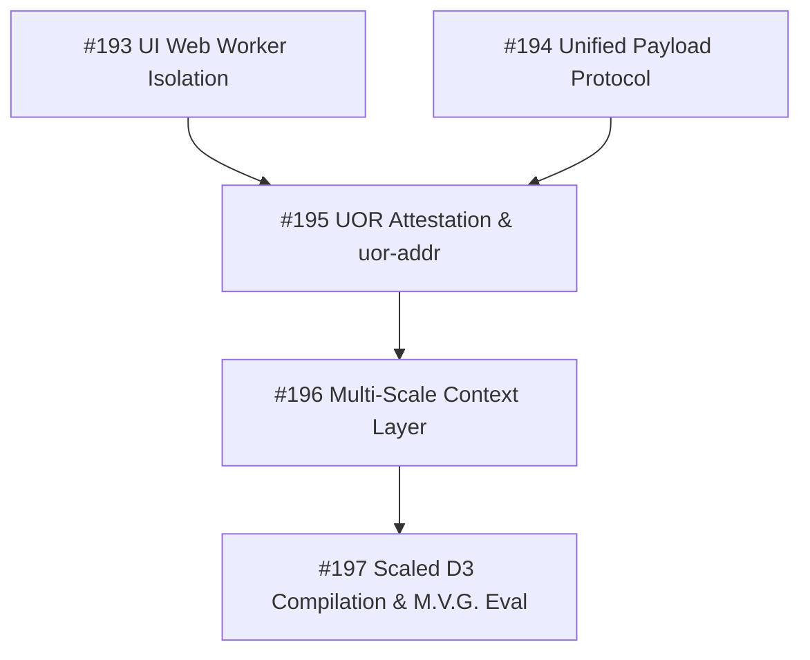

# #198 — [EPIC] Roadmap & Sequencing: Web Worker Isolation, Standards Hardening, Multi-Scale Context, and D3 Corpus Scaling

- **Type:** Issue
- **State:** closed (completed)
- **Author:** @Casey-allard
- **Created:** 2026-07-26T01:31:58Z
- **Updated:** 2026-07-26T02:19:05Z
- **Closed:** 2026-07-26T02:19:05Z
- **URL:** https://github.com/UOR-Foundation/uor-r4/issues/198
- **Archived:** 2026-10-15T02:31:04Z · UOR-Foundation/uor-r4

## Body

Source of record: `docs/r4_graph_compiler_implementation_plan.md`, `docs/transformerless/R4G1.md`, `AGENTS.md`.

## Executive Overview

This master issue serves as the primary plan tracker for harmonizing the **transformerless engine**, **holographic graph compiler**, **geometric router**, and **UOR-Framework standards** across `uor-r4`.

It details the technical roadmap, sequencing DAG, review gating process, and BDD test requirements across 5 scoped work packages to enable concurrent PR contributions while preserving repository invariants.

---

## Sequencing DAG & Work Package Hierarchy

### Tracking & Task Status Matrix

| Phase | Issue | Title | Status | Target Branch | Review Gate |
|---|---|---|---|---|---|
| **Phase 1A** | #193 | `feat(ui/wasm): Web Worker offloading and WASM event-loop isolation` | OPEN | `issue-193-web-worker-isolation` | UI Non-Blocking / devtools trace |
| **Phase 1B** | #194 | `feat(api/server): Unified InferenceRequest & InferenceResponse protocol` | OPEN | `issue-194-unified-inference-protocol` | REST / WS payload parity |
| **Phase 2** | #195 | `feat(standards): UOR-Framework attestation envelope and uor-addr` | OPEN | `issue-195-uor-attestation-envelope` | `UorAttestationResult::Verified` |
| **Phase 3** | #196 | `feat(context): Multi-timescale context layer & macro VSA state` | OPEN | `issue-196-multiscale-context-layer` | Zero-allocation steady state |
| **Phase 4** | #197 | `feat(compiler/eval): Scaled D3 observation corpus & M.V.G. cert` | OPEN | `issue-197-scaled-d3-eval-cert` | D3 bits/token floor reduction |

---

## PR Process & Quality Gating Rules (Normative)

All PRs landing work for issues tracked under this master issue MUST adhere strictly to repository workflow rules specified in `AGENTS.md`:

1. **No Direct Pushes to `main`**: All changes land via PRs from feature branches named `issue-<n>-<slug>`.
2. **Four Mandatory Gate Checks (Local & CI)**:
   - `cargo test --workspace --offline`
   - `cargo clippy --workspace --all-targets --all-features --offline -- -D warnings`
   - `cargo fmt --check`
   - `cargo check -p uor-r4-graph-format --no-default-features` & `cargo check -p uor-r4-graph-format --no-default-features --features alloc` (`no_std` ladder)
3. **No Hacked Bypass / Silent Fallback Patches**: Errors must be resolved at the contract level. No commenting out tests or returning emptyArray fallbacks.
4. **Behavioral BDD Verification**: Every feature issue must include corresponding BDD / Gherkin feature scenarios or unit assertions proving correctness before PR merge.

---

## Technical Scope Summary per Child Issue

### 1. Phase 1A (#193): Non-blocking Browser Execution
Offload WASM execution (`generate_r4g1_response`) from the main DOM thread to a Web Worker (`r4_worker.js`). Prevents browser freezing during inference while retaining local WASM synthesis.

### 2. Phase 1B (#194): Unified Payload Serialization
Harmonize REST (`/api/chat`), WebSocket streams, and client UI payloads onto strongly-typed `InferenceRequest` and `InferenceResponse` Rust structures.

### 3. Phase 2 (#195): UOR Framework & Hologram Attestation
Wrap all synthesis outputs in content-addressed `UorAttestationResult` envelopes carrying BLAKE3 CIDs for artifact, store, state vector, and generated response payload to align with Hologram infrastructure.

### 4. Phase 3 (#196): Multi-Scale Context Abstraction (Phase 8)
Wire Bott-Fock sequence state aggregation and VSA hypervector algebra (`vsa_algebra.rs`) to extend context memory past 8 tokens into macro-regions (32, 128, 512 tokens) without allocating heap memory on the prediction path.

### 5. Phase 4 (#197): Scaled D3 Corpus Compilation & M.V.G. Evaluation
Scale teacher observation compile to `--target 500000` tokens and `--sequence-length 256`, executing `r4 evaluate-report` to certify held-out D3 cross-entropy floor reduction.

---

## Related Master Documents & RFCs

- Implementation Plan: `docs/r4_graph_compiler_implementation_plan.md`
- Wire Format RFC: `docs/transformerless/R4G1.md`
- Formal Vocabulary: `docs/formal_vocabulary.md`
- Baseline Measurement: `docs/transformerless/BASELINE.md`

## Comments (1)

### comment 5081593075 — 2026-07-26T02:19:04Z — Casey-allard

Closing based on Maura's diagnostic: Chain 2 context encoding is mathematically restricted to an 8-token rolling window. Expanding it violates the R4G1 spec and corrupts the index. Replaced by Master Tracker Epic #201.

---
_Comment/review ids in this file: 5081593075_

