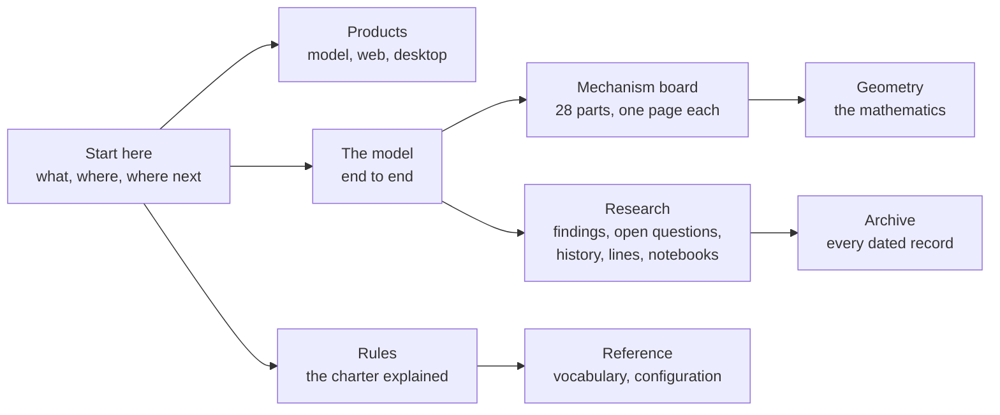

# UOR-R4 documentation

Read online: <https://uor-foundation.github.io/uor-r4/>. Production publication is by manual dispatch; pushes to main update the preview site. The earlier Studio web app moves to <https://uor-foundation.github.io/uor-r4/studio/>.

**In one paragraph.** This is the map of the UOR-R4 documentation. UOR-R4 is an open research
project building a language model that predicts text with geometry and whole-number arithmetic
instead of a transformer's large grids of decimal multiplications, so that it can run fast on a
laptop or in a browser. It is **pre-alpha**: 1 of its 8 milestones is complete, and no model built
under its rules holds a useful conversation yet ([where we are](start/where-we-are.md)). The pages
here explain what the project is, where it stands and where it is going in plain words first, then
give the evidence for every claim so an expert can check it. Use the table below to jump to the page
that answers your question. The same pages build into a book site, whose table of contents is
[SUMMARY.md](SUMMARY.md).

*How the sections connect. Read left to right for more depth; every section links back to its
sources.*

## Find your way

| You want to… | Start here |
|---|---|
| Understand the project in five minutes | [What UOR-R4 is](start/what-is-uor-r4.md), then the [glossary](start/glossary.md) and [FAQ](start/faq.md) |
| Know where the project stands, with numbers | [Where we are](start/where-we-are.md), [PLAN](../PLAN.md) and rendered [STATE](../STATE.md) |
| Know where it is going | [Where we're going](start/where-were-going.md) and the milestone table in [ROADMAP](../ROADMAP.md) |
| See which transformer part each mechanism replaces | [Transformer vs geometry](start/transformer-vs-geometry.md) |
| Find your way around the folders | [How the repository is laid out](start/repository-layout.md) |
| Learn what will ship | [The three products](products/README.md): the [model](products/language-model.md), the [web client](products/web-client.md) and the [desktop client](products/desktop-client.md) |
| Follow the model from text in to word out | [The model, end to end](model/architecture.md), then [training](model/training.md), [data and tokenizer](model/data-and-tokenizer.md), [serving and export](model/serving-and-export.md) and [GPUs and CUDA](model/gpu-and-cuda.md) |
| Check whether a mechanism is alive and what would reopen it | The [mechanism board](mechanisms/README.md): ACTIVE, READY or PARKED, one page per mechanism |
| Learn the mathematics | [The geometry of UOR-R4](geometry/README.md): primes and zeta phases, golden integers, quaternions, E8/H4 and the 600-cell, SpiralCore, the Hopf map, VSA and Hamming distance |
| Know what has been learned, and what is still open | [What the project knows](research/findings.md) and [what is still open](research/open-questions.md) |
| Read how the project got here | [History](research/history.md) and the [research lines](research/lines/README.md) |
| Follow results as they land | The [research notebooks](research/notebook/README.md), one page per line, and the one plan [PLAN.md](../PLAN.md) |
| Know the rules and who decides | The [charter](../CHARTER.md), explained in [the rules in plain language](rules/README.md); old decisions in the [decision map](rules/decision-map.md); changes in the [rule change log](rules/changes.md) |
| Find an old record | The [archive catalog](../archive/CATALOG.md): every dated record, kept byte-identical |
| Know where files live and how the laptop is kept | [Workspace, storage and hygiene](labs/workspace.md) |
| Contribute | [CONTRIBUTING](../CONTRIBUTING.md); AI labs also read [AGENTS.md](../AGENTS.md) |
| Look up a term or a specification | [Glossary](start/glossary.md), [formal vocabulary](formal_vocabulary.md), [configuration](CONFIGURATION.md), and every [reference document](reference/README.md) |

## How the sections are organised

- **Start** (`start/`): six short pages for newcomers. Each opens in plain words and ends with sources.
- **Products** (`products/`): the three things the project means to ship, and the release format.
- **The model** (`model/`): the current model path, stage by stage, with what is built and what is missing.
- **Mechanisms** (`mechanisms/`): the board and 28 mechanism pages, each with the same template: the idea, how it works, where it stands, and what would reopen it if PARKED.
- **Geometry** (`geometry/`): the mathematics behind the mechanisms, illustrated.
- **Research** (`research/`): how research is done now, findings, open questions, the history, 17 research-line pages and the notebooks.
- **Rules** (`rules/`): the charter explained, where each old decision went, and the change log.

Three directories stay at their old paths because code and tooling read them, and they are not part
of the book: `integration/` (the one plan [PLAN.md](../PLAN.md) and the decision index),
`harness/` (the research harness) and `labs/` (governance files and records dated 18 or 19 October
2026). Records dated before 18 October 2026 have moved, unchanged, to [`archive/`](../archive/CATALOG.md).

## Conventions used on every page

| Convention | Meaning |
|---|---|
| **proof** | Follows from definitions or code |
| **measurement** | From a recorded run, with its artifact linked |
| **hypothesis** | An idea not yet tested |
| ACTIVE / READY / PARKED | On the current model path / built and tested but never trained in / the tested forms failed or broke a rule, and the mechanism stays open |
| `NOT_RUN` | Never run; it is not a pass |

The labels follow [formal_vocabulary.md](formal_vocabulary.md), section 2. A passing test shows
that code does what it says; it is not a trained capability. There is no "retired" mechanism status:
a failed run closes one configuration, never a mechanism ([charter](../CHARTER.md) §4.1).

## Where it stands

| Item | State | Source |
|---|---|---|
| Milestones complete | **1 of 8 (M1)** | [PLAN](../PLAN.md), rendered [STATE](../STATE.md) |
| Model that holds a conversation | None | [where we are](start/where-we-are.md) |
| Mechanisms | 28: 12 ACTIVE, 5 READY, 11 PARKED | [mechanism board](mechanisms/README.md) |
| Research lines with their own page | 17 | [research lines](research/lines/README.md) |
| Records in the archive catalog | 1,175 | [archive catalog](../archive/CATALOG.md) |

**30 Oct 2026.** Pre-alpha, 1 of 8 milestones complete. The saved discrete M1 model scores 7,002 / 7,001 on DEV, 7,215 / 7,228 on Fresh V2 and 7,850 / 7,872 on p-f, at two seeds. It serves at 10,876 / 10,566 decode tok/s on an Apple M1. The limit is 62.5% verbatim TRAIN reference replies on p-f, not useful chat. Claude-220 serves the point key inside one float model on fresh p-w: templates improve by +41/+40/+42 at three seeds with exact claude-219 parity, while recalling TRAIN replies rather than generalizing. [Claude-222](loop/tasks/point-key-integer/claude-222/REPORT.md) has built the integer point table, search and `/8` record, with 380 library tests and a full serving audit. [Claude-224](loop/tasks/point-key-integer/claude-224/REPORT.md) has built the panel decode and grade. [Claude-227](loop/tasks/integer-retention-rates/claude-227/REPORT.md) passed retention GPU parity within the 3% bar; [Claude-228](loop/tasks/point-key-integer/claude-228/REPORT.md) built the run's reference/read-back/BOS checks; [Claude-229](loop/tasks/point-key-integer/claude-229/REPORT.md) found an instrument fault: the integer session uses the native writer instead of the trained whole-table nearest readout, so no bar result or throughput is reported. [integer-nearest-readout](roadmap/items/integer-nearest-readout.md) repairs the readout and checks parity before rerunning p-x ([where we are](start/where-we-are.md), [PLAN](../PLAN.md)).

## Go deeper

- The repository front page: [README](../README.md).
- The rules: [CHARTER](../CHARTER.md).
- The one plan: [PLAN.md](../PLAN.md); live tracker
  [#2028](https://github.com/UOR-Foundation/uor-r4/issues/2028).
- Code: the active model crate [`crates/uor-r4-discrete`](../crates/uor-r4-discrete/README.md) and the
  integer serving crate [`crates/uor-r4-integer`](../crates/uor-r4-integer/README.md).
