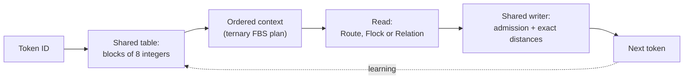

# The geometry of UOR-R4

Most chat AIs predict the next word by multiplying very large grids of decimal numbers. UOR-R4 is a bet that a different set of tools can do the same job more cheaply: rotations in a few dimensions, exact whole-number addresses built from primes, and lookup tables. This section explains those tools one chapter at a time, with pictures. It also says which ones the model uses today and which are research that has not yet been put to work. The project is pre-alpha: 1 of its 8 milestones is complete, and no model holds a useful conversation yet ([`PLAN.md`](../../PLAN.md) and rendered [`STATE.md`](../../STATE.md)).

![A map of the geometric pieces and how they connect: the six-prime registry, semiprimes, the complete graph K6, the icosahedral axes, the 120 icosians, quaternions, Z[phi], octonions and the Fano plane, Cl(0,6) bivectors, E8, the Hopf map and VSA codes, with each link marked as verified maths, used in a model, pre-registered, or a labelling choice](../figures/geometry/connections.svg)

*How the geometric pieces connect. Each arrow is one correspondence, and the table below says whether the link is forced by the mathematics or was chosen.*

## Why geometry

The owner's rule for this project is that the core of the model is built from geometric mechanisms. The reason is a cost hypothesis. A transformer's expensive parts are dense matrix multiplication, a score for every possible next word, and storing every earlier position. Rotations, exact addresses and tables may be much cheaper on a laptop (a hypothesis: no efficiency has been measured yet). Whether they are also good enough to model language is the open question.

These rules shape how the geometry is used.

- **No softmax or squashing, no matrix multiplication.** Softmax, sigmoid, tanh and softplus are banned in every executed model path ([D23](../integration/DECISIONS.md#d23---no-softmax-anywhere-in-the-active-project), D25), and so is matrix multiplication in training and serving (D25, D30). Attention itself is not banned: bounded geometric reads replace it.
- **Research compute is GPU-only** (D24). Serving the exported D11 integer artifact on a client device (CPU, WASM, Apple silicon) is the product and is allowed. It uses no floating point. Since D80 and D81 (28 Oct 2026) it may use the hardware integer multiply and divide.
- **Floating point is for offline training only** ([D37](../integration/DECISIONS.md#d37--floating-point-is-legal-in-offline-training-only-d32s-learning-path-float-ban-is-revised)). Float never re-admits softmax, squashing or matrix multiplication. The active discrete path and the served model stay integer (D11), and every float-trained candidate must report its export gap, the quality lost when converting to the integer artifact.
- **Geometry is a design priority, not a measured advantage.** A failed experiment closes one configuration, never a whole mechanism ([D22](../integration/DECISIONS.md#d22--a-negative-closes-a-configuration-never-a-mechanism-five-closures-reopened)). A passing check on a piece of mathematics does not show that the piece helps a language model.

Labels on this page follow [`docs/formal_vocabulary.md`](../formal_vocabulary.md): **proof** means derived from definitions or code, **measurement** means a recorded run, and **hypothesis** means an untested idea. Mechanism status is ACTIVE (on the current model path), READY (built and tested, not yet trained in) or PARKED (the tried forms failed or broke a rule, and the mechanism stays open). The [mechanism board](../mechanisms/README.md) holds the full list. It replaces the older labels active, dormant and archived-negative.

## The compliant next-token path

This is the path the current integer model (`crates/uor-r4-discrete`, called M1) follows for each token. Source for each step is in the [architecture table](../architecture.md#follow-one-token).



*The five steps of one token. The dotted arrow is learning, which changes the shared table by exact moves.*

1. **Input.** A token ID selects blocks from `Snapshot.table`.
2. **Context.** Ordered ternary FBS plans (a three-branch tree over earlier tokens; see the [glossary](../start/glossary.md)) preserve context order for the read.
3. **Read.** Route selects one carrier per block and transports it without summing or snapping. Flock ranks eligible nodes, transports them, sums and snaps. Relation adds finite relational reranking before the Flock selection. See [route read](../mechanisms/route-read.md), [flock read](../mechanisms/flock-read.md) and [relation read](../mechanisms/relation-read.md).
4. **Shared writer.** Product-address admission and exact distances select a token using the same table. The writer is implemented ([admission](../mechanisms/admission.md)).
5. **Learning.** The learner compares virtual exact moves on a fixed batch and accepts objective improvements through the admitted driver. `rows_v1` parallelizes proposal work ([discrete learning](../mechanisms/discrete-learning.md)).

Each block is **8D**, and four blocks give **width32**. The carrier has **16 roots**, acted on by **64 signed transport actions** ([`build.rs`](../../crates/uor-r4-discrete/build.rs)). These three counts describe different objects. The orbit is not full E8 coverage.

The earlier float operator path is preserved as evidence and is not the current token path. It includes the Hamilton gates (G2), the geometric recurrence and the delivered head (OP3a). See the [operator record](../../archive/labs/operator-phase-2026-10-12/README.md), the [head record](../../archive/labs/geometric-head-shared-writer-2026-10-13/README.md) and the [historical geometry tour](../../archive/history/geometry-float-form-2026-10.md). Its earlier sheets are inactive until they are re-registered and reviewed under D37. The dated [operator diagram](../figures/geometry/operators.svg) illustrates those retained operators.

## Reading order

Each chapter opens in plain words, shows its figure, gives the mathematics, and ends with where the model uses the idea.

| Chapter | What it covers | Used on the current path? |
|---|---|---|
| [Quaternions and rotation](./quaternions-and-rotation.md) | Four-number rotations, and why rotating keeps length but adding does not | Lineage, plus unit quaternions in the table constructor. M1's kernel uses signed actions on 8D blocks |
| [E8, H4 and the 600-cell](./e8-h4-and-the-600-cell.md) | The 120 icosians, the 600-cell, and the 240 roots of E8 | A 16-root piece of E8 is the carrier |
| [Golden integers](./golden-integers.md) | Exact arithmetic with $a+b\varphi$, no rounding | Fixed integer arithmetic in `uor-r4-core`, used by retained research code |
| [The Hopf map and the kept fibre](./hopf-observation.md) | A 3D shadow of a 4D rotation, and the angle it forgets | Kept-fibre map READY; older sector routing PARKED; not in M1 |
| [Primes and zeta phases](./primes-and-zeta.md) | Prime addresses, zeta-zero angles, and the starting table | Yes: the starting table (ACTIVE) |
| [VSA and Hamming distance](./vsa-and-hamming.md) | Long bit codes, XOR, and counting differing bits | Hamming is a tie-break in the reads; trained VSA codes are PARKED |
| [SpiralCore](./spiralcore.md) | The octonion table, the 64-state action, and the ternary tree | Yes: the integer transport (ACTIVE) |

Read them in that order if the mathematics is new. The first two build the vocabulary, and the last two are closest to the running code.

## How the pieces connect

The figure above has fifteen links. Each has its own metric, convention or labelling assumption, and the chapter named in the last column gives the full statement. Every link is investigated by finite exact enumerations and sampled numerical consistency checks in [`verify_connections.py`](../figures/geometry/verify_connections.py), which runs 29 checks with differing evidence scopes. These checks support the stated identities within their enumerated or sampled domains. They are not 29 general mathematical proofs, and they do not establish predictive value. Whether any link helps the model is the subject of the pre-registered experiments on M1 ([#2029](https://github.com/UOR-Foundation/uor-r4/issues/2029)). The SpiralCore material is credited to Matthew (SpiralCore v63/v69). The octonion and Fano material is credited to Mark (N3mesis, NEMESIS-Theory).

| From | To | Forced or chosen | Chapter |
|---|---|---|---|
| Six-prime registry {5, 7, 11, 13, 17, 19} | 15 semiprimes $p\cdot q$ | forced | [SpiralCore](./spiralcore.md) |
| 15 semiprimes | 15 edges of the complete graph K6 | forced (unique factorisation) | [SpiralCore](./spiralcore.md) |
| 15 edges of K6 | 15 half-turn axes of the icosahedral group | forced, once the six five-fold axes carry the six labels | [E8, H4 and the 600-cell](./e8-h4-and-the-600-cell.md) |
| Six primes | six five-fold axes | **chosen**: 720 labellings, 12 inequivalent under rotation | [E8, H4 and the 600-cell](./e8-h4-and-the-600-cell.md) |
| Semiprimes | Cl(0,6) bivectors | forced | [SpiralCore](./spiralcore.md) |
| Cl(0,6) bivectors | octonions | forced | [SpiralCore](./spiralcore.md) |
| Fano plane | XOR on 3-bit indices | forced, up to relabelling (168 relabellings) | [SpiralCore](./spiralcore.md) |
| Octonions | quaternions | forced | [Quaternions](./quaternions-and-rotation.md) and [SpiralCore](./spiralcore.md) |
| Quaternions (S³) | the 120 unit icosians (2I) | forced | [E8, H4 and the 600-cell](./e8-h4-and-the-600-cell.md) |
| 2I | icosahedral rotations | forced | [E8, H4 and the 600-cell](./e8-h4-and-the-600-cell.md) |
| 2I | exact Z[φ] | forced | [Golden integers](./golden-integers.md) |
| Cl(0,6) bivectors | standard-coordinate E8 | forced for the specified coordinates | [E8, H4 and the 600-cell](./e8-h4-and-the-600-cell.md) |
| 2I ∪ φ·2I | E8 | forced, under the reduced rational-part metric | [E8, H4 and the 600-cell](./e8-h4-and-the-600-cell.md) |
| 2I | Hopf S² | forced | [The Hopf map](./hopf-observation.md) |
| 2I | VSA bit codes | **learned** | [VSA and Hamming distance](./vsa-and-hamming.md) |

**Two cautions for anyone building on this.**

1. **Half-turns do not compose like bivectors.** Two half-turns whose K6 edges share a vertex multiply to an order-5 rotation, never a half-turn. The match between primes and half-turns is a correspondence of sets, not of products.
2. **Labelling primes to axes is a choice.** A design that routes primes through icosian rotations must say which of the 12 inequivalent labellings it uses.

## Serving without multiplication

A served kernel has no floating point. Under D11 as first written it also had no multiplier instruction, so a product of two runtime values is read from a table. Since D80 and D81 (28 Oct 2026) the hardware integer multiply and divide are allowed, and since claude-177 the stack's kernels use them. The table method they used before is described here, and it stays the tests' reference. Build the sixteen multiples (0 to 15) of one operand by repeated addition, index that table with the radix-16 digits of the other operand, and combine the results with shifts and adds. For example, to compute $37 \times 43$, the table holds 0, 37, 74, …, 555. Write 43 as hex `0x2B`, with digits 2 and 11. Then

$$37 \times 43 = (T[2] \ll 4) + T[11] = (74 \ll 4) + 407 = 1184 + 407 = 1591.$$

A 4-bit weight is a single digit, so one product is one table read. Division is restoring long division, square root is digit-by-digit, and the kernels are kept opaque to the optimiser so that an add chain is not folded back into a multiply. Products are taken modulo $2^{64}$ or $2^{128}$ to match the earlier integer engine. The code is in `crates/uor-r4-integer/src/stack/kernels.rs` (`stack_mul_u64`, `stack_div_u64`, `stack_isqrt`), and the ARM64 audit is `scripts/audit_zero_matmul_serving.py --stack`. The numbers in the example are illustrative and are not taken from the code. The serving contract is described on the [D11 integer serving page](../mechanisms/lut-serving.md). It is ACTIVE as the export boundary: the discrete M1 pair and the separate FBS `lut-stack/5` trunk have been exported and served at their declared scopes.

## Reproduce the figures

The status diagrams (architecture, milestones, pipelines, the geometry stack, the compliant path and the operators) are generated in Rust, and CI-style checks confirm that they are current:

```sh
cargo run -p xtask -- figures            # check
cargo run -p xtask -- figures --write    # regenerate
```

The mathematical figures in the chapters are drawn by a standard-library script. Porting it to Rust (D27) is a recorded follow-up:

```sh
python3 docs/figures/geometry/generate.py
```

## Go deeper

- [Architecture source map](../architecture.md) and the [mechanism board](../mechanisms/README.md).
- Checks for the maths: [`verify_connections.py`](../figures/geometry/verify_connections.py).
- The previous single-page version of this guide, with the retained float designs: [historical geometry tour](../../archive/history/geometry-float-form-2026-10.md).
- Live numbers: [`PLAN.md`](../../PLAN.md) and rendered [`STATE.md`](../../STATE.md).
