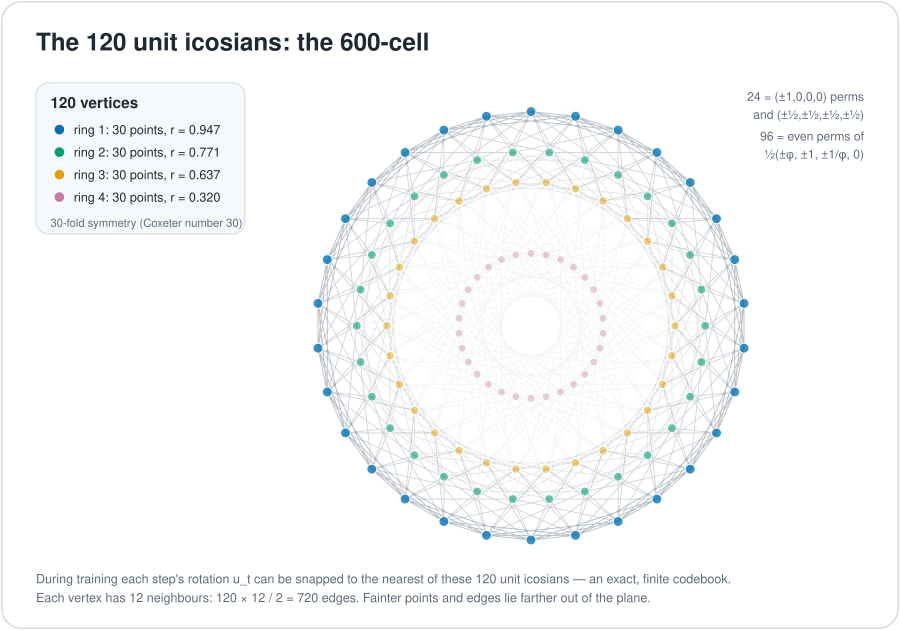
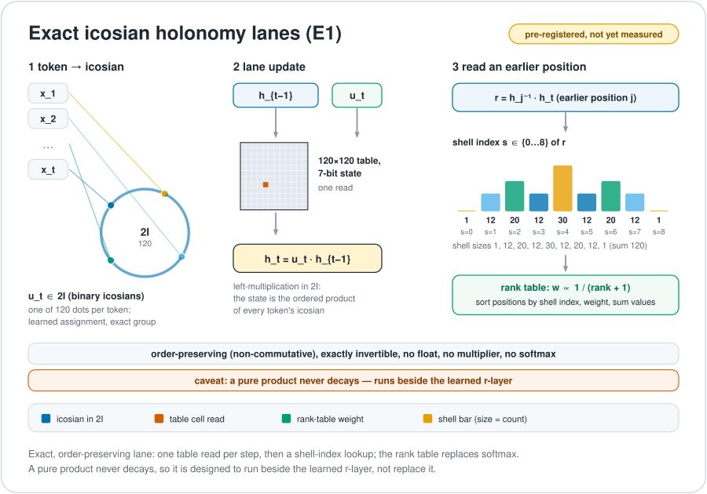

# E8, H4 and the 600-cell

There is a special set of 120 unit quaternions (each one a rotation) that are the corners of a regular solid in four dimensions called the 600-cell. Pairing that set with a golden-ratio-scaled copy of itself gives 240 points in eight dimensions, the roots of a famous lattice called E8. The project uses this structure because every rotation in it can be written with exact whole-number arithmetic, so a state can be turned and turned back with no rounding. The current model uses only a small, 16-root piece of E8, and this chapter is careful about the difference.

*The 120 unit icosians as the vertices of the 600-cell, seen from a plane chosen to show the symmetry. Four rings of 30 points, 12 neighbours per vertex, 720 edges.*

## The 120 icosians and the 600-cell

The binary icosahedral group $2I$ contains 120 unit quaternions, closed under multiplication. These are the H4 roots and the vertices of the 600-cell. They are, with coordinates in order $(w,x,y,z)$:

- 8 quaternions $\pm1,\pm i,\pm j,\pm k$;
- 16 of the form $\tfrac12(\pm1\pm i\pm j\pm k)$;
- 96 from the even permutations of $\tfrac12(\pm\varphi,\ \pm1,\ \pm\varphi^{-1},\ 0)$.

That is $8+16+96=120$ (proof, by direct count). Each has length 1: for the last family, $\tfrac14(\varphi^2+1+\varphi^{-2})=\tfrac14\cdot 4=1$ because $\varphi^2+\varphi^{-2}=3$.

Viewed from any one vertex, all 120 vertices, counting the vertex itself, fall into shells of 1, 12, 20, 12, 30, 12, 20, 12 and 1 vertices. The first shell has 12 neighbours at angle 36°, so there are $120\cdot12/2=720$ edges. The figure above retains the historical icosian-snap construction. Its 120 vertices form four projected rings of 30. Snapping a learned rotation to this 120-element codebook describes a retained experiment, not the current M1 read or learning path.

**Icosahedral rotations.** Dividing by $\pm1$ gives $2I/\{\pm1\}=A_5$, the 60 rotations of the icosahedron. It acts two-transitively on the six five-fold axes (proof; checked in [`verify_connections.py`](../figures/geometry/verify_connections.py)). Each of the 15 half-turns fixes exactly one pair of the six five-fold axes. So the 15 edges of the complete graph K6 on those axes match the 15 half-turn axes. This is forced once the six axes carry the six labels. A further fact is that the icosahedron's five orthogonal frames of two-fold axes form a *synthematic total* of K6: five perfect matchings that together cover all 15 edges.

**Primes and axes.** The six registered primes {5, 7, 11, 13, 17, 19} give 15 semiprime products, one per K6 edge (see [SpiralCore](./spiralcore.md)). Attaching the six primes to the six five-fold axes is a **labelling choice**. There are 720 labellings, and 12 of them are inequivalent under rotation. A design that routes primes through icosian rotations must say which one it uses. Half-turns also do not compose like bivectors: two half-turns whose K6 edges share a vertex multiply to an order-5 rotation, never a half-turn. The prime-to-half-turn match is a correspondence of sets, not of products.

## E8 as H4 plus a golden copy

*The 240 roots of E8 seen in the same kind of plane. Two sets of 120 meet in one picture: the icosians and a copy scaled by $\varphi$.*

The shorthand `E8 = H4 ⊕ φH4` means, here, an **icosian construction with a specified reduced metric**. It is not an independent Cartesian product of two H4 states. Let $x\cdot y = a + b\varphi$ in the quaternion coordinates. The construction uses

$$\langle x,y\rangle = 2a ,$$

the rational-part bilinear form, on the 240 elements $2I \cup \varphi\cdot 2I$. In the eight rational coefficient coordinates these have rank 8, norm 2, the E8 inner-product counts (from any root, 1 root at inner product 2, 56 at 1, 126 at 0, 56 at −1 and 1 at −2) and reflection closure. The executable finite checks are in [`verify_connections.py`](../figures/geometry/verify_connections.py) (check E2). The [primary construction paper](https://pmc.ncbi.nlm.nih.gov/articles/PMC4786034/) explains the reduced inner product. The standard picture of E8's roots in a Coxeter plane has 30-fold symmetry and 240 points in eight rings of 30, which is the natural companion to the four rings of 30 above.

Check E1 verifies something else: that the specified signed 8×8 matrices (all 15 Cl(0,6) bivector matrices and the six generator matrices) preserve the 240 roots in the standard coordinates of E8. E2 verifies the reduced-metric icosian root system. These checks do not supply a map between the two representations, so the claim that the action is preserved across that missing map is **not established**.

The retained [`anchors.rs`](../../crates/uor-r4-core/src/native_geometric/anchors.rs) stores $[a_0,\dots,a_3,b_0,\dots,b_3]$ and a Galois companion for one H4 root. Its header says that this invertible coefficient representation does **not** establish an orthogonal Euclidean E8 embedding or independent extra state. The present carrier has its own concrete basis and orbit, built in [`build.rs`](../../crates/uor-r4-discrete/build.rs): 16 roots of one E8 orbit, each a signed permutation of $(2,2,0,0,0,0,0,0)$, acted on by 64 signed transport actions. No basis bridge from this standard-coordinate carrier to the icosian realization above is asserted.

## A design off the current path: icosian holonomy lanes

*A historical proposal for remembering order with exact group elements.*

A lane state is a product in the 120-element group, updated by one read of a $120\times120$ table: $h_t = u_t h_{t-1}$. To read an earlier position $j$, form the relative element $h_j^{-1}h_t$ and use its shell index, 0 to 8, to rank that position. This design is not on the current path. It was pre-registered as the experiment called E1 (not the same thing as check E1 above), and it needs its own pre-registration and a `TEST FITNESS: FIT` review before any compute. An August recursive-attention configuration that kept one reusable summary state lost the order of earlier tokens (the August A1.0 record). Separately, the retrieval arms also called A1 were stopped on 1 October under [D18](../integration/DECISIONS.md#d18--one-retrieval-question-for-114-october-track-b-cost-and-memory-port-work-parked-with-re-entry-conditions) because every arm scored below 0.5 recall at distance 16. Under [D22](../integration/DECISIONS.md#d22--a-negative-closes-a-configuration-never-a-mechanism-five-closures-reopened) that closes the configuration, not the mechanism.

On the active discrete 16-root / 64-frame substrate, the direct counterpart (`PositionHolonomyV1`, `#2843`) accumulates prefix frames $F_{p,b} = \mathrm{COMPOSE}[u_{p,b}\cdot 64 + F_{p-1,b}]$ in the 64-element $\mathrm{Cl}(0,6)$ group and forms the relative path holonomy $H_{t\leftarrow s,b} = F_{t,b}\circ F_{s,b}^{-1}$ by two integer table reads ([`position_mechanism.rs`](../../crates/uor-r4-discrete/src/position_mechanism.rs), [lab record](../labs/m1-position-mechanism/README.md), [draft sheet](../harness/prep/m1-position-mechanism-DRAFT-2026-10-22.md)). For inter-stage block normalization on the same 16-root E8 orbit (`OrbitRootSnapNormV1`, `#2842`), multiplicity-matched `snap_n` projection onto $\mathcal{O}_{16}$ keeps every 8D block at exact invariants $\|x_b\|_1=4$, $\|x_b\|_2^2=8$, and $\|x_b\|_\infty=2$ (4 bits per block; [`normalization_mechanism.rs`](../../crates/uor-r4-discrete/src/normalization_mechanism.rs), [lab record](../labs/m1-normalization-mechanism/README.md), [draft sheet](../harness/prep/m1-normalization-mechanism-DRAFT-2026-10-22.md)).

## Where the model uses this

| Mechanism | Status | Use of E8 or the icosians |
|---|---|---|
| [Discrete learning](../mechanisms/discrete-learning.md), [route read](../mechanisms/route-read.md), [flock read](../mechanisms/flock-read.md) | ACTIVE | The 16-root orbit and its 64 signed actions are the carrier. Not full E8 coverage |
| [Prime-zeta codebook](../mechanisms/prime-zeta-codebook.md) | ACTIVE | Each 8D block of the starting table is aligned to the 16-root orbit by exact integer scores under cell quotas and uniqueness passes |
| [SpiralCore/FBS projection](../mechanisms/spiralcore-fbs.md) | READY (float), ACTIVE (integer form) | Moves a chosen block along exact E8 steps |
| [Spin-native weights](../mechanisms/spin-weights.md) | PARKED | Single-icosian snap (each quaternion weight block to one of the 120 icosians): after training, +0.141 bits per byte; trained in, +0.103 to +0.140; both negative ([record](../../archive/labs/icosian-qat-2026-10-11/README.md)). A two-icosian pair with a 2-bit scale matched an equal-parameter dense model (+0.0012) but only through dense matrix multiplication, which is barred |
| [E8 orbit memory](../mechanisms/e8-orbit-memory.md) | PARKED | Fixed E8 addresses for a large table. It stayed within its quality bar at 0.033 bits per byte worse than a dense control, but learned keys beat it by 0.023 |

Retained experiments such as these have results that concern those configurations. They do not settle the full geometry programme.

## Where it stands

| Claim | Kind | Source |
|---|---|---|
| $2I$ has 120 elements, 720 edges and the shell counts above | proof / finite enumeration | [`verify_connections.py`](../figures/geometry/verify_connections.py) |
| $2I\cup\varphi\cdot2I$ is a rank-8, norm-2, reflection-closed set of 240 roots under the reduced metric | finite enumeration (check E2) | same script |
| The signed matrices preserve the 240 standard-coordinate roots | finite enumeration (check E1) | same script |
| A map between the two E8 realizations that carries the actions | not established | [`anchors.rs`](../../crates/uor-r4-core/src/native_geometric/anchors.rs) header |
| M1 covers all of E8 | no | M1 uses a 16-root orbit ([`build.rs`](../../crates/uor-r4-discrete/build.rs)) |
| E8 or icosian structure improves language | not shown | the tried forms are on the board above |

## Go deeper

- Next: [Golden integers](./golden-integers.md), the exact arithmetic behind these coordinates.
- Code: [`anchors.rs`](../../crates/uor-r4-core/src/native_geometric/anchors.rs), [`build.rs`](../../crates/uor-r4-discrete/build.rs), [`verify_connections.py`](../figures/geometry/verify_connections.py).
- The mechanism pages above, and the [overview](./README.md).
