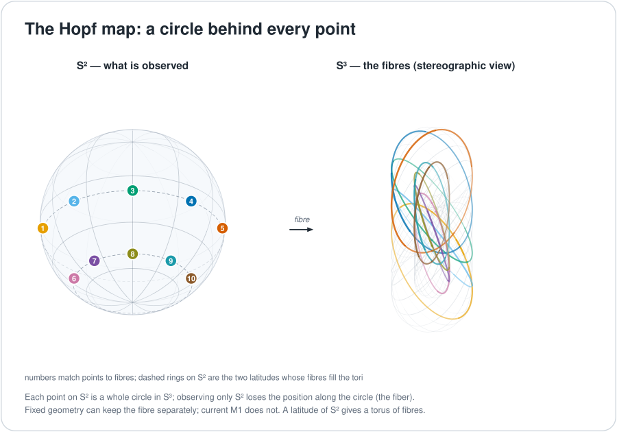

# The Hopf map and the kept fibre

In the project's quaternion designs, a rotation state is a point on a four-dimensional sphere (the current model M1 carries 8D integer blocks instead). The Hopf map takes a three-dimensional shadow of that point. The shadow forgets one angle, so many different states cast the same shadow. This chapter explains what the map does, what the forgotten angle is, and what the project does and does not do with it. Short version: the idea is built and unit-tested as a helper, it is not part of the current model's read, and nothing yet shows that keeping the forgotten angle helps language. The kept-fibre map is READY for a language test; the older sector-routing form is PARKED ([mechanism page](../mechanisms/hopf-observation.md)).

*The Hopf map $S^3\to S^2$ sends a whole circle of 4D points to one point of the 2-sphere. The shadow cannot tell them apart.*

## The map

Write a unit quaternion as $q=(a,b,c,d)$ and set $z_1=a+ib$ and $z_2=c+id$. The Hopf map to the 2-sphere is

$$h(q)=\big(2(ac+bd),\ 2(bc-ad),\ a^2+b^2-c^2-d^2\big)=\big(2\,\mathrm{Re}(z_1\bar z_2),\ 2\,\mathrm{Im}(z_1\bar z_2),\ |z_1|^2-|z_2|^2\big).$$

Two facts follow by expanding the squares (**proof**).

1. **It lands on the unit sphere.** $|h(q)|^2=4(a^2+b^2)(c^2+d^2)+\big((a^2+b^2)-(c^2+d^2)\big)^2=(a^2+b^2+c^2+d^2)^2=1$.
2. **A common phase changes nothing in the shadow.** Multiply both $z_1$ and $z_2$ by the same phase $e^{i\vartheta}$. The product $z_1\bar z_2$ and both moduli are unchanged, so $h(q)$ stays put. But $q$ moves around a circle, the **fibre**.

So the shadow alone cannot be inverted. Rebuilding $q$ needs the base point on the 2-sphere, the fibre phase and a chart convention, because there is no global identification $S^3=S^2\times S^1$. The image alone is not an invertible representation of the input, and the project does not assume a reversible universal $S^3\to S^2\to S^1$ pipeline. Keeping the lost angle in a separate slot is what "the kept fibre" means.

## How the code handles it

For a unit quaternion $(a,b,c,d)$, `UnitS3Q30::hopf` computes the formula above after decoding Q30 storage to `f64`, then normalises and requantises the result to Q30. Q30 names the storage representation here. It does not mean the Hopf map runs in integers.

[`prime_route_attention.rs`](../../crates/uor-r4-core/src/prime_route_attention.rs) provides `rotate_common_fiber` and `SpinTorsionState { s3, fiber, torsion }`, which keeps the S³ state, a fibre phase and a torsion term in separate fields. `rotate_common_fiber` also decodes to `f64`, uses `libm::sin` and `cos`, and normalises and requantises the rotated point. These are float-backed, offline, fixed-geometry utilities. They are not an integer model execution path.

**Hopf fibre tracking is not wired into the current discrete M1 read.** The retained M2 [Hopf metric](../../crates/uor-r4-core/src/native_geometric/hopf_metric.rs), which tracks a cumulative phase and a geodesic distance, is separate research and belongs to the held native learner.

**The icosians under the map.** The map sends the 120 icosians of [the previous chapters](./e8-h4-and-the-600-cell.md) onto one orbit of 30 points of the 2-sphere, every fibre of size 4 (finite enumeration in [`verify_connections.py`](../figures/geometry/verify_connections.py)). That orbit is of two-fold type; it is not literally the axes of the chosen frame. This link is forced.

## What was tried

The full history is on the [mechanism page](../mechanisms/hopf-observation.md). In brief, with the measurements it records:

| What | Result | Kind | Record |
|---|---|---|---|
| Hopf sector routing on held-out decisions (512 sectors) | 7 of 512 sectors occupied; at most 64 reachable when inputs are non-negative | measurement (negative) | [occupancy](../../archive/hopf_sector_occupancy_d3.md) |
| Hyperbolic (Lorentz) keys on real code-scope hierarchies | 77.5% of non-root queries at 16 dimensions against 0.4% for a dot product | measurement (positive, for hierarchy keys) | [cycle 2](../../archive/integration/hyperbolic-cycle2-2026-09-26.md) |
| Lorentz read against dot product in the Rust learner, 4 seeds | ahead in 3 of 4, mean 0.018 nats, below the 0.03 bar | measurement (small) | [cycle 3](../../archive/integration/hyperbolic-cycle3-2026-09-26.md) |
| Lorentz read in the 7M-parameter stack | Lorentz minus dot −0.0001 | measurement (neutral) | [toolbox](../../archive/integration/geometric-toolbox-2026-09-28.md) |

Only the occupancy rows test the Hopf map itself, and they tested one projection of one state. The attention failures in that record used an additive summary, a heatmap readout and softmax constructions, and the records say Hopf is not refuted. **Reading these honestly:** the shadow was never tested *with* its fibre kept, at equal retained bytes, as a language feature. That is the test that would reopen the mechanism. Three of the conditions that would reopen it, as the mechanism page lists them: an integer multiplier-free Hopf map wired into a consumer, a Lorentz read re-registered as an offline float sheet, and the retained-fibre test itself.

## Where the model uses this

| Mechanism | Status | Use |
|---|---|---|
| [Hopf observation](../mechanisms/hopf-observation.md) | Kept-fibre map READY; sector routing PARKED | Telemetry in the older `uor-r4-integer` chat runtime only (not M1). Per-session holonomy and winding are recorded, and they change no output |
| [Route read](../mechanisms/route-read.md) | ACTIVE | Does not use a Hopf quantity. Hyperbolic keys were once pitched as an address geometry |
| [Flock read](../mechanisms/flock-read.md), [relation read](../mechanisms/relation-read.md) | ACTIVE | Do not use a Hopf quantity |
| [Prime-zeta codebook](../mechanisms/prime-zeta-codebook.md) | ACTIVE | Shares the unit-quaternion helpers; the table uses points on the 3-sphere, not the Hopf map |

## Where it stands

| Claim | Kind | Source |
|---|---|---|
| $h$ maps $S^3$ onto $S^2$ and a common phase leaves the image fixed | proof | derivation above |
| The shadow alone cannot rebuild the state | proof | same |
| Keeping the fibre helps language | hypothesis, never tested | [mechanism page](../mechanisms/hopf-observation.md) |
| The Hopf map runs in integers | no | the float-backed helpers decode to `f64` |

## Go deeper

- Code: [`hopf_metric.rs`](../../crates/uor-r4-core/src/native_geometric/hopf_metric.rs), [`prime_route_attention.rs`](../../crates/uor-r4-core/src/prime_route_attention.rs).
- Next: [Primes and zeta phases](./primes-and-zeta.md). Back to the [overview](./README.md).
