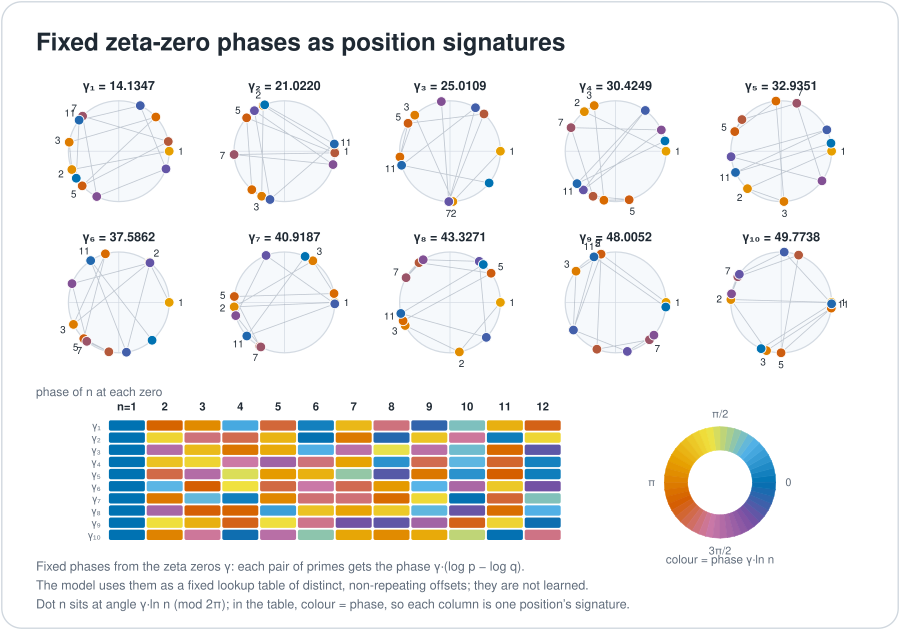

# Primes and zeta phases

Every prime number is a unique, indivisible building block, and every whole number is a product of primes in exactly one way. UOR-R4 uses that as an exact-identity idea: a word can be named by a prime (the current model M1 itself uses explicit token IDs). Separately, the project turns each prime into a set of angles using the known frequencies of the Riemann zeta zeros, as an optional input to the model's starting table; distinct starting vectors come from the allocation passes described below. This chapter explains both ideas and keeps them apart. The first is exact identity. The second is a way to scatter starting positions, and nobody has yet shown that its zeta angles help beyond simply keeping the words distinct. Terms are also defined in the [glossary](../start/glossary.md).

*Fixed zeta-zero frequencies $\gamma_k$ turn each prime $p$ into one angle per zero, $\theta_k=\gamma_k\ln p$. Think of a bank of clock hands, each turning at its own speed.*

## Zeta phases

The imaginary parts $\gamma$ of the Riemann zeta zeros are fixed numbers. The first three are about 14.1347, 21.0220 and 25.0109. Each defines a phase frequency. For a prime $p$ the phase on channel $k$ is

$$\theta_k(p)=\gamma_k\ln p \pmod{2\pi},\qquad z_k(p)=\cos\theta_k+i\sin\theta_k .$$

A worked illustration (computed from the published value, not read from the code): for $p=2$ and the first zero, $\theta_1 = 14.1347\times\ln 2 \approx 9.797$, which is about $3.514$ radians after subtracting $2\pi$. Using a finite table of these constants does not require proving the Riemann hypothesis.

The optional offline [`prime_zeta.rs`](../../crates/uor-r4-discrete/src/prime_zeta.rs) constructor uses **four complex channels per block ($\mathbb{C}^4$)** with $\theta=\gamma\ln p$, and then:

1. Realifies them into two 4-real tuples, $(\mathrm{Re}_0,\mathrm{Im}_0,\mathrm{Re}_1,\mathrm{Im}_1)$ and $(\mathrm{Re}_2,\mathrm{Im}_2,\mathrm{Re}_3,\mathrm{Im}_3)$.
2. Normalises each with `UnitS3Q30::from_r4` and quantises to Q30.
3. Applies the fixed coordinate permutation and exact integer alignment scores against the **16-root 8D carrier** (see [E8, H4 and the 600-cell](./e8-h4-and-the-600-cell.md)).
4. Allocates under writer-cell quotas and, when capacity permits, full-vector uniqueness controls. The output is `Snapshot.table`.

So $\mathbb{C}^4$ becomes $\mathbb{R}^4+\mathbb{R}^4$ per block, not $\mathbb{C}^8$ or $\mathbb{R}^{16}$ per block. The allocation controls are part of the assignment. It is not simply an unconstrained nearest-root snap. Floating point appears only in this one-time offline step, under the October 14 zeta-zero exception, and the output is an integer table.

**An honest caveat (proof, by reading the code).** The quota and uniqueness passes also run on both matched control tables (one shifts every $\gamma$ by 1.0, the other permutes the primes and scrambles phases and amplitudes). So the absence of collisions comes from those passes, not from prime phases. The record is [prime-zeta construction](../../archive/labs/prime-zeta-construction-2026-10-14/README.md); the mechanism page is [prime-zeta codebook](../mechanisms/prime-zeta-codebook.md).

The retained M2 learner used the same fixed phases in a different way: it accumulated fixed phase bins as policy inputs ([`engine.rs`](../../crates/uor-r4-core/src/native_geometric/addressed_attention/engine.rs)). That historical use is distinct from the current codebook initialisation, and it does not establish learned M1 attribution to zeta phases.

## Prime addressing

*Distinct primes make shared factors exact. A product records which primes are present, not their order or how many times each appears.*

Assign each token identity its own prime. Then shared factors are exact, by unique factorisation (**proof**). For example, with primes $2,3,5,7$ standing for four tokens, the products $42=2\cdot3\cdot7$ and $105=3\cdot5\cdot7$ have $\gcd=21=3\cdot7$, which says exactly that the two sets share tokens 3 and 7. A product of distinct primes records a *set*. Sequence order and multiplicity need explicit additional representation: $2\cdot3=3\cdot2$, and $12=2\cdot2\cdot3$ needs exponents to be told from $6=2\cdot3$. **Exact identity is not a semantic metric.** Two different primes are different, and nothing more is learned from their size or product.

## What the current model does with this

Current M1 uses explicit token IDs and an ordered BinderPlan context, plus the optional prime-addressed initialiser above. Flock and Relation reads rank finite context nodes and transport payloads before the shared writer.

A bounded kept-K list limits how many contributions are retained. **It does not bound selection cost:** the kernel scans eligible nodes, and Relation adds graph scans. The writer also scans vocabulary occupancy and admitted-cell tokens. See the [cost and source discussion](../architecture.md#dimensions-and-cost).

On 18 October the prime-zeta table was wired in as the model's starting table. Before that, a random start gave 4,096 words only 16 different starting vectors. The table gives all 4,096 distinct vectors ([prime-zeta construction](../../archive/labs/prime-zeta-construction-2026-10-14/README.md), [wiring](../labs/injective-codebook-init-2026-10-18/README.md)). The 19 October zero-update pre-flight then found that, at K=8, only about 8 of 256 target cells were opened, so admitted words were 127 of 3,847 against a gate of 500, and the run was not started ([pre-flight](../labs/injective-preflight-and-c2-qualify-2026-10-19/README.md)). That closes the configuration "spread words evenly at K=8". It does not test whether zeta phases help.

## Where the model uses this

| Mechanism | Status | Use |
|---|---|---|
| [Prime-zeta codebook](../mechanisms/prime-zeta-codebook.md) | ACTIVE | The starting table. The trained comparison against its two controls is `NOT_RUN` |
| [Address-structured cells](../mechanisms/address-cells.md) | ACTIVE | Places each word next to the words that usually precede it; the prime-zeta table is its fallback cell |
| [Admission](../mechanisms/admission.md) | ACTIVE | Narrows 4,096 words to those in a few opened cells. The measured ceiling on every attention run |
| [Exact addressed memory](../mechanisms/exact-memory.md) | PARKED | Writes a fact once under an exact prime address. The trained forms failed or used softmax; the address-as-read form was never built |
| [Pointer key](../mechanisms/pointer-key.md) | PARKED | Copies by a slot's exact name. A softmax pointer; hit rate rose from 0.377 to 0.545, but memory missed its bar |
| [Object store](../mechanisms/object-store.md) | READY | Preserves exact bytes separately in a hashed tree. It is not integrated into the M1 token path |

The [D19 object store](../../crates/uor-r4-object-store/README.md) preserves exact bytes separately. It is not silently integrated into the M1 token path. The retained [native learner](../../crates/uor-r4-core/src/native_geometric/addressed_attention/engine.rs) and the addressed-memory and pointer-identity mechanisms remain research foundations with their own artifact-bound evidence.

## Where it stands

| Claim | Kind | Source |
|---|---|---|
| Distinct primes make shared factors exact | proof | unique factorisation |
| Each of 4,096 words gets a distinct starting vector | measurement | [construction record](../../archive/labs/prime-zeta-construction-2026-10-14/README.md) |
| Zeta phases beat the matched controls in training | `NOT_RUN` | [prime-zeta codebook](../mechanisms/prime-zeta-codebook.md) |
| Prime identity is a semantic distance | no | exact identity only |
| The model has a measured language gain from either idea | no | pre-alpha; see [`PLAN.md`](../../PLAN.md) and rendered [`STATE.md`](../../STATE.md) |

## Go deeper

- Code: [`prime_zeta.rs`](../../crates/uor-r4-discrete/src/prime_zeta.rs), [`prime_route_attention.rs`](../../crates/uor-r4-core/src/prime_route_attention.rs).
- Next: [VSA and Hamming distance](./vsa-and-hamming.md). Back to the [overview](./README.md).
