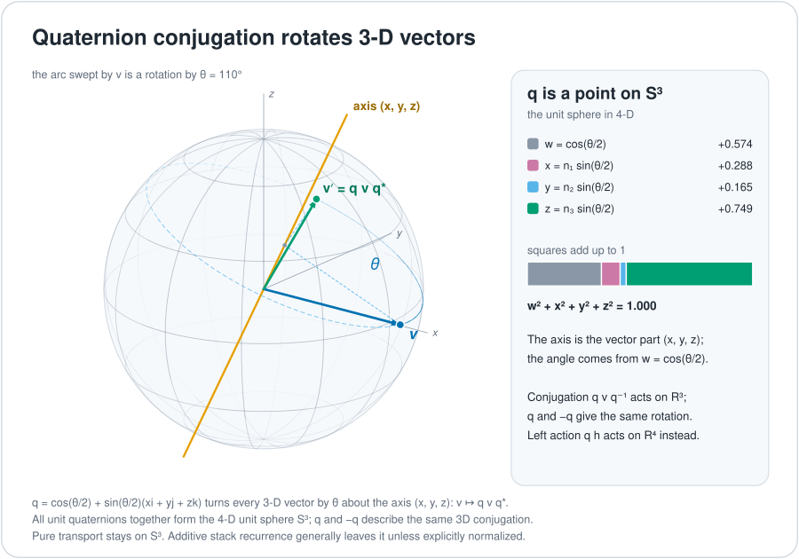

# Quaternions and rotation

A quaternion is a number with four parts. Multiplying by a unit quaternion (one of length 1) turns a point in four dimensions without stretching it, and a sandwich of two multiplications turns a point in ordinary three-dimensional space. That makes quaternions a natural way to say "turn this state" with exact, reversible steps instead of a grid of learned decimals. This chapter explains what a quaternion does, and why turning a state keeps its length while adding a new input to it does not. Terms are also defined in the [glossary](../start/glossary.md).

*Two different actions of the same quaternion. Conjugation turns 3D space, and left multiplication turns the whole 4D state.*

## Rotation: conjugation and left multiplication

A quaternion has four real components, $q = w + xi + yj + zk$, with $i^2=j^2=k^2=ijk=-1$. Quaternions of length 1 form the 3-sphere $S^3$. Multiplication does not commute: in general $qh \neq hq$.

For a pure imaginary vector $v$ (a point in $\mathbb{R}^3$), the map $v \mapsto q\,v\,q^{-1}$ is a rotation of $\mathbb{R}^3$. A unit quaternion $q=\cos\tfrac{\theta}{2}+\sin\tfrac{\theta}{2}\,n$ turns space by the angle $\theta$ about the unit axis $n$ (proof, a standard identity). The quaternions $q$ and $-q$ give the same 3D rotation.

**Left multiplication $q\,h$** is a different thing. It is a norm-preserving linear action on the full quaternion space $\mathbb{R}^4$, because $|qh| = |q|\,|h|$. It does not identify $q$ and $-q$ as the same action: the map for $-q$ is the negative of the map for $q$.

The retained float stack's `quaternion_scan` (the [geometric stack](../mechanisms/geometric-stack.md), PARKED) uses left multiplication, then additive input injection ([`geometric_stack.rs`](../../crates/uor-r4-training/src/geometric_stack.rs)). The current M1 model instead executes signed actions on 8D carrier blocks. The quaternion picture explains part of the research lineage. It is not a literal 4D state for the M1 kernel.

## Rotation preserves length; additive recurrence need not

*Pure repeated quaternion transport stays on $S^3$. The historical additive recurrence generally does not.*

The figure's pure transport orbit stays on $S^3$ when its initial state and its transport quaternion are unit. The retained float recurrence is

$$h_t = \lambda_t\,(u_t\cdot h_{t-1}) + \sqrt{1-\lambda_t^2}\;a_t .$$

Here $u_t$ is a unit quaternion that turns the old state, $a_t$ is the new input and $\lambda_t \in [0,1]$ is a fade rate. Take $h_{t-1}$ and $a_t$ to be unit. Then $|u_t h_{t-1}| = 1$, and expanding the squared norm gives

$$|h_t|^2 = \lambda_t^2 + (1-\lambda_t^2) + 2\lambda_t\sqrt{1-\lambda_t^2}\;\langle u_t h_{t-1},\,a_t\rangle = 1 + 2\lambda_t\sqrt{1-\lambda_t^2}\;\langle u_t h_{t-1},\,a_t\rangle .$$

The cross term is generally nonzero, so the sum need not lie on $S^3$ (proof, by expanding the norm). The identity $\lambda^2 + (1-\lambda^2) = 1$ alone does not normalise it. The rotation preserves the norm of the transported term. Any unit-state claim for the combined state needs an explicit normalisation or further conditions.

The same split shows up in the current reads. Flock and Relation reads sum transported vectors and snap the result back to the finite carrier. Route instead transports one selected carrier per block, without summing or snapping, in [`discrete.cu`](../../crates/uor-r4-discrete/src/discrete.cu).

## Where the model uses this

| Mechanism | Status | How it uses quaternions |
|---|---|---|
| [Hamilton gate](../mechanisms/hamilton-gate.md) | READY | Turns a gate signal into a unit quaternion and rotates the value block by it, so no sigmoid is needed. Built and tested, never trained |
| [Recurrence gates](../mechanisms/recurrence-gates.md) | READY | Carries state by rotation, with a fade rate read from a table of powers of two. Built and tested, never trained |
| [Spin-native weights](../mechanisms/spin-weights.md) | PARKED | Each 4×4 weight block is one quaternion. The single-icosian snap (one of 120 rotations) lost. A two-icosian pair with a 2-bit scale matched an equal-parameter dense model, but only through dense matrix multiplication, which a project rule bars |
| [Prime-zeta codebook](../mechanisms/prime-zeta-codebook.md) | ACTIVE | Builds the starting table from unit quaternions on $S^3$ (a one-time offline step), then stores integers |
| [Discrete learning](../mechanisms/discrete-learning.md), [route read](../mechanisms/route-read.md), [flock read](../mechanisms/flock-read.md) | ACTIVE | Do not use quaternions directly. They apply signed coordinate actions to 8D blocks (see [SpiralCore](./spiralcore.md)) |

**Octonions and quaternions.** Each of the seven Fano lines of the octonions spans a copy of the quaternions. The octonions are alternative and norm-multiplicative, and 168 of the 210 ordered unit triples are non-associative (exactly the non-collinear ones). This link is forced ([`cd_space.rs`](../../crates/uor-r4-core/src/transformerless/cd_space.rs)); see [SpiralCore](./spiralcore.md) for the table. The stack transport that relies on it is current in `uor-r4-discrete`, and it also appears in the float `geometric_stack.rs`, whose mechanism is PARKED.

## Where it stands

| Claim | Kind | Source |
|---|---|---|
| Conjugation by $q$ rotates $\mathbb{R}^3$, and $q$, $-q$ give the same rotation | proof | standard identity |
| Left multiplication by a unit quaternion preserves the norm on $\mathbb{R}^4$ | proof | $\lvert qh\rvert=\lvert q\rvert\lvert h\rvert$ |
| The additive recurrence can leave $S^3$ | proof | derivation above |
| Quaternion recurrence helps language | not shown | the float stack that used it also used softmax and dense maps; see the [board](../mechanisms/README.md) |
| M1 kernel runs on quaternions | no | M1 uses signed actions on 8D carrier blocks ([`discrete.cu`](../../crates/uor-r4-discrete/src/discrete.cu)) |

## Go deeper

- Next chapter: [E8, H4 and the 600-cell](./e8-h4-and-the-600-cell.md), where the 120 unit quaternions of the icosian group appear.
- Code: [`geometric_stack.rs`](../../crates/uor-r4-training/src/geometric_stack.rs), [`cd_space.rs`](../../crates/uor-r4-core/src/transformerless/cd_space.rs), [`discrete.cu`](../../crates/uor-r4-discrete/src/discrete.cu).
- Mechanism pages: [Hamilton gate](../mechanisms/hamilton-gate.md), [recurrence gates](../mechanisms/recurrence-gates.md), [spin-native weights](../mechanisms/spin-weights.md).
- Generator for the figures: [`generate.py`](../figures/geometry/generate.py).
- Back to the [overview](./README.md).
