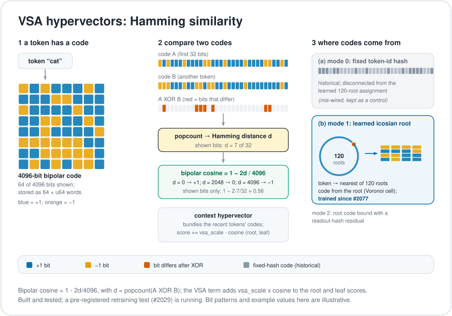
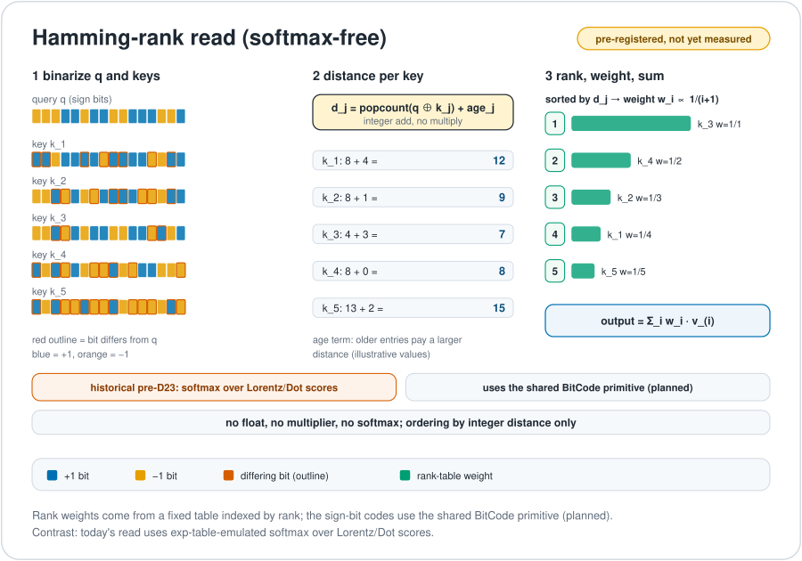

# VSA and Hamming distance

Give every word a very long string of 1s and 0s, 4,096 of them. To ask "are these two strings alike?", line them up and count the positions where they differ. That count is the Hamming distance, and it costs almost nothing on a computer: an exclusive-or (XOR) and a bit count. This chapter covers two uses of the idea. One is the older "hypervector" memory cue (VSA), which is research that was measured once and is not on the current path. The other is a Hamming tie-break that does run inside the current model's reads. In both cases the similarity is only a count of bits, and it is as meaningful as the way the codes were assigned. Terms are also defined in the [glossary](../start/glossary.md).

*Two codes are compared with an XOR and a bit count. The result is a Hamming distance and the matching bipolar cosine.*

## What a hypervector is

Each token has a 4096-bit bipolar hypervector, stored as 64 `u64` words. A set bit means $+1$ and a clear bit means $-1$. Two codes $A$ and $B$ are compared with an XOR and a popcount, which gives the Hamming distance $d$. The bipolar cosine is

$$\cos(A,B) = 1 - \frac{2d}{4096} .$$

A context hypervector *bundles* the codes of the recent tokens by a bitwise majority vote. The similarity is a statistic of the code bits, and it is only as meaningful as the way the codes were assigned.

Two standard facts (**proof**, from the definition of XOR) are worth knowing. XOR is its own inverse, $(A\oplus B)\oplus B=A$, which is why it works as a "glue and unglue" operation. For a bundle of $k$ random terms, unbinding returns the stored value plus noise of standard deviation about $\sqrt{(k-1)/D}$ with $D=4096$. That is the textbook estimate for random codes, not a measurement on this model.

## What the older model did with it

In the older native prose learner (an offline float learner on a CPU, now barred by the GPU-only rule D24), the VSA term added `vsa_scale · similarity` to the root and leaf scores. Three code modes existed.

| Mode | Code | Distinct codes |
|---|---|---|
| 0 | A fixed hash of the token id. Historical: it is disconnected from the learned 120-root assignment, which is why it was described as mis-wired | 4,096 |
| 1 | Derived from the learned icosian-root assignment (a token's nearest of the 120 roots, a Voronoi cell over the learned embeddings). Since PR #2077 these codes are trainable and refresh during training | at most 120 |
| 2 | The root code bound with a readout-hash residual | 4,096 |

**Measurement (9 October, two seeds, two held-out slices, 6,795,016 training tokens per run).** With the VSA term trained in and fixed token-hash codes (mode 0), held-out bits per byte improved in all four seed-and-slice pairs, by 0.0144 to 0.0226 (for example 1.8366 against 1.8574). Icosian-root codes (mode 1) did not help: the change in bits per byte against VSA off (negative is better) was +0.0003 and +0.0001 on one seed and −0.0053 and −0.0054 on the other, all four under the 0.01 threshold, and with only 120 distinct codes, tokens that share a root cannot be told apart. The root-plus-residual codes (mode 2) were worse than fixed codes in all four cells, by +0.013 to +0.028 ([native test record](../../archive/labs/vsa-native-test-2026-10-09/README.md); a historical float-form measurement on a CPU learner). An earlier "closed" label for mode 0 applied to a frozen-artifact swap and a wiring fault, not to this trained-in run.

The link from the icosians to these bit codes is *learned*, not forced: the learned token-to-icosian-root assignment builds the mode 1 codes ([`vsa_codes.rs`](../../crates/uor-r4-core/src/native_geometric/learner/vsa_codes.rs), since PR #2077).

Limits to keep in view: the seeds differ by about 0.015 bits per byte, the size of the effect, and the cross-arm comparison is a point estimate. The same model's exact-memory table was worth about 0.19 to 0.20 bits per byte, so VSA may duplicate evidence that other heads supply. VSA is not tied to SpiralCore ([next chapter](./spiralcore.md)). The full tried-and-untested list is on the [VSA mechanism page](../mechanisms/vsa.md), and the mechanism's status is PARKED.

## The Hamming-rank read, a tried configuration

*A historical proposal to replace a softmax with a sort by Hamming distance and a fixed rank table.*

The Hamming-rank read is a historical sign-bit and popcount design with fixed rank-table weights. Its [historical float configuration](../mechanisms/flock-read.md), trained beside a softmax stack, measured +0.2585 bits per byte against the softmax stack (+0.259 in the older write-up). That result closes only that configuration. It is not the current discrete Flock or Relation algorithm ([softmax-free read record](../../archive/labs/softmax-free-read-2026-10-10/README.md)).

## Hamming in the current reads

On the current path, Hamming distance is one factor among several, not the whole read. The kernel [`flock_vector`](../../crates/uor-r4-discrete/src/discrete.cu) orders candidates by:

1. relation score, descending;
2. L1 displacement, ascending;
3. coordinate Hamming distance, ascending;
4. recency, descending;
5. node, ascending.

In Flock mode the relation scores are zero. The kernel then **equally sums** the selected transported roots and snaps the sum to a carrier root. It does not use the historical fixed rank-table weights. Relation adds its graph reranking before this same selection and aggregation path. The Route read also uses Hamming distance, as a tie-break between ports ([route read](../mechanisms/route-read.md)).

Hamming distance on E8 labels is not the E8 lattice distance, and decision D32 treats XOR and Hamming comparison on ternary and E8 labels as one component of a model, not as a Hamming-only model ([ternary and XOR](../mechanisms/ternary-xor.md)).

## Where the model uses this

| Mechanism | Status | Use |
|---|---|---|
| [Flock read](../mechanisms/flock-read.md), [route read](../mechanisms/route-read.md), [relation read](../mechanisms/relation-read.md) | ACTIVE | Coordinate Hamming distance as one ranking or tie-break factor on the 16-root carrier |
| [VSA](../mechanisms/vsa.md) | PARKED | Trained 4096-bit codes in the held prose learner. Reopening needs a lawful retraining, for example a Hamming binding on the discrete writer |
| [Ternary and XOR arithmetic](../mechanisms/ternary-xor.md) | READY | Dense ternary or XOR weight contractions are barred, but the mechanism remains open for a lawful form; a dense ternary sum is still dense under D25 |

On 29 Oct 2026: the Hamming read (XOR and popcount over 64-bit sign codes) is in the FBS trunk as copy heads and type heads (claude-146). Its integer kernel for the copy heads is built and matches an f64 reference (claude-189), but the served session does not run it yet. See the [pipeline map](../model/pipeline-map.md).

## Where it stands

| Claim | Kind | Source |
|---|---|---|
| XOR is self-inverse; $\cos = 1-2d/4096$ | proof | definition |
| Trained fixed-hash VSA lowered held-out bits per byte by 0.0144 to 0.0226 | measurement (CPU learner, 2 seeds) | [native test](../../archive/labs/vsa-native-test-2026-10-09/README.md) |
| Root codes alone collapse token identity (120 codes for 4,096 tokens) | proof (count) and measurement (no gain) | same |
| Hamming-rank read matched a softmax | no: +0.2585 bits per byte worse | [softmax-free read](../../archive/labs/softmax-free-read-2026-10-10/README.md) |
| VSA helps the current discrete model | not tested | [VSA page](../mechanisms/vsa.md) |
| Octonion-signed binding beats plain XOR | hypothesis, untested | [SpiralCore chapter](./spiralcore.md) |

## Go deeper

- Code: [`vsa_codes.rs`](../../crates/uor-r4-core/src/native_geometric/learner/vsa_codes.rs), [`discrete.cu`](../../crates/uor-r4-discrete/src/discrete.cu).
- Mechanism pages: [VSA](../mechanisms/vsa.md), [ternary and XOR](../mechanisms/ternary-xor.md), [flock read](../mechanisms/flock-read.md).
- Next: [SpiralCore](./spiralcore.md). Back to the [overview](./README.md).
