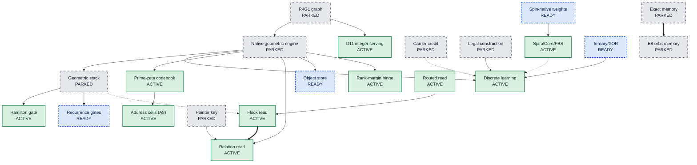

# The mechanism board

Most chat AIs are built from a few standard parts: a way to look back at earlier words (attention), a block that processes each word (a feed-forward layer), big grids of multiplications, and a function that scores every possible next word. UOR-R4 is trying to replace each of those parts with something built from geometry, such as rotations, exact addresses and lookup tables. Each replacement is called a **mechanism**. This page lists 28 rows for them, because Hopf observation is split into its two forms (owner ruling D72), and says where each one stands today. Status here means how far a mechanism has been built and tested. M1 is complete (1 of 8 milestones); no mechanism has produced a useful conversation yet ([PLAN](../../PLAN.md) and rendered [STATE](../../STATE.md)).

*The 22 mechanisms with a recorded parent or child, drawn as a family tree. Most of the live ones descend from earlier, parked attempts.*

## What the three statuses mean

| Status | Meaning | Count |
|---|---|---|
| **ACTIVE** | On a current model path: the discrete path (`crates/uor-r4-discrete`) or the float-trained FBS trunk ([two paths](../model/pipeline-map.md)). | 12 |
| **READY** | Built and tested, but not yet trained into a model. | 5 |
| **PARKED** | The forms tried so far failed or broke a project rule. The mechanism stays open, and its page lists what would reopen it. | 11 |

There is no "retired" status. Owner decision D22 says a negative result closes one tested configuration, never the mechanism, and stopping a mechanism needs the owner ([D22](../integration/DECISIONS.md#d22--a-negative-closes-a-configuration-never-a-mechanism-five-closures-reopened)). This board replaces the 18 October labels (active, dormant, archived-negative), which did not map one to one onto these three and had no rows for ten mechanisms.

Every number in the tables is a **measurement** from a recorded run or test, linked in its row, unless the cell says otherwise. The "Next" column is a **hypothesis** about what would help, not a result. A passing test is not a trained capability, and `NOT_RUN` is not a pass. BPB means bits per byte of text (lower is better). "FIT" means a pre-registered test was reviewed and judged able to answer its question.

## 30 Oct 2026: the composition

Two model paths remain distinct. The saved discrete 19-table model has closed M1 at all six bars: DEV 7,002 / 7,001, Fresh V2 7,215 / 7,228 and p-f 7,850 / 7,872 at two seeds, with exact export agreement and Apple M1 decode at 10,876 / 10,566 tok/s. The separate float-trained FBS trunk is the current complete-reply line:

- **Router:** the FBS recurrence, Hamilton gate and SpiralCore/FBS routes, trained and served exactly under `lut-stack/5`.
- **Position:** SpiralCore transport spin in the recurrence, with no RoPE.
- **Copy (look-back):** the Hamming read and copy heads, with integer kernels built; joined serving remains open.
- **Storage:** exact turn memory, trained. It names 598.7 and 598.3 of DEV's 1,226 reply openings at two seeds, but its exact-token key finds little on new phrasing.
- **Readout:** whole-table nearest (claude-150). The joined served session remains open.
- **Reading by meaning:** Flock, with cell D closed at claude-144. Its independent effect remains a question for the joined model.

M1 does not prove each mechanism's independent effect or useful conversation. Claude-217's p-s reply openings are 17.4%, 13.7% and 18.6% at three seeds, against about 80% on later tokens. Claude-219's point-key opening improves free generation at three seeds on fresh p-v, but reaches only 12–18% of the forced-opening lift; the sign key is inconclusive at this panel size. [Claude-220](../loop/tasks/one-model-end-to-end/claude-220/REPORT.md) then served the point key inside one float model on fresh p-w: templates improve by +41/+40/+42 at three seeds with exact claude-219 parity, while recalling TRAIN replies rather than generalizing. [Claude-222](../loop/tasks/point-key-integer/claude-222/REPORT.md) has built the integer point table, search and `/8` record, with 380 library tests and a full serving audit. [Claude-224](../loop/tasks/point-key-integer/claude-224/REPORT.md) has built the panel decode and grade. Before unit 3's real TRAIN export, p-x scoring and laptop measurement, [integer-retention-rates](../roadmap/items/integer-retention-rates.md) must make the integer recurrence match the trained model. The parts, costs and current order are in the [pipeline map](../model/pipeline-map.md).

## The family tree

An arrow means "came from" or "was replaced by". A solid arrow is a successor, a dotted arrow means the target is the integer form of the source, and a double arrow means the target is a specialisation of the source.

Five mechanisms have no recorded parent or child, so they are not drawn: admission, the tokenizer, Hopf observation, read binding and VSA. Source for all edges: the `family_tree` field of the [mechanism board](../labs/repo-renormalization-2026-10-19/audit/mechanisms/board.json) (19 October 2026).

## ACTIVE: on a current model path (12)

| Mechanism | In plain words | Replaces | Why this status | Next step |
|---|---|---|---|---|
| [Discrete geometric learning](discrete-learning.md) | Tries every legal rotation of one table entry and keeps it only if the whole-number loss strictly drops. No gradients, no floating point. | optimizer | The pilot and K16 are dated failures; Stage T and the 19-table trunk then produced the M1 model at all six bars ([close record](../labs/m1-close-saved-model/README.md), [bar-f](../loop/tasks/m1-heldout-phrasing-transfer/claude-211/REPORT.md), [#2029](https://github.com/UOR-Foundation/uor-r4/issues/2029)). | Independent ablation on the M2 path; M1 is a whole-model result |
| [Prime-zeta codebook](prime-zeta-codebook.md) | Gives each word a fixed, unique starting address built from primes and zeta-zero phases. | embedding | Construction passed, but the 25 October zero-update comparison was a **configuration loss**: P8 lost to Q0, Q1, R0 and R1, tied Q2 and won only R2. P8 admitted 127/3,847 against 178–188 for the strongest nulls ([record](../labs/r-prime-zeta-vs-nulls/README.md)). Trained semantic advantage remains unproven. | A matched language effect on the M2 path |
| [Address cells (A8)](address-cells.md) | Puts each word on a 16-by-16 board, next to the words that usually come just before it. | embedding | Placement raised starting admission from 127 to 1,351. A8 finite qualification passed 5/5 with D67 PASS, and the full-dose admission-preserving rerun reached Q1 4,292 / 14,287, 1,106 / 3,847 and 871 / 14,287 before a diagnostic stop. Stage T reached 5,009 with G-Adm/G-Occ, and M1 passed all six bars. Early Relation erosion remains a dated configuration negative ([full-dose rerun](../labs/m1-a8-full-dose-rerun/README.md)). | Independent address-formation evidence and the next rerun, not a repeat of old evidence |
| [Routed read](route-read.md) | Sends a query down a small tree of addresses and picks up the one earlier word at the end. | attention | Base read of the pilot, rung-0 and K16 artifacts: 20 proposals in 16,404 updates ([attention state](../labs/attention-state-2026-10-18/README.md)). M1 instead uses Flock + orbit-root pointer; Route's independent effect remains unisolated. | Read-off versus read-on test with enough proposals |
| [Flock read](flock-read.md) | Looks at a few nearest earlier positions, rotates them into its own frame and moves toward their consensus. | attention | Passes its 6 Flock controls (25 of 25 in the combined Route, Flock and driver run) and runs inside every Relation arm, but its own value was never isolated ([driver cost](../../archive/labs/discrete-driver-cost-2026-10-13/README.md)). On the FBS trunk, the flock read (cell D, claude-144) got 235 reply openings against a bar of 236 at seed 1, and 264 against 271 at seed 2. That closes the configuration, not the mechanism (29 Oct 2026). | It is the leading track for reading by meaning: revisit after the model runs end to end. Coupling test sheet to FIT, with zero and random controls |
| [Relation read](relation-read.md) | Lets the read follow links, such as "the word after the earlier copy of this word" (copying). | attention scoring | 9/9 controls and three trained runs: two stopped by admission loss, while Stage T's `T16_rel` reached 4,096 batches and 425 relation moves before its `relation_off` ablation dropped admission/top-1. No paired Route-control verdict ([A8 dose](../labs/a8-dose-2026-10-19/README.md), [Stage T](../labs/m1-bvg-k-stage-t-training/README.md)). | Independent paired ablation on the current model; M1's Flock-based close is not a Relation result |
| [Admission](admission.md) | Narrows 4,096 words to those in a few opened "drawers". A word in an unopened drawer can never be chosen. | softmax output head | The first measured limit, seen on rung 0 (the cause of weak ranking after K16 is open): one run fell from 5,680 to 1,920 admitted rows ([attention state](../labs/attention-state-2026-10-18/README.md)). On the FBS trunk, the native writer's admission failed at seed 2 (top-1 493 against nearest's 6,909, claude-150), so the readout to serve is whole-table nearest (29 Oct 2026). | `writer-admission` is ready; nearest is served meanwhile |
| [Rank-margin hinge](rank-margin.md) | The loss only asks whether the right answer beats its strongest rivals by a fixed gap. | cross-entropy loss | Integer hinge is the discrete writer's loss. One variant (K16-R) collapsed cell occupancy ([K16 outcome](../labs/k16-outcome-call-2026-10-19/README.md)). | Occupancy-regularised version |
| [Tokenizer](tokenizer.md) | Cuts text into 4,096 numbered pieces and back. | tokenizer | Every corpus, test and artifact is pinned to it. A 16,384-piece trainer exists as tooling only ([record](../labs/rust-bpe-trainer-2026-10-19/README.md)). | Matched 4,096 versus 16,384 comparison |
| [D11 integer serving](lut-serving.md) | Runs a finished model with whole numbers, adds, shifts and tables. An audit proves no float instruction; since D80 and D81 it allows the integer multiply and divide. | arithmetic (matmul) | **ACTIVE by owner ruling D72's own condition** ("READY until a lawful trained model is exported through it").  The condition was first met on the discrete path, on 26 Oct. antigravity-96 exported the four Stage T checkpoints through `lut-discrete/1` with an export gap of 0 (#2839).  A D37 float-trained FBS trunk followed on 29 Oct, inside the export-gap bar on both seeds at DEV scope (claude-182, `lut-stack/5`).  Serving audits are green (44 native symbol ranges, 7 of 7 WebAssembly with bulk memory off). They count the allowed integer multiplies and divides since claude-175, which the kernels use since claude-177. | FBS-only: a confirming run on new dual-c131 seeds, trained with the fixed-order backward. The joined next unit is `point-key-integer` (#3450) |
| [Hamilton gate (G2)](hamilton-gate.md) | Turns the gate signal into a rotation and rotates the value, so no sigmoid is needed. | feed-forward gate | **Moved from READY on 29 Oct 2026.** It is the feed-forward block of the float-trained FBS trunk, trained and served exactly under `lut-stack/5`, and the discrete M1 model's `DiscreteHamiltonGateV1` ([M1 close](../labs/m1-close-saved-model/README.md); [pipeline map](../model/pipeline-map.md)). Earlier: 944 tests, GPU parity 43 passed and 0 failed, 18 CUDA controls ([parity](../../archive/labs/cuda-parity-gate-import-2026-10-13/README.md), [controls](../../archive/labs/rung0-complete-path-2026-10-13/README.md)). | Cost per token against the other parts (`training-step-cost`) |
| [SpiralCore/FBS routes](spiralcore-fbs.md) | Each output block picks one stored block and moves it along exact steps in 8-dimensional E8 space. SpiralCore transport also carries position in the recurrence (no RoPE). | dense projections (matmul), position encoding | **Moved from READY on 29 Oct 2026.** The FBS recurrence and its SpiralCore/FBS routes are the router's backbone: trained, and served exactly under `lut-stack/5`. Only the type-spin configuration closed (claude-151). The dated float projection form remains READY; it is not M1's mechanism. M1 uses discrete Hamilton/quaternion recurrence, not FBS projection. | The one working model, trained and served end to end |

## READY: built and tested, not yet trained in (5)

| Mechanism | In plain words | Replaces | Why this status | Next step |
|---|---|---|---|---|
| [Recurrence gates](recurrence-gates.md) | Fade rate from a table of powers of two, input opened by a clamped line, state carried by rotation. | sigmoid, exp and tanh gates | Table errors at most 5.5e-8, 18 CUDA controls. The pre-registered 1,024-step six-recurrence fit ran on an RTX 5090, with mixed transport/export-gap outcomes ([record](../labs/recurrence-gates-six-recurrence-fit/README.md)). This is separate from the M1 discrete quaternion recurrence. | Match transport and export at both seeds |
| [Object store (D19)](object-store.md) | Keeps bytes exactly in a hashed tree: repeats are stored once and any range can be checked. | none (durable memory) | The consumer is built: the frozen 384-item panel passes host controls, with 77 object-store tests passed / 1 ignored plus 5 session-codec tests. The on-model M3 run awaits M2 selection; those host controls are not M3 qualification ([consumer record](../labs/object-store-consumer-m3/README.md)). | Run the on-model M3 bars after M2 selects the model |
| [Hopf observation: kept-fibre map](hopf-observation.md) | Views a 4D rotation through a 3D shadow while keeping the lost angle separately. | attention scoring | Built and unit-tested, telemetry only. Its language test was never run ([census](../labs/course-correction-2026-10-18/audits/mechanism-census.md)). READY by owner ruling D72. | Retained-fibre test |
| [Spin-native weights](spin-weights.md) | Each 4-by-4 weight block is one quaternion, snapped to 120 icosian rotations. | arithmetic (matmul) | Reached 1.5148 BPB, level with dense, but only through matmul ([record](../../archive/labs/icosian-mantissa-2026-10-11/README.md)). READY by owner ruling D74. | A lawful Hamilton-block trunk without dense multiplication |
| [Ternary/XOR](ternary-xor.md) | Weights of -1, 0 or +1, with similarity by counting differing bits. | arithmetic (matmul) | A dense ternary sum is still dense (D25). Export lost: 7.416 versus 7.171 bits. Its parts run inside discrete learning. READY by owner ruling D74, which this refresh does not change: moving it would be a decision row. Its XOR/popcount form, the Hamming read, is trained on the FBS trunk: recall probe 0.98–0.99 at three seeds (claude-146). Its integer form is `lut-stack/6` (claude-188) and the copy-head kernel (claude-189); session hooks are next (29 Oct 2026). | A geometric alphabet without a dense sum; the Hamming read's session hooks |

## PARKED: tested forms failed or broke a constraint, still open (11)

| Mechanism | In plain words | Replaces | Why this status | Next step |
|---|---|---|---|---|
| [Carrier credit](carrier-credit.md) | Sends learning credit back to the geometric objects that carried the information. | optimizer | Three fixed arms fell from 437/512 to 0/512. The sampled-choice step uses softmax ([record](../../archive/labs/unified-geometric-integration-2026-10-11/README.md)). | Hard-selection step under the lab's D67 pre-run review; D41's donor pass needs the owner at dispatch |
| [Legal construction](legal-construction.md) | Picks each parameter change from values the integer model can hold, protecting answers already correct. | optimizer | D78's exact solve of the saved case holds all 380 guards and is certified within 0.03259% of optimal; optimality is unproven. Earlier attempts stopped on solver numerics. | Apply the discrete block result on the M1 path; no new acceptance claim |
| [E8 orbit memory](e8-orbit-memory.md) | Replaces a feed-forward layer with a few rows of a large table addressed by E8 lattice points. | feed-forward layer (MLP) | Half-MLP form cost +0.033 BPB, within its bar, but learned keys beat E8 by 0.023. The gate is a sigmoid ([record](../../archive/labs/e8-orbit-memory-2026-10-11/README.md)). | Sigmoid-free gate and the named next iteration |
| [Exact memory](exact-memory.md) | Writes a fact once under an exact prime address and reads it back exactly. | key-value memory | Trained forms scored 19/40 against a 27/40 bar, or used softmax. The address-as-read form was never built ([record](../../archive/labs/addressed-memory-2026-10-10/README.md)). A different form, exact turn memory on the FBS trunk (claude-161), is trained and moves only the first word of a reply ([report](../loop/tasks/route-plus-memory/claude-161/REPORT.md)). | Build the address as the read, oracle first |
| [Pointer key](pointer-key.md) | Copies the answer by the slot's exact name, not by the surrounding wording. | copy head | A softmax pointer. Hit rate rose from 0.377 to 0.545, but memory missed its bar ([record](../../archive/labs/ptr-addr-2026-10-10/README.md)). | Lawful oracle, then a prime entity key |
| [Read binding](read-binding.md) | A teacher marks which earlier value the question asks for, and the read is rewarded for landing on it. | auxiliary loss | Wrong-value errors fell from 47 to 30 of 120 over 3 seeds, but on a softmax read ([record](../../archive/labs/read-binding-powered-2026-10-11/README.md)). | Port it to a Flock or Relation read |
| [Hopf observation: sector routing](hopf-observation.md) | Bins three Hopf coordinates 8 by 8 by 8, into 512 sectors, to pick a route. | attention scoring | Telemetry only. Sector routing used 7 of 512 sectors ([occupancy record](../../archive/hopf_sector_occupancy_d3.md)). Stays PARKED by owner ruling D72. | The reopen conditions on its page |
| [VSA](vsa.md) | 4,096-bit codes glued by XOR and compared by counting differing bits. | key-value memory | Improved BPB by 0.014 to 0.023 on 2 seeds, but on the banned CPU learner ([record](../../archive/labs/vsa-native-test-2026-10-09/README.md)). | GPU Hamming binding in the discrete model |
| [Geometric stack](geometric-stack.md) | The old 7M to 214M-parameter layered model with quaternion recurrence. | whole model | Trained form used softmax and matmul and served 1.20 to 1.24 BPB against a 0.90 bar ([record](../../archive/labs/d11-serving-2026-10-10/README.md)). | Rebuild from lawful parts (D37) |
| [Native geometric engine](native-geometric.md) | A from-scratch Rust model with prime addresses and version chains. It answered authored questions only. | whole model | No prose. 437/512 fell to 0/128 on fresh rows ([record](../../archive/labs/m2-fresh-437-2026-10-10/README.md)). | Re-register with the hinge loss under the lab's D67 pre-run review |
| [R4G1 graph](r4g1-graph.md) | Compiled a teacher model's preferences into integer lookup tables. | whole model | Never wrote coherent free text, and needs a banned transformer teacher. The crates are repaired; the mechanism stays PARKED. | Evaluate a lawful geometric successor, not a transformer-teacher revival |

## Which mechanism covers each part of a transformer

Each row names a part of a standard transformer, says what it does, and lists the mechanisms aimed at it (A = ACTIVE, R = READY, P = PARKED). Source: the `slot_map` of the [mechanism board](../labs/repo-renormalization-2026-10-19/audit/mechanisms/board.json) (19 October 2026).

| Transformer part | What it does | Our mechanisms |
|---|---|---|
| Tokenizer | Cuts text into pieces | [tokenizer](tokenizer.md) (A) |
| Token embedding table | Gives each piece a starting vector | [prime-zeta-codebook](prime-zeta-codebook.md) (A), [address-cells](address-cells.md) (A) |
| **Positional encoding** | Tells the model the order of words | FBS: [spiralcore-fbs](spiralcore-fbs.md) (A), SpiralCore transport spin, no RoPE. Discrete M1: `PositionHolonomyV1` with `DiscreteQuaternionRecurrenceV1` and the orbit-root causal pointer. |
| Attention: choosing what to read | Picks which earlier words matter | [route-read](route-read.md) (A), [flock-read](flock-read.md) (A), [relation-read](relation-read.md) (A), [admission](admission.md) (A), [hopf-observation](hopf-observation.md) (R, P) |
| Attention: mixing what was read | Combines the chosen words | [flock-read](flock-read.md) (A) |
| Copy and induction heads | Repeats what appeared earlier | [relation-read](relation-read.md) (A), [pointer-key](pointer-key.md) (P) |
| Context memory (KV cache) | Holds earlier words ready to read | [exact-memory](exact-memory.md) (P), [vsa](vsa.md) (P), [read-binding](read-binding.md) (P) |
| Durable memory outside the model | Stores facts between chats | [object-store](object-store.md) (R) |
| Feed-forward block (MLP) | Processes each word | [spiralcore-fbs](spiralcore-fbs.md) (A), [hamilton-gate](hamilton-gate.md) (A), [e8-orbit-memory](e8-orbit-memory.md) (P); the discrete M1 composition also has a discrete Hamilton gate |
| Activation and gating | Decides how much signal passes | [hamilton-gate](hamilton-gate.md) (A), [recurrence-gates](recurrence-gates.md) (R) |
| Recurrent sequence mixing | Carries a running memory along | [recurrence-gates](recurrence-gates.md) (R), [geometric-stack](geometric-stack.md) (P); M1 separately uses `DiscreteQuaternionRecurrenceV1` |
| Projections and matmul | The big grids of multiplications | [lut-serving](lut-serving.md) (A), [spiralcore-fbs](spiralcore-fbs.md) (A), [spin-weights](spin-weights.md) (R), [ternary-xor](ternary-xor.md) (R) |
| **Normalization** | Keeps numbers in a stable range | FBS: RMS norm with an integer square root, served. M1 uses `OrbitRootSnapNormV1` for discrete normalization, not the FBS RMS norm. `PositionHolonomyV1` is the separate position mechanism. |
| Output head | Scores every word and picks one | [admission](admission.md) (A), [discrete-learning](discrete-learning.md) (A) |
| Loss | Measures how wrong a guess was | [rank-margin](rank-margin.md) (A), [read-binding](read-binding.md) (P) |
| Optimizer | Decides how to change the model | [discrete-learning](discrete-learning.md) (A), [carrier-credit](carrier-credit.md) (P), [legal-construction](legal-construction.md) (P) |
| Inference runtime | Runs the finished model | [lut-serving](lut-serving.md) (A), [r4g1-graph](r4g1-graph.md) (P) |
| Whole-model engine | The complete model | [geometric-stack](geometric-stack.md) (P), [native-geometric](native-geometric.md) (P), [r4g1-graph](r4g1-graph.md) (P) |

The 19 October slot-map gaps are historical, not the current M1 state. The saved discrete M1 model
uses a discrete quaternion recurrence and Hamilton gate and beats both count tables at two seeds;
the separate FBS trunk uses SpiralCore transport and RMS norm. A mechanism's slot still does not
establish its independent effect or useful conversation.

## Where the audit questions a status

Statuses started as the audit dossiers set them (`docs/labs/repo-renormalization-2026-10-19/audit/mechanisms/`). The owner ruled on the two the audit questioned, and on two PARKED rows, on 24 Oct 2026:

- **D11 integer serving** moved from ACTIVE to READY (D72), because no lawful model had been exported through it. It is ACTIVE again by D72's own condition.
  - antigravity-96 exported the Stage T discrete checkpoints through it on 26 Oct, with an export gap of 0.
  - claude-182 exported a float-trained FBS trunk on 29 Oct.
  - The status change was recorded on 29 Oct (claude-183).
- **Hopf observation** was split in two (D72): its kept-fibre map is READY, because it is built and unit-tested and its language test never ran, and sector routing, the form that failed, stays PARKED.
- **Spin-native weights** and **Ternary/XOR** moved from PARKED to READY (D74), with their caveats kept.

## How to read a mechanism page

Each page follows the same order:

1. **In one paragraph**: the idea and what it replaces, in plain words.
2. **Figure**: a picture of the mechanism at work.
3. **How it works**: the mechanism and its maths, labelled as definition, measurement or hypothesis.
4. **Where it stands**: its status, the evidence behind it with sources, and for a PARKED mechanism what would reopen it.
5. **Go deeper**: the code, the archived records and the nearest neighbours in the tree above.

Read the status first, then the "Where it stands" table. A claim there is a measurement only if it names a recorded run.

## Go deeper

- [Glossary](../start/glossary.md) for terms such as admission, FIT and export gap.
- [The geometry page](../geometry/README.md) for pictures of the operators.
- [Decisions log](../integration/DECISIONS.md) for D22 (nothing is closed for good), D37 (offline float training) and D11 (integer serving).
- [Archived lab records](../../archive/labs/) for everything dated before 18 October 2026.
