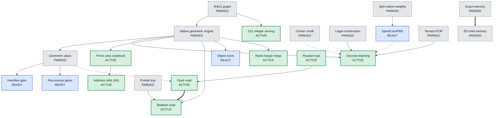

# The mechanism board

Most chat AIs are built from a few standard parts: a way to look back at earlier words (attention), a block that processes each word (a feed-forward layer), big grids of multiplications, and a function that scores every possible next word. UOR-R4 is trying to replace each of those parts with something built from geometry, such as rotations, exact addresses and lookup tables. Each replacement is called a **mechanism**. This page lists all 27 of them and says where each one stands today. Status here means how far a mechanism has been built and tested. No mechanism has produced a useful conversation yet: the project is pre-alpha, and 0 of its 8 milestones are complete (`STATUS.md`).

*The 22 mechanisms with a recorded parent or child, drawn as a family tree. Most of the live ones descend from earlier, parked attempts.*

## What the three statuses mean

| Status | Meaning | Count |
|---|---|---|
| **ACTIVE** | On the current model path, `crates/uor-r4-discrete`. | 10 |
| **READY** | Built and tested, but not yet trained into a model. | 4 |
| **PARKED** | The forms tried so far failed or broke a project rule. The mechanism stays open, and its page lists what would reopen it. | 13 |

There is no "retired" status. Owner decision D22 says a negative result closes one tested configuration, never the mechanism, and stopping a mechanism needs the owner ([D22](../integration/DECISIONS.md#d22--a-negative-closes-a-configuration-never-a-mechanism-five-closures-reopened)). This board replaces the 18 October labels (active, dormant, archived-negative), which did not map one to one onto these three and had no rows for ten mechanisms.

Every number in the tables is a **measurement** from a recorded run or test, linked in its row, unless the cell says otherwise. The "Next" column is a **hypothesis** about what would help, not a result. A passing test is not a trained capability, and `NOT_RUN` is not a pass. BPB means bits per byte of text (lower is better). "FIT" means a pre-registered test was reviewed and judged able to answer its question.

## The family tree

An arrow means "came from" or "was replaced by". A solid arrow is a successor, a dotted arrow means the target is the integer form of the source, and a double arrow means the target is a specialisation of the source.

Five mechanisms have no recorded parent or child, so they are not drawn: admission, the tokenizer, Hopf observation, read binding and VSA. Source for all edges: the `family_tree` field of the [mechanism board](../labs/repo-renormalization-2026-10-19/audit/mechanisms/board.json) (19 October 2026).

## ACTIVE: on the current model path (10)

| Mechanism | In plain words | Replaces | Why this status | Next step |
|---|---|---|---|---|
| [Discrete geometric learning](discrete-learning.md) | Tries every legal rotation of one table entry and keeps it only if the whole-number loss strictly drops. No gradients, no floating point. | optimizer | Learning rule of the only live model. A pilot and four large runs (K16) finished and no arm passed the bars ([K16 outcome](../labs/k16-outcome-call-2026-10-19/README.md)). | First trained model that beats its frozen control |
| [Prime-zeta codebook](prime-zeta-codebook.md) | Gives each word a fixed, unique starting address built from primes and zeta-zero phases. | embedding | Wired in as the start for new lineages, and the baseline arm P8; no trained artifact has started from it. The trained comparison against its two null controls is `NOT_RUN` ([record](../../archive/labs/prime-zeta-construction-2026-10-14/README.md)). | Run that comparison |
| [Address cells (A8)](address-cells.md) | Puts each word on a 16-by-16 board, next to the words that usually come just before it. | embedding | Raised successor admission from 127 to 1,351 of 3,847 before training. Learning then eroded it, and a first test stopped when Relation admission fell to 551 against the control's 857 ([A8 dose](../labs/a8-dose-2026-10-19/README.md)). | Run the real CUDA qualification of the merged guard (`NOT_RUN`), then rerun |
| [Routed read](route-read.md) | Sends a query down a small tree of addresses and picks up the one earlier word at the end. | attention | Base read of every trained artifact, but its own effect is unattributed: 20 proposals in 16,404 updates ([attention state](../labs/attention-state-2026-10-18/README.md)). | Read-off versus read-on test with enough proposals |
| [Flock read](flock-read.md) | Looks at a few nearest earlier positions, rotates them into its own frame and moves toward their consensus. | attention | Passes its 6 Flock controls (25 of 25 in the combined Route, Flock and driver run) and runs inside every Relation arm, but its own value was never isolated ([driver cost](../../archive/labs/discrete-driver-cost-2026-10-13/README.md)). | Get the coupling test sheet to FIT, with zero and random controls |
| [Relation read](relation-read.md) | Lets the read follow links, such as "the word after the earlier copy of this word" (copying). | attention scoring | 9/9 controls and two trained runs, both stopped by admission loss. No paired verdict yet ([A8 dose](../labs/a8-dose-2026-10-19/README.md)). | Paired verdict; it must beat a lookup table (6,300 of 14,287) |
| [Admission](admission.md) | Narrows 4,096 words to those in a few opened "drawers". A word in an unopened drawer can never be chosen. | softmax output head | The first measured limit, seen on rung 0 (the cause of weak ranking after K16 is open): one run fell from 5,680 to 1,920 admitted rows ([attention state](../labs/attention-state-2026-10-18/README.md)). | Admission-preserving A8 rerun |
| [Rank-margin hinge](rank-margin.md) | The loss only asks whether the right answer beats its strongest rivals by a fixed gap. | cross-entropy loss | Integer hinge is the discrete writer's loss. One variant (K16-R) collapsed cell occupancy ([K16 outcome](../labs/k16-outcome-call-2026-10-19/README.md)). | Occupancy-regularised version |
| [D11 integer serving](lut-serving.md) | Runs a finished model with whole numbers, adds, shifts and tables only. An audit proves no multiply instruction. | arithmetic (matmul) | Zero-multiply audits are green (44 native symbol ranges, 7 of 7 WebAssembly), but no lawful trained model has been exported (`docs/integration/project-track.md`). | Export one discrete model and measure its export gap |
| [Tokenizer](tokenizer.md) | Cuts text into 4,096 numbered pieces and back. | tokenizer | Every corpus, test and artifact is pinned to it. A 16,384-piece trainer exists as tooling only ([record](../labs/rust-bpe-trainer-2026-10-19/README.md)). | Matched 4,096 versus 16,384 comparison |

## READY: built and tested, not yet trained in (4)

| Mechanism | In plain words | Replaces | Why this status | Next step |
|---|---|---|---|---|
| [Hamilton gate (G2)](hamilton-gate.md) | Turns the gate signal into a rotation and rotates the value, so no sigmoid is needed. | feed-forward gate | 944 tests, GPU parity 43 passed and 0 failed, 18 CUDA controls. Never trained ([parity](../../archive/labs/cuda-parity-gate-import-2026-10-13/README.md), [controls](../../archive/labs/rung0-complete-path-2026-10-13/README.md)). | Offline-float (D37) sheet with language fit and export gap |
| [Recurrence gates](recurrence-gates.md) | Fade rate from a table of powers of two, input opened by a clamped line, state carried by rotation. | sigmoid, exp and tanh gates | Table errors at most 5.5e-8, 18 CUDA controls. The six-recurrence fit never ran ([record](../../archive/labs/rung0-complete-path-2026-10-13/README.md)). | Show the learning surrogate gives descent |
| [SpiralCore/FBS projection](spiralcore-fbs.md) | Each output block picks one stored block and moves it along exact steps in 8-dimensional E8 space. No learned weight is multiplied. | dense projections (matmul) | Exact fixtures pass on an RTX 5090. Never trained. Its integer form is ACTIVE inside discrete learning ([record](../../archive/labs/spiralcore-fbs-projection-2026-10-12/README.md)). | Descent and tokens per second in an offline-float sheet |
| [Object store (D19)](object-store.md) | Keeps bytes exactly in a hashed tree: repeats are stored once and any range can be checked. | none (durable memory) | 60 tests and a client conformance pass. Nothing consumes it; the durable-memory bars have not run ([D19](../../archive/labs/d19-object-store-2026-10-15/README.md), [conformance](../labs/uorobj01-conformance-2026-10-18/README.md)). | Wire it in and run those bars (milestone M3) |

## PARKED: tested forms failed or broke a rule, still open (13)

| Mechanism | In plain words | Replaces | Why this status | Next step |
|---|---|---|---|---|
| [Carrier credit](carrier-credit.md) | Sends learning credit back to the geometric objects that carried the information. | optimizer | Three fixed arms fell from 437/512 to 0/512. The sampled-choice step uses softmax ([record](../../archive/labs/unified-geometric-integration-2026-10-11/README.md)). | Hard-selection step; needs the M2 training hold released |
| [Legal construction](legal-construction.md) | Picks each parameter change from values the integer model can hold, protecting answers already correct. | optimizer | Never scored. Every attempt stopped on solver numerics ([record](../../archive/labs/direct-legal-construction-2026-10-09/README.md)). | Solve the saved case (1,960 variables) in exact arithmetic |
| [E8 orbit memory](e8-orbit-memory.md) | Replaces a feed-forward layer with a few rows of a large table addressed by E8 lattice points. | feed-forward layer (MLP) | Half-MLP form cost +0.033 BPB, within its bar, but learned keys beat E8 by 0.023. The gate is a sigmoid ([record](../../archive/labs/e8-orbit-memory-2026-10-11/README.md)). | Sigmoid-free gate and the named next iteration |
| [Exact memory](exact-memory.md) | Writes a fact once under an exact prime address and reads it back exactly. | key-value memory | Trained forms scored 19/40 against a 27/40 bar, or used softmax. The address-as-read form was never built ([record](../../archive/labs/addressed-memory-2026-10-10/README.md)). | Build the address as the read, oracle first |
| [Pointer key](pointer-key.md) | Copies the answer by the slot's exact name, not by the surrounding wording. | copy head | A softmax pointer. Hit rate rose from 0.377 to 0.545, but memory missed its bar ([record](../../archive/labs/ptr-addr-2026-10-10/README.md)). | Lawful oracle, then a prime entity key |
| [Read binding](read-binding.md) | A teacher marks which earlier value the question asks for, and the read is rewarded for landing on it. | auxiliary loss | Wrong-value errors fell from 47 to 30 of 120 over 3 seeds, but on a softmax read ([record](../../archive/labs/read-binding-powered-2026-10-11/README.md)). | Port it to a Flock or Relation read |
| [Hopf observation](hopf-observation.md) | Views a 4D rotation through a 3D shadow while keeping the lost angle separately. | attention scoring | Telemetry only. Sector routing used 7 of 512 sectors ([occupancy record](../../archive/hopf_sector_occupancy_d3.md)); the kept-fibre language test was never run ([census](../labs/course-correction-2026-10-18/audits/mechanism-census.md)). | Retained-fibre test |
| [VSA](vsa.md) | 4,096-bit codes glued by XOR and compared by counting differing bits. | key-value memory | Improved BPB by 0.014 to 0.023 on 2 seeds, but on the banned CPU learner ([record](../../archive/labs/vsa-native-test-2026-10-09/README.md)). | GPU Hamming binding in the discrete model |
| [Spin-native weights](spin-weights.md) | Each 4-by-4 weight block is one quaternion, snapped to 120 icosian rotations. | arithmetic (matmul) | Reached 1.5148 BPB, level with dense, but only through matmul ([record](../../archive/labs/icosian-mantissa-2026-10-11/README.md)). | Owner architecture decision |
| [Ternary/XOR](ternary-xor.md) | Weights of -1, 0 or +1, with similarity by counting differing bits. | arithmetic (matmul) | A dense ternary sum is still dense (D25). Export lost: 7.416 versus 7.171 bits. Its parts run inside discrete learning. | Owner ruling, or a geometric alphabet |
| [Geometric stack](geometric-stack.md) | The old 7M to 214M-parameter layered model with quaternion recurrence. | whole model | Trained form used softmax and matmul and served 1.20 to 1.24 BPB against a 0.90 bar ([record](../../archive/labs/d11-serving-2026-10-10/README.md)). | Rebuild from lawful parts (D37) |
| [Native geometric engine](native-geometric.md) | A from-scratch Rust model with prime addresses and version chains. It answered authored questions only. | whole model | No prose. 437/512 fell to 0/128 on fresh rows ([record](../../archive/labs/m2-fresh-437-2026-10-10/README.md)). | Re-register with the hinge loss once the M2 hold lifts |
| [R4G1 graph](r4g1-graph.md) | Compiled a teacher model's preferences into integer lookup tables. | whole model | Never wrote coherent free text, and needs a banned transformer teacher. | Owner decision on repairing or removing the crates (D36) |

## Which mechanism covers each part of a transformer

Each row names a part of a standard transformer, says what it does, and lists the mechanisms aimed at it (A = ACTIVE, R = READY, P = PARKED). Source: the `slot_map` of the [mechanism board](../labs/repo-renormalization-2026-10-19/audit/mechanisms/board.json) (19 October 2026).

| Transformer part | What it does | Our mechanisms |
|---|---|---|
| Tokenizer | Cuts text into pieces | [tokenizer](tokenizer.md) (A) |
| Token embedding table | Gives each piece a starting vector | [prime-zeta-codebook](prime-zeta-codebook.md) (A), [address-cells](address-cells.md) (A) |
| **Positional encoding** | Tells the model the order of words | **GAP: none.** No record names a mechanism for this. |
| Attention: choosing what to read | Picks which earlier words matter | [route-read](route-read.md) (A), [flock-read](flock-read.md) (A), [relation-read](relation-read.md) (A), [admission](admission.md) (A), [hopf-observation](hopf-observation.md) (P) |
| Attention: mixing what was read | Combines the chosen words | [flock-read](flock-read.md) (A) |
| Copy and induction heads | Repeats what appeared earlier | [relation-read](relation-read.md) (A), [pointer-key](pointer-key.md) (P) |
| Context memory (KV cache) | Holds earlier words ready to read | [exact-memory](exact-memory.md) (P), [vsa](vsa.md) (P), [read-binding](read-binding.md) (P) |
| Durable memory outside the model | Stores facts between chats | [object-store](object-store.md) (R) |
| Feed-forward block (MLP) | Processes each word | [spiralcore-fbs](spiralcore-fbs.md) (R), [hamilton-gate](hamilton-gate.md) (R), [e8-orbit-memory](e8-orbit-memory.md) (P) |
| Activation and gating | Decides how much signal passes | [hamilton-gate](hamilton-gate.md) (R), [recurrence-gates](recurrence-gates.md) (R) |
| Recurrent sequence mixing | Carries a running memory along | [recurrence-gates](recurrence-gates.md) (R), [geometric-stack](geometric-stack.md) (P) |
| Projections and matmul | The big grids of multiplications | [lut-serving](lut-serving.md) (A), [spiralcore-fbs](spiralcore-fbs.md) (R), [spin-weights](spin-weights.md) (P), [ternary-xor](ternary-xor.md) (P) |
| **Normalization** | Keeps numbers in a stable range | **GAP: none.** Snapping to an E8 root may serve, but no record says so. |
| Output head | Scores every word and picks one | [admission](admission.md) (A), [discrete-learning](discrete-learning.md) (A) |
| Loss | Measures how wrong a guess was | [rank-margin](rank-margin.md) (A), [read-binding](read-binding.md) (P) |
| Optimizer | Decides how to change the model | [discrete-learning](discrete-learning.md) (A), [carrier-credit](carrier-credit.md) (P), [legal-construction](legal-construction.md) (P) |
| Inference runtime | Runs the finished model | [lut-serving](lut-serving.md) (A), [r4g1-graph](r4g1-graph.md) (P) |
| Whole-model engine | The complete model | [geometric-stack](geometric-stack.md) (P), [native-geometric](native-geometric.md) (P), [r4g1-graph](r4g1-graph.md) (P) |

The two gaps matter. The only position-related result is about recurrent state transport, not word order, and it was measured in a model that used banned parts. The live discrete model has no position mechanism, no normalization and no feed-forward block, and it scores below a unigram baseline (audit synthesis, section 1). Having a mechanism for a slot does not mean it works: a row can list four mechanisms and no trained result.

## Where the audit questions a status

Statuses are left as the audit dossiers set them (`docs/labs/repo-renormalization-2026-10-19/audit/mechanisms/`). Two are open to challenge:

- **D11 integer serving** is ACTIVE as the end-of-pipeline contract, but no lawful model has ever been exported through it, so READY may be more accurate.
- **Hopf observation** is PARKED, but its kept-fibre map is built and unit-tested and its language test never ran. Only sector routing failed, so splitting the two forms may be more accurate.

## How to read a mechanism page

Each page follows the same order:

1. **In one paragraph**: the idea and what it replaces, in plain words.
2. **Figure**: a picture of the mechanism at work.
3. **How it works**: the mechanism and its maths, labelled as definition, measurement or hypothesis.
4. **Where it stands**: its status, the evidence behind it with sources, and for a PARKED mechanism what would reopen it.
5. **Go deeper**: the code, the archived records and the nearest neighbours in the tree above.

Read the status first, then the "Where it stands" table. A claim there is a measurement only if it names a recorded run.

## Go deeper

- [Glossary](../start/glossary.md) for terms such as admission, FIT and export gap.
- [The geometry page](../geometry/README.md) for pictures of the operators.
- [Decisions log](../integration/DECISIONS.md) for D22 (nothing is closed for good), D37 (offline float training) and D11 (integer serving).
- [Archived lab records](../../archive/labs/) for everything dated before 18 October 2026.
