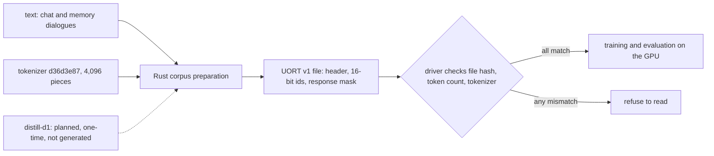

# Data and tokenizer

The model never sees letters or words. It sees a stream of numbered pieces of text, and a small program called a tokenizer cuts text into those pieces and turns them back into text. The project's data is chat-shaped text, prepared into files of piece numbers with one fixed tokenizer of 4,096 pieces. Every prepared file carries a fingerprint of that tokenizer, so a result can never be quietly compared across two different ways of cutting text. The data is small: the training set for the current model path is about 7.5 million tokens. A larger corpus, written once by an open donor model under a narrow owner exception, is planned but has not been generated.

Labels used below: **proof** means derived from definitions or code, **measurement** means a recorded run, **hypothesis** means an untested idea. See [`docs/formal_vocabulary.md`](../formal_vocabulary.md) and the [glossary](../start/glossary.md).

*Bytes become pieces by repeated merging, and the tokenizer's fingerprint travels with every prepared file. A two-digit number is still two pieces.*

*From text to a model run. The dotted arrow is a plan, not a file that exists.*

## The tokenizer

**What it is (definition).** A byte-level byte-pair-encoding (BPE) tokenizer. It starts from the 256 possible bytes, so any text can be encoded. It then learns the most frequent adjacent pairs and glues them into bigger pieces. This is a standard technique and is not novel here.

**Layout of the pinned tokenizer.** Pieces 0, 1 and 2 are start, end and unknown. Pieces 3 to 258 are the 256 single bytes. The rest are learned merges:

$$3+256+3837=4096 .$$

**Training (definition).** Count each adjacent pair over the unique pieces of text in the corpus (pre-tokens), weighted by how often each occurs. Merge the pair with the highest count into a new piece and recount only the words that contain it. Repeat until the vocabulary is full. Ties go to the pair whose left, then right, piece string sorts first, so the result is the same every time. Special tokens are atomic, and no merge crosses a special token, a pre-token boundary or an input file. Encoding then applies the merges in rank order: a table look-up with no learned arithmetic ([`training.rs`](../../crates/uor-r4-tokenizer/src/training.rs), [`lib.rs`](../../crates/uor-r4-tokenizer/src/lib.rs)).

**Identity.** The tokenizer crate computes a blake3 content address of the raw `tokenizer.json` bytes, and the discrete driver pins each file by SHA-256. The pinned tokenizer is written `d36d3e87…`; its full 64-hex SHA-256 is listed in the [donor-corpus sheet](../harness/prep/m1-distill-d1-donor-corpus-DRAFT-2026-10-19.md). A different tokenizer is therefore a different corpus.

**The 16,384-piece trainer.** On 19 October a Rust command, `train-bpe`, landed for building a tokenizer of any size from 259 to 65,536 pieces ([`train-bpe.rs`](../../crates/uor-r4-tokenizer/src/bin/train-bpe.rs), [record](../labs/rust-bpe-trainer-2026-10-19/README.md)). It is deterministic, refuses to overwrite a file, and by default accepts 64 MiB of input. Checks compared its merge ranks and its segmentation with an independent exhaustive recount over 40 small test corpora, and a synthetic 8,192-document fixture reached exactly 16,384 pieces. **Measurement, of the tool only.** It changes no active file. No tokenizer has been swapped, and no model has been trained or scored on any tokenizer other than `d36d3e87`. Whether 16,384 pieces help the model is a **hypothesis**.

**Numbers are split.** The vocabulary has no multi-digit piece, so 84 is the pieces 8 and 4. In an older chat model's 9 October acceptance run, memory rows with a distractor and a number as the stored value passed 1 of 11, against 9 of 23 with a word as the value. A diagnosis found no multi-digit token, and that the right value was not emitted rather than confused with a distractor. An untrained probe showed the project's number codec already stores two-digit values in order, so storage is not the cause; the failure sits in the learned read and write path. Both are **measurements**, on an older float model ([diagnosis](../../archive/labs/v5-numeric-diagnosis-2026-10-09/README.md), [probe](../../archive/labs/numeric-addressability-probe-2026-10-09/README.md)). Whether digit-split numbers still hurt once the discrete read can address an exact value is open.

## The prepared files

**Format (definition).** A prepared corpus (`UORT` v1) is a 64-byte header followed by 16-bit piece numbers, with start-of-document markers and an optional one-byte-per-token response mask. The mask marks the reply tokens, the only ones scored as targets. Context resets at each start marker. Before reading, the discrete driver checks each file's SHA-256, the token count and the tokenizer file ([`corpus.rs`](../../crates/uor-r4-discrete/src/corpus.rs)). A `DialogueProtocol` object fixes how roles and turns are written out, so training, test panels and chat all use identical token segments ([`dialogue.rs`](../../crates/uor-r4-tokenizer/src/dialogue.rs)).

**Preparation** is host-side Rust bookkeeping, not model compute ([`prepare-knowledge-corpus.rs`](../../crates/uor-r4-training/src/bin/prepare-knowledge-corpus.rs), [`prepare-chat-parquet.rs`](../../crates/uor-r4-training/src/bin/prepare-chat-parquet.rs), [`mix-chat-corpus.rs`](../../crates/uor-r4-training/src/bin/mix-chat-corpus.rs)).

## The corpora

| Corpus | What it is | Used for | Licence | State |
|---|---|---|---|---|
| Memory dialogues `mw-balp`: 7,512,797 training tokens, 2,425,925 scored targets. Dev split: 42,856 tokens, 14,287 scored targets | Generated by this project | The discrete model's rung-0 and K16 training sheets | MIT | Active ([rung 0](../../archive/harness/prep/m1-discrete-rung0-training-2026-10-13.md), [K16 redirect](../../archive/harness/prep/m1-discrete-rung0-admission-redirect-2026-10-15.md)) |
| `mw-orcp` and dialogue-recall sets | Generated by this project | Memory fine-tunes and recall panels | MIT | Historical |
| [TinyStories](https://huggingface.co/datasets/roneneldan/TinyStories) | Short children's stories | The 8M to 214M float ladder | CDLA-Sharing-1.0 | Historical |
| [TinyDialogues](https://huggingface.co/datasets/styfeng/TinyDialogues) | Short dialogues | 214M "Step 8" pretraining | MIT | Historical |
| [SmolLM-Corpus](https://huggingface.co/datasets/HuggingFaceTB/smollm-corpus) (FineWeb-Edu, Cosmopedia-v2) | Web and synthetic text | "Plan A" pretraining | ODC-BY | Historical |
| [SmolTalk](https://huggingface.co/datasets/HuggingFaceTB/smoltalk) and [UltraChat 200k](https://huggingface.co/datasets/HuggingFaceH4/ultrachat_200k), as `chat-v0-p2` | Chat | Chat pretraining share and assistant fine-tune | Apache-2.0 / MIT | Historical |
| `distill-d1` | A donor-written corpus | The discrete student | Apache-2.0 donor | **Planned; not generated** |

"Historical" means trained before the no-softmax and no-matrix-multiplication rules (D23 to D25), in the float form. Source: the [Hugging Face dataset card](https://huggingface.co/datasets/caseyallard/uor-r4-data) and the sheets above. The training data never includes the frozen test-panel rows.

**Data against size (measurement, older float stack).** With the model size held at 7,155,396 parameters, changing only the training data from a mixed set to chat-only lowered the held-out score from 1.1199 to 0.9607 bits per byte, a gain of 0.1592. Growing the model from 7.16M to 19.93M parameters at matched data gained 0.0837 more. Both come from one seed, one corpus and one held-out stream, and the record says a claim finer than about 0.01 bits per byte needs a clustered protocol ([#1894](../../archive/history/github-archive-2026-10-15/markdown/1894-data-vs-architecture-settled-in-domain-data-is-worth-0-159-b.md)). This is the reason the project keeps asking for data first, but it is not a result on the current model.

## Where the files live

| Hugging Face repository | Visibility | Contents |
|---|---|---|
| [`caseyallard/uor-r4-geometric-214m`](https://huggingface.co/caseyallard/uor-r4-geometric-214m) | Public | Four 214M historical float checkpoints (`base-tinystories`, `base-planA`, `chat-planA-b8`, `chat-smoltalk-b16`) with configs, sanitized run reports and the tokenizer. TinyStories validation NLL 1.032; FineWeb dev NLL 2.90 to 2.073; the chat variants rewrite and summarize usably, while code and arithmetic are wrong. Not the served model |
| [`caseyallard/uor-r4-data`](https://huggingface.co/datasets/caseyallard/uor-r4-data) | Public | The project-generated data: tokenizer, memory-dialogue sets, dev split, conversational panels, TinyStories tokenized for the native learner |
| `caseyallard/uor-r4-store` | Private | The working store: `data/*` (2.7 GB), base models, toolchain and binary caches, pod set-up, and archived run results ([compute](../labs/compute.md)) |

## `distill-d1`: one planned donor corpus

**What was decided.** On 19 October the owner ratified a one-time exception (D41). One open-weight donor, `openai/gpt-oss-120b`, may run once, offline, on one declared rented GPU, to write one corpus named `distill-d1` ([D41](../integration/DECISIONS.md#d41--one-time-offline-donor-corpus-exception-owner-2026-10-19), [record](../labs/d41-offline-donor-2026-10-19/README.md)). The exception covers generation only and expires when the corpus is sealed.

**What stays fixed.** The donor never runs in student preparation, training, evaluation, serving, grading or any panel. The student reads donor-chosen tokens as hard targets only, with no probabilities or logits. A generation receipt (donor revision, weight hashes, prompt-set hash, seeds, sampling settings, pod identity, per-shard SHA-256 and a Merkle root) is bound at generation and read back. The corpus is an input to experiments, not evidence of capability.

**The registered plan** ([sheet](../harness/prep/m1-distill-d1-donor-corpus-DRAFT-2026-10-19.md), status TEST FITNESS: FIT, no compute run, $0 so far). The target is 30,000,000 student tokens, with a floor of 20 million and a ceiling of 50 million. Each document is at most 200 tokens. The mixture is conversation 35%, question answering 20%, short code 20%, short reasoning prose 15% and general prose 10%. A pilot of about 1 million tokens (about $2) comes first, and production at 30 million tokens is projected at about $52, or $63 with retries. These costs are planning estimates, not invoices. The sheet sizes the corpus to what the student can consume, about 490 target tokens per second, or roughly 17 hours per pass at 30 million tokens.

**What it needs before it runs.** The owner must type the release personally at dispatch time (D40), and the driver-speed work must finish first. A matched-control training sheet would be needed to learn whether distillation helps at all.

## Where it stands

| Item | State | Kind | Source |
|---|---|---|---|
| Pinned 4,096-piece tokenizer | ACTIVE; every current corpus, driver and artifact is bound to it | status | [tokenizer page](../mechanisms/tokenizer.md) |
| 16,384-piece trainer | Landed as tooling; no tokenizer swapped; no model on any other tokenizer | proof (tests) and status | [record](../labs/rust-bpe-trainer-2026-10-19/README.md) |
| Training data for the current path | About 7.5M tokens of generated memory dialogues | measurement | [rung 0 sheet](../../archive/harness/prep/m1-discrete-rung0-training-2026-10-13.md) |
| Data worth more than size, at 7M parameters | 0.1592 against 0.0837 bits per byte, one seed | measurement | [#1894](../../archive/history/github-archive-2026-10-15/markdown/1894-data-vs-architecture-settled-in-domain-data-is-worth-0-159-b.md) |
| Multi-digit numbers | Not built; split pieces make numeric recall hard for the older model | measurement | [diagnosis](../../archive/labs/v5-numeric-diagnosis-2026-10-09/README.md) |
| Other scripts and languages | Never tested; the corpora are English chat | none | [tokenizer page](../mechanisms/tokenizer.md) |
| `distill-d1` | Registered, not generated, no capability claim | hypothesis | [sheet](../harness/prep/m1-distill-d1-donor-corpus-DRAFT-2026-10-19.md) |

No model holds a useful conversation yet, and 0 of 8 milestones are complete ([project track](../integration/project-track.md)).

## Go deeper

- Mechanism pages: [tokenizer](../mechanisms/tokenizer.md), [prime-zeta codebook](../mechanisms/prime-zeta-codebook.md) (assigns each piece an address), [address cells](../mechanisms/address-cells.md) (sized by the vocabulary), [discrete learning](../mechanisms/discrete-learning.md).
- Code: [`uor-r4-tokenizer`](../../crates/uor-r4-tokenizer/), [`corpus.rs`](../../crates/uor-r4-discrete/src/corpus.rs), [`prepare-knowledge-corpus.rs`](../../crates/uor-r4-training/src/bin/prepare-knowledge-corpus.rs).
- Records: [numeric plan](../../archive/labs/numeric-addressability-plan-2026-10-09/README.md), [consumer verifier for `distill-d1`](../labs/distill-d1-consumer-verifier-2026-10-19/README.md), [dialogue protocol contract](../../archive/integration/dialogue-protocol-contract-2026-09-26.md).
- Next pages: [serving and export](./serving-and-export.md), [GPU and CUDA](./gpu-and-cuda.md). Model pages: [architecture](./architecture.md), [training](./training.md).
