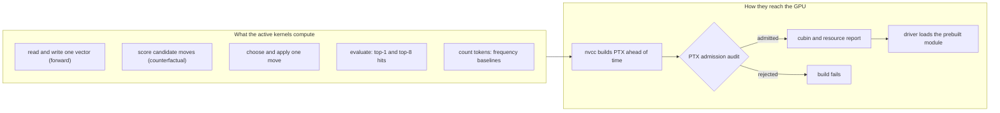

# GPUs and CUDA

The project trains and tests its model on graphics cards (GPUs), not on the laptop's processor. The programs that run on a GPU are called kernels, and the project writes them in CUDA, NVIDIA's language for GPUs. Every kernel is compiled before it runs. For the active model, an audit reads the compiled result and refuses instructions the project has banned: decimal arithmetic, tensor-core matrix instructions and approximate exponentials. The cards are rented by the hour from a marketplace through one script, under hard limits on how many and how much. The rented GPUs are used for qualification runs and a few short training doses. No trained language model has come out of them yet.

Labels used below: **proof** means derived from definitions or code, **measurement** means a recorded run, **hypothesis** means an untested idea. See [`docs/formal_vocabulary.md`](../formal_vocabulary.md) and the [glossary](../start/glossary.md).

*The kernel map. Source files compile to PTX before anything runs, and the audit sits between compiling and loading. There is no run-time compiler.*

## The kernels and what they compute

The active model is `crates/uor-r4-discrete`, and its kernels are integer only. The header of [`discrete.cu`](../../crates/uor-r4-discrete/src/discrete.cu) says model values use gather, sign, add and subtract, comparison and finite action-table look-ups, and that storage indexing uses integer products. It has 577 lines and 12 entry points:

| Kernels | What they compute |
|---|---|
| `discrete_init`, `discrete_encode`, `discrete_export_token_cells` | Set up the vector table from a seed, encode token numbers as vectors, export each token's address cells |
| `discrete_forward` | The read (route, flock or relation) and the shared writer: predictions, losses and traces |
| `discrete_counterfactual` | Score candidate moves in 16 fixed lanes, without changing the model |
| `discrete_choose`, `discrete_apply`, `discrete_validate` | Pick the best proposal, commit one move, check the state |
| `discrete_evaluate`, `discrete_evaluation_aggregate` | Top-1 and top-8 hits, with all arithmetic and denominator checks done on the GPU |
| `discrete_count`, `discrete_count_score` | Count token frequencies and rank them: the simple count baselines a model is compared with |

Five more modules are generated from `discrete.cu` at build time, each its own source, PTX and cubin, so the earlier images stay byte for byte unchanged: a diagnostic decomposition, baseline reuse, row-parallel scoring (`rows`, 3 entry points), scoring several coordinates per launch (`rowsk`, 5) and selecting and committing a set of moves (`bvgk`, 8). The build also writes exact geometry tables from the core crate: `AXES[512]`, `COMPOSE[4096]`, `INVERSE[64]`, 16 carrier roots, a breadth-first reachability map and 15 generators ([`build.rs`](../../crates/uor-r4-discrete/build.rs)).

Other CUDA code in the repository is not on the active path:

| File | Lines | Status |
|---|---:|---|
| `uor-r4-training/src/cuda_stack.cu` (22 kernels: Hamilton gate, rate select, normalisation, quaternion and recurrence scans, margin ranking, Adam update) | 859 | Held. Float, for offline training under D37 |
| `spiralcore_fbs.cu`, `starling_native.cu` | 183, 134 | Held. The SpiralCore/FBS float projection and the flock-style selector |
| `third_party/candle-kernels-0.9.2` (nine tensor modules) | 1,778 | Comparator. Patched to drop exp, log, sigmoid, tanh, erf, GELU, SiLU, softmax and RoPE |
| Upstream and D29-excluded kernels under `historical/` and `docs/history/` | 10,877 | Never compiled. Kept as evidence |

Line counts are raw counts of the files named.

## How a kernel is admitted

**Compile ahead of time (definition).** The build script calls `nvcc -ptx -std=c++17 -arch=compute_NN`, where `NN` is the card's capability from the explicit `UOR_NVCC_ARCH` setting. NVIDIA's run-time compiler, NVRTC, is banned project-wide (D29, amended 13 October): what `nvcc` compiles at build time is exactly what the driver may load, and banned code present in a module counts even if never launched ([D29](../integration/DECISIONS.md#d29--no-banned-mechanism-in-any-compiled-or-loaded-module-vendor-runtime-content-counts)). Two older pages, the [CUDA training runbook](../compute/cuda-training.md) and the [pods quickstart](../compute/pods-quickstart.md), still describe NVRTC. They were written before the ban.

**The admission audit (proof by inspection of the code).** The audit reads the emitted PTX text, not the CUDA source, so a banned instruction cannot hide behind spelling. It strips comments, splits each line into tokens, and rejects the build if any token has a component named `f16`, `f16x2`, `f32`, `f64`, `bf16`, `bf16x2`, `tf32`, `e4m3`, `e5m2`, `mma`, `wmma`, `wgmma`, `tcgen05`, `tensor` or `tensormap`, or starts with `ex2.approx`. It also requires the set of `.entry` points to equal the declared inventory exactly: a missing, extra or duplicate entry fails. A self-test runs on every build. It must accept a clean module (floats inside comments are fine) and must reject `add.f32`, a `.bf16` register, `mma.sync`, `ex2.approx`, an unexpected entry, a duplicate entry and missing entries. After admission, the same admitted PTX is assembled into a cubin for each of the six modules, and the build fails if the cubin is empty or its resource report is missing.

**What it does not say.** Integer multiplies are allowed in these kernels, for example to compute indexes. The serving contract allowed no multiply instruction at all until D80 and D81 (28 Oct 2026). It now allows the scalar integer multiply and divide, and still bans float ([serving and export](./serving-and-export.md)). The float training crate has no equivalent PTX audit, since float is legal there, and uses precision flags instead (`-ftz=false -prec-div=true -prec-sqrt=true`, and `--fmad=false` for the flock selector). Passing the audit shows which instructions are present. It does not show that a kernel computes the right thing. Correctness comes from separate controls on a pod.

**Not in continuous integration.** No GitHub workflow mentions `nvcc` or CUDA. The standing checks compile without the `cuda` feature, and qualification runs on rented pods. For exact-head compile checks there is a recipe, [`scripts/pod/uor-cuda-check-remote`](../../scripts/pod/uor-cuda-check-remote). It rents one fresh RTX 5090 with CUDA 12.8 for 15 minutes (30 for the training crate), runs `cargo check` and then `clippy`, and tears the pod down ([compute guide](../labs/compute.md)). It is compile and lint only, never a model run.

## Renting the cards

The rules are written in [`docs/labs/compute.md`](../labs/compute.md) and printed by `uor-pod` itself.

| Rule | What it says |
|---|---|
| One tool | Every pod action goes through `scripts/pod/uor-pod`. Nobody rents by hand |
| Provider | Vast.ai is the default since 13 October ([D26](../integration/DECISIONS.md#d26---vastai-is-the-default-provider-for-new-pods)). Runpod is an emergency backup: `up --wait` falls back to it after 30 minutes with no Vast offer, and choosing it by hand needs `--owner-approved` |
| Hosts | Verified datacenter hosts only, with CUDA 12.8 or newer. Community hosts are not used, because their operator would hold the disk and the access token |
| Ladder | RTX 5090 first, then 4090, then RTX PRO 6000. A100, H100 and larger are refused without owner approval |
| Caps | At most 4 running pods and $8 an hour, counting both providers together |
| Leases | Each session leases the GPUs it uses, renews at least every 30 minutes, and releases when done. Another session's GPU is never yours, even idle; only an expired lease may be taken over |
| Jobs | One job per GPU, run detached under a lock, with a log ending in `# exit=N` |
| Safety net | A pod-side reaper deletes a pod with no live lease after 20 idle minutes |
| Results | `down` copies the run, job, pod and evaluation folders off the pod first, or uploads them to the private store. Pods are not kept as storage |
| No fallback | If no GPU is free and the caps are reached, wait or ask the owner. Never run model work on the laptop CPU |

The laptop does non-model work: editing, compiling CPU-only builds, static checks and grading stored outputs. All model compute is GPU work (D24). Serving a finished model on the user's own device is a separate matter and is allowed ([charter](../../CHARTER.md), section 3.6).

**Measured costs.**

- On 13 October a verified datacenter RTX 5090 on Vast cost $0.469 an hour, against $1.19 an hour on Runpod. A fresh Vast pod took its toolchain, crate cache and binaries from the private store and was ready in 57 seconds, with nothing built (**measurement**, [compute guide](../labs/compute.md)).
- The 19 October A8 dose ran on a Vast pod with two RTX 5090s at $1.816 an hour for about 62 minutes: about $1.9. That is a resource estimate, not an invoice, and storage and transfer were not measured. The owner typed the release for each arm personally ([record](../labs/a8-dose-2026-10-19/README.md)).
- Scoring 16 candidate moves in one launch took a median 123.57 ms, against 125.51 ms for scoring one. All 5,130 coordinates matched the reference exactly, and a deliberately broken copy failed as it should. The earlier launch used only 8 of the card's 170 multiprocessors ([record](../labs/bvgk-rowsk-scoring-2026-10-18/README.md)). **Measurement**, at that one shape.
- One full pass over every parameter of the discrete model is projected at about 17.8 hours for the route read and 19.2 for the flock read, roughly $16 to $17. That is an **unverified projection**, not a run ([record](../../archive/labs/discrete-driver-cost-2026-10-13/README.md)).
- A fused memory kernel claimed to be 12 times faster was never run on the pod, and its commit broke the build and was reverted. No measurement survives ([record](../../archive/labs/fused-memory-kernel-2026-10-11/README.md)).

## Where it stands

| Item | State | Kind | Source |
|---|---|---|---|
| Active kernels and PTX admission | Built and qualified on pods. The 19 October A8 dose trained two arms and was stopped for diagnosis, which the record says is not a mechanism negative | measurement | [A8 record](../labs/a8-dose-2026-10-19/README.md), [discrete crate](../../crates/uor-r4-discrete/README.md) |
| NVRTC | Banned and removed from the active path | status | [D29](../integration/DECISIONS.md#d29--no-banned-mechanism-in-any-compiled-or-loaded-module-vendor-runtime-content-counts) |
| Float training kernels | Held, with no PTX audit | status | [compute guide](../labs/compute.md) |
| Training | Goes through the lab's own pre-run review (D67); D41's donor pass is the named owner-at-dispatch exception | status | [A8 record](../labs/a8-dose-2026-10-19/README.md), [charter](../../CHARTER.md) §5.1 |
| CUDA in CI | None; qualification is on pods | status | `.github/workflows/` |
| A trained language model from these GPUs | **Exists and has closed M1**: the saved discrete pair passes all six bars at two seeds; useful conversation remains unqualified | measurement | [M1 close](../labs/m1-close-saved-model/README.md), [project track](../integration/project-track.md) |

## Go deeper

- Mechanism pages: [discrete learning](../mechanisms/discrete-learning.md), [SpiralCore and FBS](../mechanisms/spiralcore-fbs.md), [Hamilton gate](../mechanisms/hamilton-gate.md).
- Code: [`discrete.cu`](../../crates/uor-r4-discrete/src/discrete.cu), [`build.rs`](../../crates/uor-r4-discrete/build.rs), [`scripts/pod/uor-pod`](../../scripts/pod/uor-pod).
- Guides: [pod rules](../labs/compute.md), [CUDA training runbook](../compute/cuda-training.md) (older, pre-dates the NVRTC ban), [pods quickstart](../compute/pods-quickstart.md).
- Next pages: [serving and export](./serving-and-export.md), [data and tokenizer](./data-and-tokenizer.md). Model pages: [architecture](./architecture.md), [training](./training.md).
