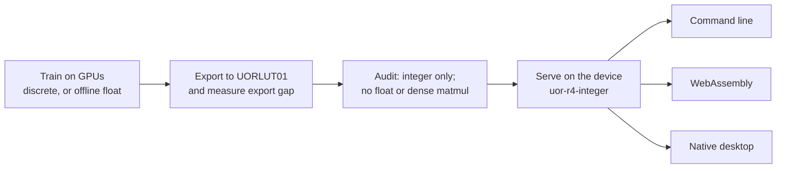

# The language model

The core product is a language model: a program that reads text and predicts what comes next, so it
can eventually hold a conversation. UOR-R4 tries to do that with geometry and exact memory rather
than a transformer's dense arithmetic. It is meant to ship as one `UORLUT01` integer file that an
ordinary laptop or browser can run without floating-point arithmetic. **M1 is complete, but that
product does not ship yet.** No model holds a useful conversation and no alpha release exists.

Labels: **proof** (derived from definitions or code), **measurement** (a recorded run), and
**hypothesis** (untested). See [`docs/formal_vocabulary.md`](../formal_vocabulary.md) and the
[glossary](../start/glossary.md).

*Training happens offline on a GPU. The exported integer artifact is the product boundary.*

## What the model is meant to be

**A geometric autoregressive state model with exact addressed memory.** Prime addresses, zeta
phases, E8/H4/icosian rotations and SpiralCore/FBS routing replace transformer machinery. Exact
identity remains separate from geometric address. Conversation with durable memory comes first,
then coding and reasoning, on one model.

**Fast and local.** The lead metric is tokens per second on ordinary hardware, with context and
decode reported separately. A small quality gap is acceptable if the model is much cheaper.

**Integer at serving.** D11 bans floating point and transcendental arithmetic and excludes dense
matrix multiplication. Since D80 and D81 it allows the hardware integer multiply and divide. Offline
training may use float under D37, but every float candidate must report its export gap and ship as
an integer artifact.

## What exists now

The M1 closing artifact is antigravity-110's discrete `trunk-joint-pointer-v1-d11`, a 19-table
`uor-r4.lut-discrete-trunk/1` model saved as two seeded `UORLUT01` files. It is not the separate
float-trained FBS `lut-stack/5` trunk.

| Test | Seed 1 | Seed 2 | Controls |
|---|---:|---:|---|
| DEV integer top-1 | **7,002 / 14,287** | **7,001 / 14,287** | unigram 1,226; T2 6,300 |
| Fresh V2 integer top-1 | **7,215 / 14,479** | **7,228 / 14,479** | unigram 1,279; T2 6,582 |
| p-f held-out phrasing | **7,850 / 15,953** | **7,872 / 15,953** | unigram 1,409; T2 7,375; band 81 |
| Apple M1 decode | **10,876 tok/s** | **10,566 tok/s** | median; 192-token prefill, 64-token decode |

Both seeds have exact export/reference agreement and pass B4. These results close M1
([#2029](https://github.com/UOR-Foundation/uor-r4/issues/2029)), with the older close grade for
bars (a)–(e) and claude-211's panel score for bar (f).

**The limitation is part of the result:** 62.5% of p-f's reference replies are verbatim TRAIN
replies. M1 shows reading new prompt phrasings into known reply kinds, not new reply kinds or useful
conversation.

## Two model paths, not one joined model

- **The discrete path** produced the M1 artifact. It trains integer geometric state and exports
  through table-native `UORLUT01` schemas.
- **The float-trained FBS trunk** trains offline under D37 and exports exactly under `lut-stack/5`
  at DEV scope. It is the current complete-reply research line, not the M1 artifact.

Claude-217's cycle-step experiment ends every registered loop but leaves content underpowered, so
greedy remains the decode. Exact turn memory keys on exact first token ids and misses reworded
prompts ([claude-217](../loop/tasks/one-model-end-to-end/claude-217/REPORT.md)). Claude-218 found
trunk-state keys offline; [claude-219](../loop/tasks/one-model-end-to-end/claude-219/REPORT.md)
then served the point key for the first reply token in free generation on fresh p-v. It improves
templates by +13/+8/+12 and exact replies by +9/+8/+12 at three seeds, but reaches only 12–18% of
the forced-opening lift. Next, train and serve it in one integer model and score it end to end.
This is not a useful-chat result.

## The artifact format and serving boundary

`UORLUT01` begins with an 8-byte magic string and a JSON header, then aligned integer data sections.
The reader checks offsets and lengths and computes the file's SHA-256 as it loads, so a release can
pin that identity ([`format.rs`](../../crates/uor-r4-integer/src/stack/format.rs)). Table-native
schemas now include `lut-discrete/1`, `lut-discrete-trunk/1` and the FBS `lut-stack` contracts; the
older dense `/1`, `/2` and `/3` schemas are not a description of today's M1 artifact.

The serving engine is [`crates/uor-r4-integer`](../../crates/uor-r4-integer/). It serves native and
WebAssembly artifacts, with save/restore formats such as `UR4SESS1`. An engine audit proves the
absence of refused instructions, not model quality. M4 still requires the accepted model's full
quality, session and distribution path.

## The eight milestones in plain words

| # | Meaning | Current state |
|---|---|---|
| M1 | **It predicts text.** Six bars through the saved integer model, including fresh and held-out-phrasing transfer | **Complete** |
| M2 | **It answers from memory.** ≥256/512 complete correct DEV replies and ≥40% fresh | In progress |
| M3 | **It remembers across sessions.** Provenance, correction, abstention, reset and restart | In progress |
| M4 | **It is served.** Accepted model, export gap, quality, CLI, session and audits | Not complete; accepted model path not started |
| M5 | **It is cheap on a laptop.** Latency, memory, energy and selected access measured | Not started |
| M6 | **It reasons and codes.** Frozen tasks with executable oracles and causal ablation | Not started |
| M7 | **It runs everywhere the same.** Library, CLI and browser parity plus client-only Studio | Runtime/harness on synthetic stand-in; accepted model open |
| M8 | **It is released.** One versioned, checksum-pinned artifact meeting M1–M7 | Not started |

M4's quality work includes a lawful likelihood (`PRLL`), but GPU held-out scoring remains open. M1
does not select the M2/M3/M4 model automatically, and an engine audit alone closes no milestone.

## Historical models and open questions

The four 214M-parameter checkpoints on Hugging Face predate today's rules and used softmax and
matrix multiplication. They are historical evidence, not the D11 product. K16's 65 and 463 of
14,287 were also important negative results, but they predate the M1 close.

Open questions now centre on complete generation rather than M1:

- Can exact memory key a reworded known question so a new phrasing starts the right reply?
- Can one joined model produce complete correct replies and durable memory, then pass M4's full
  serving path?
- What are the full-path latency, memory traffic and energy per token? M5 has not measured them.
- Can library, CLI and browser produce bit-identical tokens and sessions on the accepted model?

## Go deeper

- [Model architecture](../model/architecture.md), [training](../model/training.md), and [serving and export](../model/serving-and-export.md).
- [Releases and artifacts](./releases-and-artifacts.md) for format, checksums and the future M8 release.
- [M1 close](../labs/m1-close-saved-model/README.md) and [bar-f report](../loop/tasks/m1-heldout-phrasing-transfer/claude-211/REPORT.md).
- Code: [`crates/uor-r4-discrete/`](../../crates/uor-r4-discrete/) and [`crates/uor-r4-integer/`](../../crates/uor-r4-integer/).
- The one [PLAN](../../PLAN.md) and the long-form [project track](../integration/project-track.md).
