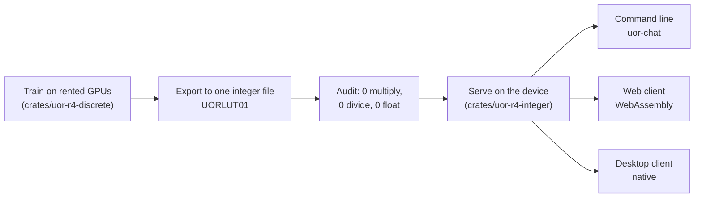

# The language model

The core product is a language model: a program that reads text and predicts what comes next, and so can hold a conversation. Most language models today are transformers that do billions of decimal multiplications per word. UOR-R4 tries a different route. It predicts text with geometry (prime-number addresses, rotations in four dimensions, exact look-up memory), and it ships as one file of whole numbers that an ordinary laptop or browser can run with whole-number arithmetic only, never decimals. That file is meant to be the one thing every client loads. **It does not ship yet.** As of 29 Oct 2026 the project is pre-alpha, 0 of the 8 milestones are complete, and no model holds a useful conversation ([NOW](../integration/NOW.md)). Nothing ships until a trained model passes M1 to M8.

Labels used below: **proof** (derived from definitions or code), **measurement** (a recorded run with its artifact), **hypothesis** (untested). See [`docs/formal_vocabulary.md`](../formal_vocabulary.md) and the [glossary](../start/glossary.md).

*The model's life in one line. Training happens once, offline, on a GPU. Everything after the export runs on the user's machine using whole numbers only.*

## What the model is meant to be

**A geometric model, not a transformer.** The project calls it the UOR-R4 Geometric Language Model. Technically it is an autoregressive geometric state model with exact addressed memory: it keeps a running state, updates it with each token through rotations and table look-ups, and reads facts from an exact memory by address ([architecture](../model/architecture.md)). The charter forbids the expensive parts of a transformer outright: no softmax or other squashing functions and no dense matrix multiplication, anywhere: training, evaluation, tooling and serving ([charter](../../CHARTER.md), sections 3.2 and 3.3).

**One model for every job.** Conversation with durable memory comes first, then coding and reasoning, all on the same model ([charter](../../CHARTER.md), section 1).

**Fast and local.** The lead metric is tokens per second on an ordinary machine, with decode and context reported separately. A small quality gap is acceptable if the model is much cheaper to run.

## How it will be delivered

The deliverable is **one checksum-pinned D11 integer artifact in the `UORLUT01` format**, released at milestone M8 ([project track](../integration/project-track.md), M8).

- **D11** is the serving contract. Its five rules are: no floating point or maths library (R1); no multiply or divide instruction (R2, amended by D80 and D81 on 28 Oct 2026, which allow the integer multiply and divide); reading every weight for every token is an interim stage, not the end state (R3; the charter no longer treats dense table maps as an allowed stepping stone for new exports); no transformer backbone (R4); energy claimed only when measured (R5) ([D11](../integration/DECISIONS.md#d11--native-multiplier-free-transformerless-serving-for-every-lab-d10-superseded)).
- **`UORLUT01`** is the file format. It holds an 8-byte magic string, a JSON header, 4-bit weight codes in groups with one scale byte each, and small integer tables for the few nonlinear steps ([`format.rs`](../../crates/uor-r4-integer/src/stack/format.rs); **proof** by reading the code). The reader computes the SHA-256 hash of the whole file as it loads it, so a release can pin that hash. Details are on the [releases page](./releases-and-artifacts.md).
- **Training may use decimals; serving may not.** Since 18 October, offline training may use floating point, but the shipped file is integer, and every float-trained candidate must report its *export gap*: its served score minus its float score on the same evaluator ([D37](../integration/DECISIONS.md#d37--floating-point-is-legal-in-offline-training-only-d32s-learning-path-float-ban-is-revised), [charter](../../CHARTER.md) section 3.7).
- **The engine is `crates/uor-r4-integer`.** It runs the file natively (the `uor-chat` and `uor-r4-stack` command-line programs) and as WebAssembly (`UOR-Foundation/uor-r4#2654`). The [serving page](../model/serving-and-export.md) shows how it multiplied without a multiply instruction before D80, and how it uses the hardware multiply now.

## Status today

| Question | Answer | Kind | Source |
|---|---|---|---|
| Does a trained model exist in `UORLUT01` under today's rules? | No model that holds a conversation. A float-trained trunk (FBS) has been exported to integers, on the DEV panel only (claude-180 to 182), and serves, but it is not the product | measurement | [lut-serving dossier](../mechanisms/lut-serving.md); [pipeline map](../model/pipeline-map.md) |
| Does the serving engine work? | Yes, on a synthetic stand-in model: native audit 44 symbol ranges clean; WebAssembly 7 of 7 serving functions clean; save and restore reload identically | measurement | [project track](../integration/project-track.md) M4; [WebAssembly record](../labs/wasm-serving-runtime-2026-10-18/README.md) |
| Is the engine exact? | On older float models it reproduced its float reference almost exactly: engine difference 2.7e-7 BPB on a matched 512-window check | measurement | [criterion-2 record](../../archive/labs/criterion2-protocol-pin-2026-10-09/README.md) |
| What model is being trained? | The discrete model in `crates/uor-r4-discrete`, integer from end to end on the GPU | — | [training](../model/training.md) |
| How far is it? | M1 is in progress; the reply bar is suspended and M1 closes on the charter 4.8 bar through the saved-model path (D79). In the latest two-seed run (K16, 18–19 October) the best arm and seed reached top-1 of 463 of 14,287 development rows, and no arm met its bars | measurement | [K16 outcome call](../labs/k16-outcome-call-2026-10-19/README.md) |
| Is training running? | Runs go ahead on the lab's own pre-run review. The latest line, 27 to 29 Oct, trains the FBS trunk on GPUs | — | [charter](../../CHARTER.md) section 5.1 |

### Where it stands on 29 Oct 2026

- **Pre-alpha.** No model holds a useful conversation. M1 is in progress and no registered closing run has passed the charter 4.8 bar.
- **Served in integers.** The FBS trunk is exported and served in integers on the M1 laptop at 4,829 tok/s (claude-177, snapped; 4,217 to 4,504 tok/s with the exact `lut-stack/5` contract), with byte-identical replies.
- **No typed chat yet.** R7, the text path, is not built: FBS artifacts take token ids only.
- **The composition, briefly.** The trunk routes (a learned table, SpiralCore position, a recurrence with a Hamilton gate, Hamming copy heads) and exact turn memory stores. Exact memory names 598.7 and 598.3 of DEV's 1,226 reply openings at two seeds, but only the first word of a reply (claude-161). The full part-by-part table is the [pipeline map](../model/pipeline-map.md).
- **Order of work.** First carry the memory past a reply's first word. Then serve the model's parts in integers. Then R7, so a typed question gets a typed reply. Then one model trained with all of it and scored on prompts, with tokens/s. Cost work comes after. See [PLAN](../../PLAN.md).

For scale, the M1 closing bar asks the exported model's integer top-1 to beat two simple count tables on the same panel, the unigram table (1,226 of 14,287) and the successor table (6,300 of 14,287), on two seeds ([charter](../../CHARTER.md), section 4.8). The K16 run was graded on the model's own evaluator, not through the export, so the comparison is a rough guide only.

**What about the models on Hugging Face?** The four 214M-parameter checkpoints in `caseyallard/uor-r4-geometric-214m` are **historical**. They are float models trained before the softmax and matmul bans. Their measured results were TinyStories validation NLL 1.032 and FineWeb development NLL 2.90 → 2.073; the chat versions could rewrite and summarize but got code and arithmetic wrong ([model card](https://huggingface.co/caseyallard/uor-r4-geometric-214m), the Hugging Face model card). They are not the D11 product.

**An earlier export of a float stack missed its bar.** On 10 October three 29M-parameter float models were exported and served exactly by D11, at 1.20 to 1.24 bits per byte, far from the 0.90 target. The record puts the gap in the model, not the engine ([D11 serving record](../../archive/labs/d11-serving-2026-10-10/README.md); **measurement**).

## The eight milestones in plain words

Each milestone is a GitHub milestone with an issue. The bars are frozen there; the [project track](../integration/project-track.md) still shows the old M1 bar (0.90 BPB through the D11 export) and has not yet been updated, so charter section 4.8 governs. Changing any bar is the owner's decision.

| # | Plain meaning | Bar, briefly | Issue |
|---|---|---|---|
| M1 | **It predicts text.** A saved discrete model passes its admission and occupancy checks on two seeds, and through the integer export beats both count tables | Charter 4.8 bars (a)–(e), including a fresh pre-registered transfer panel | #2029 |
| M2 | **It answers from memory.** It replies correctly using facts stored in exact memory | ≥ 256 of 512 complete correct replies on development, ≥ 40% on a fresh panel | #2030 |
| M3 | **It remembers across sessions.** It tracks where a fact came from, accepts corrections, abstains on unknown facts, resets, and survives a restart | All five memory checks; a saved and restored session continues token for token | #2031 |
| M4 | **It is served.** The chosen model is exported to `UORLUT01` and served by the command line | Audits at 0; export gap reported; ≤ 0.90 BPB held out plus the M1–M3 bars through `uor-chat`; bit-identical continuation after restore | #2032 |
| M5 | **It is cheap on a laptop.** Its real cost is measured | ms per token, peak memory, mJ per token, and weights read per token, all reproducible | #2033 |
| M6 | **It reasons and codes.** The same served model solves unseen multi-step and coding tasks | Frozen reasoning panel with compile-and-test oracles, plus a causal ablation | #2034 |
| M7 | **It runs everywhere the same.** Library, command line and browser give bit-identical tokens; the Studio makes no remote model calls | Parity across three hosts; WebAssembly audit 7 of 7 on the shipped model | #2035 |
| M8 | **It is released.** One versioned, checksum-pinned `UORLUT01` file meets M1–M7 | Reproducible install, release notes with the exact scores, independent check on consumer hardware | #2036 |

Two notes. First, M4's quality bar is still written in bits per byte (≤ 0.90), while M1's was changed on 19 October to a top-1 comparison; the charter says BPB returns as a later bar once the model has a lawful likelihood ([charter](../../CHARTER.md), section 4.8). Second, M4's audit criterion is already green, but it is a check on the engine, not on a model, so it cannot close M4 by itself ([project track](../integration/project-track.md), M4).

## Open questions

- What is the export gap of the discrete model through `UORLUT01`, and does the format need a new schema for table-native models rather than 4-bit dense groups? Never measured ([lut-serving dossier](../mechanisms/lut-serving.md)).
- How many of the roughly 30.2M parameters read per token in the older 29M stack can addressed reads remove before tokens per second moves? This is the D5 end state, unmeasured until M5 ([D5](../integration/DECISIONS.md#d5--per-token-parameter-sparsity-is-the-terminal-serving-invariant)).
- The engine cannot yet serve a product-key or addressed memory read; the exporter refuses it ([lut-serving dossier](../mechanisms/lut-serving.md)).

## Go deeper

- [Model architecture](../model/architecture.md), [training](../model/training.md), [serving and export](../model/serving-and-export.md).
- [Releases and artifacts](./releases-and-artifacts.md) for the file format and checksums.
- Code: [`crates/uor-r4-discrete/`](../../crates/uor-r4-discrete/) (the model being trained), [`crates/uor-r4-integer/`](../../crates/uor-r4-integer/) (the serving engine).
- [NOW](../integration/NOW.md) for this week's work; [project track](../integration/project-track.md) for the milestone definitions.
