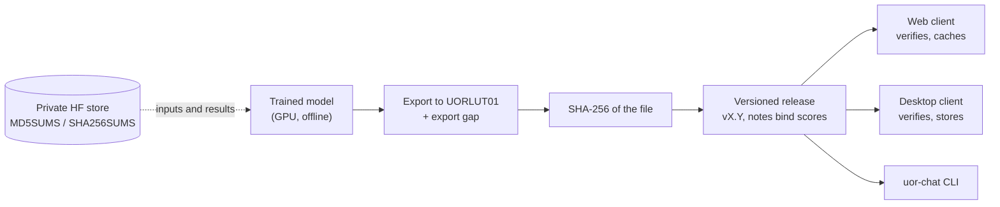

# Releases and artifacts

A release is how a finished model reaches people: a numbered version, a file you can download, and a fingerprint (a checksum) that proves the file is exactly the one that was tested. For UOR-R4 the product file is meant to be one integer-only model file in a format called `UORLUT01`, released at milestone M8. **That M8 release does not exist.** Separately, checksum-pinned research artifacts are now public on Hugging Face, including the M1 pair; they are not a qualified conversational product or M8 release. Two old software releases are on GitHub from the summer, plus one pinned-corpus data release, but both software releases belong to an earlier engine and neither is a qualified model. The release automation still targets that older engine too. This page explains the file format, the release machinery as it is, the Hugging Face repositories, and how checksums bind them together. **No product ships until a trained model passes M1 to M8.**

Labels used below: **proof** (derived from definitions or code), **measurement** (a recorded run with its artifact), **hypothesis** (untested). See the [glossary](../start/glossary.md).

*The planned path from a trained model to the clients. Every hop carries a checksum. The release box exists only as a plan for this model; the old pipeline served a different engine.*

## The model file: `UORLUT01`

`UORLUT01` is the container the integer engine reads. Its layout, from the reader [`format.rs`](../../crates/uor-r4-integer/src/stack/format.rs) (**proof** by reading the code):

- The 8-byte magic string `UORLUT01`, then the header length as a little-endian 64-bit integer.
- A JSON header with the schema name, the model's shape, the group size, numeric settings, a list of matrices and tables, the exporter's provenance (never read by the serving arithmetic), and an optional record of a trained-in rotation snap, with the SHA-256 of its root set.
- Zero padding to a 64-byte boundary, then the data sections at 64-byte-aligned offsets.
- In dense/FBS schemas, each weight matrix is stored as 4-bit codes, two per byte, with one scale byte per row and group. The scale byte holds a 4-bit mantissa $m$ and a 4-bit exponent step $d_e$, meaning a group scale of $(16+m)\,2^{\,e_{\text{base}}+d_e-4}$. M1's table-native `lut-discrete-trunk/1` instead stores named integer lookup tables and has zero 4-bit matrix sections.
- Small integer tables (16-bit or 32-bit) for the few nonlinear steps.

**Older dense schemas** are `lut-stack/1` (a softmax attention read), `/2` (adds a pointer head) and `/3` (a softmax-free flock rank read). The first two serve exp-table softmax reads, which the no-squashing rule bans, and the older family also carries SiLU/GELU tables and dense 4-bit weight maps. **Current table-native contracts include** `lut-discrete/1` and the M1 `lut-discrete-trunk/1`. The separate FBS `lut-stack/5` is a 4-bit float-to-integer stack with exact rotations, not a table-native discrete schema; `/6` carries additional read hooks. These are the formats relevant to today's saved artifacts ([lut-serving dossier](../mechanisms/lut-serving.md)).

**A built-in fingerprint.** When the reader parses a file, it computes the SHA-256 of all its bytes and keeps it with the parsed model (`format.rs`, line 557). A release can therefore pin that hash, and a client can refuse any file that does not match.

**Safe loading.** Every offset, length and product of sizes is checked, so a malformed file returns an error rather than crashing. A file that declares a product-key memory is refused outright, because the integer kernel for it is not built ([`format.rs`](../../crates/uor-r4-integer/src/stack/format.rs)).

**Saved sessions** use a separate format, `UR4SESS1`, which records a conversation's state so it can be restored byte for byte ([`session_codec.rs`](../../crates/uor-r4-integer/src/session_codec.rs)).

## The release pipeline as it is

| Piece | What it does | Fits the product? |
|---|---|---|
| [`.github/workflows/release.yml`](../../.github/workflows/release.yml) | On a pushed `v*` tag: creates a **draft** GitHub Release; builds the `r4` command-line program for Linux x86_64 and macOS arm64; builds a WebAssembly frontend with `wasm-pack`; attaches each archive with a `.sha256` file beside it | No. All three of its jobs are paused (`if: ${{ false }}`) since the legacy-crate repair (#2793, 20 October 2026): the root crate now builds only its compliant library surface, so neither the `r4` program nor the WebAssembly frontend (the retired router engine) can be built under the bans. Rewriting it for `UORLUT01` is M8 work |
| [`docs/RELEASE_PIPELINE.md`](../RELEASE_PIPELINE.md) | The release convention adopted 19 August (`#741`): a tag `vX.Y` binds the code SHA, the inference-contract version and BLAKE3 digests of every bundle component; the maintainer attaches the model bundle by hand and publishes the draft; users install with `r4 install-release`, which verifies it | No. The document itself says it is a preserved reference for the older graph-engine (R4G1) bundle, not the product's pipeline |
| `src/release_install.rs`, `release_bundle_packager.rs`, `release_bundle_loader.rs` | Package and install the schema-2 R4G1 bundle | No. R4G1, not `UORLUT01` |

Source: reading `release.yml` and the repository tree. This audit did not confirm that a tag build passes today.

**The two software releases on GitHub are historical.** `v0.1` (19 August 2026) attached `r4` binaries, a WebAssembly frontend and a model bundle compiled from a pinned SmolLM2-360M-Instruct snapshot, a converted transformer that the current serving rules exclude. `v0.1.0-alpha` (8 September 2026) is marked a pre-release: its notes say the alpha qualification was withdrawn after a recovery audit found the claims unsupported, and it is kept only for historical reproducibility. Neither is a release of the geometric model. A third GitHub release, "D3 pinned corpus: simple-wiki-20231101-sample" (29 July 2026), is a data release, not a model (release pages on `UOR-Foundation/uor-r4`, read 19 October 2026).

**The owner has decided to repair the legacy crates, not archive them.** The root crate and four others are to be repaired so that they build on the current core. Repairing restores the build only; their old mechanisms stay parked ([charter](../../CHARTER.md), section 2.4). A repaired build would let `release.yml` run again, but it would still package the wrong format until it is changed.

## What an M8 release must contain

The M8 bar is "one versioned, checksum-pinned `UORLUT01` artifact" that meets the frozen bars of M1 to M7, with "reproducible installation, release notes binding the exact measured scores and known limitations, and independent verification on consumer hardware" ([project track](../integration/project-track.md), M8; issue `#2036`). Read as a checklist, it is a plan, not existing work:

1. **The model file** with its SHA-256, plus the tokenizer it was trained with.
2. **Release notes** that bind the code SHA, the file hash, the tokenizer, the training data and seed, every measured score with its panel, the export gap, and the known limits. The charter requires every artifact to bind its data, seed, configuration, parameters and format (section 3.12).
3. **Binaries:** `uor-chat` for each platform and the WebAssembly bundle, each with a `.sha256`, and each re-passing its engine's serving audit. Every audit refuses float. The FBS stack's audits (`uor-r4-stack` and the WebAssembly serving surface) also refuse vector and matrix multiplies, while D80 and D81 allow scalar integer multiply and divide. Any separate legacy `uor-chat` audit is reported under that engine's own rules, not as a current project-wide zero-multiply rule. At last count the audits covered 44 native symbol ranges and 7 of 7 WebAssembly functions ([project track](../integration/project-track.md), M4).
4. **The Studio**, published to `/studio` on the documentation site ([charter](../../CHARTER.md), section 2).
5. **Independent verification** on consumer hardware.

Missing today: a release workflow for `UORLUT01`, WebAssembly and desktop packaging of the integer engine in that workflow, and one inference contract. Two contracts still coexist: [`docs/inference_contract.md`](../inference_contract.md) for the older R4G1 runtime, and D11 rules R1 to R5 for the product ([D11](../integration/DECISIONS.md#d11--native-multiplier-free-transformerless-serving-for-every-lab-d10-superseded)).

## Hugging Face repositories

| Repository | Visibility | What it holds | Status |
|---|---|---|---|
| [`caseyallard/uor-r4-m1-model`](https://huggingface.co/caseyallard/uor-r4-m1-model) | Public (model, MIT) | The M1-closing 19-table discrete trunk pair, 86,536,132 and 84,943,328 bytes, with stack-bound tokenizers | **Current research artifact.** Studio top-8 next-token prediction, not chat; not an M8 product release |
| [`caseyallard/uor-r4-m1-discrete`](https://huggingface.co/caseyallard/uor-r4-m1-discrete) | Public (model, MIT) | Four-table Stage-T base exports and tokenizer | Earlier discrete research artifacts, not the closing M1 pair |
| [`caseyallard/uor-r4-fbs-dual-c131`](https://huggingface.co/caseyallard/uor-r4-fbs-dual-c131) | Public (model, MIT) | Separate trained FBS trunk pair and tokenizers | Research artifacts; no trained token writer, so the Studio does not generate from them |
| [`caseyallard/uor-r4-geometric-214m`](https://huggingface.co/caseyallard/uor-r4-geometric-214m) | Public (model, MIT) | Four 214M-parameter float checkpoints: `base-tinystories`, `base-planA`, `chat-planA-b8`, `chat-smoltalk-b16`, with configs, sanitized run reports and the byte-level BPE tokenizer | **Historical.** Trained before the softmax and matmul bans; not the D11 product |
| [`datasets/caseyallard/uor-r4-data`](https://huggingface.co/datasets/caseyallard/uor-r4-data) | Public (dataset, MIT plus CDLA-Sharing-1.0) | Project-generated data: the tokenizer, the memory-dialogue sets `mw-balp` and `mw-orcp` with the fine-tune manifest, the dev split, conversational panels, TinyStories tokenized for the native learner | Live data |
| `caseyallard/uor-r4-store` | Private | The labs' working store: `data/*` (about 2.7 GB, checked against `MD5SUMS`), base models, pinned toolchain and crate-registry archives, project binaries `bin/<sha>` with `SHA256SUMS`, pod setup, and `results/<lab>/<topic-date>/` | Working store; never a release channel |

The historical model and data repositories were published on 9 October 2026. DeepSeek's #3445 records the three public research-model releases, their exact bytes and SHA-256 pins, and the Studio's explicit-click M1 download ([report](../loop/tasks/m7-studio-live-model-sources/deepseek-3/REPORT.md)); [compute guide](../labs/compute.md) covers the private working store.

## How checksums tie it together

| Where | Checksum | What it proves |
|---|---|---|
| `UORLUT01` load | SHA-256 of the whole file, computed by the reader | The file is byte-identical to a pinned release |
| Rotation snap in the header | SHA-256 of the root set, checked against the engine's constant | The model was trained against the same exact geometry the engine uses |
| `release.yml` assets | `.sha256` beside each archive | The download is intact |
| Legacy R4G1 bundle | BLAKE3 digests per component in `release-bundle.json` | Historical only |
| Private store data | `MD5SUMS` | A pod's inputs match the store |
| Project binaries in the store | `SHA256SUMS`, plus a recorded parity pass | A prebuilt binary is the one that was checked |
| Archived records | `SHA256SUMS` files | Archived evidence is unchanged |
| Results in iCloud | MD5 round-trip on upload | The copy matches the original |

A checksum proves integrity: the bytes are the ones that were pinned. It does not prove who made them, and it says nothing about model quality.

## Go deeper

- [Language model](./language-model.md) for the M1 to M8 path; [products overview](./README.md).
- [Serving and export](../model/serving-and-export.md) for the engine and the export gap.
- [Integer serving dossier](../mechanisms/lut-serving.md).
- [Compute guide](../labs/compute.md) for the private store and `uor-store`.
- [Charter](../../CHARTER.md), sections 2, 3.6 and 3.12.
