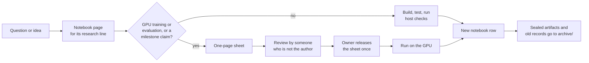

# How research is done now

UOR-R4 is a research project, and for months it ran research the heavy way: one folder per pull request, a written plan before almost every step, and a review before each run. In the week of 12 to 18 October only 11% of the recorded lab work was a model result (see [history](./history.md)). Since 19 October 2026 the owner's charter keeps the rigour but drops the bulk. Each line of research has one notebook page with one row per result. A written plan is required only before a GPU run or a run that a milestone claim rests on. Old records are kept, untouched, in `archive/`.

*The path of one piece of work. Only the right-hand branch needs a sheet, a FIT review and the lab's pre-run review.*

Terms follow the [glossary](../start/glossary.md). Claims are labelled **proof**, **measurement** or **hypothesis** as defined in [`formal_vocabulary.md`](../formal_vocabulary.md). The rules below are the research clauses of the [charter](../../CHARTER.md); section numbers point there.

## The working rules

**One notebook per research line (charter §5.6).** A *line* is one sustained question, such as "how the discrete model reads context". Its notebook lives at `docs/research/notebook/<line>.md`. Each result is one row: date, what ran, the number, the bar it was tested against, the verdict and a link to the artifact. A dated evidence folder is kept only when a run seals artifacts. The one plan for the whole project is [`PLAN.md`](../../PLAN.md); with the notebooks and rendered STATE/HANDOFF, it replaces the old running log (`current-state.md`).

**A sheet only where it decides spend (§4.5).** A *sheet* is a pre-registration of one page: the bar, the noise, the controls, the seeds, the cost and what each outcome would decide. It needs a review by a non-author, called a FIT review, before:

- any GPU training or evaluation, and
- any run that a milestone claim rests on.

A fresh-context subagent counts as a non-author. Builds, finite kernel tests and host checks need no sheet. Old float sheets come back only as new sheets with a new FIT. A FIT review releases nothing by itself.

**A pre-run review for each run (§5.1, D67).** A GPU or training run goes ahead on the lab's own whole-project pre-run review, inside the caps. D41's donor pass is the named owner-at-dispatch exception; there is no blanket owner release for every sheet. Labs stage the commands and check the records.

**Mechanism statuses (§4.1).** Every mechanism is **ACTIVE** (on the model path), **READY** (built and tested but not yet trained in) or **PARKED** (the tested forms failed or broke a rule). A PARKED page lists what would reopen it. There is no terminal status. The [mechanism board](../mechanisms/README.md) shows the current state. This is the rule from decision D22 (a negative closes a configuration, never a mechanism).

**What a verdict closes.** A negative result closes the exact tested configuration: the recipe, dose, window, key and objective. It never closes the mechanism, and stopping a novel mechanism takes an owner decision. A run that meets its own pre-registered mechanism target without a significant headline loss is a KEEP, and the work iterates. A tooling or numerical failure is a blocker to fix, not a negative. Source: D22 sections 1 and 2 in [`archive/integration/DECISIONS-2026-10-19.md`](../../archive/integration/DECISIONS-2026-10-19.md).

**Instrument first (§4.2).** Before calling a result, decide whether the check itself is faulty. An instrument defect is a fix, never a negative. No target is set from a vacuous instrument, and no single number rules out a line. [Findings](./findings.md) shows why: a metric that read zero, a control that checked zero rows and a typed-in number each misled the project once.

**Power and transfer (§4.3).** A decisive run uses at least two seeds or at least 200 fresh rows. Its bar is never narrower than the measured noise. The mechanism must be trained in, not bolted on. Every gain on a development panel is reported together with a fresh transfer number.

**Controls and pivots (§4.4).** Compare against lawful non-neural baselines, which today means count tables. After three results on one line that do not move its headline number, write a pivot note: stop, or run one decisive test.

**Plain verdict words.** *NOT_RUN* means nothing ran; it is not a pass. *UNAVAILABLE* means a needed input was missing; it is not a negative. A passing test is not trained capability, and a passing control is not a language result (§4.6).

**Preserve everything (§4.7).** Nothing is deleted. Negatives, unique source and other labs' work go to the archive, byte-identical.

## The lines of research

The research line that is current is the FBS trunk line, which carries the model's replies. See the [pipeline map](../model/pipeline-map.md) for the two model paths. Four labs work in the loop (claude, antigravity, deepseek and kimi). Its results since 27 Oct are in [what the project knows](./findings.md).

The catalog groups its 1,173 records into 20 lines. The ten largest are below. Counts are catalog records, which mix lab records and lane results, so they show where effort went and not how many experiments ran.

| Line (catalog id) | Records | First to last date | What it covers |
|---|---:|---|---|
| `native-geometric-sept` | 294 | 31 Jul to 28 Sep | The September native Rust geometric model and its memory and attention variants |
| `m1-discrete-attention` | 199 | 7 Aug to 19 Oct | The discrete model path: reads, address cells and the K16 and A8 runs |
| `harness-governance` | 185 | 24 Jul to 19 Oct | Research tooling, rules and process |
| `m2-exact-memory` | 151 | 3 Sep to 12 Oct | Exact memory and grounded replies |
| `geometric-stack-pretraining` | 84 | 20 Sep to 11 Oct | The deeper float "geometric stack" trained on GPUs |
| `r4g1-transformerless` | 74 | 21 Jul to 27 Sep | The first compile-a-teacher-into-tables work |
| `m4-serving` | 42 | 7 Aug to 18 Oct | Integer serving (decision D11) |
| `m1-float-rung0` | 38 | 31 Aug to 13 Oct | The float route to the first milestone rung (rung 0) |
| `m3-durable-memory` | 33 | 3 Oct to 18 Oct | The durable-memory session and evaluator |
| `compute-ops` | 15 | 3 Sep to 18 Oct | Pod and GPU operations |

Source: `archive/catalog.jsonl` (fields `line`, `date`), counted with `jq`. The remaining ten lines hold 14 records or fewer each. The descriptions come from the line names and milestone titles, not from a field in the catalog. Every line becomes a notebook page as it is touched.

## Where old records live

Every dated record before 18 October 2026 now sits under `archive/`, at the same relative path it had under `docs/`, except the reference documents that stayed in `docs/` (such as `docs/scaling_law.md` and `docs/inference_contract.md`). Records dated 18 and 19 October stay in `docs/labs/`. The archive never changes: many experiment sheets are pinned by hash, and `SHA256SUMS` files cover the records. So read an archived record as a faithful copy of the day it was written, including any claim that was corrected later.

To find a record, use the generated index [`archive/CATALOG.md`](../../archive/CATALOG.md), with the same data in [`archive/catalog.jsonl`](../../archive/catalog.jsonl). Its columns are date, lab, line, milestone, mechanism, verdict and path. It also holds the old-path to new-path map, so an old link still resolves. The catalog is an index, not a verdict. Follow its path and read the record before you rely on a number.

## Go deeper

- [What the project knows](./findings.md): the lessons and the measured results behind them.
- [What is still open](./open-questions.md): the tests nobody has run and the cheapest decisive ones.
- [How the project got here](./history.md): five phases and 32 eras, 10 June to 15 October.
- [Mechanism board](../mechanisms/README.md) and the [charter](../../CHARTER.md).
- [`NOW.md`](../integration/NOW.md) for the current plan, and [`docs/harness/README.md`](../harness/README.md) for the research harness.
