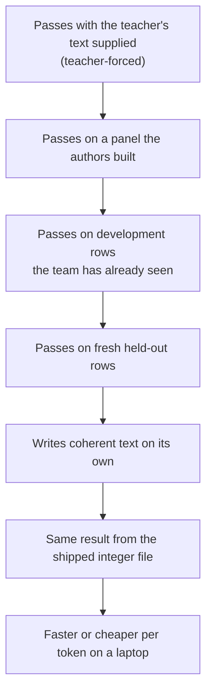

# What the project knows

The project's record holds more lessons about what misleads than results about what works. The most useful knowledge is a set of 21 lessons, mostly about how to measure honestly, plus a short list of measured results. The honest summary is this. Several lawful parts exist and have passed their finite tests. No model on the current path has learned language: the best trained discrete model sits below a simple count table. The cause is not yet established.

*The ladder a result must climb before it counts as capability. The project has repeatedly stopped at the first three steps (lessons 3 and 4 below).*

## How to read this page

- `#N` is issue or pull request N in `UOR-Foundation/uor-r4`. Each lesson cites the items it came from.
- The lessons come from the audit's reading of the GitHub archive, items [#1](https://github.com/UOR-Foundation/uor-r4/issues/1) to [#2495](https://github.com/UOR-Foundation/uor-r4/issues/2495). Some items were read in full and some by title only (`docs/labs/repo-renormalization-2026-10-19/audit/eras/eras.json`, field `notes`). Check the item before you rely on a number.
- Each lesson records something that happened at a stated scope, so each is a **measurement** of that case. Where a lesson generalises, the generalisation is a **hypothesis**, and it never closes a mechanism (decision D22).
- Mechanism names use the statuses ACTIVE, READY and PARKED. See the [mechanism board](../mechanisms/README.md).

## The 21 lessons, by theme

The numbers are the audit's own, so you can trace a lesson back to its era in the [history](./history.md). Lessons are grouped by theme, so their numbers are not in order; other pages cite them by number.

### Check the measurement first

1. **Check the instrument before trusting a result.** A metric that read 0.0000 hid a real loss (the #99 metric, removed by the revert [#102](https://github.com/UOR-Foundation/uor-r4/issues/102)). An outside check on the same text differed from the pipeline's own score by about a factor of three, 11.17 against 3.84 bits per token ([#300](https://github.com/UOR-Foundation/uor-r4/issues/300)). Typed-in numbers were once merged as results ([#1459](https://github.com/UOR-Foundation/uor-r4/issues/1459)). A lookup-table gain was retracted as a constant shift ([#1881](https://github.com/UOR-Foundation/uor-r4/issues/1881)). A control that checked zero rows reported a pass ([#2112](https://github.com/UOR-Foundation/uor-r4/issues/2112)).
2. **Measure the shipped form.** The trained model and the shipped artifact differed by 0.57 bits per byte (BPB) ([#1284](https://github.com/UOR-Foundation/uor-r4/issues/1284)).
3. **A teacher-forced or authored-panel pass is not coherent generation.** Loss kept falling while prose stayed at 0 of 5 ([#948](https://github.com/UOR-Foundation/uor-r4/issues/948), [#1264](https://github.com/UOR-Foundation/uor-r4/issues/1264), [#1398](https://github.com/UOR-Foundation/uor-r4/issues/1398)).
4. **Development is not fresh.** A frozen-upstream adapter scored 437 of 512 on rows the team had seen, then 0 of 128 on a fresh draw ([#2162](https://github.com/UOR-Foundation/uor-r4/issues/2162), [#2164](https://github.com/UOR-Foundation/uor-r4/issues/2164)).
15. **A gate set before a run does not move after a miss, and a missing input is not a negative.** Frozen floors survived every re-entry ([#887](https://github.com/UOR-Foundation/uor-r4/issues/887), [#931](https://github.com/UOR-Foundation/uor-r4/issues/931)). An *UNAVAILABLE* report is not a zero ([#661](https://github.com/UOR-Foundation/uor-r4/issues/661), [#986](https://github.com/UOR-Foundation/uor-r4/issues/986)).

### What geometry bought and what it did not

6. **Fixed geometry usually tied or lost to a matched ordinary control.** This held for W(3,3) ([#929](https://github.com/UOR-Foundation/uor-r4/issues/929)), for the project's geometric mechanisms as of September ([#1371](https://github.com/UOR-Foundation/uor-r4/issues/1371)) and for fixed E8 or H4 codebooks against k-means ([#1456](https://github.com/UOR-Foundation/uor-r4/issues/1456)). Kept exceptions: quaternion transport ([#1460](https://github.com/UOR-Foundation/uor-r4/issues/1460)), quaternion and icosian weights ([#2193](https://github.com/UOR-Foundation/uor-r4/issues/2193), [#2216](https://github.com/UOR-Foundation/uor-r4/issues/2216)) and seed reliability ([#1798](https://github.com/UOR-Foundation/uor-r4/issues/1798)).
7. **Some geometry wins were storage or lexical artifacts.** A zeta-grid headline was storage banding ([#440](https://github.com/UOR-Foundation/uor-r4/issues/440)); see also [#487](https://github.com/UOR-Foundation/uor-r4/issues/487).
8. **Exact algebra reproduces perfectly but carries no meaning on its own.** H4 and the 64-state SpiralCore worked as controls and supplied no semantics ([#952](https://github.com/UOR-Foundation/uor-r4/issues/952), [#985](https://github.com/UOR-Foundation/uor-r4/issues/985)).
19. **Shift-and-add stores and E8 codebooks beat sign codes at equal bits** ([#243](https://github.com/UOR-Foundation/uor-r4/issues/243), [#395](https://github.com/UOR-Foundation/uor-r4/issues/395)).

### Data and scale

5. **Data and teacher breadth beat model size and clever stores.** On broad text the ceiling was the teacher ([#437](https://github.com/UOR-Foundation/uor-r4/issues/437)). Matching the training distribution beat adding parameters ([#1913](https://github.com/UOR-Foundation/uor-r4/issues/1913)).

### Memory and retrieval

9. **An exact log plus a prime sieve retrieves; the learned pointer copied recency.** The pointer returned the most recent value, not the queried one ([#1558](https://github.com/UOR-Foundation/uor-r4/issues/1558)). The sieve did the retrieval ([#1559](https://github.com/UOR-Foundation/uor-r4/issues/1559), [#1607](https://github.com/UOR-Foundation/uor-r4/issues/1607)).
10. **Chat failures came from missing knowledge and fluency, not retrieval.** Retrieval accounted for 2.2% of failing rows ([#1708](https://github.com/UOR-Foundation/uor-r4/issues/1708)).
11. **Compliance needs a demand paired with its exact short answer.** Instruction following was 0 of 6 until each demand was paired ([#1918](https://github.com/UOR-Foundation/uor-r4/issues/1918), [#1958](https://github.com/UOR-Foundation/uor-r4/issues/1958)).
17. **Exact integer export and bit-exact serving work** ([#1254](https://github.com/UOR-Foundation/uor-r4/issues/1254), [#1893](https://github.com/UOR-Foundation/uor-r4/issues/1893)).

### Learning

12. **Hard geometric selection gives unselected keys no gradient.** It needs a training bridge ([#2195](https://github.com/UOR-Foundation/uor-r4/issues/2195), [#2249](https://github.com/UOR-Foundation/uor-r4/issues/2249)).
18. **State and horizon were the levers, not training length** ([#1366](https://github.com/UOR-Foundation/uor-r4/issues/1366), [#1379](https://github.com/UOR-Foundation/uor-r4/issues/1379)).
20. **Binding failures came from the training recipe, not the architecture.** A copied reference cell scored 99.17% where the bundled recipe failed ([#1045](https://github.com/UOR-Foundation/uor-r4/issues/1045), [#1050](https://github.com/UOR-Foundation/uor-r4/issues/1050)).

### Speed and cost

13. **Savings counted on paper are not tokens per second.** Analytic multiply savings did not become speed ([#2200](https://github.com/UOR-Foundation/uor-r4/issues/2200), [#2211](https://github.com/UOR-Foundation/uor-r4/issues/2211)). Integer serving first cost 4.3 times more energy than its float parent (on a dense model with every multiply replaced by a table read) ([#1449](https://github.com/UOR-Foundation/uor-r4/issues/1449)).
14. **Check where compute goes.** The output readout took 99.97% of per-token compute ([#1287](https://github.com/UOR-Foundation/uor-r4/issues/1287)). Geometric operations were 0.05% of the stack's arithmetic ([#2186](https://github.com/UOR-Foundation/uor-r4/issues/2186)).

### How to work

16. **Keep dormant mechanisms behind gates; never delete them** ([#515](https://github.com/UOR-Foundation/uor-r4/issues/515), [#1747](https://github.com/UOR-Foundation/uor-r4/issues/1747)).
21. **A process that forbids running code produces nothing** ([#1111](https://github.com/UOR-Foundation/uor-r4/issues/1111)). **A negative closes a configuration, never a mechanism** ([#2165](https://github.com/UOR-Foundation/uor-r4/issues/2165)).

## Key measured results

All rows are **measurements** unless the row says otherwise. Terms in the first row: top-1 is the right next word ranked first; T2 is a context-free table of the most common next word; admission is the shortlist of candidate cells the read can see (see [what is still open](./open-questions.md#how-the-output-head-works-in-two-lines)). Records dated before 18 October now live under `archive/labs/`.

| Result | Scope and caveat | Source |
|---|---|---|
| Best trained discrete model: top-1 of 65 and 463 of 14,287 development rows. Unigram table 1,226; context-free successor table (T2) 6,300 | Two seeds of the K16-A run. Both fail the admission gate (2,237 and 3,167 against 4,894). A configuration negative, no KEEP | [K16 outcome](../labs/k16-outcome-call-2026-10-19/README.md); [host diagnostics](../../archive/labs/host-diagnostics-2026-10-17/README.md) |
| Aliasing does not explain that ranking failure | Training broke much of the aliasing (ceiling about 9,000 rows), yet top-1 stayed at 65 and 463. Ranking capacity, the read and the schedule stay open | [K16 outcome](../labs/k16-outcome-call-2026-10-19/README.md) |
| The seeded start had at most 16 distinct vectors | The alias ceiling at start was 1,986 rows. A configuration flaw, not a proven cause | [K16 outcome](../labs/k16-outcome-call-2026-10-19/README.md); [A2 diagnosis](../../archive/labs/a2-pilot-diagnosis-2026-10-14/README.md) |
| Address cells raised admission from 127 to 1,351 of 3,847 rows at zero training. After training it fell to 551, against a control at 857 | Learning eroded the placement | [pre-flight](../labs/address-cells-preflight-2026-10-19/README.md); [A8 dose](../labs/a8-dose-2026-10-19/README.md) |
| The prime-zeta construction gives 4,096 of 4,096 tokens unique vectors | A construction check, not a language result | [construction](../../archive/labs/prime-zeta-construction-2026-10-14/README.md) |
| Four full K16 runs of 16,404 batches accepted 407, 130, 410 and 129 moves. One pass sees 1,049,856 of 2,425,925 targets (43.3%, **proof** by arithmetic) | A pass touches under half of the training split | [NOW.md](../integration/NOW.md); [discrete learning](../mechanisms/discrete-learning.md) |
| The row-parallel proposal is about 56 times faster (55.6 and 56.9) | One RTX 5090; non-gating timing, not qualified | [rows parity](../labs/counterfactual-rows-parity-2026-10-18/README.md) |
| Old float geometric stack: 0.877 BPB float and 0.933 served, against the old 0.90 bar. The float cell used 512 windows and the served cell 64, so the pair is not comparable (protocol pin, 9 Oct; the criterion is recorded as not met and not claimable). The charted models reached 1.20 to 1.24 | Trained with softmax, SiLU and matmul; serving read every weight per token. `STATUS.md` also records 0.886838 BPB for a 19.9M stack at 512 windows, under a different protocol | [D11 serving](../../archive/labs/d11-serving-2026-10-10/README.md); [stack](../mechanisms/geometric-stack.md) |
| Best softmax-free read (arm W): +0.0172 BPB float, +0.0166 served, 15% slower (195.2 against 228.4 tokens/s). Verdict REJECT | Its gradient used a softmax straight-through surrogate and a CPU fallback. Closes the configuration only | [softmax-free read](../../archive/labs/softmax-free-read-2026-10-10/README.md) |
| Starling read: recall 0.329 against 0.999 for softmax | Target not met; trained against a dense teacher; retention fails by eviction as context grows ([#2239](https://github.com/UOR-Foundation/uor-r4/issues/2239)) | [starling tree](../../archive/labs/starling-tree-2026-10-12/README.md) |
| E8 memory replacing half the feed-forward blocks: 0.033 BPB worse than the dense control (inside its +0.05 bar) at about 10 times fewer operations; learned product keys beat the fixed E8 addresses by 0.023 | Used a sigmoid gate and 2,000 CPU steps; PARKED | [E8 memory](../../archive/labs/e8-orbit-memory-2026-10-11/README.md) |
| Quaternion transport beat identity by 0.071 and 0.077 nats at 1,000 updates | Confounded: softmax attention, a sigmoid gate, dense MLPs, and 332,928 fewer parameters in the identity arm | [transport attribution](../../archive/integration/transport-attribution-d1-2026-09-28.md) |
| The exact store scored 1.000 whenever its register was right | That the same holds for a learned read is a **hypothesis**; none exists yet | [exact memory](../mechanisms/exact-memory.md) |
| The integer engine is bit-exact and float-free: 44 native symbol ranges and 7 of 7 WebAssembly serving symbols pass the serving audit (multiplier-free until claude-177, which uses the allowed integer multiply and divide) | No lawful trained model has been exported, so the export gap is unmeasured | [WASM runtime](../labs/wasm-serving-runtime-2026-10-18/README.md) (7 of 7); [project track](../integration/project-track.md) (44 native ranges) |

## Go deeper

- [What is still open](./open-questions.md) and [how the project got here](./history.md).
- The audit's long form: `docs/labs/repo-renormalization-2026-10-19/audit/synthesis.md` (stitching map and shortest path) and `docs/labs/repo-renormalization-2026-10-19/audit/eras/eras.md` (the lessons with their eras).
- [Archive catalog](../../archive/CATALOG.md) for every dated record.
