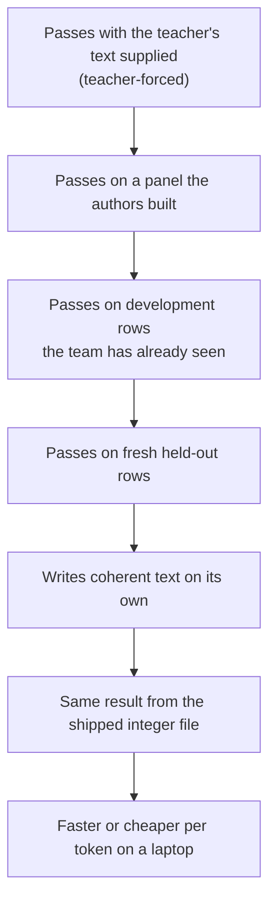

# What the project knows

The project now has one measured milestone result beside its longer record of measurement lessons:
**M1 is complete**. A saved discrete model beats both count tables on two seeds through its integer
export, on DEV, Fresh V2 and held-out phrasing. It is not useful chat. The broader lesson remains:
the difference between a construction check, a panel result and a working product is where most
mistakes happen.

*M1 reaches the saved integer-file panel result. It does not by itself establish coherent generation, full product parity or cost.*

## How to read this page

- `#N` is issue or pull request N in `UOR-Foundation/uor-r4`. Each lesson cites its source.
- The 21 lessons came from the audit's reading of items up to #2495. Newer M1 and generation
  evidence is listed separately below.
- Each lesson is a **measurement** at a stated scope; a generalisation is a **hypothesis**. A negative
  closes a configuration, never a mechanism.
- Mechanism names use ACTIVE, READY and PARKED. See the [mechanism board](../mechanisms/README.md).

## The 21 lessons, by theme

### Check the measurement first

1. **Check the instrument before trusting a result.** A metric that read 0.0000 hid a real loss
   (#99/#102), an outside check differed by about three times (#300), typed-in numbers were once
   merged as results (#1459), and a zero-row control once reported a pass (#2112).
2. **Measure the shipped form.** The trained model and shipped artifact differed by 0.57 BPB
   (#1284). The M1 close therefore uses the integer `UORLUT01` artifact, not only a training score.
3. **Teacher-forced or authored-panel success is not coherent generation.** Loss fell while prose
   stayed at 0 of 5 (#948, #1264, #1398).
4. **Development is not fresh.** A frozen-upstream adapter scored 437/512 on seen rows, then 0/128
   on a fresh draw (#2162, #2164).
15. **A gate set before a run does not move after a miss, and a missing input is not a negative.**
   Frozen floors survived re-entry (#887, #931), and UNAVAILABLE is not zero (#661, #986).

### What geometry bought and what it did not

6. **Fixed geometry usually tied or lost to a matched ordinary control.** This held for W(3,3)
   (#929), September's mechanisms (#1371), and fixed E8/H4 codebooks against k-means (#1456). Kept
   exceptions were quaternion transport (#1460), quaternion/icosian weights (#2193, #2216) and seed
   reliability (#1798). M1 is a whole-model result, not proof of each mechanism independently.
7. **Some geometry wins were storage or lexical artifacts.** A zeta-grid headline was storage
   banding (#440; also #487).
8. **Exact algebra reproduces perfectly but carries no meaning on its own.** H4 and the 64-state
   SpiralCore supplied controls, not semantics (#952, #985).
19. **Shift-and-add stores and E8 codebooks beat sign codes at equal bits** (#243, #395).

### Data and scale

5. **Data and teacher breadth beat model size and clever stores.** On broad text the ceiling was
   the teacher (#437), and matching the training distribution beat adding parameters (#1913).

### Memory and retrieval

9. **An exact log plus a prime sieve retrieves; the learned pointer copied recency.** The pointer
   returned the most recent value (#1558); the sieve did the retrieval (#1559, #1607). The newer
   true-address oracle is 80/80 against 0/80 no-memory and 20/80 sieve, but that is still oracle scope.
10. **Chat failures came from missing knowledge and fluency, not only retrieval.** Retrieval
   accounted for 2.2% of failing rows in the older analysis (#1708).
11. **Compliance needs a demand paired with its exact short answer.** Instruction following was 0
   of 6 until each demand was paired (#1918, #1958).
17. **Exact integer export and bit-exact serving work** (#1254, #1893), and the M1 pair has exact
   14,287-row export agreement with B4 pass.

### Learning

12. **Hard geometric selection gives unselected keys no gradient.** It needs a training bridge
   (#2195, #2249).
18. **State and horizon were the levers, not training length** (#1366, #1379).
20. **Binding failures came from the training recipe, not the architecture.** A copied reference
   cell scored 99.17% where the bundled recipe failed (#1045, #1050).

### Speed and cost

13. **Savings counted on paper are not tokens per second.** Analytic multiply savings did not become
   speed (#2200, #2211). Integer serving first cost 4.3 times more energy than float on a dense model
   (#1449).
14. **Check where compute goes.** The output readout took 99.97% of per-token compute (#1287), and
   geometric operations were 0.05% of an older stack's arithmetic (#2186).

### How to work

16. **Keep dormant mechanisms behind gates; never delete them** (#515, #1747).
21. **A process that forbids running code produces nothing** (#1111). **A negative closes a
   configuration, never a mechanism** (#2165).

## Key measured results

All rows are **measurements** unless noted. Top-1 is the right next token ranked first; T2 is a
context-free successor table. See [open questions](./open-questions.md) for what remains unknown.

| Result | Scope and caveat | Source |
|---|---|---|
| **M1 complete:** DEV 7,002 / 7,001 of 14,287 against unigram 1,226 and T2 6,300 | Two seeded discrete `UORLUT01` artifacts; exact export agreement and B4 pass | [M1 close](../labs/m1-close-saved-model/README.md) |
| Fresh V2: 7,215 / 7,228 of 14,479 against unigram 1,279 and T2 6,582 | Paired band 82 at both seeds | [Fresh transfer](../labs/m1-fresh-panel-transfer/README.md) |
| p-f: 7,850 / 7,872 of 15,953 against unigram 1,409 and T2 7,375, band 81 | New prompt phrasings at K = 1,024; 62.5% of reference replies are verbatim TRAIN, so known reply kinds, not new reply kinds or chat | [bar-f report](../loop/tasks/m1-heldout-phrasing-transfer/claude-211/REPORT.md) |
| Apple M1 decode 10,876 / 10,566 tok/s | Median, 192-token prefill and 64-token decode; native, not browser | [bar-f report](../loop/tasks/m1-heldout-phrasing-transfer/claude-211/REPORT.md) |
| Exact-address oracle 80/80 against 0/80 no-memory and 20/80 sieve | Exact-read/oracle scope only; not learned address formation or M3 | [exact memory](../mechanisms/exact-memory.md) |
| FBS `lut-stack/5` inside the export-gap bar at DEV | Separate float-trained path from the M1 model; not a joined model | [claude-182](../loop/tasks/d11-exporter-float-trunk/claude-182/REPORT.md) |
| Cycle step ends every registered loop, but content is underpowered and greedy remains the decode | Loop suppression alone is not a quality result | [claude-217](../loop/tasks/one-model-end-to-end/claude-217/REPORT.md) |
| p-s reply openings 17.4%, 13.7%, 18.6% against about 80% on later tokens | Exact-key memory misses new phrasing | [claude-217](../loop/tasks/one-model-end-to-end/claude-217/REPORT.md) |
| Offline teacher-forced key probe: sign +46/+37/+33 on p-u's 1,218 missed rows; point +125/+185/+114 | Claude-218 selected the cheapest passing sign key before the free-generation test; claude-219 then reversed that next step on fresh evidence | [claude-218](../loop/tasks/one-model-end-to-end/claude-218/REPORT.md) |
| Free-generation point-key opening: template +13/+8/+12 and exact +9/+8/+12 on fresh p-v | Partial gain at three seeds; 27–31% correct keyed openings and 12–18% of the forced-opening lift. Sign key inconclusive at this panel size; real TRAIN integer export and end-to-end score open | [claude-219](../loop/tasks/one-model-end-to-end/claude-219/REPORT.md) |
| In-model served point key: templates +41/+40/+42 and exact replies +39/+40/+43 on fresh p-w | All three seeds with exact claude-219 parity; recall of TRAIN replies, not generalization. Float GPU evaluation, not integer speed; integer follow-on below | [claude-220](../loop/tasks/one-model-end-to-end/claude-220/REPORT.md) |
| Integer point table, search and `/8` record built | 380 library tests, 18 negative gates and a full serving audit; synthetic only | [claude-222](../loop/tasks/point-key-integer/claude-222/REPORT.md) |
| Integer panel decode and grade built | 383 integer-library tests, 185 float-library tests, 13 negative gates and a full serving audit; no real export or panel run | [claude-224](../loop/tasks/point-key-integer/claude-224/REPORT.md) |
| Retention recurrence and artifact flag built | 386 integer-library tests, 186 float-library tests, nine negative gates and a full serving audit; implementation only, parity below | [claude-226](../loop/tasks/integer-retention-rates/claude-226/REPORT.md) |
| Retention GPU parity PASS | Retained artifact: 1,531 / 1,536 sequences and 4,023 / 4,096 single tokens, both within the 3% bar; decay control 17 and 84. Row 0 instrument fault below; no tok/s yet | [claude-227](../loop/tasks/integer-retention-rates/claude-227/REPORT.md) |
| Run reference/read-back/BOS instruments built | 390 integer-library tests with one ignored, four negative gates and a full serving audit; row 0 instrument fault below | [claude-228](../loop/tasks/point-key-integer/claude-228/REPORT.md) |
| Real run: row 0 instrument fault | Integer uses native writer, not trained whole-table nearest; every grade pair is (0, 0). No mechanism verdict or tok/s. [Claude-231](../loop/tasks/integer-nearest-readout/claude-231/REPORT.md) built the nearest readout; greedy parity missed every cell in claude-232; the p-x rerun waits on localization | [claude-229](../loop/tasks/point-key-integer/claude-229/REPORT.md) |
| Nearest readout and export built | 395 integer-library tests with one ignored, seven negative gates and full serving/WASM audits; native and browser paths. Nearest decode 1,365 tok/s and prefill 1,405 tok/s, about 2.85× writer cost; claude-232 missed parity in every cell; p-x rerun waits on localization | [claude-231](../loop/tasks/integer-nearest-readout/claude-231/REPORT.md) |
| K16-A: 65 and 463 of 14,287 below unigram 1,226 and T2 6,300 | Dated configuration negative, not the current best | [K16 outcome](../labs/k16-outcome-call-2026-10-19/README.md) |
| Older float geometric stack: 0.933 BPB served against an old 0.90 bar | Used softmax, SiLU and matmul; historical model, not the D11 product | [D11 serving](../../archive/labs/d11-serving-2026-10-10/README.md) |
| Older dense table-emulated products cost about 4.3× the energy of float | One dense model under an older serving rule; not an M5 measurement of the accepted model | [#1449](../../archive/history/github-archive-2026-10-15/markdown/1449-roadmap-measured-energy-the-oversight-audit-reconciliation-i.md) |

## Go deeper

- [What is still open](./open-questions.md) and [how the project got here](./history.md).
- The audit's long form: `docs/labs/repo-renormalization-2026-10-19/audit/synthesis.md` and
  `docs/labs/repo-renormalization-2026-10-19/audit/eras/eras.md`.
- [Archive catalog](../../archive/CATALOG.md) for every dated record.
