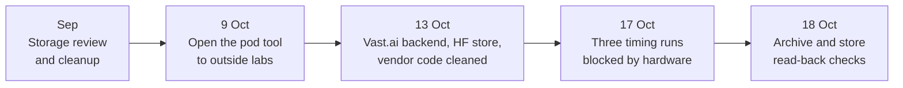

# Research line: GPU and pod operations

Training and scoring run on rented GPUs, and every rental has to be started, checked, paid for and shut down without losing results. This line is the plumbing: the pod tool, its tests, the switch to a cheaper provider, and the guards that stop a run on the wrong machine. It contains no model result. Its blocked records are the clearest example of a run that fails for operational reasons and says nothing about the model.

| | |
|---|---|
| **Catalog id** | `compute-ops` |
| **Time span** | 3 Sep to 18 Oct 2026 |
| **Milestone** | None for 11 records; M1 for 4 |
| **Records** | 15 |
| **Outcomes** | ops 9 · blocked 3 · tooling 2 · review 1 |
| **State** | Active support work. Vast.ai is the default provider (D26); Runpod is an emergency backup |

Counts: `archive/catalog.jsonl`. Terms follow the [glossary](../../start/glossary.md); ACTIVE, READY and PARKED are defined on the [mechanism board](../../mechanisms/README.md).

*Each step makes a rented run easier to start or harder to lose.*

## What it set out to do

Make GPU work cheap, repeatable and safe. The rules are owner rules: touch pods only through the project's `uor-pod` tool, keep to the cost caps, save durable output off the pod before it is destroyed, and never use the laptop CPU for research model compute. Serving the exported artifact on the user's own device is the product and is allowed (charter §3.6).

## What happened, in order

1. **September.** A read-only storage review deleted nothing ([review](../../../archive/integration/storage-review-1094.md)). An owner-authorized cleanup recovered about 21.6 GiB of regenerable caches and debug dependencies, and preserved models, research, binaries and downloads ([cleanup](../../../archive/integration/storage-cleanup-2026-09-20.md)).
2. **9 Oct.** Hard-coded account details were removed from the pod tool so outside contributors can rent GPUs. Its dry-run suite reached 240 of 240 with 16 new checks; two timing-flaky tests were fixed so the suite passed in 10 of 10 runs under load, where the unfixed version failed 6 of 6 ([open pods](../../../archive/labs/open-pods-2026-10-09/README.md), [deflake](../../../archive/labs/pod-test-deflake-2026-10-09/README.md)).
3. **13 Oct.** A missing import in a CUDA-only test broke every pod's parity check; adding it restored 43 passing parity tests at a cost of about $0.05 ([record](../../../archive/labs/cuda-parity-gate-import-2026-10-13/README.md)). The tool gained a Vast.ai backend at about half Runpod's price for the same card: an empty RTX 5090 pod reached a CUDA build and passed 38 of 38 parity tests in 137 s at $0.469 per hour ([Vast](../../../archive/labs/vast-provider-2026-10-13/README.md)). Pods now fetch toolchains from a private Hugging Face store; a warm pod is ready in 57 s against 330 s cold ([store](../../../archive/labs/pod-hf-store-2026-10-13/README.md)). Vendored CUDA and Rust dependencies were cleaned of banned code (cuBLAS, softmax and tanh kernels, matmul crates) and 31 of 31 finite controls passed, at an observed cost estimate of $1.23 ([vendor boundary](../../../archive/labs/d29-vendor-boundary-2026-10-13/README.md)).
4. **17 Oct.** Three timing attempts stopped before running anything: the rented GPU had driver 580.105.08 instead of the admitted 580.95.05, then driver 595.71.05, then the right driver on a different physical GPU than the one qualified. Each recorded zero instrument invocations ([first](../../../archive/labs/counterfactual-baseline-reuse-controls-2026-10-17/README.md), [third](../../../archive/labs/counterfactual-baseline-reuse-timing-uuid-blocker-2026-10-17/README.md)). An opt-in setting now allocates only hosts advertising one exact driver ([driver-aware selection](../../../archive/labs/driver-aware-pod-selection-2026-10-17/README.md)).
5. **18 Oct.** The tool checks a per-file checksum manifest of the laptop archive, and reads uploaded results back from the store, before it destroys a pod ([archive verify](../../labs/pod-laptop-archive-verify-2026-10-18/README.md), [store read-back](../../labs/pod-store-readback-2026-10-18/README.md)).

## Key results

| Result | Kind | Source |
|---|---|---|
| Vast.ai pod from empty to CUDA build and parity 38/38 in 137 s at $0.469/h | measurement | [Vast](../../../archive/labs/vast-provider-2026-10-13/README.md) |
| Warm pod ready in 57 s against 330 s cold | measurement | [store](../../../archive/labs/pod-hf-store-2026-10-13/README.md) |
| Vendored code cleaned of banned kernels; 31 of 31 finite controls pass | measurement | [vendor boundary](../../../archive/labs/d29-vendor-boundary-2026-10-13/README.md) |
| Three timing attempts blocked by hardware; zero timed pairs | measurement | [uuid blocker](../../../archive/labs/counterfactual-baseline-reuse-timing-uuid-blocker-2026-10-17/README.md) |

## What it taught

A blocked run is a tooling or environment fault to fix, not a negative result (decision D22: a negative closes a configuration, never a mechanism), and a wrapper that refuses a wrong GPU protects the value of the measurement. One missing import silently broke every pod's gate, which is lesson 1 again: check the instrument first (see [what the project knows](../findings.md)). Save results off the pod before it goes.

## Current state

Active, and a support line for every milestone. Pod admission also runs the banned-mechanism check (D29: compiled GPU modules may hold only allowed operations) in place of a CPU-reference test that no longer compiles ([pod gate](../../../archive/labs/pod-gate-d29-2026-10-13/README.md)).

**Go deeper:** the [generated catalog page](../../../archive/catalog/compute-ops.md) lists all 15 records.
