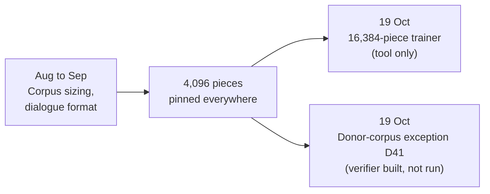

# Research line: data and tokenizer

A language model never sees letters. It sees numbered pieces of text, and it learns from whatever text it is given. This line holds the small set of records about both choices: which tokenizer cuts the text, and where training text comes from. The project has used one 4,096-piece tokenizer for every current corpus, panel and model. A larger one is prepared as a tool but never trained. The newest records plan a one-time, owner-approved corpus written offline by a large open model.

| | |
|---|---|
| **Catalog id** | `data-tokenizer` |
| **Time span** | 16 Aug to 19 Oct 2026 (2 records undated) |
| **Milestone** | M1 (1 record); none for 7 |
| **Records** | 8 |
| **Outcomes** | tooling 5 · inconclusive 1 · process 1 · review 1. No model result |
| **State** | The 4,096-piece tokenizer `d36d3e87` is ACTIVE ([tokenizer](../../mechanisms/tokenizer.md)). The 16,384-piece trainer and the donor corpus are prepared, not run |

Counts: `archive/catalog.jsonl`. Terms follow the [glossary](../../start/glossary.md); ACTIVE, READY and PARKED are defined on the [mechanism board](../../mechanisms/README.md).

*Two preparations on 19 October; neither has produced a model result.*

## What it set out to do

Fix a single text-to-piece mapping so every corpus, test panel and trained file refers to the same pieces, and decide where enough good training text can come from.

## What happened, in order

1. **Corpus sizing (16 Aug).** A historical scaling-law document measured a coverage knee near 1.5 million records, then a correction said the sweep was not fixed-partition evidence and gives no estimate of the exponent ([scaling law](../../../docs/scaling_law.md)).
2. **Teacher rehearsals.** A pinned small teacher compiled a 20,000-token corpus into table-native artifacts, explicitly not a quotable quality baseline ([record](../../../archive/smollm2_teacher_baseline_320.md)). A how-to for refreshing a corpus with the frozen integer runtime alone labels the result self-distilled, kept apart from teacher-fidelity numbers ([record](../../../archive/runtime_only_compile_327.md)).
3. **Reuse audit (3 Sep).** External repositories were audited for licences and interfaces. No new dependency was admitted and matrix multiplication was rejected as a backend ([audit](../../../archive/integration/afflom-ecosystem-followup.md)).
4. **Dialogue format (26 Sep).** A contract binds training, panel and chat encoders to one tokenizer identity and a shared role format. So far only the integer session path uses it ([contract](../../../archive/integration/dialogue-protocol-contract-2026-09-26.md)).
5. **19 Oct: two preparations.** A deterministic Rust command can train a byte-level BPE tokenizer of 16,384 pieces; it does not change the active tokenizer ([trainer](../../labs/rust-bpe-trainer-2026-10-19/README.md)). Decision D41 lets one open model (gpt-oss-120b) write a training corpus offline once, then never run again for the student. The estimated production corpus of about 30 million tokens costs about $52 to $63 on one large GPU, and executing it needs a separate owner release ([D41](../../labs/d41-offline-donor-2026-10-19/README.md)). A host-only checker that validates such a corpus against its registered sheet passes 32 of 32 self-tests, with no generation run ([verifier](../../labs/distill-d1-consumer-verifier-2026-10-19/README.md)).

## Key results

| Result | Kind | Source |
|---|---|---|
| No multi-digit tokens in the 4,096-piece vocabulary; 12 of 13 numeric memory rows failed | measurement | [numeric diagnosis](../../../archive/labs/v5-numeric-diagnosis-2026-10-09/README.md) |
| Donor corpus estimate: about 30M tokens, $52 to $63 | estimate (not a measurement) | [D41](../../labs/d41-offline-donor-2026-10-19/README.md) |
| Corpus checker self-tests: 32 of 32 pass | measurement | [verifier](../../labs/distill-d1-consumer-verifier-2026-10-19/README.md) |

## What it taught

A tokenizer is a hidden hypothesis. The missing multi-digit pieces look like an obvious cause of the numeric-memory failures, but an untrained probe found that the number codec already stores two-digit values in order, so the failure sits in the learned read and emit path ([probe](../../../archive/labs/numeric-addressability-probe-2026-10-09/README.md)). A number-aware tokenizer was planned and never built or run (`docs/labs/repo-renormalization-2026-10-19/audit/mechanisms/tokenizer.json`, field `never_tested`). A data source that is borrowed, such as a teacher, sets the ceiling (lesson 5 in [what the project knows](../findings.md)). Self-distilled numbers must stay apart from teacher-fidelity numbers.

## Current state

Nothing has been trained on any tokenizer except `d36d3e87`. The never-run tests are 4,096 against 16,384 pieces, a number-aware tokenizer, and whether tokenizer choice interacts with the address placement of the discrete model. D41 releases no training hold: generating a corpus is not training the student ([scope note](../../labs/d41-scope-clarification-2026-10-19/README.md)).

**Go deeper:** the [generated catalog page](../../../archive/catalog/data-tokenizer.md) lists all 8 records.
