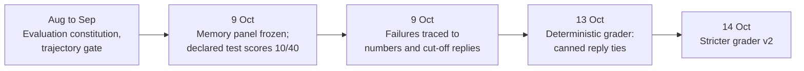

# Research line: evaluation panels and graders

A model is only as well measured as its test. This line built and audited the project's test sets (panels) and the programs that mark them (graders). Its main finding is humbling: a single canned reply scored as well as the trained chat models on the abstention half of the test, so the early "reply" scores did not show what they seemed to show. The panels are now frozen and graded by deterministic code, not by a neural judge.

| | |
|---|---|
| **Catalog id** | `eval-panels` |
| **Time span** | 7 Aug to 14 Oct 2026 |
| **Milestone** | M1 for 9 records; none for 5 |
| **Records** | 14 |
| **Outcomes** | tooling 5 · negative 3 · plan 2 · diagnostic-stop 1 · inconclusive 1 · process 1 · review 1 |
| **State** | Panels frozen. The chat-reply score (37 of 232) is suspended and is no longer the M1 headline |

Counts: `archive/catalog.jsonl`. Terms follow the [glossary](../../start/glossary.md); ACTIVE, READY and PARKED are defined on the [mechanism board](../../mechanisms/README.md).

*Each step made the test harder to fool, and each lowered the score the project could claim.*

## What it set out to do

Settle how progress is judged before more compute is spent. Two panels matter. A 64-row held-out memory panel (40 memory rows, 24 questions that cannot be answered) was drawn from public word lists and sealed with its pass bar before any model saw it. A 232-row open reply panel measures chat quality.

## What happened, in order

1. **August to September.** A committed evaluation constitution fixed content-pinned suites and leakage checks, and asserted no capability result ([constitution](../../../archive/capability_suites_832.md)). A trajectory-state diagnostic found that none of the free-running failures was state-addressable (0 per mille) ([record](../../../archive/state_trajectory_gate_842.md)). The latest evaluation-policy entry stopped a predictive block-delta test at a gain of 0.0390 against a 0.0433 floor, with no generation ([policy](../../../archive/geometric_intelligence_evaluation.md)).
2. **9 Oct: freeze, then score.** The memory panel was sealed (26 files, 26 verified), and a binding-swap control passed 0 of 40 ([freeze](../../../archive/labs/panel-freeze-2026-10-09/README.md)). The pre-declared test of a 29M chat model scored 10 of 40 against a bar of 34, and 1 of 24 on abstention, where a constant answer did better ([v5 acceptance](../../../archive/labs/v5-declared-acceptance-2026-10-09/README.md)). The 214M model's 31 of 40 reproduced exactly, even on a laptop CPU ([v4 reproduction](../../../archive/labs/v4-memory-panel-reproduction-2026-10-09/README.md)).
3. **9 Oct: why replies fail.** Of 189 failing replies, 152 (80.4%) were neither fluent nor relevant, and 125 (66.1%) ended mid-clause; 85 of those ran to the 64-token cap, and a 50% larger budget rescued only 2.4% of them. No judge-free property separated accepted replies from rejected ones. One canned greeting made up between a fifth and a quarter of the accepted rows ([open reply panel](../../../archive/labs/open-reply-panel-2026-10-09/README.md)). On numeric memory rows 12 of 13 failed, and the 4,096-piece vocabulary holds no multi-digit tokens ([numeric diagnosis](../../../archive/labs/v5-numeric-diagnosis-2026-10-09/README.md)). Judge-free checks can mark only 88 of the 232 reply rows exactly, 37.9% ([deterministic checks](../../../archive/labs/reply-panel-deterministic-checks-2026-10-09/README.md)).
4. **13 to 14 Oct.** A deterministic Rust grader replaced the neural judge. Re-scoring showed one canned abstention reply scores 40 of 88 and copying the last value ties the model at 20 of 40, so the reply headline was suspended ([grader](../../../archive/labs/m1-deterministic-reply-grader-2026-10-13/README.md)). Version 2 stopped a wrong number that contains the right digits from passing, and left old scores unchanged (11 of 96 and 15 of 96) ([grader v2](../../../archive/labs/f9-reply-grader-and-prime-zeta-complex-routing-2026-10-14/README.md)).

## Key results

| Result | Kind | Source |
|---|---|---|
| v5 memory rows 10/40 (bar 34/40); whole panel 11/64 | measurement | [v5 acceptance](../../../archive/labs/v5-declared-acceptance-2026-10-09/README.md) |
| One canned abstention reply scores 40/88 on the open panel; the model scored 1/88 | measurement | [grader](../../../archive/labs/m1-deterministic-reply-grader-2026-10-13/README.md) |
| 12 of 13 numeric memory rows failed; 0 multi-digit tokens in the vocabulary | measurement | [numeric diagnosis](../../../archive/labs/v5-numeric-diagnosis-2026-10-09/README.md) |
| 88 of 232 reply rows exactly checkable without a judge | measurement | [deterministic checks](../../../archive/labs/reply-panel-deterministic-checks-2026-10-09/README.md) |

## What it taught

Check the instrument first (lesson 1 in [what the project knows](../findings.md)). A model score means little until a constant reply and a copy rule have been scored on the same panel. A pass on a built panel is not general capability (lesson 3). The panel rules are now in the charter: lawful non-neural baselines, which today means count tables, are the standard control.

## Current state

The reply and memory panels and graders are frozen and unchanged. The M1 closing bar is now integer top-1 beating the unigram and successor tables, not chat replies ([charter](../../../CHARTER.md), item 8). The reply headline stays suspended, and the charter brings bits per byte back as a bar only once a lawful likelihood exists.

**Go deeper:** the [generated catalog page](../../../archive/catalog/eval-panels.md) lists all 14 records.
