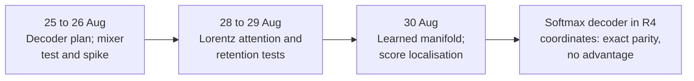

# Research line: the August geometric intelligence programme

In August the project asked a basic question: can the geometry it likes, rotations in four dimensions (R4/Spin coordinates) and hyperbolic (Lorentz) space, carry the work of attention in a language model? The programme (issue #973) reproduced ordinary attention exactly inside these coordinates, which is a useful parity check, but never found a case where the geometry did better than a plain control. This line holds its nine records. Its questions moved into the September native model.

| | |
|---|---|
| **Catalog id** | `geometric-intelligence-aug` |
| **Time span** | 25 to 30 Aug 2026 (1 record undated) |
| **Milestone** | None recorded (9 of 9) |
| **Records** | 9 |
| **Outcomes** | negative 3 · plan 2 · positive 2 · diagnostic-stop 1 · inconclusive 1 |
| **State** | Closed; superseded by the [September native model](native-geometric-sept.md). Configurations are closed, the ideas are not |

Counts: `archive/catalog.jsonl`. Terms follow the [glossary](../../start/glossary.md); ACTIVE, READY and PARKED are defined on the [mechanism board](../../mechanisms/README.md).

*Parity was achieved; advantage was not.*

## What it set out to do

Replace or enrich the standard transformer's attention with geometry from the project's own toolbox, using a small donor model (SmolLM2) as the reference. A positive result would have meant a measurable gain over a matched control that uses the same parameters and no geometry.

## What happened, in order

1. **25 to 26 Aug: a decoder plan and a mixer.** A one-layer mixer distilled from a donor layer beat a coordinate-permuted control by 4.44% against a 5% gate, verdict REDESIGN_REPRESENTATION ([record](../../../archive/geometric_mixer_qualification_951.md)). A layer-29 geometric spike passed its first gate with 32 cycle-free tokens and 4/5 on a control review, promoted to the next gate with no quality claim ([spike](../../../archive/geometric_decoder_spike_950.md)). The decoder roadmap records that its next gate (G1) ended in REDESIGN_REPRESENTATION ([plan](../../../archive/geometric_causal_decoder_plan.md)).
2. **28 Aug.** Retention with a geometric gate scored 16/28 against 23/28 for plain gated delta on a synthetic fixture ([record](../../../archive/geometric_gated_delta_retention_973.md)).
3. **29 Aug.** Intrinsic Lorentz attention was stopped before held-out data. Its covariance residual was 9.12e-8 against a frozen ceiling of 1e-8, and the curved arm trailed the flat one ([record](../../../archive/intrinsic_lorentz_r4_attention_973.md)). A learned Lorentz manifold had cross-entropy 7.71 against 4.48 for a flat Euclidean arm and 3.67 for the donor ([record](../../../archive/helm_d_learned_manifold_r4_construction_973.md)).
4. **30 Aug.** A tangent value readout was 1.0644 times worse than a normalised-centroid readout, and a plain Euclidean score beat the Lorentz score as a diagnostic ([record](../../../archive/helm_d_score_centroid_localization_973.md)). A preflight for finite Lorentz score radii was parked and never run ([record](../../../archive/helm_d_score_radius_preflight_973.md)).
5. **Undated.** The full decoder with ordinary causal softmax run through coherent R4/Spin frames matched the donor's logits to a maximum absolute difference of 1.05e-5 over 196,608 logits, with no R4 advantage ([record](../../../archive/helm_d_r4_softmax_decoder_973.md)).

## Key results

| Result | Kind | Source |
|---|---|---|
| R4/Spin softmax decoder matches the donor: maximum logit difference 1.05e-5 over 196,608 logits | measurement | [record](../../../archive/helm_d_r4_softmax_decoder_973.md) |
| One-layer mixer beats a permuted control by 4.44%; gate 5% | measurement | [record](../../../archive/geometric_mixer_qualification_951.md) |
| Geometric retention 16/28 against plain 23/28 | measurement | [record](../../../archive/geometric_gated_delta_retention_973.md) |
| Learned Lorentz manifold cross-entropy 7.71 against 4.48 Euclidean and 3.67 donor | measurement | [record](../../../archive/helm_d_learned_manifold_r4_construction_973.md) |

## What it taught

Exact algebra reproduces ordinary behaviour perfectly but carries no meaning on its own (lesson 8 in [what the project knows](../findings.md)). Fixed geometry usually tied or lost to a matched control (lesson 6). The Lorentz idea returned in September, where a Lorentz read beat a dot read by 0.018 nats on code in 3 of 4 seeds before it lost when adapted ([stack line](geometric-stack-pretraining.md)). Each negative closes only its exact configuration (decision D22).

## Current state

Closed. The programme record survives as inactive evidence.

**Go deeper:** the [generated catalog page](../../../archive/catalog/geometric-intelligence-aug.md) lists all 9 records.
