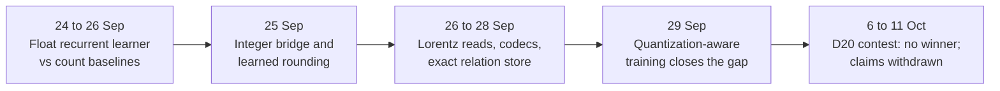

# Research line: the geometric stack

The "geometric stack" was a layered float model whose layers carried state with quaternion rotations. It was trained offline and then converted to 4-bit integers for serving. It matched an ordinary transformer on loss, served bit-exactly, and still wrote useless prose. It also used softmax, SiLU and matrix multiplication in training, so the owner's later bans made it a historical form. Some of its pieces now have trained descendants on the discrete M1 and FBS paths.

| | |
|---|---|
| **Catalog id** | `geometric-stack-pretraining` |
| **Time span** | 20 Sep to 11 Oct 2026 (2 records undated) |
| **Milestone** | None recorded (81 of 84); 3 tagged M1 |
| **Records** | 84 |
| **Outcomes** | plan 21 · negative 20 · positive 18 · inconclusive 8 · review 6 · tooling 5 · diagnostic-stop 4 · process 2 |
| **State** | The whole-model form is PARKED ([geometric stack](../../mechanisms/geometric-stack.md)) |

Counts: `archive/catalog.jsonl`. Terms follow the [glossary](../../start/glossary.md); ACTIVE, READY and PARKED are defined on the [mechanism board](../../mechanisms/README.md).

*The stack's arc: a good loss number, then repeated attempts to turn it into a model that talks.*

## What it set out to do

Train a deeper model with recurrence, geometric reads and exact memory, then compress it to integers and serve it without multiplications. The steps followed the owner's learning ladder (decision D8: reference baselines, then joint learning, then conversion to the discrete form): reference baselines, a joint recurrent learner, then conversion to the discrete form.

## What happened, in order

1. **Baselines and the recurrent learner (24 to 25 Sep).** A neural reference reached 1.574 nats against 2.392 for the best 5-gram-plus-cache baseline ([baselines](../../../archive/integration/reference-baselines-result-2026-09-24.md)). Both float recurrent arms reached about 2.11 nats and passed the engineering gate, but the quaternion arm trailed the ordinary control, so no geometric advantage was shown ([result](../../../archive/integration/joint-recurrent-result-2026-09-25.md)).
2. **Integer forms (25 to 27 Sep).** Four-bit quantization-aware training missed its +0.05-nat retention gate (+0.059 and +0.080) ([result](../../../archive/integration/quantized-recurrent-result-2026-09-25.md)). Learned rounding passed (2.114 and 2.111 nats) and an integer bridge kept every source answer, about 28 times slower than float ([learned rounding](../../../archive/integration/learned-rounding-result-2026-09-25.md), [bridge](../../../archive/integration/integer-execution-result-2026-09-25.md)). A standalone integer command reproduced all 4,096 saved distribution hashes and ran 4.5 to 6.6 times faster after one optimization ([serving](../../../archive/integration/integer-serving-result-2026-09-25.md)). Continued language training lowered loss but produced 0 of 5 acceptable stories ([continuation](../../../archive/integration/language-continuation-result-2026-09-26.md)).
3. **Geometric reads (26 to 28 Sep).** A Lorentz (hyperbolic) read beat a dot-product read by 0.018 nats on code in 3 of 4 seeds, then lost to the matched dot reset when adapted (+0.046 and +0.013 nats) ([cycle 3](../../../archive/integration/hyperbolic-cycle3-2026-09-26.md), [adaptation](../../../archive/integration/radial-adaptation-result-2026-09-27.md)). The stack matched a 7M-parameter transformer on repository code (1.998 against 2.011 nats), but generated code was useless ([cycle 4](../../../archive/integration/geometric-stack-cycle4-2026-09-27.md)). An exact relation store was perfect in distribution but its learned read trigger fired 0 of 826 times on held-out phrasing ([exact relation store probe, D2](../../../archive/integration/d2-aerm-probe-result-2026-09-28.md)).
4. **Quantization (28 to 29 Sep).** Round-to-nearest 4-bit export cost +0.0362 nats against a 0.02 gate ([representation measurements](../../../archive/integration/d4-stack-representation-measurements-2026-09-28.md)). Quantization-aware training brought the integer engine within +0.0106 nats of its float model, bit-identical to a NEON reference ([QAT](../../../archive/integration/d4-geometric-s1-qat-result-2026-09-29.md)).
5. **Contest and withdrawals (6 to 11 Oct).** In the D20 contest, a three-seed test of the geometric read against a parameter-matched control found no winner: the geometric arm scored 0.0073, 0.9995 and 1.0000 in class against about 0.25 for the control ([D20 run](../../../archive/labs/d20-run-2026-10-06/)). A claimed 12-times faster fused kernel was withdrawn because the pod never ran it ([record](../../../archive/labs/fused-memory-kernel-2026-10-11/README.md)).

## Key results

| Result | Kind | Source |
|---|---|---|
| Stack parity with a transformer control: 1.998 against 2.011 nats on repository code | measurement | [cycle 4](../../../archive/integration/geometric-stack-cycle4-2026-09-27.md) |
| Quaternion transport beat identity by 0.071 and 0.077 nats; confounded by softmax, sigmoid, dense layers and a 332,928-parameter difference | measurement | [attribution](../../../archive/integration/transport-attribution-d1-2026-09-28.md) |
| Dialogue stack: pooled response loss 2.521 against 2.774, yet 2 of 38 final turns answered and no memory recalled | measurement | [baseline](../../../archive/integration/s2-dialogue-stack-baseline-2026-09-28.md) |
| Geometric operations were 0.05% of the stack's arithmetic | measurement | `docs/labs/repo-renormalization-2026-10-19/audit/eras/eras.md` (#2186) |
| Served 1.20 to 1.24 bits per byte against the 0.90 target | measurement | [D11 serving](../../../archive/labs/d11-serving-2026-10-10/README.md) |

## What it taught

Loss and prose are different things: a good number coexisted with 0 of 5 stories (lesson 3 in [what the project knows](../findings.md)). Fixed geometry usually tied or lost to a matched control (lesson 6), and the quaternion-transport win is a hypothesis until a parameter-matched, lawful control exists. Compute went to the readout, not the geometry (lesson 14).

## Current state

PARKED as a whole model. Its lawful pieces are tracked separately: [Hamilton gate](../../mechanisms/hamilton-gate.md) and [SpiralCore/FBS](../../mechanisms/spiralcore-fbs.md) are ACTIVE and trained on the discrete M1 and/or FBS paths; [recurrence gates](../../mechanisms/recurrence-gates.md) is READY with its fit/export measured. The M1 table-native and FBS `lut-stack/5` exporters exist at their declared scopes. A rebuild remains a separate research question, not a missing exporter.

**Go deeper:** the [generated catalog page](../../../archive/catalog/geometric-stack-pretraining.md) lists all 84 records.
