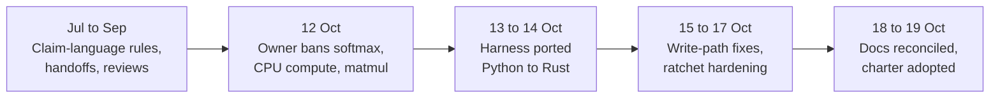

# Research line: research tooling and rules

This line is not about the model. It records the rules, checkers and command-line tools the project built to keep its own research honest: who may run what, how claims are worded, and which banned operations must never creep back in. It holds 185 records and not one is a model result. Most of the effort came in two days in mid-October, when the whole tool was ported from Python to Rust.

| | |
|---|---|
| **Catalog id** | `harness-governance` |
| **Time span** | 24 Jul to 19 Oct 2026 (10 records undated). 105 of the 185 are dated 13 or 14 Oct |
| **Milestone** | None (175 of 185); the tooling serves every milestone |
| **Records** | 185 |
| **Outcomes** | tooling 115 · process 55 · review 9 · ops 4 · plan 2. No positive or negative model results |
| **State** | Active, but the 19 Oct charter cuts the bulk. The tool is a view over the real authorities, not a replacement for them |

Source: `archive/catalog.jsonl`, counted with `jq`. Terms follow the [glossary](../../start/glossary.md); ACTIVE, READY and PARKED are defined on the [mechanism board](../../mechanisms/README.md).

*The line in four phases. The second box explains much of the third: the Rust-first rule (D27) required the ports.*

## What it set out to do

Make a many-lab research project reproducible and hard to fool. Three jobs recur: keep claim wording honest ([formal vocabulary](../../formal_vocabulary.md)), keep banned mechanisms out (scripts that count softmax-like code and dense matrix products and fail if the count grows), and let several AI labs share one repository without overwriting each other (claims on branches, check-ins, receipts).

## What happened, in order

1. **Jul to Sep.** Normative claim-language rules, a traceability matrix of the formal analysis, handoff documents and audits of outside repositories. No code was adopted from the audits ([external research audit](../../../archive/integration/external-research-audit.md)).
2. **12 Oct.** The owner banned softmax everywhere (D23), CPU model compute (D24) and dense matrix products (D25). A scan found all five active code paths still used softmax ([softmax census](../../../archive/labs/softmax-census-2026-10-12/README.md)). The first harness and its multi-lab version arrived the same day. An agent also removed 11,171 research files from git to save disk; they were restored byte for byte ([integrity record](../../../archive/labs/repository-integrity-2026-10-12/README.md)).
3. **13 to 14 Oct.** About 105 records port the harness commands and checks to Rust, each compared against the Python output. The comparisons kept finding faults in the checkers themselves: a parity check that could never fail ([harness CI](../../../archive/labs/harness-ci-2026-10-13/README.md)), a green report when the binary was not built and nothing was checked ([skipped is not a pass](../../../archive/labs/skipped-is-not-a-pass-2026-10-13/README.md)), and a check command that ran none of its 41 rules ([dispatcher](../../../archive/labs/check-dispatcher-2026-10-14/README.md)).
4. **15 to 17 Oct.** Fixes to how the tool writes state, branch-cleanup proof for squash merges, and hardening of the ban scans. Five rules that were registered but never executed were wired in ([record](../../../archive/labs/harness-d32-and-rule-dispatch-2026-10-17/README.md)).
5. **18 to 19 Oct.** Documentation reconciliation against the source, the offline-float decision D37, the owner-phrase rule D40 and many one-paragraph documentation syncs ([course correction](../../labs/course-correction-2026-10-18/README.md)).

## Key results

| Result | Kind | Source |
|---|---|---|
| In the week of 12 to 18 Oct, 34 of 309 records (about 11%) were model results; the rest were tooling, plans, process and review | measurement | `docs/labs/repo-renormalization-2026-10-19/audit/synthesis.md`, section 3 |
| Part of that drop was owner-ordered: D23 to D32 forced a substrate rebuild and D27 made Rust mandatory | measurement | same, "Confound" |
| 19 owner decisions in 8 days (D23 on 12 Oct to D41 on 19 Oct) | measurement | same |
| Matmul ratchet counted 95 dense call sites and refuses growth | measurement | [interlock record](../../../archive/labs/no-matmul-interlock-2026-10-13/README.md) |
| Claim-wording check rewritten in Rust with byte-identical output on the repository | measurement | [port record](../../labs/claim-wording-rust-port-2026-10-18/README.md) |

## What it taught

Every checker needs a test that can fail (lesson 1 in [what the project knows](../findings.md)). Several tools here reported success while checking nothing. A process that forbids running code produces nothing (lesson 21). Section 3 of the synthesis separates owner-mandated rebuilding from discretionary gating as causes of the drop in model results. Branches are temporary; `main` is the authority, and a merged claim must be released.

## Current state

Active but slimmer. The charter adopted on 19 October requires a written sheet only before GPU runs or milestone-claim runs, and keeps one notebook per line ([how research is done now](../README.md)). No record in this line is a model result.

**Go deeper:** the [generated catalog page](../../../archive/catalog/harness-governance.md) lists all 185 records.
