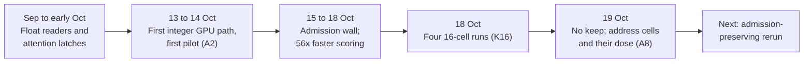

# Research line: discrete attention for the language base (M1)

This is the line that carries the project today. It asks one question: can a model that uses only integers and small geometric moves learn to read earlier text well enough to predict the next word? So far the answer is no. The best trained discrete model gets the next word right in 65 and 463 of 14,287 development rows, below a plain word-count table that gets 1,226.

| | |
|---|---|
| **Catalog id** | `m1-discrete-attention` |
| **Time span** | 7 Aug to 19 Oct 2026 (two early records; the work in earnest runs 19 Sep to 19 Oct; 3 records undated) |
| **Milestone** | M1, the language base (141 of 199 records) |
| **Records** | 199 |
| **Outcomes** | tooling 40 · plan 38 · positive 27 · inconclusive 26 · review 26 · process 16 · negative 14 · blocked 6 · diagnostic-stop 6 |
| **State** | Active. M1 is not met and training is held |

Counts: `archive/catalog.jsonl`. M1 is the first of the eight milestones; 0 of 8 are complete (`docs/integration/NOW.md`). Terms follow the [glossary](../../start/glossary.md); ACTIVE, READY and PARKED are defined on the [mechanism board](../../mechanisms/README.md).

*Two terms used below. Admission is the shortlist of words the read can see; a word outside it can never be chosen. Top-1 means the right word ranked first.*

## What it set out to do

Give the discrete model an attention-like read of context. Under the owner's rules (no softmax, no matrix multiplication, integer serving) the read must be a tree walk ([Route](../../mechanisms/route-read.md)), a small neighbour set rotated into the query's frame ([Flock](../../mechanisms/flock-read.md)) or a link-following rule such as "the word after the earlier copy of this word" ([Relation](../../mechanisms/relation-read.md)). The line's yardstick is milestone M1: a saved discrete artifact that, after export to integer serving and on each of two seeds, beats a unigram table and a successor table on the same development rows ([charter](../../../CHARTER.md), item 8 of the research clauses).

## What happened, in order

1. **Float readers and latches (19 Sep to 5 Oct).** A hard capture-and-hold gate let saved models answer 128 of 128 original and stress rows, against 47 to 59 for same-size controls ([latch](../../../archive/integration/geometric-attention-latch-2026-10-01.md)). Fresh complete replies stayed low: a directed cue relation scored 0/32 and its cue-only control 1/32 ([cue carrier](../../../archive/integration/geometric-cue-carrier-2026-10-04.md)).
2. **First integer GPU path (13 to 14 Oct).** All eleven construction controls passed, then 25 of 25 ([discrete learning](../../../archive/labs/discrete-geometric-learning-2026-10-13/README.md), [driver cost](../../../archive/labs/discrete-driver-cost-2026-10-13/README.md)). The first training pilot (A2, 1,640 batches) raised top-1 from 17 to 82 and top-8 from 173 to 1,169 of 14,287, while the loss total rose from 13,816,032 to 13,884,032 ([pilot](../../../archive/labs/a2-pilot-2026-10-14/README.md)). The diagnosis: the starting table had only 16 distinct vectors for 4,096 tokens ([diagnosis](../../../archive/labs/a2-pilot-diagnosis-2026-10-14/README.md)).
3. **The admission wall (15 to 17 Oct).** Re-scoring saved checkpoints with 8 to 16 kept cells never reached the 4,894 admission bar (best 2,400 at 16), so capacity had to be trained in ([sweep](../../../archive/labs/rung0-stage-a-sweep-2026-10-15/README.md)). Repeated qualification restarts (five by the last record) stopped on build, interface and lint errors and then on a 99-against-100 timing count ([restart 5](../../../archive/labs/k16-qualification-restart5-2026-10-16/README.md)). A host check found that a context-free successor table already scores 6,300 of 14,287 ([host diagnostics](../../../archive/labs/host-diagnostics-2026-10-17/README.md)).
4. **Speed (16 to 18 Oct).** In a three-batch diagnostic, over 99.99% of each proposal's time was one scoring kernel; a row-parallel version gave equal losses about 56 times faster (3.843 s to 0.0691 s) ([rows parity](../../labs/counterfactual-rows-parity-2026-10-18/README.md)).
5. **The paired test and the 16-cell runs (18 to 19 Oct).** The first paired attention test (Dose 1) was stopped by the owner at 904 and 1,065 batches, before any checkpoint, to switch to the row-parallel driver (a diagnostic stop, not a verdict). The paired row-parallel run that followed (Dose 2) reached its registered collapse stop at 4,096 batches in both arms (the Relation read and a frozen control): admission on 3,847 copy-successor rows (development rows where copying the word after the previous occurrence would be right) fell from 2,034 to 225 (Relation) and 205 (frozen control) ([Q1 diagnosis](../../labs/attention-rows-q1-diagnosis-2026-10-18/README.md)). Four runs of the 16-cell experiment (K16) used two training objectives, an address-margin loss (A) and an occupancy-rank loss (R), with two seeds each. They accepted 407, 130, 410 and 129 moves. The occupancy-rank loss collapsed to 19 or 20 occupied cells; the margin loss lost admission. Verdict: no KEEP (no run met its own target), and the fresh slice stays sealed ([outcome call](../../labs/k16-outcome-call-2026-10-19/README.md)).
6. **Address cells (19 Oct).** Placing each token's cell near its predecessors' cells lifted starting admission from 127 to 1,351 of 3,847 at zero training; a shuffled control got 476 ([pre-flight](../../labs/address-cells-preflight-2026-10-19/README.md)). Training then eroded it in the address-cell dose (A8): Relation 1,351 to 551 (stopped), frozen control 857 ([A8 dose](../../labs/a8-dose-2026-10-19/README.md)). A controller that audits admission every 64 batches is built; its GPU qualification has not been run (NOT_RUN) ([controller](../../labs/admission-anchor-controller-2026-10-19/README.md)).

## Key results

| Result | Kind | Source |
|---|---|---|
| Address-margin runs (K16-A, two seeds): top-1 65 and 463, top-8 547 and 1,295, admission 2,237 and 3,167 of 14,287 (bar 4,894) | measurement | [outcome call](../../labs/k16-outcome-call-2026-10-19/README.md) |
| Unigram table 1,226; context-free successor table (T2) 6,300 of 14,287 | measurement | [host diagnostics](../../../archive/labs/host-diagnostics-2026-10-17/README.md) |
| Aliasing does not explain the ranking failure: the alias ceiling rose to about 9,000 rows yet top-1 stayed low | measurement | [outcome call](../../labs/k16-outcome-call-2026-10-19/README.md) |
| Address cells: 127 to 1,351 of 3,847 at zero training | measurement | [pre-flight](../../labs/address-cells-preflight-2026-10-19/README.md) |

## What it taught

Check the instrument first (lesson 1 in [what the project knows](../findings.md)): a register-count mismatch, a mismatched JSON key and a hash-domain bug each blocked a run or rejected a valid artifact without testing any mechanism. Development is not fresh (lesson 4), and a pass is not a language result. The mechanisms in play are [discrete learning](../../mechanisms/discrete-learning.md), [admission](../../mechanisms/admission.md), [address cells](../../mechanisms/address-cells.md) and the three reads linked above.

## Current state

M1 is not met. No trained discrete artifact beats the unigram table. The cheapest approved next steps are the read-code capacity capture (W2) and the admission-preserving rerun of the address-cell dose (A8) (`docs/labs/repo-renormalization-2026-10-19/audit/synthesis.md`, section 4). Any further training needs a new owner release.

**Go deeper:** the [generated catalog page](../../../archive/catalog/m1-discrete-attention.md) lists all 199 records.
