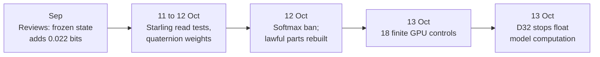

# Research line: the float route to rung 0 (M1)

"Rung 0" is the first, smallest training test of a model that obeys every rule: no softmax, no matrix multiplication, geometric parts only. This line tried to reach it with floating-point training, then rebuilt each part until it was lawful. The central case was the "starling" read, which picks about seven neighbouring earlier tokens instead of using softmax. It could not learn from scratch. On 13 October the owner moved training to the integer path, and this line was preserved as inactive evidence.

| | |
|---|---|
| **Catalog id** | `m1-float-rung0` |
| **Time span** | 31 Aug to 13 Oct 2026 |
| **Milestone** | M1 (9 records) and M4 (15 records, the starling work); 14 untagged |
| **Records** | 38 |
| **Outcomes** | negative 7 · plan 7 · tooling 7 · inconclusive 5 · review 5 · positive 4 · diagnostic-stop 2 · process 1 |
| **State** | Historical line. D37 made offline float training legal again, and the separate FBS trunk now uses it; M1 is complete on the discrete path |

Counts: `archive/catalog.jsonl`. Terms follow the [glossary](../../start/glossary.md); ACTIVE, READY and PARKED are defined on the [mechanism board](../../mechanisms/README.md).

*Seven days of experiments, then a rebuild, then an owner decision that paused the route.*

## What it set out to do

Reach a first rule-compliant training result. The plan of 12 October named the pieces: a hard rank-hinge loss in place of cross-entropy, an exact flock selection on the 600-cell, a raw-score output head, a rotation gate in place of sigmoid gating and a geometric projection in place of dense maps ([design](../../../archive/labs/d23-learning-law-design-2026-10-12/README.md)). Rung 0 would pass only if the margin loss fell steadily and the rate of unviolated targets reached five times the no-model rate on both seeds.

## What happened, in order

1. **September reviews.** A frozen recurrent state added only 0.022 bits over a count table, so no readout work was justified ([result](../../../archive/integration/frozen-state-readout-adjudication-result-2026-09-24.md)).
2. **11 Oct: the starling read.** Trained from scratch, it scored mean recall 0.009 (chance 0.0045) where an L2-softmax control scored 0.617, because hard selection gives unchosen keys no gradient ([record](../../../archive/labs/starling-read-2026-10-11/README.md)). A temporary dense helper raised the address hit rate from 10% to 73% but recall stayed at 0.011 ([anneal](../../../archive/labs/starling-anneal-2026-10-11/README.md)). Gating by content instead of address did not help ([content](../../../archive/labs/starling-content-2026-10-11/README.md)).
3. **12 Oct: partial recoveries.** A dense bootstrap teacher got 3 of 5 seeds to softmax-level recall, against 1 of 5 without it ([bootstrap](../../../archive/labs/starling-bootstrap-2026-10-12/README.md)). A light distillation weight gave 0.380 ([sweep](../../../archive/labs/starling-distill-sweep-2026-10-12/README.md)). Training twice as long gave 0.78 on 5 of 5 seeds on a 512 synthetic test, a provisional KEEP (target met, at an unequal budget) ([recall](../../../archive/labs/starling-recall-2026-10-12/README.md)). At 1,536 context the read collapsed to 0.241 against 0.999, because each cell kept only its last four keys ([context](../../../archive/labs/starling-context-2026-10-12/README.md)). A persistent tree fixed retention but recall stayed at 0.329 ([tree](../../../archive/labs/starling-tree-2026-10-12/README.md)).
4. **Quaternion weights (11 Oct).** Quaternion-structured projections beat a dense model of equal parameters by 0.018 bits per byte, six times the noise, with four times fewer matrix weights than an equal-width dense model ([record](../../../archive/labs/quaternion-weights-2026-10-11/README.md)).
5. **12 to 13 Oct: lawful rebuild.** Source landed for the rank-hinge loss, the Hamilton gate, geometric recurrence gates and the SpiralCore and FBS projection. Finite GPU checks passed: 18 controls on the complete path ([rung 0 path](../../../archive/labs/rung0-complete-path-2026-10-13/README.md)). No training followed.
6. **13 Oct.** The owner's D32 decision banned float model computation. The float qualification attempts were stopped and kept: 31 of 33 controls passed at the last complete replay; the 34-control replay was NOT_RUN. This was a scope change, not a mechanism negative ([record](../../../archive/labs/s1-s2-float-preservation-2026-10-13/README.md)).

## Key results

| Result | Kind | Source |
|---|---|---|
| Starling from scratch: recall 0.009 against 0.617 for the L2-softmax control | measurement | [starling read](../../../archive/labs/starling-read-2026-10-11/README.md) |
| Starling with persistent tree at 1,536 context: 0.329 against 0.999 for softmax | measurement | [tree](../../../archive/labs/starling-tree-2026-10-12/README.md) |
| Quaternion weights 1.495866 against 1.513594 bits per byte for dense at equal parameters | measurement | [record](../../../archive/labs/quaternion-weights-2026-10-11/README.md) |
| 18 finite GPU controls pass on the complete rung-0 path; no training | measurement | [rung 0 path](../../../archive/labs/rung0-complete-path-2026-10-13/README.md) |

## What it taught

Hard geometric selection gives unselected keys no gradient, so it needs a training bridge (lesson 12 in [what the project knows](../findings.md)). Every float read that learned had softmax help it in training, so whether a softmax-free read can learn ranking from scratch is the biggest open question (`docs/labs/repo-renormalization-2026-10-19/audit/synthesis.md`, section 5). A scope change is not a negative (lesson 21).

## Current state

Preserved evidence, not a live line. [Hamilton gate](../../mechanisms/hamilton-gate.md) and [SpiralCore/FBS](../../mechanisms/spiralcore-fbs.md) are ACTIVE and trained on the discrete M1 and/or FBS paths; [recurrence gates](../../mechanisms/recurrence-gates.md) is READY with its 1,024-step fit and mixed export outcome, and [Flock read](../../mechanisms/flock-read.md) is ACTIVE. [Spin weights](../../mechanisms/spin-weights.md) is READY by D74. Archived float sheets return only as new sheets with a fresh review and the lab's D67 pre-run review.

## 29 Oct 2026

The float route is live again as the FBS trunk, trained in float on the GPU and exported to integers (owner direction, 28 Oct; D37 keeps float training offline-only). The trunk has about 63,744 trainable values, and the 4,096 by 256 word table holds about 94% of the model. On held-out text it gets about 60% next word, against 44% for word pairs and 49% for the counting model (claude-142). The Hamming read (claude-146) is the copy mechanism. The diagnosis (claude-155) is that the trunk routes but cannot store; exact memory is the storage. Training is deterministic since claude-179. See [the pipeline map](../../model/pipeline-map.md) and [claude-161](../../loop/tasks/route-plus-memory/claude-161/REPORT.md). The starling result above still stands as history. M1 is complete on the separate discrete model, not claimed for this FBS trunk or useful chat.

**Go deeper:** the [generated catalog page](../../../archive/catalog/m1-float-rung0.md) lists all 38 records.
