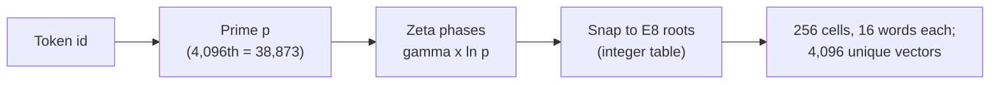

# Research line: the prime-zeta codebook (M1)

Every word needs a starting address. The discrete model had been starting from a seeded table that left 4,096 words sharing only 16 distinct addresses. This line built a fixed, repeatable table instead: each word gets a prime number, and the prime is turned into a vector through the phases of the Riemann zeta zeros. All 4,096 words now get unique addresses. The line has three catalog records, plus a later zero-update comparison that found no advantage for PrimeZeta over simple injective controls.

| | |
|---|---|
| **Catalog id** | `m1-prime-zeta` |
| **Time span** | 14 Oct 2026 for the one dated record; two older reference records are undated |
| **Milestone** | M1 (1 record); none for 2 |
| **Records** | 3 |
| **Outcomes** | positive 1 · inconclusive 1 · review 1 |
| **State** | ACTIVE as the baseline start and the fallback inside the address-cell table ([prime-zeta codebook](../../mechanisms/prime-zeta-codebook.md)). No trained result against its controls |

Counts: `archive/catalog.jsonl`. Terms follow the [glossary](../../start/glossary.md); ACTIVE, READY and PARKED are defined on the [mechanism board](../../mechanisms/README.md).

*The construction, run once offline on the host. The model only sees the finished table of small integers.*

## What it set out to do

Replace the random start that caused the first pilot's ranking trouble. In that pilot the initializer produced only 16 distinct vectors for 4,096 token identities, so most words could not be told apart by the read ([A2 diagnosis](../../../archive/labs/a2-pilot-diagnosis-2026-10-14/README.md)). The prime-zeta construction was registered as a zero-training check that a deterministic, arithmetic table could fix that.

## How it works

Token $v$ gets the prime $p_{\mathrm{id}(v)+1}$, so the vocabulary maps one to one onto the first $V$ primes. For each of the first 512 pinned zeta-zero ordinates $\gamma_k$, the phase is $\theta_k(p)=\gamma_k\ln p \bmod 2\pi$. Four channels per 8-dimensional block are quantized to integers and matched to the nearest of 16 roots of the E8 lattice by an exact integer inner product. A word's writer cell is the pair of roots of its first and last block, a 16 by 16 grid of 256 cells with exactly 16 words each. A uniqueness pass then gives interior blocks distinct roots. Floating point appears only in this one-time host step (`docs/labs/repo-renormalization-2026-10-19/audit/mechanisms/prime-zeta-codebook.json`, field `how_it_works`).

## What happened, in order

1. **Older reference work (undated).** Replacing a stub router with sixteen zeta-window projections raised top-1 from 0.17 to 1.00, but only on a six-sentence fixture ([record](../../../archive/zeta_projection_246.md)). An audit checked every consumer of the stored zeta state vector before widening its storage ([audit](../../../archive/debanding_audit_434.md)).
2. **14 Oct: construction qualified.** The generator was built, with no training and no corpus rows. All 4,096 of 4,096 tokens receive unique vectors, 17 of 17 base CUDA controls and 6 of 6 prime-zeta controls pass, and the tables match across macOS and Linux ([construction record](../../../archive/labs/prime-zeta-construction-2026-10-14/README.md)).
3. **18 to 19 Oct: used as a starting point.** Starting from the injective table fixed aliasing but spread tokens over all 256 cells, so only 127 of 3,847 copy-successor rows had the right cell in view at 8 kept cells, below the 500 gate ([pre-flight](../../labs/injective-preflight-and-c2-qualify-2026-10-19/README.md)). Address-structured cells (see the [M1 line](m1-discrete-attention.md)) lifted that to 1,351 at zero training, and prime-zeta remains the fallback inside that table.
4. **25 Oct: zero-update null comparison lost.** P8 admitted 127 of 3,847 against 178–188 for the strongest nulls. It lost to Q0, Q1, R0 and R1, tied Q2 and won only R2. This is a configuration negative under D22, not a mechanism-wide rejection or a trained language result ([comparison](../../labs/r-prime-zeta-vs-nulls/README.md)).

## Where it stands

| Claim | Kind | Source |
|---|---|---|
| 4,096 of 4,096 tokens get unique vectors; 0 collisions; 256 of 256 cells occupied | measurement | [construction record](../../../archive/labs/prime-zeta-construction-2026-10-14/README.md) |
| The two matched controls (shifted zeta ordinates, permuted primes) also give 4,096 unique vectors, so uniqueness comes from the quota and uniqueness pass, not from the primes | measurement | same |
| Do prime-zeta phases give similar words similar addresses? Primes are assigned by token id, which is arbitrary | hypothesis (untested) | `prime-zeta-codebook.json`, `never_tested` |
| A trained model starting from prime-zeta beats its controls | not run | same |

## What it taught

An injective table is necessary, not sufficient. Uniqueness solved aliasing, and it did not solve admission. Two kinds of check are separate here: a construction passing its tests, and a trained model gaining anything from it. A passing control is not a language result.

## Current state

ACTIVE. The 25 October zero-update comparison was a configuration loss: P8 admitted 127/3,847 against 178–188 for the strongest nulls, lost to Q0, Q1, R0 and R1, tied Q2 and won only R2. The trained-in test against the two original nulls (a shifted-ordinate null and a permuted-prime null) is not yet run; it needs a fresh FIT and the lab's D67 pre-run review at matched budget with at least two seeds. Prime-zeta is a deterministic function of token id, so identical seeds give identical tables; seed variance needs another declared axis.

**Go deeper:** the [generated catalog page](../../../archive/catalog/m1-prime-zeta.md) lists the three records.
