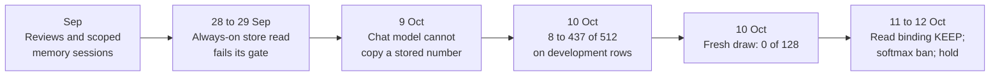

# Research line: grounded replies from exact memory (M2)

This line tried to make the model answer a question from a fact it was told earlier, and to say "I don't know" when it was never told. Facts sit in an exact store, so storing and fetching are not the hard part. The hard part is getting a trained model to read the right fact and write it out. One model reached 437 of 512 correct replies on the rows the team had been tuning on, then 0 of 128 on fresh rows.

| | |
|---|---|
| **Catalog id** | `m2-exact-memory` |
| **Time span** | 3 Sep to 12 Oct 2026 (7 records undated) |
| **Milestone** | M2, grounded reply from exact memory (60 of 151 records); 38 tagged M1 |
| **Records** | 151 |
| **Outcomes** | review 39 · negative 35 · positive 25 · inconclusive 21 · diagnostic-stop 12 · plan 9 · tooling 9 · blocked 1 |
| **State** | In progress. M2 is incomplete; fresh qualification is unqualified, and D67 removed the blanket owner hold |

M2's bar is at least 256 of 512 saved replies and at least 40% on genuinely fresh rows, with existing panels and graders unchanged (`ROADMAP.md`, M2 row). Counts: `archive/catalog.jsonl`. Terms follow the [glossary](../../start/glossary.md); ACTIVE, READY and PARKED are defined on the [mechanism board](../../mechanisms/README.md).

*The development score rose in steps on a panel the team could see. The fresh draw, run with no further training, did not follow.*

## What it set out to do

Build the second capability after a language base: a reply that is correct because it came from an exact record, not from a guess. Exact storage is easy and was never the problem; an exact store scored 1.000 whenever its register was right ([exact memory dossier](../../mechanisms/exact-memory.md)). The line tested which learned reader or writer could use it.

## What happened, in order

1. **September.** Fifteen records dated 3 Sep are source audits and acceptance reviews of a text-to-clause adapter and a native bridge. A pre-registered exact-pair cache lowered the count reference by 0.238 bits per target on exposed project Markdown, not general prose ([result](../../../archive/integration/realtext-sparse-recall-result-2026-09-24.md)). An always-on exact-store read failed its gate on all three seeds, with held-out accuracy of 0.03 to 0.16 against a 0.90 bar ([G1](../../../archive/integration/g1-always-on-read-result-2026-09-28.md)). A diagnostic put 77.7 percent of held-out failures at query-entity tagging ([decomposition](../../../archive/integration/g1-decomposition-result-2026-09-29.md)).
2. **1 to 5 Oct.** Adapting only the readouts raised complete own-prefix source replies from 4/20 to 18/20 ([coadapt](../../../archive/integration/geometric-readout-coadapt-2026-10-03.md)), yet a prospectively frozen fresh panel gave 0/8 ([frozen transfer](../../../archive/integration/geometric-readout-frozen-transfer-2026-10-04.md)).
3. **9 Oct.** Traces showed why stored numbers failed. The copy pointer attended the repeated sentence frame, never the second digit of the value (0 of 13 rows), and the 4,096-piece vocabulary has no multi-digit tokens ([positional read](../../../archive/labs/pointer-positional-read-2026-10-09/README.md)). Several attempts to build legal parameter changes with an exact solver stopped on numeric errors, which are blockers, not negatives.
4. **10 Oct.** Whole-answer replies on the 512-row development panel went 8, 22, 145, 175, 177, then 437 after training each token against its strongest wrong rival (260 gains and no losses on that last step) ([pooled rank](../../../archive/labs/m2-pooled-rank-2026-10-10/README.md)). Five other recipes lowered it (8 to 2, 8 to 4, 8 to 0 and 145 to 139 replies). The saved 437 model then scored 0/128 against a bar of 52 on fresh role and value combinations ([fresh](../../../archive/labs/m2-fresh-437-2026-10-10/README.md)).
5. **10 to 12 Oct.** Training the read to land on the asked value was flat at first (19/40 against 20/40). A powered rerun over three seeds cut wrong-value failures from 47 to 30 of 120, and at four times the length from 49 to 23 ([scaled](../../../archive/labs/read-binding-scaled-2026-10-11/README.md)). Both met their bars, so each was a KEEP (target met without a significant loss elsewhere), but on a softmax read. A whole-path source reference was built; CUDA execution has not been run (NOT_RUN) ([recovery](../../../archive/labs/whole-path-recovery-2026-10-12/README.md)). The softmax ban (D23, 12 Oct) and the M2 training hold stopped further runs.

## Key results

| Result | Kind | Source |
|---|---|---|
| 437/512 on the exposed development panel, then 0/128 fresh (bar 52/128) | measurement | [fresh](../../../archive/labs/m2-fresh-437-2026-10-10/README.md) |
| Read binding, 3 seeds: wrong-value 47 to 30 of 120, memory rows 57 to 65 | measurement | [powered](../../../archive/labs/read-binding-powered-2026-10-11/README.md) |
| Product-key memory added to the chat model: 19/40 on stored-value questions against a 27/40 bar | measurement | [addressed memory](../../../archive/labs/addressed-memory-2026-10-10/README.md) |
| Muting the last read layer: memory answers 24/40 to 0/40 | measurement | [head ablation](../../../archive/labs/head-ablation-2026-10-11/README.md) |
| Rounding to the legal quarter grid causes 90 to 96% of the adverse pressure on failed protected updates | measurement | [attribution](../../../archive/labs/quantized-protection-attribution-2026-10-09/README.md) |

## What it taught

Development is not fresh (lesson 4 in [what the project knows](../findings.md)). An exact log retrieves; the learned pointer copied recency (lesson 9). Chat failures came from missing knowledge and fluency, not retrieval (lesson 10), and binding failures came from the recipe (lesson 20). Hard selection needs a training bridge (lesson 12). On 10 Oct the three-negatives rule (D21) fired, and D22 ruled that a negative closes a configuration only.

## Current state

M2 is in progress and its acceptance bar is unchanged; no blanket owner hold remains (D67). These mechanisms are PARKED, each with the conditions that would reopen it: [exact memory](../../mechanisms/exact-memory.md), [read binding](../../mechanisms/read-binding.md), [pointer key](../../mechanisms/pointer-key.md), [carrier credit](../../mechanisms/carrier-credit.md), [legal construction](../../mechanisms/legal-construction.md) and [native geometric](../../mechanisms/native-geometric.md). The durable store lives in [the M3 line](m3-durable-memory.md).

Related work on the FBS trunk line: exact turn memory keyed by the user's first 8 tokens names 598.7 and 598.3 of the DEV panel's 1,226 reply openings at two seeds (claude-161, [report](../../loop/tasks/route-plus-memory/claude-161/REPORT.md)), against 266.3 and 281.0 for an empty-table control. It moves only the first word of a reply. Claude-219's point-key opening improves free generation at three seeds on fresh p-v, but reaches only 12–18% of the forced-opening lift. Next, train and serve it in one integer model and score it end to end. This is not M2 acceptance or useful chat. See [the pipeline map](../../model/pipeline-map.md).

**Go deeper:** the [generated catalog page](../../../archive/catalog/m2-exact-memory.md) lists all 151 records.
