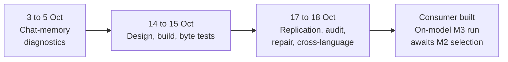

# Research line: durable memory and the object store (M3)

Milestone M3 asks that a conversation's memory survive between sessions and that answers stay grounded in it. This line built the storage half: an exact object store that keeps bytes once in a hashed tree, can fetch any range with an integrity check, and can copy itself between machines. The store works and is well tested. The consumer is built, but the on-model M3 run awaits M2's model selection, so M3 has not been measured end to end.

| | |
|---|---|
| **Catalog id** | `m3-durable-memory` |
| **Catalog time span** | 3 Oct to 18 Oct 2026; the later consumer record is 22–25 Oct |
| **Milestone** | M3, durable conversation memory (28 of 33 records) |
| **Records** | 33 |
| **Outcomes** | tooling 27 · inconclusive 2 · plan 2 · positive 1 · review 1 |
| **State** | The object store is READY ([D19 object store](../../mechanisms/object-store.md)). The consumer is built; the on-model M3 run awaits M2 selection; its bars have not been run |

Counts: `archive/catalog.jsonl`. The store follows decision D19 (a model-independent exact byte store). Terms follow the [glossary](../../start/glossary.md); ACTIVE, READY and PARKED are defined on the [mechanism board](../../mechanisms/README.md).

*The storage consumer and its controls are built; the selected model's on-model M3 qualification remains open.*

## What it set out to do

Give the model a memory outside its weights: exact bytes, deduplicated, verifiable and portable, tied to token occurrences. The early records (3 to 5 Oct) tested whether a model could use an exact selected value in chat. With the exact value supplied, 16 of 20 development cases answered correctly against 0 of 20 with the read off ([source binding](../../../archive/integration/geometric-chat-source-binding-2026-10-03.md)). That is an open-development diagnostic only.

## What happened, in order

1. **Design (14 Oct).** Data is folded into hashed records that can be rebuilt or range-read with checks. A node id is 12 bytes. A 32,768-byte fixture record kept 70,972 bytes, a reminder that deduplication is not universal compression ([design](../../../archive/labs/d19-object-store-design-2026-10-14/README.md)).
2. **Build (14 to 15 Oct).** A Rust reader fetched 203 byte ranges with identical bytes from an eager and an indexed backend ([reader](../../../archive/labs/recon-dag-reader-2026-10-14/README.md)). The store folded and rebuilt source bytes exactly; a repeated fixture kept 380 bytes for 7,776 raw bytes. Twenty integration tests and 13 tokenizer tests passed ([store](../../../archive/labs/d19-object-store-2026-10-15/README.md)).
3. **Replication and audit (17 to 18 Oct).** About 25 records add a peer protocol. A receiver holding an older 1 MiB version fetched 22 records, 1,014 bytes, in three rounds ([peer](../../../archive/labs/object-store-peer-2026-10-17/README.md)). Batching a cold 52 MB pull over a high-latency link took 91.50 s against 236.19 s ([batch](../../../archive/labs/object-store-batch-2026-10-17/README.md)). Pipelined fetches ran about 2.8 times faster with an emulated 8 ms delay, which is not a real wide-area measurement ([pipelined](../../labs/object-store-pipelined-fetch-2026-10-18/README.md)). Other records add pinning, failover, repair, retries and a verified audit command. Twelve warm receivers pulling at once took 0.864 s against 3.506 s one at a time ([concurrency](../../../archive/labs/object-store-peer-concurrency-2026-10-17/README.md)).
4. **Second language (18 Oct).** A pure-Python client audited and pulled a 256 KiB artifact from the Rust server over loopback, byte for byte ([conformance](../../labs/uorobj01-conformance-2026-10-18/README.md)). The test suite stands at 60 passing ([batch plumbing](../../labs/object-store-batch-plumbing-2026-10-18/README.md)).

## Key results

| Result | Kind | Source |
|---|---|---|
| Exact value supplied: 16/20 development cases correct, 0/20 with the read off | measurement | [source binding](../../../archive/integration/geometric-chat-source-binding-2026-10-03.md) |
| Repeated fixture: 380 retained bytes for 7,776 raw bytes | measurement | [store](../../../archive/labs/d19-object-store-2026-10-15/README.md) |
| 1 MiB delta pull: 22 records, 1,014 bytes, 3 rounds | measurement | [peer](../../../archive/labs/object-store-peer-2026-10-17/README.md) |
| WAN cold pull with batching: 91.50 s against 236.19 s (2.58 times) | measurement | [batch](../../../archive/labs/object-store-batch-2026-10-17/README.md) |
| Cross-language conformance: PASS, 262,144 bytes pulled identical | measurement | [conformance](../../labs/uorobj01-conformance-2026-10-18/README.md) |

## What it taught

A byte store is a reliable component, and its tests show that it stores and returns bytes exactly. They say nothing about whether a model can use it, and a passing control is not a language result. The record also shows where effort went: 27 of the 33 records are tooling, and most are network plumbing built before any model consumed the store (a count from the catalog; the reading is a hypothesis).

## Current state

READY. The store and its consumer are built, but the on-model M3 run awaits M2's model selection and no M3 bar has been run ([consumer record](../../labs/object-store-consumer-m3/README.md)). The next step is to run M3 on the selected model, not to repeat storage-only work. Exact addressed memory as a read is still unbuilt ([exact memory](../../mechanisms/exact-memory.md)).

**Go deeper:** the [generated catalog page](../../../archive/catalog/m3-durable-memory.md) lists all 33 records.
