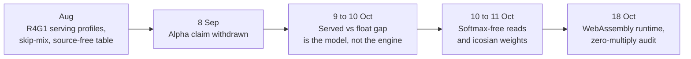

# Research line: integer serving (M4)

This line is about running a finished model on an ordinary laptop or in a browser using whole-number arithmetic and table lookups, with no floating point. The records below date from when multiplication was also banned (see 29 Oct 2026 at the end). In the records the engine reproduced its float models exactly on the old stack, and the multiply-free audits pass on the WASM serving symbols. The older models scored 1.20 to 1.24 bits per byte against a 0.90 target. Since then the discrete M1 pair and separate FBS `lut-stack/5` export have been served at their declared scopes; M4's accepted-model path remains open.

| | |
|---|---|
| **Catalog id** | `m4-serving` |
| **Time span** | 7 Aug to 18 Oct 2026 (6 records undated) |
| **Milestone** | M4, one served model under D11 and a command-line interface (12 of 42 records); 4 tagged M1 |
| **Records** | 42 |
| **Outcomes** | tooling 10 · negative 9 · positive 7 · inconclusive 6 · review 3 · ops 2 · process 2 · blocked 1 · diagnostic-stop 1 · plan 1 |
| **State** | The D11 engine is ACTIVE ([D11 integer serving](../../mechanisms/lut-serving.md)). M4 is not complete; the accepted model path is not started. M1 export agreement is exact and FBS's export gap passes at DEV scope; `PRLL` held-out scoring remains open |

Counts: `archive/catalog.jsonl`. D11 is the owner decision that every lab serves under one integer contract (the multiply and divide rule changed on 28 Oct, see below). Terms follow the [glossary](../../start/glossary.md); ACTIVE, READY and PARKED are defined on the [mechanism board](../../mechanisms/README.md).

*The engine was settled early. The quality gap was never in the engine.*

## What it set out to do

Make fast, cheap, local inference real: one served model, integer-only (D11), reachable from a command line, with tokens per second and energy measured on the owner's laptop. The product is serving; panel scoring and training stay on the GPU.

## What happened, in order

1. **August.** A source-free integer n-gram table predicted 22.26% of held-out targets against 5.41% for unigram, and one exact tie-break added 0.95 points ([table](../../../archive/source_free_table_baseline_989.md), [tie-break](../../../archive/source_free_table_geometric_intervention_953.md)). The skip-mix lane beat base by +28.45 per mille top-1 ([record](../../../archive/skipmix_endtoend_causal_908.md)). A vector (SIMD) scan sped one path up 1.60 times against a 2 times bar ([record](../../../archive/simd_dot_scan_design.md)).
2. **8 Sep.** The alpha publication was withdrawn: the scorecard had used constant or flag evidence ([record](../../../archive/integration/release-qualification-alpha.md)).
3. **9 to 10 Oct: the gap is the model.** The published 0.877 float against 0.933 served compared different numbers of windows. On a matched retrain the pair is 0.8776 against 0.8868 bits per byte ([protocol pin](../../../archive/labs/criterion2-protocol-pin-2026-10-09/README.md)). The recorded criterion is still "not met and not claimable", and the matched float model sits at 0.924 on the attribution record's own table. At identical positions quantization cost 0.0041 and the engine cost -0.0000008 ([attribution](../../../archive/labs/chat-served-gap-attribution-2026-10-09/README.md)). The integer engine matched float exactly (maximum logit difference 0) while three served models scored 1.20, 1.24 and 1.24 against the 0.90 target ([D11 serving](../../../archive/labs/d11-serving-2026-10-10/README.md)).
4. **10 to 11 Oct: lawful pieces.** Replacing the served softmax read with rank-weight tables cost 0.017 to 0.26 bits per byte more across four arms, all missing a 0.01 bar ([softmax-free read](../../../archive/labs/softmax-free-read-2026-10-10/README.md)). Weights built from two icosian table entries and a 2-bit mantissa reached 1.5148 against 1.4944 for float quaternions and 1.5136 for dense of equal size ([icosian mantissa](../../../archive/labs/icosian-mantissa-2026-10-11/README.md)). The integer engine refuses product-key memory entirely, so the speed case there is unmeasured ([port](../../../archive/labs/native-address-port-2026-10-11/README.md)).
5. **18 Oct.** An outside contributor's WebAssembly integer runtime was merged after hardening: 165 tests pass and 7 of 7 serving symbols show no multiply, divide or float. The vector (SIMD) kernels are not integrated and the demo is not runnable from a clean clone ([record](../../labs/wasm-serving-runtime-2026-10-18/README.md)).

## Key results

| Result | Kind | Source |
|---|---|---|
| Integer engine equals float: negative log-likelihood difference 0.0, maximum logit difference 0 | measurement | [D11 serving](../../../archive/labs/d11-serving-2026-10-10/README.md) |
| Served quality 1.20138, 1.24402 and 1.24233 bits per byte; target at most 0.90 | measurement | same |
| Speed fell from 63.41 tokens/s at 384 context to 30.43 at 4,096, so replacing the quadratic read buys at most about 1.7 times | measurement | [context curve](../../../archive/labs/context-curve-2026-10-11/README.md) |
| 3-bit E8 quantization of SmolLM2 MLP weights was +4.89 nats worse than 4-bit round-to-nearest, tripping its kill rule | measurement | [record](../../../archive/integration/b3-e8-smollm2-result-2026-09-29.md) |
| Zero-multiply audit: 44 native symbol ranges and 7 of 7 WebAssembly serving symbols | measurement | [WASM runtime](../../labs/wasm-serving-runtime-2026-10-18/README.md) (7 of 7); [project track](../../integration/project-track.md) (44 native ranges) |

## What it taught

Check the instrument before blaming the engine (lesson 1 in [what the project knows](../findings.md)): most of the apparent served-versus-float gap came from comparing different numbers of windows. Measure the shipped form (lesson 2). Savings counted on paper are not tokens per second (lesson 13). Exact integer export and bit-exact serving work (lesson 17).

## Current state

The zero-multiply and bit-exact properties are verified on the old stack and on the WASM serving symbols. Discrete Stage T and M1 exports now serve at their declared scopes; the separate FBS trunk has served under the current rules since 29 Oct (after D80/D81 on 28 Oct). The WASM record lists its SIMD kernels as unintegrated fixtures, so its contract is not yet exercised end to end. The 19.9M-parameter stack that missed the old M1 bar read every weight on every token, and two of the integer schemas serve softmax through exponent tables, which the current rules ban (`docs/labs/repo-renormalization-2026-10-19/audit/synthesis.md`, section 1). Written 18 Oct: the next step was to export one discrete artifact and measure its export gap ([board](../../mechanisms/README.md)). Product serving, including tokens per second and energy on the laptop, is allowed; panel scoring of an exported artifact is still GPU research compute.

## 29 Oct 2026

The records above describe the old multiplier-free stack. Since 28 Oct, D80 (integer multiply) and D81 (integer divide) allow the hardware operations in served code. Floats, transcendentals and dense matmul stay banned. Serving the FBS trunk on the M1 laptop now runs:

- 270 to 3,042 tok/s with exact structured kernels, replies byte-identical to the engine before each change (claude-163 to 170).
- 4,829 tok/s snapped, replies byte-identical to the engine before the multiply and divide (claude-177, [report](../../loop/tasks/integer-mul-div-serving/claude-177/REPORT.md)).
- The unsnapped contract `lut-stack/5` is inside the export-gap bar on the DEV panel on both seeds, serving at 4,217 to 4,320 tok/s (claude-182, [report](../../loop/tasks/d11-exporter-float-trunk/claude-182/REPORT.md)), then 4,491 and 4,504 tok/s after the integer square root (claude-186).
- `lut-stack/6` carries the Hamming reads (claude-188, [report](../../loop/tasks/integer-hamming-read/claude-188/REPORT.md)). The copy-head integer kernel matches an f64 reference (claude-189, [report](../../loop/tasks/integer-hamming-read/claude-189/REPORT.md)). The session refuses `/6` until its hooks serve them. Those hooks are next.

Not yet on the accepted M4 path: text in and out (R7), and joined serving with proven readout parity. Claude-231 built the nearest readout on native and browser paths, but [claude-232](../../loop/tasks/integer-nearest-readout/claude-232/REPORT.md) missed greedy parity in every cell; the mismatch must be localized before p-x. The `/7` engine serves opening and later-reply memory tables on synthetic fixtures; trained-artifact parity and memory-session restore remain open. M1 is complete; M4 is not complete, and its accepted-model path is not started. See [the pipeline map](../../model/pipeline-map.md).

**Go deeper:** the [generated catalog page](../../../archive/catalog/m4-serving.md) lists all 42 records.
