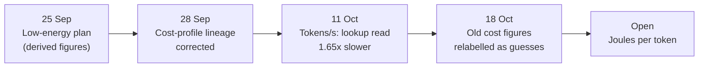

# Research line: laptop energy and cost (M5)

The project's goal is fast local AI that costs little energy. Milestone M5 asks for the proof: measured joules per token, memory use and tokens per second on an M1 laptop. This line has only four records, and the milestone is not started. The most useful record is a warning: an operation count of "90% fewer multiplies" did not become faster generation. It was 1.65 times slower.

| | |
|---|---|
| **Catalog id** | `m5-energy` |
| **Time span** | 25 Sep to 18 Oct 2026 |
| **Milestone** | M5, laptop cost (1 record); M1 (1); none (2) |
| **Records** | 4 |
| **Outcomes** | negative 1 · plan 1 · process 1 · review 1 |
| **State** | Not started. No joules per token has been measured for a model on the current path |

Counts: `archive/catalog.jsonl`. M5's bar: measured J/token, memory and tokens/s on the M1 with the selected parameter access (`ROADMAP.md`). Terms follow the [glossary](../../start/glossary.md); ACTIVE, READY and PARKED are defined on the [mechanism board](../../mechanisms/README.md).

*Three of the four steps corrected an earlier claim.*

## What it set out to do

Show that a geometric, table-driven model uses less energy per token on a laptop than an ordinary model. The plan of 25 September proposed ternary table-lookup serving with recurrence and exact memory, to be judged by measured joules per token. Its energy figures were derived from operation counts, not measured ([plan](../../../archive/integration/low-energy-plan-2026-09-25.md)).

## What happened, in order

1. **28 Sep: a sealed record was edited.** The sealed root of the cost profile for the D11 serving contract had been edited in place and resealed. The correction records the hashes, the overwritten fields and a duplicated evaluation record ([lineage correction](../../../archive/integration/d11-cost-profile-1-lineage-correction.md)).
2. **11 Oct: the metric changes.** The owner directed that generated tokens per second is the headline comparison, reported with panel acceptance and never alone. A direct test swapped a layer's feed-forward block for an addressed lookup memory. Analytic multiplies fell by 90%, but generation ran at about 385 ids per second against about 637 for the control, 1.65 times slower. Training took 245 s against 104 s for 2,000 steps, 2.4 times longer ([tokens per second](../../../archive/labs/tokens-per-second-2026-10-11/README.md)). A same-day correction relabelled the arms as feed-forward block against lookup memory, not read against address.
3. **18 Oct: cost provenance.** Energy evidence must separate cache residency from sparsity. Earlier cost figures for the injective-initialisation draft are relabelled planning guesses, not measurements: 1.31 s per batch survives only as an extrapolation, and 5,361 seconds meant a resource lifetime, not a per-batch time ([record](../../labs/d38-cost-provenance-docs-2026-10-18/README.md)).

## Key results

| Result | Kind | Source |
|---|---|---|
| Generation about 637 ids/s (control) against about 385 ids/s (addressed lookup): 1.65 times slower | measurement | [tokens per second](../../../archive/labs/tokens-per-second-2026-10-11/README.md) |
| Multiply count at the replaced layer fell 90% (1,769,472 to 173,056 at context 384) | proof (arithmetic count) | same |
| Integer serving first cost 4.3 times more energy than its float parent, on a dense configuration | measurement | `docs/labs/repo-renormalization-2026-10-19/audit/synthesis.md`, section 5 (#1449) |
| Energy per token on the current discrete path | not measured | no record |

## What it taught

Savings counted on paper are not tokens per second (lesson 13 in [what the project knows](../findings.md)). Check where compute goes: the output readout took 99.97% of per-token compute in one model, and geometric operations were 0.05% of the stack's arithmetic (lesson 14). A table read is the intended primitive of the native integer path, but that path refuses product-key memory today, so the lookup's cost there is unmeasured ([native address port](../../../archive/labs/native-address-port-2026-10-11/README.md)).

## Current state

Not started. M5 needs a lawful model to measure, and none has been exported ([serving line](m4-serving.md)). Product serving and its tokens per second and energy on the client device are allowed measurements (charter, item 6).

**Go deeper:** the [generated catalog page](../../../archive/catalog/m5-energy.md) lists all 4 records.
