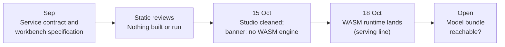

# Research line: API, browser runtime and Studio (M7)

Milestone M7 asks that the finished model be reachable through a local API, a WebAssembly runtime and a web "Studio". This line holds the early design and review work for that surface and one cleanup of the Studio. It contains no model result, because there is no model to serve yet. The runtime half has since been delivered (see the [serving line](m4-serving.md)); the model half has not.

| | |
|---|---|
| **Catalog id** | `m7-distribution` |
| **Time span** | 3 Sep to 15 Oct 2026 (3 records undated) |
| **Milestone** | M7 by name; the catalog tags none of its 8 records |
| **Records** | 8 |
| **Outcomes** | review 5 · tooling 2 · plan 1 |
| **State** | Runtime delivered, model bundle not integrated. Local API only |

Counts: `archive/catalog.jsonl`. State: `ROADMAP.md`, M7 row. Terms follow the [glossary](../../start/glossary.md); ACTIVE, READY and PARKED are defined on the [mechanism board](../../mechanisms/README.md).

*The surface was specified early and built late; the model that would fill it is still missing.*

## What it set out to do

Put the model in a person's hands: one local Rust service that owns model identity, inference and a static web workbench, plus a browser runtime. The project states that nothing on this surface proves model quality.

## What happened, in order

1. **3 to 4 Sep: specification and review.** An independent review accepted the native workbench service API specification, with no implementation, runtime or model result ([review](../../../archive/r4_service_contract_1105_review.md)). A source manifest listed original and R4 sources for the service contract, with nothing executed or copied ([sources](../../../archive/r4_service_contract_1105_sources.md)). The frontend port plan fixed the product boundary and was kept as a reference, with nothing built ([plan](../../../archive/integration/frontend-port-plan.md)).
2. **Workbench source (undated).** The workbench candidate was frozen as reviewable but unbuilt, and a static review accepted its source contract after five corrections, with compilation, tests and behaviour explicitly not run ([candidate](../../../archive/r4_workbench_candidate_1107.md), [review](../../../archive/r4_workbench_candidate_1107_review.md)). A source-only audit looked at the learned-reference seams for the service ([audit](../../../archive/r4_service_contract_1105_service_audit.md)).
3. **3 Sep: publication check.** An audit found the browser-product arXiv package not ready: a stale bibliography, unverified benchmark constants and an overstated formal-verification scope. No decision notice was located ([audit](../../../archive/integration/publication-readiness.md)).
4. **15 Oct: Studio cleanup.** The cleanup removed five dead calls to WebAssembly functions, guarded one missing function and added a banner saying no served WebAssembly engine exists yet. A search for the dead references now finds zero matches ([cleanup](../../../archive/labs/studio-shell-d36-cleanup-2026-10-15/README.md)).

## Key results

| Result | Kind | Source |
|---|---|---|
| Dead WebAssembly references in the Studio page after cleanup: 0 matches | measurement | [cleanup](../../../archive/labs/studio-shell-d36-cleanup-2026-10-15/README.md) |
| WebAssembly runtime: 165 tests pass, 7 of 7 serving symbols with no multiply, divide or float | measurement | [WASM runtime](../../labs/wasm-serving-runtime-2026-10-18/README.md) |

## What it taught

An interface can be specified, reviewed and even delivered while the thing behind it does not exist. A passing specification review is not a capability, and a banner that says so is honest. The publication audit found a stale bibliography, unverified constants and an overstated proof scope in a draft paper package.

## Current state

M7 is not met. The integer runtime, Studio worker and parity harness are delivered and verified on a synthetic stand-in; the accepted model bundle and its parity are still open. The demo requires a local bundle build and self-hosted assets, not a claim of product deployment. Pre-alpha: 1 of 8 milestones is complete ([ROADMAP](../../../ROADMAP.md), [web client](../../products/web-client.md)).

**Go deeper:** the [generated catalog page](../../../archive/catalog/m7-distribution.md) lists all 8 records.
