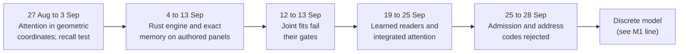

# Research line: the September native geometric model

This line was the project's first attempt to build a language model from scratch in Rust out of geometric parts. It gave the model an exact memory of what was said and small learned "readers" that choose what to look at. It produced many narrow wins on hand-written test panels and no model that writes prose. The ideas that survived went into the discrete model that now carries the project.

| | |
|---|---|
| **Catalog id** | `native-geometric-sept` |
| **Time span** | 31 Jul to 28 Sep 2026 (one early record; the bulk runs 27 Aug to 28 Sep; 62 records carry no date) |
| **Milestone** | None recorded (292 of 294 records); the work fed M1 (language base) and M2 (grounded reply) |
| **Records** | 294, the largest line in the catalog |
| **Outcomes** | positive 113 · negative 81 · plan 40 · inconclusive 25 · review 22 · process 6 · diagnostic-stop 5 · blocked 1 · tooling 1 |
| **State** | Closed as a line. Its whole-model form is PARKED (see [native-geometric](../../mechanisms/native-geometric.md)) |

Source for every count: `archive/catalog.jsonl`, counted with `jq`. Terms follow the [glossary](../../start/glossary.md); ACTIVE, READY and PARKED are defined on the [mechanism board](../../mechanisms/README.md).

*The line in five steps. Most of the green results sit in the second box and were scored on panels the authors wrote.*

## What it set out to do

The compile-a-teacher approach ([R4G1](r4g1-transformerless.md)) had stalled: it could copy a teacher but not write text on its own. This line asked a different question. Can a model whose parts are exact geometric objects, such as prime-number addresses, rotations in four dimensions (H4) and versioned records of what was said, learn to read context and answer from it?

## What happened, in order

1. **Attention in geometric coordinates (27 Aug to 3 Sep).** Small positive tests changed a decoded continuation: for example real 2/2 against 0/2 when the binding was permuted ([paragraph test](../../../archive/paragraph_entity_spin_path_attention_973.md)). Not all passed. Full H4 causal attention scored 3/12 while plain fixed-tangent attention scored 12/12 ([direct causal test](../../../archive/direct_causal_geometric_attention_973.md)), and a gauge-covariance test scored 13/24 against an 18 gate ([V4](../../../archive/connection_gauge_covariance_v4_973.md)). A recall control (Zoology) reached 99.17% (11,900/12,000) with an ordinary softmax cell, which showed the earlier binding failures came from the training recipe ([record](../../../archive/r4_zoology_release_reproduction_1050.md)).
2. **A parameter-free readout ladder failed.** Four variants of reading retained state all missed the frozen prompt-gain floor of 0.0433 (best 0.0390) ([block-delta](../../../archive/r4_predictive_block_delta_binding_prompt_capacity_973.md)).
3. **Rust engine and exact memory (4 to 13 Sep).** Dozens of narrow positives on authored panels, for example 50/50 against 12/50 for a contextual phrase start and 64/64 against 0/64 for fresh historical targets ([contextual start](../../../archive/native_geometric_contextual_start_1139.md), [historical query](../../../archive/native_geometric_historical_query_context_973.md)). Each is scoped to a familiar grammar. The fixed geometric readout alone scored 0.13% against 21.5% with geometry disabled ([recovery](../../../archive/native_geometric_recovery_973.md)).
4. **Joint fits failed (12 to 13 Sep).** Eight negative records on calibrated emission, block learning and tied sampling each broke earlier behaviour or missed a gate. A 64-update addressed-attention pilot produced no useful answers ([pilot](../../../archive/native_geometric_addressed_attention_pilot_973.md)).
5. **Learned readers (19 to 25 Sep).** A competing-source reader beat exact recurrence on a built panel but harmed natural text by +1.29 bits per token against a +0.05 tolerance ([result](../../../archive/integration/competitive-reader-result-2026-09-20.md)). H4 shared transitions scored 186/288 where an ordinary finite table scored 288/288 ([result](../../../archive/integration/shared-transition-result-2026-09-21.md)). Four integrated-attention trials (A1 to A4) lifted correct source admission from 1/24 to 17/24 but never produced a complete correct answer (0/12 per arm) ([A3](../../../archive/integration/integrated-attention-a3-result-2026-09-24.md)).
6. **End of the line (25 to 28 Sep).** Bounded admission lost the first noun in 11 and 8 cases against a maximum of 2 ([result](../../../archive/integration/bounded-admission-result-2026-09-25.md)). Icosian direction codes changed the dense read's top choice at 41 to 46 percent of positions and were rejected as address codes ([audit](../../../archive/integration/d6-information-audit-result-2026-09-28.md)).

## Key results

| Result | Kind | Source |
|---|---|---|
| Zoology cell reproduced at 99.17% (11,900/12,000); no geometric claim | measurement | [record](../../../archive/r4_zoology_release_reproduction_1050.md) |
| Coherent R4 transport preserved 11,900 of 12,000 decisions of that model | measurement | [record](../../../archive/r4_zoology_coherent_inference_1059.md) |
| Fixed geometric readout 0.1312% against 21.5206% with geometry off | measurement | [recovery](../../../archive/native_geometric_recovery_973.md) |
| Read-conditioned residual emitted 35/180 correct uncopied answers on development | measurement | [result](../../../archive/integration/contextual-emission-result-2026-09-21.md) |
| Policy campaign shown infeasible for every per-bucket action table | proof | [result](../../../archive/integration/policy-feasibility-result-2026-09-21.md) |
| Integrated attention A3: admission 17/24, complete answers 0/12 per arm | measurement | [A3](../../../archive/integration/integrated-attention-a3-result-2026-09-24.md) |

## What it taught

- A pass on an authored panel is not language. Many positive records state their own scope as an authored panel, a familiar grammar or development rows only (lessons 3 and 4 in [what the project knows](../findings.md)).
- Fixed geometry tied or lost to a matched ordinary control (lesson 6), and exact algebra reproduced perfectly without carrying meaning (lesson 8).
- Binding failures came from the recipe, not the architecture (lesson 20).
- Several first readings were later withdrawn by principal reviews, for instance a gain that did not reproduce after a threshold defect (lesson 1).

## Current state

Closed. The whole-model form is PARKED. Its reads continue as the Route, Flock and Relation reads of the discrete model ([route](../../mechanisms/route-read.md), [flock](../../mechanisms/flock-read.md), [relation](../../mechanisms/relation-read.md)), and its exact memory as [exact memory](../../mechanisms/exact-memory.md). A negative closes a configuration, never a mechanism (D22). See [history](../history.md) for how this fits the five phases.

**Go deeper:** every record of this line is listed in the [generated catalog page](../../../archive/catalog/native-geometric-sept.md).
