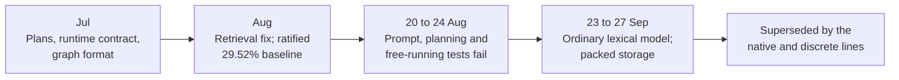

# Research line: compiling a teacher into tables (R4G1)

This was the project's first idea. Watch an ordinary language model (the "teacher"), compile what it does into lookup tables and a graph, and run those on a laptop with no multiplications. It worked as a compiler: it copied the teacher's top choice about as often as the teacher's own tables did. It never wrote coherent text on its own, which is why the project moved on.

| | |
|---|---|
| **Catalog id** | `r4g1-transformerless` |
| **Time span** | 21 Jul to 27 Sep 2026 (24 records undated, mostly design and reference documents) |
| **Milestone** | None recorded (74 of 74) |
| **Records** | 74 |
| **Outcomes** | plan 21 · negative 19 · positive 15 · inconclusive 5 · process 5 · review 4 · tooling 3 · diagnostic-stop 1 · ops 1 |
| **State** | PARKED ([R4G1 graph](../../mechanisms/r4g1-graph.md)); the frozen integer runtime is kept as a separate contract |

Counts: `archive/catalog.jsonl`. Terms follow the [glossary](../../start/glossary.md); ACTIVE, READY and PARKED are defined on the [mechanism board](../../mechanisms/README.md).

*From a compiler that copies a teacher to the point where the objective had to change.*

## What it set out to do

Compile a teacher into an integer-only graph (called R4G1) that a CPU can run with no floating point, no multiplications and no allocation while serving. Its rules are in [`inference_contract.md`](../../../docs/inference_contract.md). Compilation itself may use a teacher; only the served runtime must be lawful.

## What happened, in order

1. **July.** Planning documents, a runtime contract and a format for the graph. The cyclic phase-clock design was an open proposal that authorized no work ([phase clock](../../../archive/phase_clock_address_design.md)). Held-out Hopf routing used only 7 of 512 sectors ([record](../../../archive/hopf_sector_occupancy_d3.md)).
2. **August: retrieval and baselines.** Three retrieval negatives turned out to be one measurement bug: a dead cosine term. With a content query, mean reciprocal rank rose from 0.7179 to 0.8542 ([reassessment](../../../archive/retrieval_reassessment_500.md)). A certified GPT-2 dense teacher ran at 0.704 times the conventional cost against a 3.0 gate, bit-exactly ([record](../../../archive/gpt2_dense_704.md)). The attested SmolLM2 baseline was ratified at 29.5203% top-1 (21,293 of 72,130 positions) against 28.1214% for the older runtime ([record](../../../archive/normative_scorer_831.md)). A one-token skip-mix lane followed the reference in 41 of 87 favorable pairs, then in 58 of 87 after the candidates were injected, clearing the 53-of-87 bar ([spot check](../../../archive/skipmix_lane_897_spotcheck.md), [fix](../../../archive/skipmix_candidate_injection_906.md)).
3. **20 to 24 Aug: the walls.** The best prompt-conditioning arm gained +16.2 per mille against a 20 per mille floor ([bake-off](../../../archive/prompt_arms_bakeoff_834.md)). No sealed final partition existed for planning, so reasoning was NOT ESTABLISHED ([certification](../../../archive/compositional_planning_certification_846.md)). The skip-mix lane worsened free-running cycle collapse from 710 to 1000 per mille, so corrective rounds were not launched ([reachability](../../../archive/free_running_reachability_840.md)).
4. **23 to 27 Sep: the ordinary lexical model.** One shared Generate, Copy and Stop model passed 32 of 32 authored preflight cases but was 2.25 bits per target worse than a tuned count table ([result](../../../archive/integration/ordinary-lexical-result-2026-09-23.md)). Doubling joint-fit steps added only +0.025 bits against a 0.30 bar ([joint fit](../../../archive/integration/ordinary-lexical-joint-fit-result-2026-09-23.md)). Packed 4-bit storage kept eight output pairs identical and cut retained coefficient bytes from 6,702,340 to 847,876 (87.35%) ([comparison](../../../archive/integration/packed-integer-comparison-2026-09-27.md)).

## Key results

| Result | Kind | Source |
|---|---|---|
| Greedy decode matched the teacher on 29.5203% of 72,130 positions (older runtime 28.1214%) | measurement | [normative scorer](../../../archive/normative_scorer_831.md) |
| Content-query retrieval: mean reciprocal rank 0.8542 against 0.7179 (a measurement bug had hidden it) | measurement | [reassessment](../../../archive/retrieval_reassessment_500.md) |
| Prompt conditioning, best arm +16.2 per mille against a 20 floor | measurement | [bake-off](../../../archive/prompt_arms_bakeoff_834.md) |
| Served ordinary lexical model 2.25 bits per target behind a count table | measurement | [result](../../../archive/integration/ordinary-lexical-result-2026-09-23.md) |
| Packed storage cut retained coefficient bytes by 87.35% with identical outputs on eight pairs | measurement | [comparison](../../../archive/integration/packed-integer-comparison-2026-09-27.md) |

## What it taught

The teacher set the ceiling, not the store (lesson 5 in [what the project knows](../findings.md)). A metric that read zero, or a cosine term that never fired, hid real results, so check the instrument first (lesson 1). Gains measured while the teacher's text was supplied never became coherent text the model wrote itself (lesson 3). Exact integer export and bit-exact serving work (lesson 17), and the project kept that contract. Dormant mechanisms were kept behind gates, never deleted (lesson 16).

## Current state

PARKED. The R4G1 graph never produced coherent free text and needs a transformer teacher, which the current rules ban. What happens to its crates is an open owner question (`docs/labs/repo-renormalization-2026-10-19/audit/mechanisms/board.md`, D36 item 3). The integer runtime contract remains the model for D11 serving (the integer-only serving decision) ([M4 line](m4-serving.md)).

**Go deeper:** the [generated catalog page](../../../archive/catalog/r4g1-transformerless.md) lists all 74 records.
