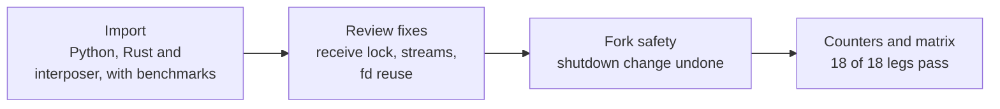

# Research line: SpiralCore wire transport (side exploration)

This line is a side road, not the model. SpiralCore is a set of exact geometric tools that the project also uses inside the model. Here, someone imported a separate use of it: compressing and routing network traffic between programs. All seven records are dated 18 October. They fix bugs, add tests and record loopback timings. None of them touches the language model, and none is a language result.

| | |
|---|---|
| **Catalog id** | `spiralcore-wire` |
| **Time span** | 18 Oct 2026 only |
| **Milestone** | None |
| **Records** | 7 |
| **Outcomes** | tooling 7 |
| **State** | Self-contained side exploration, off the model path |

Counts: `archive/catalog.jsonl`. Terms follow the [glossary](../../start/glossary.md); ACTIVE, READY and PARKED are defined on the [mechanism board](../../mechanisms/README.md).

*One day of import, review and repair.*

## What it set out to do

Test whether the exact byte-transport ideas in SpiralCore can shrink repeated network exchanges. The project's own review of the SpiralCore documents on 14 October found the byte transport and exact geometry sound, while the proposed attention head was incomplete and unproven. In the supplied tests a 1 MiB cold exchange used 62,579 bytes and a warm repeat 438 bytes ([review](../../../archive/labs/spiralcore-attention-assessment-2026-10-14/README.md)). The wire work asks a narrower question about transport only.

## What happened, in order

1. **Import.** The standalone wire compression and transport code (Python, Rust and an interposer) was imported as a self-contained side exploration with loopback benchmarks. On a Rust peer, a 1.25 MiB compressed exchange took 2.86 ms on average (range 2.10 to 3.30) against 1.92 ms for plain TCP; for 1 KiB, a round trip took 41.8 microseconds against 55.1. So on loopback the wire layer was faster for the 1 KiB round trip and slower for the 1.25 MiB exchange ([import](../../labs/spiralcore-wire-side-2026-10-18/README.md)).
2. **Review fixes.** Four findings from Codex's review of the merged transport were repaired: a receive lock, stream cleanup, a workspace path and committed build outputs. Smoke tests pass; no model compute ran ([fixes](../../labs/spiralcore-wire-review-fixes-2026-10-18/README.md)). A second round repaired a file-descriptor reuse race, stream registration order and half-close handling, with four smoke tests passing ([round two](../../labs/spiralcore-wire-review-fixes-2-2026-10-18/README.md)).
3. **A fix that broke something.** Adding a socket shutdown on close woke a blocked reader but broke fork safety, and the next record replaced it. The final interposer closes a shared socket after a fork without killing the parent's connection; fork and negative-control smoke tests pass on macOS and a Linux guest ([round three](../../labs/spiralcore-wire-review-fixes-3-2026-10-18/README.md), [fork-safe](../../labs/spiralcore-wire-interposer-fork-safe-2026-10-18/README.md)).
4. **Counters and reproducibility.** A one-character bug made a reused route report only its last connection's bytes. The fix reports two connections, 3,357 wire bytes and a ratio of 0.0041 against 0.0030 for the last connection alone, and a regression test fails without it ([counter fix](../../labs/wire-counter-aggregation-2026-10-18/README.md)). The interoperability matrix was made reproducible off the owner's machine, with 18 passing legs and none failing, and claims that cited nonexistent verify tools were withdrawn ([matrix](../../labs/wire-matrix-repro-2026-10-18/README.md)).

## Key results

| Result | Kind | Source |
|---|---|---|
| Interoperability matrix: 18 pass, 0 fail | measurement | [matrix](../../labs/wire-matrix-repro-2026-10-18/README.md) |
| 1 KiB round trip: 41.8 us over the wire layer against 55.1 us plain, on loopback | measurement | [import](../../labs/spiralcore-wire-side-2026-10-18/README.md) |
| 1.25 MiB compressed exchange: 2.86 ms mean against 1.92 ms plain TCP, on loopback | measurement | same |
| Route counter fix: 3,357 wire bytes over two connections | measurement | [counter fix](../../labs/wire-counter-aggregation-2026-10-18/README.md) |

## What it taught

Loopback numbers are not wide-area numbers: the benchmarks are one-machine timings, and one 2 MiB probe figure (16.7 ms) is a single uncontrolled run. A fix can break a neighbouring property, so the fork-safety smoke test mattered. Claims about checks that do not exist were withdrawn when found, which is lesson 1: check the instrument ([what the project knows](../findings.md)). Nothing here is evidence about language.

## Current state

A side exploration, kept for its tests. It uses no model, trains nothing and moves no milestone. The related exact-memory work that does matter to the model is the [object store](m3-durable-memory.md), which has its own peer protocol.

**Go deeper:** the [generated catalog page](../../../archive/catalog/spiralcore-wire.md) lists all 7 records.
