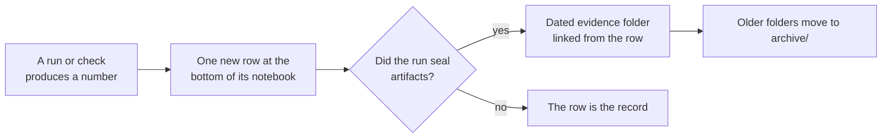

# Research notebooks

A notebook is one page per line of research, and each page is a table with one row for every result. Instead of a new folder and a new status entry for every pull request, the project now adds one row to the right notebook when a run produces a number. You can read a page top to bottom and see what was tried, what it measured, what bar it had to clear and what was concluded.

*How a result becomes a row. Only a run that seals artifacts keeps its own dated folder.*

## The format

Each notebook lives at `docs/research/notebook/<line>.md`. A *line* is one sustained question, such as "how the discrete model reads context". The charter sets this format (`CHARTER.md`, section 5.6), and the owner chose it in answer to question 4 of the 19 October 2026 review.

Every result is one row with six columns:

| Column | What goes in it |
|---|---|
| **Date** | The ISO date the result was recorded (`YYYY-MM-DD`). |
| **What ran** | One or two plain sentences: the test or check, on what, with what budget. |
| **Number** | The measured value, with its denominator and the baseline it is read against. |
| **Bar** | The pass line that was fixed before the run, or "none registered" when the run was a diagnostic or a qualification check. |
| **Verdict** | One of the five words below, with a short qualifier. |
| **Artifact** | A link to the record or the sealed evidence folder that holds the proof. |

Rules for keeping a notebook:

- **Append at the bottom.** The newest row is last. Rows from one day appear in the order the work ran where the records show it.
- **One row per result.** A repeat of an earlier run gets its own row. A change of plan, a review or a tooling step is not a result and gets no row.
- **A dated evidence folder only when a run seals artifacts** (checkpoints, receipts, logs with checksums). The row links to it. A result with nothing to seal needs no folder.
- **Numbers are measurements** from a recorded run, unless the row says proof or hypothesis, as defined in [`formal_vocabulary.md`](../../formal_vocabulary.md). A passing control is not a language result, and `NOT_RUN` is not a pass.
- **Rows are never edited to change a verdict.** If a later run corrects an earlier one, add a new row that names the earlier one.

### The five verdict words

| Verdict | Meaning |
|---|---|
| **positive** | The run met the bar or passed the controls it registered, at the scope stated in the row. |
| **negative** | The run missed a registered bar. It closes that exact configuration (recipe, dose, window, objective) and never the mechanism (D22). |
| **inconclusive** | The run produced a number, but no bar was decided, or the evidence cannot separate the explanations. |
| **diagnostic stop** | A registered stop rule or the owner ended the run early so the cause could be found. It is not a negative. |
| **blocked** | A fault in the tooling, the machine or the source stopped the run before it could measure. It is not a negative, and it is not a result about the model. |

## The notebooks

| Line | Page | What it asks | Result rows |
|---|---|---|---:|
| `m1-discrete-attention` | [m1-discrete-attention.md](./m1-discrete-attention.md) | Can the integer model learn to read earlier text well enough to predict the next word? | 30 |
| `m1-prime-zeta` | [m1-prime-zeta.md](./m1-prime-zeta.md) | Can prime numbers and zeta-zero phases give every token a distinct starting vector? | 1 |
| `m3-durable-memory` | [m3-durable-memory.md](./m3-durable-memory.md) | Can conversation be stored and rebuilt exactly, so memory lasts across sessions? | 1 |
| `m4-serving` | [m4-serving.md](./m4-serving.md) | Can the trained model be served with integers and tables only? | 0 |
| `data-tokenizer` | [data-tokenizer.md](./data-tokenizer.md) | Which data and which tokenizer does the model train on? | 0 |
| `harness-governance` | [harness-governance.md](./harness-governance.md) | Is the research tooling and process worth its cost? | 0 |

*Source of the counts: `local/renorm/audit/catalog.jsonl`, records dated 12 October 2026 or later whose outcome is positive, negative, inconclusive, diagnostic-stop or blocked, counted with `jq`. Pages with 0 rows have records on those dates, but all of them are tooling, planning or process records. The page says so.*

The other fourteen lines in the audit catalog (for example `m2-exact-memory` and `m1-float-rung0`) have no notebook yet. Each gets one the next time it produces a result. The project is pre-alpha: 0 of 8 milestones are complete, and no row on any page is a language result.

## Where the rows came from

The first rows were seeded from the audit catalog, which read every lab record in the repository. The seed covers 12 October 2026 to 19 October 2026. Earlier work is summarised in [How the project got here](../history.md) and sits in [`archive/`](../../../archive/CATALOG.md). Records dated before 18 October 2026 link to their archived path; records of 18 and 19 October stay in `docs/labs/`.

## Go deeper

- [How research is done now](../README.md), including the sheet, review and release rules.
- [What the project knows](../findings.md) and [what is still open](../open-questions.md).
- [`docs/integration/NOW.md`](../../integration/NOW.md): the current plan, which with these notebooks replaces the old running state log.
- [`archive/CATALOG.md`](../../../archive/CATALOG.md): every archived record, by date, lab, line and verdict.
