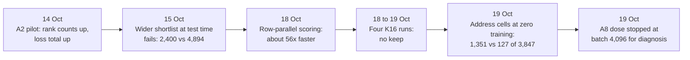

# Notebook: discrete attention for the language base (M1)

This is the running table of results for the line that carries the project today. It asks whether a model that uses only integers and small geometric moves can learn to read earlier text well enough to predict the next word. The rows below run from 13 October to 19 October 2026. None of them is a trained language result: the best trained discrete model gets the right next word first in 463 of 14,287 development rows, while a simple count table (T2) gets 6,300.

*The turning points in the rows below. Each box is one or more rows; the numbers are in the table.*

The longer story of this line is on its [line page](../lines/m1-discrete-attention.md). The mechanisms involved are described in [address cells](../../mechanisms/address-cells.md), [admission](../../mechanisms/admission.md), [rank margin](../../mechanisms/rank-margin.md) and [relation read](../../mechanisms/relation-read.md).

## Terms used in the table

- **DEV panel.** The open development panel of 14,287 rows. Each row is a context and the true next token. **P_succ** (the copy-successor subset) is 3,847 of those rows; it is the subset where the answer follows an earlier occurrence of the same token.
- **Admission.** The read can only choose among a shortlist of candidate cells (K of them, usually K=8). A row is *admitted* when the true next token's cell is on the shortlist. A token outside it can never be chosen, so admission is a ceiling on top-1.
- **Top-1 / top-8.** The true token ranked first / within the first eight.
- **Batches.** Training steps. A full registered dose is 16,404 batches.
- **FIT.** An independent review of a run's pre-registration sheet before spending compute. A FIT releases nothing by itself.
- **Control (C-R1 to C-R6, V2 and the like).** A check built to fail if the instrument is wrong. A passing control is not a model result.
- **Status words** (positive, negative, diagnostic stop, blocked) are defined in the [format page](./README.md#the-five-verdict-words).

## Results

Sources: each row links its record. Counts and one-line descriptions come from [`archive/catalog.jsonl`](../../../archive/catalog.jsonl); numbers and bars were checked against the record itself. Records dated before 18 October 2026 are in `archive/`.

| Date | What ran | Number | Bar | Verdict | Artifact |
|---|---|---|---|---|---|
| 2026-10-13 | Wired the flock read (a small neighbour set) and ternary gates into the discrete GPU model, then ran the finite construction controls on a rented GPU pod. No training. | 17 of 17 controls pass (11 route, 6 flock); 0 updates applied | All finite CUDA construction controls pass; no training registered | positive (construction only) | [discrete-flock-writer-integration](../../../archive/labs/discrete-flock-writer-integration-2026-10-13/README.md) |
| 2026-10-13 | First integer-only GPU path: context, tree routing, rotation and a shared token-vector writer, with proposal-only learning. No update ran. | 11 of 11 construction controls pass on attempt 3 (6 s). Attempt 1 hit a CUDA out-of-resources stop after one pass. | All 11 controls pass at the pinned source, after independent FIT review | positive (construction only) | [discrete-geometric-learning](../../../archive/labs/discrete-geometric-learning-2026-10-13/README.md) |
| 2026-10-14 | A2 seed-1 pilot: the first 1,640-batch GPU training run of the discrete model, on one RTX 5090 (about $1.77). | Top-1 17 to 82 of 14,287; top-8 173 to 1,169; loss total 13,816,032 to 13,884,032 (it rose); occupied writer cells 16 to 124 | Not decided (pilot) | inconclusive (mixed; no mechanism verdict; receipt audit passes) | [a2-pilot](../../../archive/labs/a2-pilot-2026-10-14/README.md) |
| 2026-10-15 | Standalone GPU runner for the six C-R control checks of the rank-hinge admission objective, over five restarts. | Restart 5: all six controls pass; the run then halted at the timing gate with 99 timed batches | Six controls pass and 100 timed batches | diagnostic stop (instrument gate, not a mechanism result) | [admission-rank-fixture-runner](../../../archive/labs/admission-rank-fixture-runner-2026-10-15/README.md) |
| 2026-10-15 | Stage-A K-sweep: four saved checkpoints re-scored with 8 to 16 kept cells (36 points). | Best target-admitted rows 2,400 at K=16 (1,920 at K=8) | Gate G-A: some K reaches 4,894 target-admitted rows at batch 16,404 (bar 4,775 plus a 119-row half-width) | negative (G-A fails; closes widening at evaluation time only) | [rung0-stage-a-sweep](../../../archive/labs/rung0-stage-a-sweep-2026-10-15/README.md) |
| 2026-10-15 | The read-only instrument behind the K-sweep, built and run on a pod. | K=8 controls reproduce the five registered counts exactly (top-1 149, target-admitted 1,920); best at K=16 is 2,400 | Same gate G-A (4,894) | negative (FAIL_EVAL_TIME_WIDENING_ONLY; same result as the row above) | [stage-a-admission-instrument](../../../archive/labs/stage-a-admission-instrument-2026-10-15/README.md) |
| 2026-10-16 | First finite-control GPU run for counterfactual proposals. | Stopped at an admission check: 90 registers in the loaded kernel against 88 in the compiled report; 0 proposals run | Zero register difference between loaded and compiled kernel | blocked (instrument provenance defect, not a mechanism negative) | [counterfactual-controls-run](../../../archive/labs/counterfactual-controls-run-2026-10-16/README.md) |
| 2026-10-16 | Finite controls repeated after the image-binding repair. | 40 proposals, 128 one-row endpoint evaluations and 16 typed refusals all matched; resource counts equal; no state changed | All finite control checks match, with zero apply | positive (qualification, not a model result) | [counterfactual-controls-pass](../../../archive/labs/counterfactual-controls-pass-2026-10-16/README.md) |
| 2026-10-16 | Bounded GPU diagnostic of the slow proposal kernel. | The baseline is recomputed for each of 16 candidates, about 47% of lane cycles; the writer is about 99.98% of cycles; 32 proposals with matching U/D losses | None registered (diagnostic) | positive (locates the waste; no speedup yet) | [counterfactual-decomposition-run](../../../archive/labs/counterfactual-decomposition-run-2026-10-16/README.md) |
| 2026-10-16 | Checkpoint-0 timing of the propose phase, 3 timed batches per arm on a GPU. | 7.36 s per proposal; over 99.99% is the counterfactual scoring kernel | None registered (diagnostic) | inconclusive (not a training rate or mechanism verdict) | [propose-subphase-diagnostic-run](../../../archive/labs/propose-subphase-diagnostic-run-2026-10-16/README.md) |
| 2026-10-16 | K16 qualification, first attempt, on a pod. | Stopped at step 0: the fixture runner failed to compile on CUDA (exit 101); no control, timing or training ran | Step-0 builds, then G-Pre, C-R1 to C-R6, then a 100-batch timing, in order | blocked (build blocker, not a mechanism negative) | [k16-qualification](../../../archive/labs/k16-qualification-2026-10-16/README.md) |
| 2026-10-16 | K16 qualification restart. | Stopped before any GPU work: the control script and the evaluator disagreed on a JSON key name | Same ordered sequence; admission bar 4,894 unchanged | blocked (source bug, not a result) | [k16-qualification-restart](../../../archive/labs/k16-qualification-restart-2026-10-16/README.md) |
| 2026-10-16 | K16 qualification restart 4. | All three CUDA builds passed; the strict lint check (clippy, exit 101) failed on the control-runner code; step 0 fails | The lint gate runs with warnings as errors and was not weakened | blocked (source defect) | [k16-qualification-restart4](../../../archive/labs/k16-qualification-restart4-2026-10-16/README.md) |
| 2026-10-16 | K16 qualification restart 5. | Controls and untrained admission checks pass (K16-A seed 1: 14,287 of 14,287 rows admitted, 0 strict wins; K8 A seed 1: 5,680); timing recorded 99 batches | Admission above 4,894 (met); 100 timed batches (missed by one) | blocked (timing sample-count bug) | [k16-qualification-restart5](../../../archive/labs/k16-qualification-restart5-2026-10-16/README.md) |
| 2026-10-17 | Attention preflight Battery 3: a zero-training GPU run of 26 steps measuring starting admission and 9 relation controls. | P_succ admission 2,034 of 3,847 (full panel 7,500 of 14,287); 9 of 9 relation controls pass | P_succ admission at least 500 | positive (zero-training preflight; learned relation NOT_RUN) | [attention-preflight](../../../archive/labs/attention-preflight-2026-10-17/README.md) |
| 2026-10-17 | Baseline-reuse path compared with the ordinary path on GPU driver 580.95.05. | 32 comparisons with identical losses; 64 proposals (56 successes, 8 status-8); 16 refusals; zero apply. Timing NOT_RUN. | Identical results to the ordinary path | positive (finite controls only) | [counterfactual-baseline-reuse-finite-pass](../../../archive/labs/counterfactual-baseline-reuse-finite-pass-2026-10-17/README.md) |
| 2026-10-17 | The same finite controls on a second GPU driver (595.71.05). | 32 pairs, 64 proposals and 16 refusals pass; zero apply | Same as the row above | positive (qualifies the environment, not speed) | [counterfactual-baseline-reuse-driver-595](../../../archive/labs/counterfactual-baseline-reuse-driver-595-2026-10-17/README.md) |
| 2026-10-17 | Host-only re-score of the Stage-A checkpoints, plus a context-free successor table (T2) as a comparator. | K=8 to K=16 top-1 on 1,920 rows: 149 to 138. T2 gets 6,300 of 14,287 top-1; the trained Route artifact gets 149. | Primary change must rise by the floor of 24 rows; a trained Relation artifact must beat T2 | inconclusive (the Relation arm was not run, so that row is UNAVAILABLE) | [host-diagnostics](../../../archive/labs/host-diagnostics-2026-10-17/README.md) |
| 2026-10-17 | Native Relation learning path: built the training schedule and tried six paid compiler-check pod runs. | 0 model updates; 6 pod leases; finite CUDA qualification NOT_RUN | None reached | blocked (operator and lint blockers) | [native-relation-learning-path](../../../archive/labs/native-relation-learning-path-2026-10-17/README.md) |
| 2026-10-18 | Dose 1, the first paired attention run (Relation arm and a frozen-zero control). The owner stopped it early to switch to a faster row-parallel driver. | Relation reached 904 batches and the control 1,065 (both exit 143); 198 files, 237,872,396 bytes preserved | Registered bars unchanged and not tested | diagnostic stop (owner stop; not a verdict) | [attention-dose1-strategic-stop](../../labs/attention-dose1-strategic-stop-2026-10-18/README.md) |
| 2026-10-18 | The paired rows_v1 run reached its first check (Q1, 4,096 batches) in both arms. | P_succ admission 2,034 to 225 (Relation) and 205 (control) of 3,847; full panel 7,500 to 829 and 767 of 14,287 | Q1 stop criteria: P_succ admission below 500 and below half of 2,034 (both fired) | diagnostic stop (the read could not be judged) | [attention-rows-q1-diagnosis](../../labs/attention-rows-q1-diagnosis-2026-10-18/README.md) |
| 2026-10-18 | Row-parallel GPU kernel for the exact counterfactual, compared with the ordinary kernel. | Proposal time 3.843 s to 0.0691 s (55.6x) with equal losses; Route parity 684 of 684 on attempt 3; K16 shape 7.400 s to 0.1297 s (57.0x) | Losses equal on every compared index; the negative control must fail (it did) | positive (opt-in path; default unchanged) | [counterfactual-rows-parity](../../labs/counterfactual-rows-parity-2026-10-18/README.md) |
| 2026-10-18 | BVG-K stage C1: scoring 16 candidate moves in one GPU launch. | 5,130 of 5,130 coordinates match single-coordinate scoring; 16 coordinates cost 123.6 ms against 125.5 ms for one (16.25x versus 16 single calls) | Parity on every coordinate; 2x reading threshold; the sabotage control must fail (it did) | positive (scoring only; block apply is next) | [bvgk-rowsk-scoring](../../labs/bvgk-rowsk-scoring-2026-10-18/README.md) |
| 2026-10-18 | K16 rows-path qualification: controls, an untrained admission check and a 100-sample timing. | Existing finite controls 25 of 25; C-R1 to C-R6 6 of 6; K16-A seed 1 admits 14,287 of 14,287 rows at top-1 19, with 0 strict wins | All qualification gates in order; bars unchanged | positive (qualification; no learning result) | [k16-rows-qualification](../../labs/k16-rows-qualification-2026-10-18/README.md) |
| 2026-10-18 | Documentation sync for the finished R-arm seed-1 run (K16-R). | 16,404 batches, 130 accepted updates; DEV top-1 101 and top-8 515 of 14,287 | None decided; two-seed reading pending | inconclusive (a sync of one run, not a verdict) | [r1-completion-docs](../../labs/r1-completion-docs-2026-10-18/README.md) |
| 2026-10-18 | All four registered K16 runs (two writer objectives, two seeds) finished 16,404 batches. | Accepted updates, target-admitted rows of 14,287, top-1: A seed 1 407, 2,237, 65; A seed 2 410, 3,167, 463; R seed 1 130, 12,089, 101; R seed 2 129, 12,466, 230 | Pending the registered two-seed interpretation | inconclusive (at this record; settled by the 19 October row) | [k16-four-role-execution](../../labs/k16-four-role-execution-2026-10-18/README.md) |
| 2026-10-19 | Registered two-seed outcome call on the four K16 runs. | R keeps admission (12,089 of 14,287) but collapses to about 20 occupied cells; A keeps 192 to 209 cells but admits only 2,237 and 3,167 rows; top-1 is 65 and 463 for A | Admission at least 4,894; top-1 at least 1,941; top-8 at least 4,775 | negative (OCCUPANCY_COLLAPSE_TRIGGERED; no keep; closes these configurations only; fresh slice sealed) | [k16-outcome-call](../../labs/k16-outcome-call-2026-10-19/README.md) |
| 2026-10-19 | Injective-table pre-flight at zero training, plus BVG-K stage C2 qualification (which passes). | P_succ admission 127 of 3,847 (full panel 427 of 14,287); occupied cells 256 | P_succ admission at least 500 (B3_init) | diagnostic stop (the run was not dispatched; nothing trained) | [injective-preflight-and-c2-qualify](../../labs/injective-preflight-and-c2-qualify-2026-10-19/README.md) |
| 2026-10-19 | Address-structured injective cells at zero training: each token's cell is placed near its predecessors' cells. | P_succ admission 1,351 of 3,847 (full panel 4,244 of 14,287), against 476 for a shuffled-packing control and 127 for the injective table | P_succ admission at least 500 (B3_init): passes | positive (zero-update admission evidence, not learning) | [address-cells-preflight](../../labs/address-cells-preflight-2026-10-19/README.md) |
| 2026-10-19 | A8 dose: both arms trained on address-structured cells, on 2 RTX 5090 GPUs for about 62 minutes (about $1.9). | P_succ admission 1,351 to 551 for Relation at batch 4,096 (stop fired); the frozen-zero control fell to 857 and finished the dose | Stop if P_succ admission at the first check is below 500 or below half its start (675.5) | diagnostic stop (learning moves ejected target cells from the shortlist; not a mechanism negative) | [a8-dose](../../labs/a8-dose-2026-10-19/README.md) |
| 2026-10-22 | Host placement census of the A8 dose on its retained checkpoints and move logs to Q1, on the laptop. No admission recomputed, no GPU. Seven controls pass, including the GPU cell receipt match and an exact 3,847 of 14,287 P_succ rows. | Relation against the frozen-zero control: tokens whose cell moved 80 against 91; P_succ rows whose target moved 1,461 against 1,369; row-weighted target-to-predecessor distance 8.564 to 10.123 against 9.799; all 256 cells stay occupied | None (diagnosis; the item registers no bar) | inconclusive (placement remains a suspect on the row-weighted measures and the read is not cleared; separating them needs a device admission run under its own FIT sheet) | [m1-a8-erosion-diagnosis](../../labs/m1-a8-erosion-diagnosis/README.md) |
| 2026-10-25 | W2 read-code capacity on the seed-1 Q4 checkpoint, which was imported evaluation-only after Gate R reproduced its sealed DEV evaluation exactly. A table keyed by the exact read code and two ordinary next-word tables were built from the model-matched 1,049,856 TRAIN targets (the sheet's fallback regime) and scored on DEV. Two runs on one RTX 5090 gave identical results (about $0.48). | Code table 3,414 of 14,287; bigram 6,300; unigram 1,226; writer 149. On the 1,920 admitted rows, the code table restricted to admitted cells gets 1,138 against the writer's 149 | §4.7: H_law if T > M + F (about 6,435); H_mixed if W + H (about 265) ≤ T ≤ M + F | positive (the registered table resolves to H_mixed: the code is informative beyond the writer but not beyond the bigram; the next step is a code-utilization diagnostic, not a learning-law change) | [m1-w2-capacity-capture](../../labs/m1-w2-capacity-capture/README.md) |
| 2026-10-25 | A8 admission-anchor controller finite CUDA qualification and restoration (`train61-synthetic1-interval64-two-arm-throughput-v1`) under sheet-bound source `fd409fcdf` on one RTX 5090 (about $0.25). Both `relation` and `frozen-zero` arms ran 384 timed transitions plus controlled post-update restoration and 3,847-row TRAIN anchor verification. | Synthetic control PASS (`1` update, `1` stale apply refusal, `1` stale carry refusal, restored epoch `0`); both arms `5/5` qualification stages PASS (`canonical_initlock_c2` 9/9, `required_negatives` exits `[2, 2]`, `g_occ` P_succ `1,351/3,847`, `sensitivity` `[1, 1]`, `audited_restore_epoch_cursor` `384` steps, `58` and `54` updates restored to epoch `0` with identical `1,211/3,847` TRAIN anchor admission); projected 516-audit + 514-restore gate cost `4,947.75 s` against `6,309.72 s` ungated two-arm dose (`R = 78.41%`, `38.06%` at 0 restores) | All finite qualification controls PASS on CUDA; readiness bar `R <= 15%` before full-dose training (`STOP_OVER_15_PERCENT_GATE_COST` if `R > 15%`) | diagnostic stop (all finite qualification and restoration controls PASS; `R = 78.41% > 15%` triggers the registered readiness replan before full-dose training in `#2831`, not a mechanism negative) | [m1-a8-finite-cuda-qualification](../../labs/m1-a8-finite-cuda-qualification/README.md) |

## What the rows say, in plain terms

- The integer path is built and its finite controls pass. Those are construction results, and they say nothing about language.
- Training moves the rank counts up but has not yet beaten the context-free count table. The best trained result in the rows is 463 of 14,287, against 6,300 for T2 and 1,226 for the unigram table (`CHARTER.md`, section 4.8).
- The main obstacle found so far is admission: a token outside the shortlist can never be chosen. Widening the shortlist at test time did not fix it (row of 15 October). Placing cells by address structure fixed it at the start (1,351 against 127 of 3,847), but training then pushed target cells out of the shortlist (the A8 row).
- W2 (25 October) gave H_mixed on the Q4 checkpoint. A table keyed by the model's own read code predicts 3,414 rows, far above the trained writer's 149, but below the next-word bigram's 6,300. When the target's cell is admitted, the code table restricted to admitted cells picks the target 1,138 times out of 1,920, against 149 for the writer. So the output map loses most of what survives admission. Admission itself loses more: at least 2,276 of the table's 3,414 hits are on rows where the writer never admitted the target's cell.
- Six of the 31 rows are blocked by tooling or build faults and are not results about the model. The row-parallel kernel (about 56x faster proposals with identical losses) is the largest measured speed change.
- On 25 October, the admission-preserving A8 controller passed all finite CUDA qualification and restoration controls on an RTX 5090 under the sheet-bound source `fd409fcdf`: both the `relation` (58 accepted updates across 384 steps) and `frozen-zero` (54 accepted updates across 384 steps) arms restored exact model storage and snapshot hashes to epoch `0` while advancing the training cursor to batch `384`, refusing stale handles, and reproducing `1,211 / 3,847` TRAIN anchor admission identically before and after restore. Because `rows_v1` accelerated 64-step training intervals to `17.66 s` (`relation`) and `6.88 s` (`frozen-zero`), running a `4.44 s` 61-batch TRAIN anchor evaluation + full JSON checkpoint seal/readback every 64 batches (`516` audits) plus charging `514` worst-case full restores (`4.95 s` each) projects `78.41%` gate overhead (`38.06%` at zero restores), triggering the sheet's `> 15%` readiness stop so the audit cadence or restore bound is replanned before full-dose training (`#2831`).

## Not in this table

- Plans, reviews, tooling and process records of the same period are not results. They are listed in `archive/CATALOG.md` and in `docs/labs/` under this line.
- The GPU rental blockers for the baseline-reuse timing runs (17 October) are filed under the `compute-ops` line, not here.
- The float "starling" reads of 12 October are filed under `m1-float-rung0`, which has no notebook yet.

## Go deeper

- [Line page: discrete attention for the language base](../lines/m1-discrete-attention.md)
- [Format and verdict words](./README.md)
- [Prime and zeta starting codebook notebook](./m1-prime-zeta.md), whose table was the starting point for the 19 October address-cell rows
- [`archive/CATALOG.md`](../../../archive/CATALOG.md), filtered by line `m1-discrete-attention`
