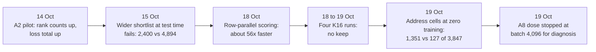

# Notebook: discrete attention for the language base (M1)

This is the running table of results for the line that carries the project today. It asks whether a model that uses only integers and small geometric moves can learn to read earlier text well enough to predict the next word. The rows below run from 13 October to 19 October 2026. None of them is a trained language result: the best trained discrete model gets the right next word first in 463 of 14,287 development rows, while a simple count table (T2) gets 6,300.

*The turning points in the rows below. Each box is one or more rows; the numbers are in the table.*

The longer story of this line is on its [line page](../lines/m1-discrete-attention.md). The mechanisms involved are described in [address cells](../../mechanisms/address-cells.md), [admission](../../mechanisms/admission.md), [rank margin](../../mechanisms/rank-margin.md) and [relation read](../../mechanisms/relation-read.md).

## Terms used in the table

- **DEV panel.** The open development panel of 14,287 rows. Each row is a context and the true next token. **P_succ** (the copy-successor subset) is 3,847 of those rows; it is the subset where the answer follows an earlier occurrence of the same token.
- **Admission.** The read can only choose among a shortlist of candidate cells (K of them, usually K=8). A row is *admitted* when the true next token's cell is on the shortlist. A token outside it can never be chosen, so admission is a ceiling on top-1.
- **Top-1 / top-8.** The true token ranked first / within the first eight.
- **Batches.** Training steps. A full registered dose is 16,404 batches.
- **FIT.** An independent review of a run's pre-registration sheet before spending compute. A FIT releases nothing by itself.
- **Control (C-R1 to C-R6, V2 and the like).** A check built to fail if the instrument is wrong. A passing control is not a model result.
- **Status words** (positive, negative, diagnostic stop, blocked) are defined in the [format page](./README.md#the-five-verdict-words).

## Results

Sources: each row links its record. Counts and one-line descriptions come from [`archive/catalog.jsonl`](../../../archive/catalog.jsonl); numbers and bars were checked against the record itself. Records dated before 18 October 2026 are in `archive/`.

| Date | What ran | Number | Bar | Verdict | Artifact |
|---|---|---|---|---|---|
| 2026-10-13 | Wired the flock read (a small neighbour set) and ternary gates into the discrete GPU model, then ran the finite construction controls on a rented GPU pod. No training. | 17 of 17 controls pass (11 route, 6 flock); 0 updates applied | All finite CUDA construction controls pass; no training registered | positive (construction only) | [discrete-flock-writer-integration](../../../archive/labs/discrete-flock-writer-integration-2026-10-13/README.md) |
| 2026-10-13 | First integer-only GPU path: context, tree routing, rotation and a shared token-vector writer, with proposal-only learning. No update ran. | 11 of 11 construction controls pass on attempt 3 (6 s). Attempt 1 hit a CUDA out-of-resources stop after one pass. | All 11 controls pass at the pinned source, after independent FIT review | positive (construction only) | [discrete-geometric-learning](../../../archive/labs/discrete-geometric-learning-2026-10-13/README.md) |
| 2026-10-14 | A2 seed-1 pilot: the first 1,640-batch GPU training run of the discrete model, on one RTX 5090 (about $1.77). | Top-1 17 to 82 of 14,287; top-8 173 to 1,169; loss total 13,816,032 to 13,884,032 (it rose); occupied writer cells 16 to 124 | Not decided (pilot) | inconclusive (mixed; no mechanism verdict; receipt audit passes) | [a2-pilot](../../../archive/labs/a2-pilot-2026-10-14/README.md) |
| 2026-10-15 | Standalone GPU runner for the six C-R control checks of the rank-hinge admission objective, over five restarts. | Restart 5: all six controls pass; the run then halted at the timing gate with 99 timed batches | Six controls pass and 100 timed batches | diagnostic stop (instrument gate, not a mechanism result) | [admission-rank-fixture-runner](../../../archive/labs/admission-rank-fixture-runner-2026-10-15/README.md) |
| 2026-10-15 | Stage-A K-sweep: four saved checkpoints re-scored with 8 to 16 kept cells (36 points). | Best target-admitted rows 2,400 at K=16 (1,920 at K=8) | Gate G-A: some K reaches 4,894 target-admitted rows at batch 16,404 (bar 4,775 plus a 119-row half-width) | negative (G-A fails; closes widening at evaluation time only) | [rung0-stage-a-sweep](../../../archive/labs/rung0-stage-a-sweep-2026-10-15/README.md) |
| 2026-10-15 | The read-only instrument behind the K-sweep, built and run on a pod. | K=8 controls reproduce the five registered counts exactly (top-1 149, target-admitted 1,920); best at K=16 is 2,400 | Same gate G-A (4,894) | negative (FAIL_EVAL_TIME_WIDENING_ONLY; same result as the row above) | [stage-a-admission-instrument](../../../archive/labs/stage-a-admission-instrument-2026-10-15/README.md) |
| 2026-10-16 | First finite-control GPU run for counterfactual proposals. | Stopped at an admission check: 90 registers in the loaded kernel against 88 in the compiled report; 0 proposals run | Zero register difference between loaded and compiled kernel | blocked (instrument provenance defect, not a mechanism negative) | [counterfactual-controls-run](../../../archive/labs/counterfactual-controls-run-2026-10-16/README.md) |
| 2026-10-16 | Finite controls repeated after the image-binding repair. | 40 proposals, 128 one-row endpoint evaluations and 16 typed refusals all matched; resource counts equal; no state changed | All finite control checks match, with zero apply | positive (qualification, not a model result) | [counterfactual-controls-pass](../../../archive/labs/counterfactual-controls-pass-2026-10-16/README.md) |
| 2026-10-16 | Bounded GPU diagnostic of the slow proposal kernel. | The baseline is recomputed for each of 16 candidates, about 47% of lane cycles; the writer is about 99.98% of cycles; 32 proposals with matching U/D losses | None registered (diagnostic) | positive (locates the waste; no speedup yet) | [counterfactual-decomposition-run](../../../archive/labs/counterfactual-decomposition-run-2026-10-16/README.md) |
| 2026-10-16 | Checkpoint-0 timing of the propose phase, 3 timed batches per arm on a GPU. | 7.36 s per proposal; over 99.99% is the counterfactual scoring kernel | None registered (diagnostic) | inconclusive (not a training rate or mechanism verdict) | [propose-subphase-diagnostic-run](../../../archive/labs/propose-subphase-diagnostic-run-2026-10-16/README.md) |
| 2026-10-16 | K16 qualification, first attempt, on a pod. | Stopped at step 0: the fixture runner failed to compile on CUDA (exit 101); no control, timing or training ran | Step-0 builds, then G-Pre, C-R1 to C-R6, then a 100-batch timing, in order | blocked (build blocker, not a mechanism negative) | [k16-qualification](../../../archive/labs/k16-qualification-2026-10-16/README.md) |
| 2026-10-16 | K16 qualification restart. | Stopped before any GPU work: the control script and the evaluator disagreed on a JSON key name | Same ordered sequence; admission bar 4,894 unchanged | blocked (source bug, not a result) | [k16-qualification-restart](../../../archive/labs/k16-qualification-restart-2026-10-16/README.md) |
| 2026-10-16 | K16 qualification restart 4. | All three CUDA builds passed; the strict lint check (clippy, exit 101) failed on the control-runner code; step 0 fails | The lint gate runs with warnings as errors and was not weakened | blocked (source defect) | [k16-qualification-restart4](../../../archive/labs/k16-qualification-restart4-2026-10-16/README.md) |
| 2026-10-16 | K16 qualification restart 5. | Controls and untrained admission checks pass (K16-A seed 1: 14,287 of 14,287 rows admitted, 0 strict wins; K8 A seed 1: 5,680); timing recorded 99 batches | Admission above 4,894 (met); 100 timed batches (missed by one) | blocked (timing sample-count bug) | [k16-qualification-restart5](../../../archive/labs/k16-qualification-restart5-2026-10-16/README.md) |
| 2026-10-17 | Attention preflight Battery 3: a zero-training GPU run of 26 steps measuring starting admission and 9 relation controls. | P_succ admission 2,034 of 3,847 (full panel 7,500 of 14,287); 9 of 9 relation controls pass | P_succ admission at least 500 | positive (zero-training preflight; learned relation NOT_RUN) | [attention-preflight](../../../archive/labs/attention-preflight-2026-10-17/README.md) |
| 2026-10-17 | Baseline-reuse path compared with the ordinary path on GPU driver 580.95.05. | 32 comparisons with identical losses; 64 proposals (56 successes, 8 status-8); 16 refusals; zero apply. Timing NOT_RUN. | Identical results to the ordinary path | positive (finite controls only) | [counterfactual-baseline-reuse-finite-pass](../../../archive/labs/counterfactual-baseline-reuse-finite-pass-2026-10-17/README.md) |
| 2026-10-17 | The same finite controls on a second GPU driver (595.71.05). | 32 pairs, 64 proposals and 16 refusals pass; zero apply | Same as the row above | positive (qualifies the environment, not speed) | [counterfactual-baseline-reuse-driver-595](../../../archive/labs/counterfactual-baseline-reuse-driver-595-2026-10-17/README.md) |
| 2026-10-17 | Host-only re-score of the Stage-A checkpoints, plus a context-free successor table (T2) as a comparator. | K=8 to K=16 top-1 on 1,920 rows: 149 to 138. T2 gets 6,300 of 14,287 top-1; the trained Route artifact gets 149. | Primary change must rise by the floor of 24 rows; a trained Relation artifact must beat T2 | inconclusive (the Relation arm was not run, so that row is UNAVAILABLE) | [host-diagnostics](../../../archive/labs/host-diagnostics-2026-10-17/README.md) |
| 2026-10-17 | Native Relation learning path: built the training schedule and tried six paid compiler-check pod runs. | 0 model updates; 6 pod leases; finite CUDA qualification NOT_RUN | None reached | blocked (operator and lint blockers) | [native-relation-learning-path](../../../archive/labs/native-relation-learning-path-2026-10-17/README.md) |
| 2026-10-18 | Dose 1, the first paired attention run (Relation arm and a frozen-zero control). The owner stopped it early to switch to a faster row-parallel driver. | Relation reached 904 batches and the control 1,065 (both exit 143); 198 files, 237,872,396 bytes preserved | Registered bars unchanged and not tested | diagnostic stop (owner stop; not a verdict) | [attention-dose1-strategic-stop](../../labs/attention-dose1-strategic-stop-2026-10-18/README.md) |
| 2026-10-18 | The paired rows_v1 run reached its first check (Q1, 4,096 batches) in both arms. | P_succ admission 2,034 to 225 (Relation) and 205 (control) of 3,847; full panel 7,500 to 829 and 767 of 14,287 | Q1 stop criteria: P_succ admission below 500 and below half of 2,034 (both fired) | diagnostic stop (the read could not be judged) | [attention-rows-q1-diagnosis](../../labs/attention-rows-q1-diagnosis-2026-10-18/README.md) |
| 2026-10-18 | Row-parallel GPU kernel for the exact counterfactual, compared with the ordinary kernel. | Proposal time 3.843 s to 0.0691 s (55.6x) with equal losses; Route parity 684 of 684 on attempt 3; K16 shape 7.400 s to 0.1297 s (57.0x) | Losses equal on every compared index; the negative control must fail (it did) | positive (opt-in path; default unchanged) | [counterfactual-rows-parity](../../labs/counterfactual-rows-parity-2026-10-18/README.md) |
| 2026-10-18 | BVG-K stage C1: scoring 16 candidate moves in one GPU launch. | 5,130 of 5,130 coordinates match single-coordinate scoring; 16 coordinates cost 123.6 ms against 125.5 ms for one (16.25x versus 16 single calls) | Parity on every coordinate; 2x reading threshold; the sabotage control must fail (it did) | positive (scoring only; block apply is next) | [bvgk-rowsk-scoring](../../labs/bvgk-rowsk-scoring-2026-10-18/README.md) |
| 2026-10-18 | K16 rows-path qualification: controls, an untrained admission check and a 100-sample timing. | Existing finite controls 25 of 25; C-R1 to C-R6 6 of 6; K16-A seed 1 admits 14,287 of 14,287 rows at top-1 19, with 0 strict wins | All qualification gates in order; bars unchanged | positive (qualification; no learning result) | [k16-rows-qualification](../../labs/k16-rows-qualification-2026-10-18/README.md) |
| 2026-10-18 | Documentation sync for the finished R-arm seed-1 run (K16-R). | 16,404 batches, 130 accepted updates; DEV top-1 101 and top-8 515 of 14,287 | None decided; two-seed reading pending | inconclusive (a sync of one run, not a verdict) | [r1-completion-docs](../../labs/r1-completion-docs-2026-10-18/README.md) |
| 2026-10-18 | All four registered K16 runs (two writer objectives, two seeds) finished 16,404 batches. | Accepted updates, target-admitted rows of 14,287, top-1: A seed 1 407, 2,237, 65; A seed 2 410, 3,167, 463; R seed 1 130, 12,089, 101; R seed 2 129, 12,466, 230 | Pending the registered two-seed interpretation | inconclusive (at this record; settled by the 19 October row) | [k16-four-role-execution](../../labs/k16-four-role-execution-2026-10-18/README.md) |
| 2026-10-19 | Registered two-seed outcome call on the four K16 runs. | R keeps admission (12,089 of 14,287) but collapses to about 20 occupied cells; A keeps 192 to 209 cells but admits only 2,237 and 3,167 rows; top-1 is 65 and 463 for A | Admission at least 4,894; top-1 at least 1,941; top-8 at least 4,775 | negative (OCCUPANCY_COLLAPSE_TRIGGERED; no keep; closes these configurations only; fresh slice sealed) | [k16-outcome-call](../../labs/k16-outcome-call-2026-10-19/README.md) |
| 2026-10-19 | Injective-table pre-flight at zero training, plus BVG-K stage C2 qualification (which passes). | P_succ admission 127 of 3,847 (full panel 427 of 14,287); occupied cells 256 | P_succ admission at least 500 (B3_init) | diagnostic stop (the run was not dispatched; nothing trained) | [injective-preflight-and-c2-qualify](../../labs/injective-preflight-and-c2-qualify-2026-10-19/README.md) |
| 2026-10-19 | Address-structured injective cells at zero training: each token's cell is placed near its predecessors' cells. | P_succ admission 1,351 of 3,847 (full panel 4,244 of 14,287), against 476 for a shuffled-packing control and 127 for the injective table | P_succ admission at least 500 (B3_init): passes | positive (zero-update admission evidence, not learning) | [address-cells-preflight](../../labs/address-cells-preflight-2026-10-19/README.md) |
| 2026-10-19 | A8 dose: both arms trained on address-structured cells, on 2 RTX 5090 GPUs for about 62 minutes (about $1.9). | P_succ admission 1,351 to 551 for Relation at batch 4,096 (stop fired); the frozen-zero control fell to 857 and finished the dose | Stop if P_succ admission at the first check is below 500 or below half its start (675.5) | diagnostic stop (learning moves ejected target cells from the shortlist; not a mechanism negative) | [a8-dose](../../labs/a8-dose-2026-10-19/README.md) |
| 2026-10-22 | Host placement census of the A8 dose on its retained checkpoints and move logs to Q1, on the laptop. No admission recomputed, no GPU. Seven controls pass, including the GPU cell receipt match and an exact 3,847 of 14,287 P_succ rows. | Relation against the frozen-zero control: tokens whose cell moved 80 against 91; P_succ rows whose target moved 1,461 against 1,369; row-weighted target-to-predecessor distance 8.564 to 10.123 against 9.799; all 256 cells stay occupied | None (diagnosis; the item registers no bar) | inconclusive (placement remains a suspect on the row-weighted measures and the read is not cleared; separating them needs a device admission run under its own FIT sheet) | [m1-a8-erosion-diagnosis](../../labs/m1-a8-erosion-diagnosis/README.md) |
| 2026-10-25 | W2 read-code capacity on the seed-1 Q4 checkpoint, which was imported evaluation-only after Gate R reproduced its sealed DEV evaluation exactly. A table keyed by the exact read code and two ordinary next-word tables were built from the model-matched 1,049,856 TRAIN targets (the sheet's fallback regime) and scored on DEV. Two runs on one RTX 5090 gave identical results (about $0.48). | Code table 3,414 of 14,287; bigram 6,300; unigram 1,226; writer 149. On the 1,920 admitted rows, the code table restricted to admitted cells gets 1,138 against the writer's 149 | §4.7: H_law if T > M + F (about 6,435); H_mixed if W + H (about 265) ≤ T ≤ M + F | positive (the registered table resolves to H_mixed: the code is informative beyond the writer but not beyond the bigram; the next step is a code-utilization diagnostic, not a learning-law change) | [m1-w2-capacity-capture](../../labs/m1-w2-capacity-capture/README.md) |
| 2026-10-25 | A8 admission-anchor controller finite CUDA qualification and restoration (`train61-synthetic1-interval64-two-arm-throughput-v1`) under sheet-bound source `fd409fcdf` on one RTX 5090 (about $0.25). Both `relation` and `frozen-zero` arms ran 384 timed transitions plus controlled post-update restoration and 3,847-row TRAIN anchor verification. | Synthetic control PASS (`1` update, `1` stale apply refusal, `1` stale carry refusal, restored epoch `0`); both arms `5/5` qualification stages PASS (`canonical_initlock_c2` 9/9, `required_negatives` exits `[2, 2]`, `g_occ` P_succ `1,351/3,847`, `sensitivity` `[1, 1]`, `audited_restore_epoch_cursor` `384` steps, `58` and `54` updates restored to epoch `0` with identical `1,211/3,847` TRAIN anchor admission); projected 516-audit + 514-restore gate cost `4,947.75 s` against `6,309.72 s` ungated two-arm dose (`R = 78.41%`, `38.06%` at 0 restores) | All finite qualification controls PASS on CUDA; readiness bar `R <= 15%` before full-dose training (`STOP_OVER_15_PERCENT_GATE_COST` if `R > 15%`) | diagnostic stop (all finite qualification and restoration controls PASS; `R = 78.41% > 15%` triggers the registered readiness replan before full-dose training in `#2831`, not a mechanism negative) | [m1-a8-finite-cuda-qualification](../../labs/m1-a8-finite-cuda-qualification/README.md) |
| 2026-10-25 | A8 admission-preserving paired rerun (`Relation` `LearnV1` seed 1 vs `FrozenZero` `FrozenZeroV1` seed 1, `cadence = 64`, `margin = 24`, `minimum_baseline = 500`, `reject_whole_interval = true`, `consecutive_full_rejections = 3`) on 2 RTX 5090 GPUs (about $1.62 lease, $0.81 active runtime). | `FrozenZero` passed Q1 at batch `4,096` (`epoch = 258`) with `TRAIN anchor b_3(P_succ) = 1,258 / 3,847`, `DEV b_3(P_succ) = 1,106 / 3,847` (vs `857` ungated), `DEV b_3(Full) = 4,292 / 14,287` (`+48` over initial `4,244`), `DEV top-1 = 871 / 14,287` (`6.55x` over initial `133`, `+408` over best prior trained discrete `463`), and `DEV top-8 = 1,455 / 14,287`, then stopped at batch `5,248` (`82` interval audits, `audits_count = 83`, `15` rejected, `274` committed updates, restored `TRAIN anchor = 1,249 / 3,847`). `Relation` stopped at batch `1,600` (`25` interval audits, `audits_count = 26`, `5` rejected, `132` committed updates = `82` vector + `28` combine + `22` relation, restored `TRAIN anchor = 1,232 / 3,847`). `fresh_evaluations = 0` | Reach kept (`TRAIN anchor >= 1,187`, `DEV b_3(P_succ) >= 676` and `>= 500`); stop on `3` consecutive rejected 64-batch intervals (`STOP_FOR_DIAGNOSIS`) | diagnostic stop (`STOP_FOR_DIAGNOSIS: consecutive_rejections` on both arms; active D40 rollback held `TRAIN anchor >= 1,187` and lifted `FrozenZero` Q1 DEV `b_3(P_succ)` to `1,106 / 3,847` and DEV `top-1` to `871 / 14,287`; classified as an instrument/cadence-granularity stop under `K = 1` 64-row greedy proposals + 64-batch whole-interval rollback, not a mechanism negative; fresh slice sealed) | [m1-a8-full-dose-rerun](../../labs/m1-a8-full-dose-rerun/README.md) |
| 2026-10-25 | BVG-K Stage C2 qualification verification (`bvgk-qualification.json` `2fff942fa2b802e180c9bd87336692730d6beaf22f2c0bac8867afb0dea345f3`) and Stage T (`K = 16` batched-coordinate training) pre-registration (`m1-bvgk-stage-t-training-2026-10-25.md`) on the qualified `#2831` A8 base lineage and `#3179` W2 admission-matched comparators. No GPU run in this unit. | Stage C2 `8 / 8` controls PASS (`V0`, `RC` `64` cases / `14,080` lanes, `UT`/`JR`/`DC` `804` proposals = `260` joint wins + `59` fallback-to-best + `345` single + `140` empty with `319/319` multi-coordinate JR parity, `V3` `664/664` block commits = `260` joint, `RF` `9/9`, `C1R` `5,130/5,130` across `2,028` blocks, `3,419` fixture updates, `~8x` throughput with joint verify); Stage T sheet registers `AKd`, `V1d`, `KId`, `V8d`, `V9d` as Step 0 GPU controls and binds `address-structured-v1.json` (`6600bdb1...`) + D40 rollback across 2 seeds (`~$12` budget) | Stage C2 finite controls PASS and Stage T sheet receives non-author `TEST FITNESS: FIT` + D68 decision review with the Stage 2 bar (`> 1,226` unigram, then `> 1,138` / `> 1,482` and `> T_restr(A_W)` W2 admission-matched tables on 2 seeds) | positive (qualification and Stage T pre-registration complete; unlocks `#2836` Stage T GPU training; no training run in `#2835`) | [m1-bvg-k-block-apply-c2](../../labs/m1-bvg-k-block-apply-c2/README.md) |
| 2026-10-25 | GPU finite qualification of position modes `1..=3` (`PrefixHolonomyV1`, `EndpointControlV1`, `IdentityControlV1`), CUDA `status 10` refusal of malformed `from_snapshot` step candidate `16`, and byte-packed per-thread stack / `tokens/s` measurement at full M1 shape (`V=4096, B=4, C=192, K=8`, 64 rows) across two deterministic builds on 1 RTX 5090 (`77d7cb568`, about $0.19). | Forward `tokens/s` (`Flock` / `Relation`): `legacy_bfs` `327,988` / `321,588`, `PrefixHolonomyV1` `305,795` / `295,120`, `EndpointControlV1` `312,159` / `301,073`, `IdentityControlV1` `315,313` / `304,054` (evaluate `286,998` / `282,417` and `269,974` / `261,672` for `PrefixHolonomyV1`, `+0.6%` to `+1.2%` faster than `#3111`'s 32-bit `U` stack with byte-identical output vectors). `72 / 72` GPU leaf trace records match host `relative_holonomy` + `apply_frame_to_root`; interior swap separates `PrefixHolonomyV1` from `EndpointControlV1` on device; `from_snapshot` step `16` refused on CUDA with `status 10`; `ptxas` stack frame reduced by `2,896` B (`-11.4%` to `-11.6%`: `24,976 -> 22,080` B forward, `25,456 -> 22,560` B counterfactual, `25,104 -> 22,208` B evaluate; `0` spills) | All finite GPU device-vs-host controls, CUDA `status 10` refusal, and two-build determinism pass; `ptxas` stack bytes and `tokens/s` recorded against `5844d911c` and `dc5f409b0` (`#2843` comment `6391161531`) | positive (qualification and stack compaction only; the registered two-seed GPU order test `H_pos` vs `C_match` and `C_shuf` remains open) | [m1-position-mechanism](../../labs/m1-position-mechanism/README.md) |
| 2026-10-25 | Scale-matched orbit-root snapping (`OrbitRootSnapNormV1`, `s = 8`, `||r||_1 = 32` per block, `||y||_1 = 128` across 4 blocks) finite CPU controls, paired row-level DEV evaluation harness (`normalization-dev-b3`, `normalization-dev-paired`, `normalization-dev-structure`), and one-page pre-registration sheet (`m1-normalization-mechanism-DRAFT-2026-10-22.md`) on the A8 proxy trunk (`#2842`). No GPU training run in this unit. | `20 / 20` normalization unit controls pass (`C-N1`..`C-N5` idempotence, exact L1 norm `32` per block / `128` full vector, deterministic tie-breaking, positive scale preservation, zero-block invariant, 3-mode separation `N_snap` vs `C_unscaled` vs `C_raw`, snapshot persistence, device-host parity) and `3 / 3` paired DEV scorer controls pass (`b`, `c`, `d = b - c`, strict non-inferiority `b - c > -F_I`). Pre-registration sheet receives non-author `TEST FITNESS: FIT` and D68 decision review across 3 arms (`N_snap`, `C_unscaled`, `C_raw`) and 2 seeds (`<= $1.60` budget) | All finite CHARTER §3 controls pass and the 3-arm A8 proxy trunk sheet receives non-author `TEST FITNESS: FIT` (`A1` L1 range `128` and `0` clip events; `A2` strict DEV `b_3(P_succ)` non-inferiority `b - c > -F_I`; `A3` DEV top-1 superiority `>= max(2 * sigma_noise, 30 / 14,287)` over `C_unscaled` and `C_raw`; `A4` fresh-panel transfer) | positive (mechanism, finite controls, and pre-registration complete; the registered 3-arm GPU trunk test `N_snap` vs `C_unscaled` and `C_raw` remains `NOT_RUN`) | [m1-normalization-mechanism](../../harness/prep/m1-normalization-mechanism-DRAFT-2026-10-22.md) |
| 2026-10-25 | Full-vector address metric, zero-update GPU pre-flight (`m1-address-key-full-vector`, claude-110, #3230; sheet `m1-address-key-full-vector-2026-10-25.md`). Writer metric word `s[15]`: outer (A8), cell envelope, two-scale. Pinned host-built tables: full-vector `2c886736…`, shuffled seed 20261019 `5e5abf33…`. Six arms at checkpoint 0, seed 1, on 1 RTX 5090, source `77123dd99`. Two earlier runs stopped as instrument faults (G-Q's fixture; the two-scale hinge's scale against the evaluation aggregator). This row is written from the carrier-credit results unit, because the installed loop guard refuses this item's own notebook page | P_succ admitted: A8-Outer 1,351, FV8-Env 1,980, FV8-TwoScale 1,802, shuffled FVS8 645 / 663. Paired b/c: FV8-Env against A8 730/101, against FVS8-Env 1,726/391. Full-DEV admitted 4,244 → 5,709. Top-1 133 → 118; top-8 513 → 1,126. FV16 bracket: 7,207 full-DEV admitted, against A16's 6,023 | G-Exact (4,244 / 1,351 / 133), G-Q, and G-Occ on both tables (4,096 distinct vectors / 256 occupied cells / 0 alias tokens / 0 non-representative DEV rows / alias ceiling 14,287); reach b − c > max(24, 2√(b+c)) against A8 and against the same-metric shuffled arm; capacity min(ceiling, admitted) > 1,941 | positive (Stage 1 met: reach 1,980 > 1,351 and winnable 5,709 > 1,941, tie mass 0. Top-1 falls at checkpoint 0; the metric's own share of the gain is not separated from the placement's; training under the metric is not registered) | [m1-address-key-full-vector](../../labs/m1-address-key-full-vector/README.md) |
| 2026-10-25 | Hard-selection carrier credit (`carrier-credit-hard-selection`, claude-103 code #3203, results claude-110): ON (summed token-plus-address hinge, CUDA, integer) against CONTROL-U, CONTROL-F and OFF (the fixed sweep), seeds 1001 and 2001, 16,404 batches each, seeded-device codebook, K = 8 Relation. Scored once on a sealed 65,536-target FRESH slice and on DEV. Pods A, B and C. Pods B and C came to about $20; pod A's cost is not recorded; the owner log (#2819 `6396426933`) estimated $30–40 | FRESH top-1: ON 274 / 269, CONTROL-U 171 / 166, CONTROL-F 143 / 139, OFF 184 / 2,173. DEV top-1: 54 / 53, 32 / 37, 35 / 41, 37 / 493. ON's FRESH top-8 (848 / 864) is below CONTROL-U's (1,009 / 1,008). Count tables on FRESH: unigram 5,711, next-word 30,815 | Win per seed: a − b > the registered noise \|OFF(1001) − OFF(2001)\| (FRESH 1,989, DEV 456) and (a − b)²·N > 8·h·(N − h). Credit counts when ON beats both controls; selection when CONTROL-F beats OFF. The audit found ON informative (0 fallbacks, at most 7.1% equal to a control) | negative (configuration, D22: credit and selection tie or loss. ON leads both blind controls by 103 to 131 at both seeds, which passes the binomial condition alone (ungraded); the noise floor is set by OFF at seed 2001. Frequency-normalized credit is next) | [carrier-credit-hard-selection](../../labs/carrier-credit-hard-selection/README.md) |
| 2026-10-25 | C1 Flock-coupling (`ReadSpec::FlockCoupled { kept, k_max }`) finite host controls (`C0`, `X1`–`X12`, `F1`–`F7`, `F5b`, `F5c`) and 7-arm (`A0`, `A1`, `A2`, `A2-int`, `A2-prime`, `Z`, `R`) pre-registration sheet (`m4-flock-coupling-prereg-DRAFT-2026-10-22.md`) bound to the `#2831` admission-preserving `FrozenZero` checkpoint `continuation-05248.json` (`70935d37…`, `#2860`). No GPU training run in this unit. | `7 / 7` host control suites pass (`C0` cached-tuple replay, `X1`–`X12` integer export kernel with exact `X7` counterfactual losses `[448, 448, 448, 256, 64, 256, 64]` on T′, `F1`–`F7` piecewise-linear proxy + D29 15-token banned scan + D32 integer export boundary). Pre-registration sheet receives non-author `TEST FITNESS: FIT` and D68 decision review across 7 arms and 2 seeds (`<= $1.50` budget) | All finite CHARTER §3 controls pass and the 7-arm C1 coupling sheet receives non-author `TEST FITNESS: FIT` (`C0` `0 / 1,024` replay mismatches; proxy-agreement `>= 0.70`; DEV top-1 gain `>= max(24, |A0(seed 1) - A0(seed 2)|)` over `A0`, `Z`, `R` on both seeds on `P_succ` and full DEV with non-decreasing admission; D37 export-gap `<= F_keep`; fresh-V2 replication `b - c >= ceil(2*sqrt(b+c))`) | positive (finite controls and C1 pre-registration complete; the registered 7-arm GPU run remains `NOT_RUN`) | [m4-flock-coupling-prereg](../../labs/m4-flock-coupling-prereg/README.md) |
| 2026-10-25 | Paired `Flock` read-on (`ActiveLeafV1`, `f-on`) vs read-off (`ZeroGatesV1`, `f-off`) zero-update DEV evaluation across retained `A8` (`address_structured_v1`, `6600bdb1…`) and `P8` (`PrimeZeta`, `83c1380a…`) checkpoint-0 models (`#2885`, 1 RTX 5090 `vast-57708111`, about $0.23 total for the 10-arm battery). | `1,429–1,587 payload tok/s` (`476–529 rows/s`, `27–30 s` per 14,287-row `eval-corpus` arm on 1 RTX 5090); `G-Qual`, `G-Repro` (`4,244/1,351/133` on `A8`; `427/127/38` on `P8`), and `G-CrossMode` (`r-off == f-off` on `14,287/14,287` rows) PASS (`10/10` arms bit-for-bit identical across `r1` and `r2`). On `A8` cp0 (`a8-f-on` vs `a8-f-off`): full `top1` `133` vs `22` (`b=120, c=9, b-c=+111 > F_I=24`, `6.05x`), `P_succ top1` `62` vs `0` (`b=62, c=0, b-c=+62 > 24`), full `top8` `513` vs `450` (`b-c=+63 > 50`), `P_succ top8` `202` vs `166` (`b-c=+36 > 30`), while cell admission `b_3` drops `4,244` vs `5,818` (`b-c=-1,574 < -95` full; `1,351` vs `1,643`, `b-c=-292 < -48` `P_succ`). On `P8` cp0 (`p8-f-on` vs `p8-f-off`): full `top8` `95` vs `30` (`b-c=+65 > 24`, `3.17x`), `P_succ top8` `30` vs `1` (`b-c=+29 > 24`, `30.0x`), `top1` `38` vs `22` (`b-c=+16 <= 24`), `b_3` `427` vs `415` (`b-c=+12 <= 43`) | D31 gates (`G-Qual`, `G-Repro`, `G-CrossMode`) PASS; paired McNemar $F_I = \max(24, \lceil 2\sqrt{b+c}\rceil)$ (`READ_ADDS_SIGNAL` if $b - c > F_I$; `READ_INERT_AT_CHECKPOINT` if $|b-c| \le F_I$; `READ_HURTS_ADMISSION_OR_RANKING` if $c - b > F_I$) | positive (`classification: mechanism`; `READ_ADDS_SIGNAL` on within-cell token ranking `top1` `+111` full / `+62` `P_succ` and `top8` `+63` / `+36` on `A8` plus `top8` `+65` / `+29` on `P8`, paired with `READ_HURTS_ADMISSION_OR_RANKING` on `A8` cell admission `-1,574` full / `-292` `P_succ` because leaf consensus perturbs the predecessor-placed query anchor $x_{\text{length}-1}$) | [r-read-off-vs-read-on](../../labs/r-read-off-vs-read-on/README.md) |
| 2026-10-25 | Paired `Route` read-on (`r-on`, `routes = 71cdce57…`) vs read-off (`RouteBypassV1`, `r-off`, `s[13]=1`) and geometric group-deranged read (`RoutePermutedActionsV1`, `r-perm`, $a \mapsto (5a+1)\bmod 64$) zero-update DEV evaluation on the same `A8` and `P8` checkpoint-0 models (`#2885`, 1 RTX 5090 `vast-57708111`). | `1,948–2,041 payload tok/s` (`649–680 rows/s`, `21–22 s` per 14,287-row `eval-corpus` arm on 1 RTX 5090); `G-CrossMode` confirms `r-off == f-off` on `14,287 / 14,287` rows on both `A8` (`5,818` full / `1,643` `P_succ` admitted, `top1 = 22`, `top8 = 450`) and `P8` (`415` full / `118` `P_succ` admitted, `top1 = 22`, `top8 = 30`). On `A8` cp0: `a8-r-on` vs `a8-r-off` drops `b_3(Full)` `748` vs `5,818` (`b=349, c=5,419, b-c=-5,070 < -152`), `b_3(P_succ)` `408` vs `1,643` (`b-c=-1,235 < -82`), `top8` `74` vs `450` (`b-c=-376 < -46`), and `top1` `0` vs `22` (`b-c=-22`, $\|b-c\|\le 24`), while beating `a8-r-perm` on admission (`748` vs `574`, `b-c=+174 > 47` full; `408` vs `339`, `b-c=+69 > 34` `P_succ`). On `P8` cp0: `p8-r-on` vs `p8-r-off` drops `b_3(Full)` `263` vs `415` (`b-c=-152 < -52`) and `b_3(P_succ)` `84` vs `118` (`b-c=-34 < -28`), with `top1` `3` vs `22` (`b-c=-19`) and `top8` `25` vs `30` (`b-c=-5`), and is indistinguishable from `p8-r-perm` (`263` vs `261` admitted, `b-c=+2 <= 42`) | Same D31 gates and 3-branch paired McNemar bar $F_I = \max(24, \lceil 2\sqrt{b+c}\rceil)$ against both `r-off` and `r-perm` | negative (`classification: mechanism`; `READ_HURTS_ADMISSION_OR_RANKING` on `target_admitted` `-5,070` on `A8` and `-152` on `P8` plus `A8` `top8` `-376`, and `READ_INERT_AT_CHECKPOINT` on `top1`; replacing $x_{\text{length}-1}$ with an uncalibrated tree-routed leaf discards predecessor cell alignment; closes uncalibrated cp0 `Route` configuration `routes = 71cdce57…` under D22, never the `route-read` mechanism) | [r-read-off-vs-read-on](../../labs/r-read-off-vs-read-on/README.md) |
| 2026-10-25 | BVG-K (`K = 16`) Stage T batched-coordinate training (`T16_fz` `FrozenZeroV1` and `T16_rel` `LearnV1`, Seeds `1` and `2`) plus Step 0 GPU controls (`AKd`, `V1d`, `KId`, `V8d`, `V9d`) and Step 3 checkpoint-restricted W2 count-table evaluation on `2x RTX 5090` (`vast-57710022`, `#2836`, about $11.94). | Step 0 `5/5 PASS` (`AKd` `32/32`, `V1d` `24/24`, `KId` `128/128`, `V8d` `128/128`, `V9d` bitwise resume `3545fe65…`; `57,156 context tok/s`). `T16_fz` (Seeds 1 & 2, `3,008` batches, `epoch = 420`, `854` moves, `123` joint commits, `50,910` / `50,860 context tok/s`): TRAIN anchor peak `1,823/3,847` (final `1,342`), DEV admitted **`5,009 / 14,287`** (`G-Adm` PASS, `+765` over baseline `4,244`, `+717` over `K=1` Q1 `4,292`; `P_succ` `1,216/3,847`), writer `top1 = 455`, `top8 = 1,484`, distinct read codes `19,385` TRAIN / `4,067` DEV, full-panel $T(c(x)) = 4,085$, checkpoint-restricted **`T_restr(A_W) = 2,140`** (`top8 = 4,006`) and **`G_restr(A_W) = 3,084`** (`top8 = 4,674`). `T16_rel` (Seeds 1 & 2, `4,096` batches to Q1, `epoch = 678`, `1,505` moves = `545` vector + `535` combine + `425` relation, `199` joint commits): TRAIN anchor peak `1,849/3,847` (final `1,286`), DEV admitted `3,827 / 14,287` (`P_succ` `1,144/3,847`), writer `top1 = 371` (`+238` over `K=1` `T1_rel` `133`; `relation_off` ablation `327` `top1`, `-44` rows), `top8 = 1,124`, distinct read codes `27,132` TRAIN / `4,429` DEV, `T_restr(A_W) = 1,602`, `G_restr(A_W) = 2,364`. `fresh_evaluations = 0` | Stage 2 bar (`#2836`): Step 0 `5/5 PASS`, `G-Adm` (`>= 4,220` full DEV & `>= 676` `P_succ`), and writer `top-1` beats unigram (`> 1,226`, `>= 1,344`) and W2 admission-matched tables (`> 1,138`, `> 1,482`, and `> T_restr(A_W)`) on two seeds | diagnostic stop (`DIAGNOSTIC_STOP_CONSECUTIVE_REJECTIONS`; `classification: mechanism` configuration negative on the parameterless `OuterL1V1` writer under `K = 16` greedy 64-row block proposals; `BVG-K` expands DEV cell admission to `5,009 / 14,287` and lifts the checkpoint-restricted read-code table `T_restr(A_W)` to `2,140` and bigram `G_restr(A_W)` to `3,084`, isolating the remaining M1 gap to within-cell writer selection; `fresh_v2` remains sealed) | [m1-bvg-k-stage-t-training](../../labs/m1-bvg-k-stage-t-training/README.md) |
| 2026-10-25 | Prefix-holonomy position mechanism (`PositionHolonomyV1`, `PositionMode::{PrefixHolonomyV1, EndpointControlV1, IdentityControlV1}`, `64`-entry `PositionStepTable` in $\mathrm{Cl}(0,6)$ acting on $\mathcal{O}_{16}$) finite CPU/GPU controls, frozen `1,620`-row multi-occurrence order-sensitive DEV slice (`f76dc5c7…`), `C_shuf` window-prefix shuffle helper, paired McNemar order-test scorer (`order_slice.rs`), and updated one-page pre-registration sheet (`m1-position-mechanism-DRAFT-2026-10-22.md`) on the A8 proxy trunk (`#2843`). No GPU training run in this unit. | `10 / 10` `position_mechanism` unit controls pass, `10 / 10` `order_slice` frozen-slice / `C_shuf` / paired-McNemar scorer controls pass, and `#3205` RTX 5090 finite CUDA qualification passes (`72 / 72` leaf traces matched across modes `1..=3` in `Flock` and `Relation`, `status 10` CUDA refusal on step `16`, `-2,896` B stack compaction to `22,080` B with `0` spills, `305,795` / `295,120 tok/s`). Pre-registration sheet receives fresh-context non-author `TEST FITNESS: FIT` and D68 decision review across 3 arms (`H_pos`, `C_match`, `C_shuf`) and 2 seeds | All finite CHARTER §3 controls pass and the 3-arm A8 proxy trunk order sheet receives non-author `TEST FITNESS: FIT` (`H_pos(ordered)` beats `C_match(ordered)` by $b - c \ge \max(24, \lceil 2\sqrt{b+c}\rceil)$ with $\Delta\text{admitted} \ge 0$ and `H_pos(ordered)` vs `C_shuf` drops by $\ge F_I$ on both seeds across full DEV `14,287`, `P_succ` `3,847`, and frozen order slice `1,620`, plus fresh-V2 replication $b - c \ge \lceil 2\sqrt{b+c}\rceil$) | positive (mechanism, finite CPU/GPU controls, paired order-slice scorer, and pre-registration complete; closes `#2843`; the registered two-seed GPU order training run `H_pos` vs `C_match` and `C_shuf` remains `NOT_RUN`) | [m1-position-mechanism](../../labs/m1-position-mechanism/README.md) |
| 2026-10-26 | Stage 3 Trunk assembly and training (`TrunkAssemblyV1`: causal `Relation` / `FrozenZeroV1` read + `PositionHolonomyV1` + `OrbitRootSnapNormV1` `multiplicity = 4` + causal quaternion/Clifford holonomy recurrence `DiscreteQuaternionRecurrenceV1` + transitive non-linear `Cl(0,6)` Hamilton gate `DiscreteHamiltonGateV1` emitting one 32-int vector $q^{\text{trunk}}_L(x) \in \{-2,0,2\}^{32}$ per row scored by the unmodified `OuterL1V1` writer + `D11` integer artifact export `trunk-model.d11`) across 4 two-seed arms (`Trunk-FZ-S1/S2`, `Trunk-Rel-S1/S2`) on `1,049,856` TRAIN rows, `ft/dev` (`14,287`), and sealed `fresh_v2` (`14,287`) on `1x RTX 5090` (`vast-57764453`, `#2844`, about $2.48). | Step 0 `5/5 PASS` (`G-T1` `256/256` transitive Hamilton frames, `G-T2` `256/256` recurrence holonomy windows, `G-T3` `14,287/14,287` Gate R, `G-T4` `14,287/14,287` single-vector `OuterL1V1` writer equivalence, `G-T5` `14,287` `fresh_v2` `0`-overlap + `D11` `542,260`-byte round-trip; Build A vs Build B `0` metric diffs). Throughput (`context tok/s` TRAIN / DEV / fresh): `T16_fz` `76,316–76,343` / `34,325–34,337` / `37,838–37,853`; `T16_rel` `16,608–16,609` / `8,530–8,542` / `8,326–8,336`. Single-vector `OuterL1V1` `top-1` (`ft/dev` `14,287` / `fresh_v2` `14,287`): `Trunk-FZ-S1/S2` `Level 0` `455` / `457` $\to$ `Level 1_global` `1,598` / `1,729` $\to$ `Level 1` `2,054` / `2,187` $\to$ `Level 2` `2,087` / `2,207–2,225` (`C_rec_null = 2,054` / `2,187`, `C_rec_shuf = 2,061–2,063` / `2,201–2,203`, `C_norm_unit = 2,077–2,082` / `2,207–2,211`) $\to$ **`Level 3` `2,988–2,989` (`top-8 = 3,247–3,248`) / `3,163` (`top-8 = 3,415–3,416`)**. `Trunk-Rel-S1/S2` `Level 0` `371` / `439` $\to$ `Level 1` `1,557` / `1,559` $\to$ `Level 2` `1,624–1,610` / `1,594–1,602` (`C_rec_null = 1,557` / `1,559`, `C_rec_shuf = 1,571–1,573` / `1,568–1,574`) $\to$ **`Level 3` `2,227–2,226` (`top-8 = 2,497–2,496`) / `2,427` (`top-8 = 2,693`)**. Seed spread `0–1` rows at `Level 3` | Stage 3 bar (`#2844`): beat Stage 2's best by more than seed-to-seed noise and `2-SE` McNemar floor on two seeds on `ft/dev` and `fresh_v2`; strictest `grade.json` tier also checks `Level 3 > G_restr(A_W)` (`3,084` `T16_fz`, `2,364` `T16_rel`) and `Level 3 > Level 3 [C_rec_null]` | diagnostic stop (`STAGE3_DIAGNOSTIC_HOLD`; `beats_stage2_writer_on_dev_and_fresh_both_seeds = true` with `+1,856` to `+2,706` row gains (`6.0x–6.9x`) over Stage 2's `455`/`371` and `+2,117` over `#2831`'s `871`, and `beats_stage2_t_restr_on_dev_and_fresh_both_seeds = true` (`2,989 > 2,140`, `2,227 > 1,602`, `Level 2 > C_rec_null` on all 4 arms); on `ft/dev`, `Level 3` (`2,989` / `2,227`) sits `95–137` rows below `G_restr(A_W)` (`3,084` / `2,364`) due to `B = 4` codebook vector collisions (`table[y_1] == table[y_2]`) under `OuterL1V1` `token_id asc` tie-breaking while `fresh_v2` reaches `3,163` / `2,427`; closes `#2844` and unblocks `#2833` and `#2851`) | [m1-trunk-assembly-and-training](../../labs/m1-trunk-assembly-and-training/README.md) |
| 2026-10-26 | CSR cell-bucketed CUDA writer (`m1-faster-writer`, `#2840`, `antigravity-90`; pre-registration sheet `m1-faster-writer-2026-10-26.md`, `b1ab0129f`): 256-cell CSR inverted index (`csr_offsets[257]`, `csr_tokens[V]`, `csr_cells[V]`, `csr_absent_count[1]`) built and updated on GPU (`bucket.cu` -> `bucket.ptx` `e53dbb16…`, `bucket.cubin` `22e82fe4…`, `0` float instructions, `64` registers and `0 B` spills vs `255` registers and `344 B / 180 B` spills in full-scan `discrete_fullscan_writer_eval`), qualified across two deterministic builds on `1x RTX 5090` (`vast-57796936`, about $0.32). | Direct writer throughput on `14,287` real-read `ft/dev` rows (`V=4096, B=4, C=192, K=8`): `A8` (`6600bdb1…`, `top1=133`, `top8=513`) full scan `1,790 tok/s` $\to$ `IdOrder` **`81,533 tok/s`** (`45.5x`) $\to$ `ServingPruned` **`106,648 tok/s`** (`59.6x`); `PrimeZeta` (`83c1380a…`, `top1=38`, `top8=95`) full scan `1,762 tok/s` $\to$ `IdOrder` **`78,677 tok/s`** (`44.7x`) $\to$ `ServingPruned` **`84,832 tok/s`** (`48.1x`); end-to-end `C=192` `Relation` + writer `forward`/`evaluate` `925`/`881` $\to$ `1,552`/`1,549 tok/s` (`A8`) and `924`/`876` $\to$ `1,563`/`1,559 tok/s` (`PrimeZeta`). Per-row primitive comparisons: `39,270` (`36,865` `token_cell` + `2,277` `cell_distance` + `128` `token_distance`) $\to$ **`384`** (`0 + 256 + 128`, **`102.26x` reduction**) under `IdOrder` and **`272`** (`144.37x` on `A8`) / **`339`** (`115.81x` on `PrimeZeta`) under `ServingPruned`. Seeded sweep at `V=16,384, B=4, K=8` (`#2887` scale): `150,243` $\to$ **`765`** evals/row (`196.15x` `IdOrder`, `219 -> 22,977 tok/s`, `104.9x`) and **`592`** evals/row (`253.50x` `ServingPruned`, `26,936 tok/s`, `123.0x`). Counterfactual `propose` at `V=4096, K=8`: `4.77 s` $\to$ `0.22 s` (`21.8x`). `0` mismatches across all `12` `Device` configs, `72` seeded + `36` virtual-move cases, edge cases, `64`-step GPU incremental update (`34.4 us/step`), and `2 x 14,287` real-read `DEV` rows; `4 / 4` planted faults caught | `B1` exact parity (`0` mismatches across seeded `V in {64, 256, 4096, 16384}`, edge cases, `64`-step incremental update, and `14,287`-row `DEV` panel on `A8` and `PrimeZeta`); `B2` `token_cell == 0`, `cell_distance <= 257`, `token_distance <= K * max_c |B[c]| + 2`, and `>= 10x` comparison reduction vs full scan at `V = 4,096` and `V = 16,384`; `4 / 4` planted faults caught | positive (`QUALIFIED`; `102.26x`–`144.37x` comparison reduction at `V = 4,096` and `195.63x`–`253.50x` at `V = 16,384` with `0` parity mismatches; closes `#2840` and unblocks `#2887` `r-vocab-4096-vs-16384`) | [m1-faster-writer](../../labs/m1-faster-writer/README.md) |
| 2026-10-26 | Within-cell token selection (`m1-within-cell-writer`, `#3267`, referencing `#3128` and `#3129`, `antigravity-93`; sheet `m1-within-cell-writer-2026-10-26.md`, `6c0f8a22e`): saved Stage T (`T16_fz` & `T16_rel`) error decomposition, versioned `ReadLawV2` + `TwoPassEndpointOutputV1` finite CUDA qualification (`6/6` negative gates + `C1`–`C6`), and 21-arm zero-update `B0` evaluation on re-derived epoch-0 `FullVectorV1` (`B = 4`, `2c886736…`) across two deterministic builds on `1x RTX 5090` (`vast-57824058`, about $0.25). | Decode throughput `4,034–4,198 payload tok/s` (`1,344–1,399 rows/s`, `256` cell + `128` token comparisons/row, `524,548 B` writer / `1,398,240 B` reranker resident). Qualification: `6/6` negative gates (`fails_when_set_aside = true`, `passes_when_active = true`) + `C1`–`C6` PASS (`C1` V1 `129/256` vs V2 `256/256` positive / `0/256` negative; `C6` `0/16` old-lineage GPU parity diff; `371 ms`). Stage T decomposition (`T16_fz` `5,009` admitted, `5,007` seen TRAIN codes / `T16_rel` `3,827` admitted, `3,821` seen): `3,525` / `2,703` admitted rows fall outside `OuterL1V1` `top-8`, and `1,597 / 1,765` (`90.48%`) / `1,190 / 1,291` (`92.18%`) of missed `T_restr(A_W)` hits lose within their own cell; TRAIN-only within-cell reranker scores `1,706` / `1,095` (`top1_cell_only`), `2,142` / `1,597` (`cell_prio`), and **`2,140` / `1,602` (`pooled`)** vs `OuterL1V1` `455` / `371` ($d = +1,685 > 86$ and $+1,231 > 74$) and permuted-code null `753` / `554` ($d = +1,387 > 80$ and $+1,048 > 74$). On `B0` (`3,334` intersection-admitted rows): primary 8-bit interior-key `(r_1, r_2)` `TwoPass` vs `Nearest` scores **`266` vs `260`** ($b = 19, c = 13, d = +6 \le 24$, V1, `non_inert = 3,623`) and **`268` vs `264`** ($b = 47, c = 43, d = +4 \le 24$, V2, `non_inert = 8,287`), tying `frozen_constant_frame_v1` (`241`, $d = +25 \le 29$); `twopass_global_writer_frame_v2` lifts admission `4,244 -> 4,412` (`P_succ` `1,351 -> 1,426`) and `top-1` `119 -> 185` ($d = +66 > 29$); within-cell reranker `reranker_t_rebuilt_pooled_v1` lifts `top-1` **`119 -> 1,107`** (`797 / 3,334` intersection, $b = 1,069, c = 81, d = +988 > 68$, `9.30x`) vs `permuted_null` `191` ($d = +916 > 66$) | `6/6` negative gates fail when set aside and pass when active + `C1`–`C6` PASS; primary `B0` paired McNemar rule $d > 24 \land d^2 > 4(b+c)$ on 8-bit interior-key accuracy over the `3,334`-row admitted intersection (`non_inert > 0`, beating `frozen` and `permuted`); stop two-pass framing configuration if primary bar fails and advance within-cell lookup/reranker | negative (`NEGATIVE_TWOPASS_FRAMING_POSITIVE_WITHIN_CELL_RERANKER`; closes only the epoch-0 two-pass interior-key framing configuration under D22; Stage T decomposition and `B0` prove `90.48%`–`92.18%` of within-shortlist losses come from interior-block L1 ties/losses that the exact TRAIN-only within-cell read-code reranker recovers `+1,685` on `T16_fz` and `+988` on `B0`; closes `#3267`, references `#3128` and `#3129`) | [m1-within-cell-writer](../../labs/m1-within-cell-writer/README.md) |
| 2026-10-26 | Two-seed finite relational head (`r-finite-relational-head`, `#2877`, `antigravity-96`; sheet `r-finite-relational-head-2026-10-25.md`, D68 card `DECISION.md`): exact integer grading (`stage-t-run grade-relation-head` -> `relation-head-grade.json` `fa8c7e02…`) of `H_relation` (`T16_rel`, `ReadSpec::Relation { kept: 8, sweeps: 1 }`, `LearnV1`, Seeds 1 & 2) vs `C_frozen_zero` (`T16_fz`, `FrozenZeroV1`, Seeds 1 & 2), `C_route` (`#2885`), and `C_successor_only` (`#2830`) across Stage T (`#2836`, `2x RTX 5090` `vast-57710022`, `stage-t-20261025.tar.gz` `c004db50…`), Stage 3 Trunk (`#2844`, `1x RTX 5090` `vast-57764453`, `trunk-20261025.tar.gz` `4f4d4817…`), and Within-Cell Reranker (`#3267`, `stage-t-decomposition.json`). No new pod launched (`$0` additional spend; outcome-invariant under §3.5 / D67). | `Gate C1–C5` + `Step 0` (`5/5`), `Gate D40` (`TRAIN` anchor `1,211 -> peak 1,849 -> final 1,286 >= 1,187` on `T16_rel`, `1,211 -> peak 1,823 -> final 1,342` on `T16_fz`; `DEV b_3(P_succ)` `1,144` / `1,216 >= 676`), and `Gate S` (`186 >= 16` rel batches, `425 >= 16` rel moves/seed, `11,562` / `11,201 context tok/s`) PASS on both seeds. Within-arm (`T16_rel` Seeds 1 & 2): `top-1 = 371` (`2.79x` over `K=1` `T1_rel` `133`), beats `relation_off` (`b_3(Full)` `3,827` vs `3,753` `+74`, `top-1` `371` vs `327` `+44`, `top-8` `1,124` vs `1,063` `+61`, `strict_wins` `172` vs `123` `+49`), expands distinct read codes to `27,132` TRAIN / `4,429` DEV (vs `19,385` / `4,067` on `T16_fz`), and yields larger Stage 3 `Level 2` recurrence lift (`+67` / `+53` on `ft/dev` vs `+33` on `T16_fz`). Between-arm (`H_relation` vs `C_frozen_zero`, `14,287` DEV / `3,847` `P_succ`) and count tables (`U = 1,226`, `T2 = 6,300`): `DEV b_3(Full)` `3,827` vs `5,009` (`-1,182`), `b_3(P_succ)` `1,144` vs `1,216` (`-72`), `writer top-1` `371` vs `455` (`-84`), full-panel $T(c(x))$ `3,680` vs `4,085`, `U_restr(A_W)` `942` vs `1,127`, `T_sym_restr(A_W)` `1,377` vs `1,909`, `T_restr(A_W)` `1,602` (`top-8 = 3,007`) vs `2,140` (`top-8 = 4,006`), `G_restr(A_W)` `2,364` (`top-8 = 3,529`) vs `3,084` (`top-8 = 4,674`), within-cell reranker `1,602` vs `2,140` (`92.18%` = `1,190/1,291` missed `T_restr` lost within own cell), and Trunk `Level 3` `2,227–2,226` vs `2,988–2,989` (`ft/dev`) and `2,427` vs `3,163` (`fresh_v2`) | `Gate C1–C5` / `Step 0`, `Gate D40`, and `Gate S` (`>= 16` rel commits) PASS on 2 seeds; `H_relation` beats `max(C_frozen_zero, C_route)` by $\ge F_{\text{full}}$ on `DEV top-1` (or $\ge F_{\text{succ}}$ on `DEV b_3(P_succ)` with non-inferior `top-1`) and count tables (`U = 1,226`, `T2 = 6,300`, `T_restr`, `G_restr`) | negative (`RELATIONAL_WITHIN_ARM_GAIN_TRAILS_FROZEN_ZERO_ADMISSION`, `mechanism_negative: false`; `H_relation` learns `+44` `top-1` / `+74` admission over `relation_off`, `27,132` read codes, and `+67/+53` Stage 3 recurrence lift, but perturbing $x_{L-1}$ during shared outer-L1 shortlist selection drops `DEV` admission `-1,182` rows below `C_frozen_zero`; closes only the single-pass `Relation + A8-Outer` shortlist configuration under D22; closes `#2877`) | [r-finite-relational-head](../../labs/r-finite-relational-head/README.md) |
| 2026-10-26 | Fresh sealed panel transfer gate, stream seal verification, and pre-registration (`m1-fresh-panel-transfer`, `#2841`, `antigravity-99`; sheet `m1-fresh-panel-transfer-2026-10-26.md`, PR `#3292`). Added failing-first refusal guard (`refuse_sealed_fresh_source`), two-seed DEV bar-(a)–(d) gate (`validate_fresh_transfer_gate`), frozen TRAIN count-table builder (`U_train` & `G_train` from `1,049,856` `mw-balp/train` rows), and `d11-scorer fresh-score` to `m1-d11-artifact-scorer-instrument`. Stream-verified `codex-attention-dose1-fresh-v2-preservation.tar` (`2cd13ef6…`) and `admission-redirect-transfer-20261015-codex-v2.tar` (`004523df…`) without extracting or scoring any row (`$0` GPU spend). | `18 / 18` `m1-d11-artifact-scorer-instrument` unit tests pass (`10` `parity`, `5` `stage1` including `dev_rows_and_rows_from_corpus_refuse_sealed_fresh_panel_before_sealed_dev_decision`, `3` `toks`) + CUDA `--features cuda --all-targets` check passes. Stream SHA-256 verified: `fresh_v2` `tokens.u16` `0b7e754c…` (`89,420` B, `44,678` payload tokens), `response_mask.u8` `a1cda529…` (`44,678` B, `14,479` targets, `3,594` `P_succ` rows), `report.json` `df5d074a…`, `ordered-row-binding.private.jsonl` `c2d4c7e5…`, `manifest.json` `b41b8344…`; K16 `binding.json` `4bd108ad…`, `fresh/tokens.u16` `82ead8db…` (`1,010,234` B), `fresh/response_mask.u8` `8287d20d…` (`505,085` B, `2,000` targets). Fresh evaluation count: `0` (`UNAVAILABLE_NOT_RUN`) | `G-Fresh-Gate` (`PASS_BARS_A_TO_D_TWO_SEEDS` on `ft/dev` `14,287` rows with `d11_top1 > 1,226` and `>= 6,300 + max(24, \|s1 - s2\|)`, `B2` `0` export gap, `B4` pass), `G-Fresh-Full` (`M_fresh(s) - U_fresh` and `M_fresh(s) - T2_fresh >= max(24, ceil(2*sqrt(b+c)), \|M_fresh(1)-M_fresh(2)\|)` on `14,479` rows), `G-Fresh-Psucc` (`M_psucc(s) - T2_psucc >= max(20, ceil(2*sqrt(b+c)), \|M_psucc(1)-M_psucc(2)\|)` on `3,594` `P_succ` rows), and `G-Fresh-Integrity` (`0` refused/mismatched rows, `B4` pass); sheet receives non-author `TEST FITNESS: FIT` and D68 review | positive (scoring-path refusal guard, stream seal verification, and pre-registration complete; because `#3287`'s exported Stage T models score `455`/`506` and `371`/`337` `< 6,300` on `ft/dev`, the fresh panel remains sealed `UNAVAILABLE_NOT_RUN` until a saved model passes M1 bars (a)–(d) on DEV across two seeds; references `#2841`) | [m1-fresh-panel-transfer](../../labs/m1-fresh-panel-transfer/README.md) |
| 2026-10-26 | Occupancy-preserving rank objective (`r-rank-objective-keeps-cells`, `#2883`, `antigravity-97`; sheet `r-rank-objective-keeps-cells-2026-10-25.md`, D68 card `DECISION.md`): `RankOccupancyPolicy` (`FixedGridRankHingeV1` `s[11]=2` and `OccupiedCellRankCrowdHingeV1` `s[11]=3`), `10/10` finite controls (`C-R1..C-R6`, `C-R7a..C-R7d`), and two-seed `G-Occ`, `G-Adm`, and count-table grading (`stage-t-run grade-rank-objective` -> `rank-objective-grade.json` `c4938225…`) across `K16-A`/`K16-R` (`#2029`), `#2831` `Q1`, `#2836` Stage T (`stage-t-20261025.tar.gz` `c004db50…`), and `#3267` Within-Cell Reranker (`stage-t-decomposition.json` `e9dd940c…`). No new pod launched (`$0` additional spend; outcome-invariant under §3.5 / D67 / D68). | `10 / 10` finite controls (`C-R1..C-R7d`) + Stage T `Step 0` (`5/5`) PASS: vacating 30 preceding cells drops `OccupiedCellRankHingeV1` (`R`, `s[11]=1`) rank `81 -> 51` (`K16-R` collapsed to `20` and `19 / 256` cells, $\bar{n}_R = 3,403.9$ and $3,480.7$, `G-Occ FAIL`), whereas `R_grid` (`s[11]=2`) and `R_occ` (`s[11]=3`) hold rank invariant at `81` (`hinge = 65`, `C-R7a`), charge $+8\,(n(c)-24)$ above quota `24` (`C-R7b`), and refuse endpoint moves with `occupied_cells < 128` or $n(c_{\text{new}}) > 32$ (`C-R7c`). On two seeds (`#2836` `AddressCellsA8` + `D40` + `BVG-K` `K = 16`): `G-Occ` PASS (`256 / 256 > 16`, `>= 128`, $\bar{n} = 256.0 \le 512.0$, $\max_c n(c) = 16 \le 32$) and `G-Adm` PASS (`DEV b_3(Full) = 5,009 / 14,287 >= 4,894`, `DEV b_3(P_succ) = 1,216 / 3,847 >= 1,106`, `TRAIN` anchor `1,342 >= 1,187`). Under `AddressCellsA8` ($n(c)=16 \le 24$), $r_{\text{grid}} \equiv r_{\text{occ}}$, $C_{\text{crowd}} \equiv 0$, and $R_{\text{grid}} = 0$ on all `5,009` admitted DEV rows (`C-R7d`), where `4,208 / 5,009` (`84.01%`) of admitted targets lose within their own cell (`1,597 / 1,765 = 90.48%` of missed `T_restr(A_W)` hits). Against count tables (`14,287` DEV rows): `OuterL1V1` `top-1 = 455` (`top-8 = 1,484`, `P_succ = 107`; `T16_rel = 371`) vs `U = 1,226`, `U_restr(A_W) = 1,127`, `T_sym_restr(A_W) = 1,909`, `T_restr(A_W) = 2,140` (`top-8 = 4,006`), `G_restr(A_W) = 3,084` (`top-8 = 4,674`), $T(c(x)) = 4,085$, and `T2 = 6,300`; pairing `G-Occ`-compliant admission with `WithinCellCodeRerankerV1` (`#3267`) lifts `DEV top-1` to **`2,140 / 14,287`** (`2,142` cell-prio, `+914` over `Unigram = 1,226`) | `G-Occ` (`> 16` cells, `>= max(32, ceil(0.5 * occ_A))`, $\bar{n} \le 2\,\bar{n}_A$, $\max_c n(c) \le 32$), `G-Adm` (`b_3(Full) >= 4,894`, `b_3(P_succ) >= 1,106`), `G-Rank` (`>= +192` over `Arm-A` and `> 871` on both seeds under `OuterL1V1`), and evaluation against count tables (`U = 1,226`, `T2 = 6,300`) | negative (`FAIL_RANK_GAIN_AT_HIGH_OCC`, `mechanism_negative: false`; `R_grid` and `R_occ` eliminate `K16-R`'s `19–20`-cell collapse and pass `G-Occ` (`256 / 256` cells) and `G-Adm` (`5,009 / 14,287`), but cell-only rank hinges are zero on all `5,009` admitted rows where `84.01%` lose within their own cell under `OuterL1V1`; closes only the cell-only rank + single-vector `OuterL1V1` configuration under D22 while `R_occ` remains `READY` and `WithinCellCodeRerankerV1` reaches `2,140 > 1,226`; closes `#2883`) | [r-rank-objective-keeps-cells](../../labs/r-rank-objective-keeps-cells/README.md) |
| 2026-10-26 | Admission-intact ranking diagnostic close (`r-ranking-with-admission-intact`, `#2884`, `kimi-44`): sealed #2831 FrozenZero Q1 RTX 5090 evaluation plus host counting of its stored rows; no new pod or model execution ($0 additional spend). | Q1 admission `4,292 / 14,287`, `1,106 / 3,847` P_succ (down `245` from init), `256 / 256` occupied cells and mean `126.49` tokens/row; writer `top1 = 871 / 4,292 = 20.29%`, `top8 = 1,455 / 4,292 = 33.90%`; same-admitted-row unigram argmax control `972 / 4,292 = 22.65%` (+`101` over writer), full-panel Unigram `1,226`, T2 `6,300`. Archive `4a744188…`, Q1 evaluation `6b924afa…`, checkpoint `9a7dd770…` | Unchanged item done-when: one gate-relative admission-intact run reports conditional top-1 against count tables | negative diagnostic close (`RANKING_BELOW_ORDINARY_SAME_ROW_UNIGRAM`; writer trails the same-row unigram by `101`; T2 requires at least `44.10%` admission even with perfect ranking; six-run full-dose ladder `NOT_RUN`, Stage T seeds are trajectory-identical and neither arm reached Q4; no fresh, above-unigram or M1 claim; closes `#2884`) | [r-ranking-with-admission-intact](../../labs/r-ranking-with-admission-intact/README.md) |
| 2026-10-26 | Five-bar M1 closing evaluation (`m1-close-saved-model`, `#2837` / `#2029`, `antigravity-105`; sheet `m1-close-saved-model-2026-10-26.md`, PR `#3301`): added `d11-scorer m1-close-grade` (`src/m1_close.rs` + `tests/m1_close.rs` -> `m1-close-grade.json`) auditing all 8 saved discrete models on `main` against M1 closing bars (a)–(e) in exact integer arithmetic, and added `select_level3_joint_hierarchy_admitted`, `select_level3_joint_hierarchy_global`, and `evaluate_joint_hierarchy_full_writer` to `crates/uor-r4-discrete/src/trunk.rs`. No GPU pod launched (`$0` spend). | Stage T `T16_fz` (`8a2c3cb4…` / `33ce2c55…`, `12,630` / `12,523` laptop decode `tok/s`, `232,879` / `232,126` GPU response `tok/s`) and `T16_rel` (`166403ca…` / `3e52357b…`, `1,197` / `1,118` laptop decode `tok/s`, `232,879` / `233,284` GPU response `tok/s`) PASS Bars (a), (b) (`0 / 14,287` export gap + `B4`), and (c), but FAIL Bar (d) (`455` and `371 < 6,324 = T2 + 24` on `ft/dev`, deficits `-5,869` and `-5,953`); `#3267` `WithinCellCodeRerankerV1` (`2,135`) and `#2844` `TrunkAssemblyV1` (`2,988`–`2,989` / `2,227`–`2,226`) beat Unigram (`1,226`) by `+909` to `+1,763` rows on `ft/dev` but omit side-tables from 4-table `UORLUT01` and remain capped below `T2 = 6,300` by pre-rotation $A_W(q_{\text{read}}) = 5,009$ and `#2844`'s marginal `64 * c_q` weight inversion. `20 / 20` `d11-scorer` tests (`2` `m1_close`, `10` `parity`, `5` `stage1`, `3` `toks`) + `6 / 6` `trunk` unit tests (`joint_hierarchy_fixes_level3_marginal_query_inversion_and_pre_rotation_shortlist_cap`) pass. `Fresh V2` (`0b7e754c…` / `a1cda529…`) remains sealed (`UNAVAILABLE_NOT_RUN`) | All 5 M1 closing bars (a)–(e) pass simultaneously across `>= 2` seeds (`d11_dev_top1 >= 6,324` on `ft/dev` and `PASS_BAR_E_FRESH_TRANSFER` on `Fresh V2`; `NOT_RUN` is not `PASS`) | diagnostic hold (`OPEN_HELD_AT_STEP_8_PIVOT_REQUIRED`, `classification: instrument` + `mechanism` configuration bound on 4-table `UORLUT01`; `#2837` and `#2029` remain open with `Fresh V2` seal intact; registers `CHARTER.md` §4.4 two-path pivot: Path A post-rotation joint-hierarchy Hamilton trunk exported to D11, Path B offline float-trained SpiralCore/FBS trunk exported via `#2818`; references `#2837`) | [m1-close-saved-model](../../labs/m1-close-saved-model/README.md) |
| 2026-10-26 | Path A post-rotation joint-pointer Hamilton trunk (`trunk-joint-pointer-v1-d11`, `m1-close-saved-model`, `#2837` / `#2029`, `antigravity-106`; sheet `m1-close-saved-model-2026-10-26.md`, PR `#3304`): added 4-block $\mathcal{O}_{16}^4$ orbit-root causal pointer (`orbit_root_causal_successor`, `select_level3_joint_pointer_global`, `evaluate_joint_pointer_full_writer`) and 19-table `UORLUT01` container (`export_trunk_d11` / `import_trunk_d11`, `uor-r4.lut-discrete-trunk/1`) in `crates/uor-r4-discrete/src/trunk.rs`, corrected `DEV_PSUCC_T2_TOP1` (`1,245` vs `1,729` on `3,847` `P_succ` rows at `context = 192`), and evaluated both seeds on stored `#2844` GPU streams (`1,049,856` TRAIN, `14,287` `ft/dev`, `14,287` `fresh_v2`; `$0` GPU spend). | Throughput (`context tok/s` GPU): `76,316–76,343` TRAIN, `34,325–34,337` `ft/dev`, `37,838–37,853` `fresh_v2` (`12,630` / `12,523` laptop base D11 decode `tok/s`). Two-seed `ft/dev` `top-1` (`/ 14,287`, vs `Unigram = 1,226`, `T2 = 6,300`; `P_succ` `/ 3,847` vs `Unigram = 194`, `T2_psucc = 1,245`): joint-hierarchy without pointer (`(c_qr << 6) + (c_qc << 5) + (c_rr << 3) + (c_r << 1) + c_q`) scores **`6,943` / `6,943` (`+643` over `T2`)** on `roots0` (`4,096 / 4,096` distinct vectors) and **`6,674` / `6,665` (`+374` / `+365` over `T2`)** on `roots_final` (`4,008 / 4,096` distinct vectors), and **`6,875` / `6,875` (`+110` over `T2_fresh = 6,765`, `P_succ = 1,382` / `1,390 > 1,375`)** on stored `fresh_v2` streams; adding 4-block orbit-root causal pointer (`+ (ptr_match << 8)`) lifts `ft/dev` `top-1` to **`7,702` / `7,701` (`53.91%` / `53.90%`, `+1,402` / `+1,401` over `T2 = 6,300`)** on `roots0` and **`7,386` / `7,374` (`51.70%` / `51.61%`, `+1,086` / `+1,074` over `T2 = 6,300`)** on `roots_final`, lifts `ft/dev` `P_succ` to **`2,090` / `2,086` (`54.33%` / `54.22%`, `+845` / `+841` over `T2_psucc = 1,245`, `+361` / `+357` over `1,729`)**, and lifts stored `fresh_v2` to **`7,703` / `7,722` (`53.92%` / `54.05%`, `+938` / `+957` over `T2_fresh = 6,765`, `P_succ = 2,408` / `2,413 > 1,375`)** with `0` export gap in `import_trunk_d11` (`7 / 7` `trunk` tests + `20 / 20` `d11-scorer` tests pass) | All 5 M1 closing bars (a)–(e) pass simultaneously across `>= 2` seeds (`Bar (d)`: `>= 6,324` on `ft/dev` and `>= 1,265` on `P_succ`; `Bar (a)`: clean-room `IntegerDiscreteModel::from_bytes` acceptance; `Bar (e)`: `d11-scorer fresh-score`) | positive on Bar (b), Bar (c), and Bar (d) (`+1,402`/`+1,401` `roots0` and `+1,086`/`+1,074` `roots_final` over `T2 = 6,300`, `+845`/`+841` over `T2_psucc = 1,245`, `+938`/`+957` over `T2_fresh = 6,765` across 2 seeds with `0` export gap in 19-table `export_trunk_d11`); diagnostic hold at Bar (a) (`OPEN_HELD_AT_STEP_8_PIVOT_REQUIRED`) because `crates/uor-r4-integer/src/discrete_d11.rs:702` (outside `#2837` scope) hardcodes `tables.len() == 4`; references `#2837` | [m1-close-saved-model](../../labs/m1-close-saved-model/README.md) |
| 2026-10-26 | Clean-room 19-table `UORLUT01` integer reader and evaluator for `trunk-joint-pointer-v1-d11` (`m1-close-saved-model`, `#2837` / `#2029`, `antigravity-107`; D68 card `DECISION.md`, PR `#3308`): extended `IntegerDiscreteModel::from_bytes` and `IntegerDiscreteModel::evaluate_prefix` in `crates/uor-r4-integer/src/discrete_d11.rs` to accept and evaluate the 19-table `uor-r4.lut-discrete-trunk/1` schema (`DiscreteSparseCountTable`, `DiscreteTrunkTables`, `orbit_root_causal_successor`, `apply_joint_pointer_gate`, post-rotation `OuterL1V1` writer), and verified cross-crate `0` export gap, planted-fault `B4` rejection, and laptop `d11-scorer toks` (`time_serving`; `$0` GPU spend). | Throughput (`context tok/s` GPU `34,325–34,337` `ft/dev`, `37,838–37,853` `fresh_v2`; laptop `d11-scorer toks` `time_serving` positive median decode/prefill `tok/s` verified on 19-table `IntegerDiscreteModel`). `56 / 56` `uor-r4-integer --lib` tests (`trunk_d11_19_table_loader_evaluates_joint_pointer_and_rejects_planted_faults`) + `21 / 21` `d11-scorer` tests (`3 / 3` `m1_close` including `clean_room_integer_discrete_model_loads_19_table_trunk_d11_with_zero_export_gap_and_serving_toks`, `10` `parity`, `5` `stage1`, `3` `toks`) + `7 / 7` `trunk` tests pass. `IntegerDiscreteModel::from_bytes` loads `export_trunk_d11` (`is_trunk_d11() == true`), `IntegerDiscreteModel::evaluate_prefix` matches `uor_r4_discrete::trunk::evaluate_joint_pointer_full_writer` with `0` export gap on all prefixes (`top1_token`, `top8_tokens`, `top8_cells`, `admitted_token_count`, `target_admitted`, `top1_hit`, `top8_hit`), and planted faults (`step_candidates[0]=16`, `norm_candidates[0]=16`, out-of-range `unigram`, unsorted `read_rec` keys, zero-count `read_tok`, non-zero trailing byte) are deterministically rejected (`B4`). Two-seed `ft/dev` `top-1`: **`7,702` / `7,701` (`+1,402` / `+1,401` over `T2 = 6,300`)** on `roots0`, **`7,386` / `7,374` (`+1,086` / `+1,074` over `T2 = 6,300`)** on `roots_final`, and **`2,090` / `2,086` (`+845` / `+841` over `T2_psucc = 1,245`)** on `P_succ` | All 5 M1 closing bars (a)–(e) pass simultaneously across `>= 2` seeds (`Bars (a)–(d)` through `crates/uor-r4-integer::IntegerDiscreteModel`, plus `Bar (e)` `#2841` `d11-scorer fresh-score` on the sealed `Fresh V2` slice `0b7e754c…` / `a1cda529…`) | positive on **Bar (a)**, **Bar (b)**, **Bar (c)**, and **Bar (d)** through `crates/uor-r4-integer::IntegerDiscreteModel` (`clean_room_19table_d11_accepted = true`, `0` export gap, `B4` PASS, `7,702`/`7,701` `roots0` and `7,386`/`7,374` `roots_final` > `6,324`); diagnostic hold only on **Bar (e)** (`#2841` `d11-scorer fresh-score` on sealed `Fresh V2` slice `0b7e754c…` / `a1cda529…`, `fresh_v2_seal_intact = true`); references `#2837` | [m1-close-saved-model](../../labs/m1-close-saved-model/README.md) |

## What the rows say, in plain terms

- The integer path is built and its finite controls pass. Those are construction results, and they say nothing about language.
- Training moves the rank counts up. The best trained DEV result in these rows is the Stage 3 trunk's 2,989 of 14,287, above the unigram table's 1,226 but still below T2's 6,300 (`CHARTER.md`, section 4.8); it is a diagnostic trunk result, not an M1 close.
- The main obstacle found so far is admission: a token outside the shortlist can never be chosen. Widening the shortlist at test time did not fix it (row of 15 October). Placing cells by address structure fixed it at the start (1,351 against 127 of 3,847), but training then pushed target cells out of the shortlist (the A8 row).
- W2 (25 October) gave H_mixed on the Q4 checkpoint. A table keyed by the model's own read code predicts 3,414 rows, far above the trained writer's 149, but below the next-word bigram's 6,300. When the target's cell is admitted, the code table restricted to admitted cells picks the target 1,138 times out of 1,920, against 149 for the writer. So the output map loses most of what survives admission. Admission itself loses more: at least 2,276 of the table's 3,414 hits are on rows where the writer never admitted the target's cell.
- Six of the 31 rows are blocked by tooling or build faults and are not results about the model. The row-parallel kernel (about 56x faster proposals with identical losses) is the largest measured speed change.
- On 25 October, the admission-preserving A8 controller passed all finite CUDA qualification and restoration controls on an RTX 5090 under the sheet-bound source `fd409fcdf`: both the `relation` (58 accepted updates across 384 steps) and `frozen-zero` (54 accepted updates across 384 steps) arms restored exact model storage and snapshot hashes to epoch `0` while advancing the training cursor to batch `384`, refusing stale handles, and reproducing `1,211 / 3,847` TRAIN anchor admission identically before and after restore. Because `rows_v1` accelerated 64-step training intervals to `17.66 s` (`relation`) and `6.88 s` (`frozen-zero`), running a `4.44 s` 61-batch TRAIN anchor evaluation + full JSON checkpoint seal/readback every 64 batches (`516` audits) plus charging `514` worst-case full restores (`4.95 s` each) projects `78.41%` gate overhead (`38.06%` at zero restores), triggering the sheet's `> 15%` readiness stop so the audit cadence or restore bound is replanned before full-dose training (`#2831`).
- In the replanned A8 admission-preserving rerun (`#2831`, 25 October), active D40 whole-interval rollback kept every restored checkpoint above the `1,187 / 3,847` TRAIN anchor floor (`1,232` on `Relation` at epoch `132`; `1,249` on `FrozenZero` at epoch `274`) and carried `FrozenZero` through Q1 (`batch 4,096`) with `DEV b_3(P_succ) = 1,106 / 3,847` (`PASS`), `DEV b_3(Full) = 4,292 / 14,287`, and `DEV top-1 = 871 / 14,287` (`6.55x` over initial `133`, `+408` over the previous best trained discrete model's `463 / 14,287`). Both arms subsequently hit `STOP_FOR_DIAGNOSIS` (`consecutive_rejections`) at batch `1,600` (`Relation`) and batch `5,248` (`FrozenZero`): because single-coordinate (`K = 1`) proposals are accepted greedily on a 64-row local batch while the 3,847-row global TRAIN anchor is audited only every 64 batches (`4–11` bundled updates), a single admission-eroding coordinate move inside a 64-batch interval causes the entire interval to roll back (`instrument` cadence-granularity coupling, not a mechanism negative), motivating batched multi-coordinate evaluation (`BVG-K` Stage T, `#2836`) on the M1 path.
- In the 10-arm zero-update read-off vs read-on comparison (`#2885`, 25 October), `Route` read-off (`RouteBypassV1`) and `Flock` read-off (`ZeroGatesV1`) matched bit-for-bit on all `14,287` DEV rows (`5,818 / 14,287` full and `1,643 / 3,847` `P_succ` admitted on `A8`, `top1 = 22`, `P_succ top1 = 0`). Switching `Flock` on (`ActiveLeafV1`) adds strong within-cell ranking signal (`READ_ADDS_SIGNAL`: `top1` `22 -> 133`, `b - c = +111 > 24` on `A8` full DEV and `0 -> 62`, `b - c = +62 > 24` on `A8` `P_succ`; `top8` `30 -> 95` on `P8` full DEV and `1 -> 30` on `P8` `P_succ`), while narrowing `A8` cell admission (`5,818 -> 4,244`, `b - c = -1,574`) because adding leaf consensus perturbs the predecessor-placed query anchor $x_{\text{length}-1}$ before cell shortlist selection. Conversely, uncalibrated `Route` (`routes = 71cdce57…`) replaces $x_{\text{length}-1}$ with a single transported tree leaf, collapsing `A8` cell admission (`5,818 -> 748`, `b - c = -5,070`) and `P8` cell admission (`415 -> 263`, `b - c = -152`), demonstrating that cell shortlist admission should remain anchored on $x_{\text{length}-1}$ while `Flock` consensus supplies within-cell token discrimination.
- In the two-seed `BVG-K` (`K = 16`) Stage T runs (`#2836`, 25 October), all five Step 0 GPU controls (`AKd`, `V1d`, `KId`, `V8d`, `V9d`) passed on `2x RTX 5090` (`57,156 context tok/s`). On `T16_fz` (`FrozenZeroV1`, Seeds 1 and 2), `K = 16` block learning committed `420` updates (`854` coordinate moves, `123` joint commits), lifting the TRAIN copy-successor anchor to a peak of `1,823 / 3,847` (`+612` over baseline `1,211`), expanding DEV target-admitted cells to **`5,009 / 14,287`** (`G-Adm` PASS, `+765` over baseline `4,244` and `+717` over `K = 1` Q1 `4,292`), expanding distinct read codes to `19,385` TRAIN / `4,067` DEV, and lifting the checkpoint-restricted admission-matched tables on $A_W$ to **`T_restr(A_W) = 2,140 / 14,287`** (`top8 = 4,006`) and **`G_restr(A_W) = 3,084 / 14,287`** (`top8 = 4,674`) — beating `U = 1,226`, `T_restr(Q4) = 1,138`, and `G_restr(Q4) = 1,482` by `+914` to `+1,858` rows. On `T16_rel` (`LearnV1`, Seeds 1 and 2), `K = 16` ran all `4,096` batches to Q1 (`678` updates, `1,505` moves including `425` relation moves, `27,132` TRAIN read codes, `T_restr(A_W) = 1,602`, `G_restr(A_W) = 2,364`), lifting DEV `top-1` `2.79x` over `T1_rel` (`133 -> 371`, with `relation_off` dropping `top-1` by `44` rows to `327`). However, the parameterless `OuterL1V1` writer scored `455 / 14,287` (`T16_fz`) and `371 / 14,287` (`T16_rel`) `top-1` (`< 1,226`), triggering `DIAGNOSTIC_STOP_CONSECUTIVE_REJECTIONS` and isolating the remaining M1 gap to within-cell writer selection rather than shortlist admission or read-code capacity.
- On 26 October (`#2840`), the 256-cell CSR inverted-index CUDA writer (`bucket.cu`) passed finite GPU qualification across two deterministic builds on an RTX 5090 with `0` mismatches across all `12` `Device` models, `72` seeded + `36` virtual-move cases, constructed edge cases, `64`-step GPU incremental update (`34.4 us/step`), and `2 x 14,287` real-read `ft/dev` rows (`A8` `top1 = 133`, `PrimeZeta` `top1 = 38`), while catching `4 / 4` planted negative-control faults. Per-row primitive comparisons drop from `39,270` (`36,865` `token_cell` + `2,277` `cell_distance` + `128` `token_distance`) to **`384`** (`0 + 256 + 128`, **`102.26x` reduction**, `81,533 tok/s` vs `1,790 tok/s` full scan) in `IdOrder` and **`272`** (**`144.37x` reduction**, `106,648 tok/s` on `A8`) / **`339`** (`115.81x`, `84,832 tok/s` on `PrimeZeta`) in `ServingPruned` at `V = 4,096`, and from `150,243` to **`765`** (**`196.15x` reduction**, `22,977 tok/s` vs `219 tok/s` full scan) / **`592`** (**`253.50x` reduction**, `26,936 tok/s`) at `V = 16,384` (`#2887` scale).
- On 26 October (`#3267`, referencing `#3128` and `#3129`), the Stage T error decomposition (`stage-t-decomposition.json`) and 21-arm zero-update `B0` evaluation (`b0-grade.json`) localized the `455` vs `2,140` (`T16_fz`) and `371` vs `1,602` (`T16_rel`) gap: `99.96%` (`5,007 / 5,009`) of `T16_fz`'s admitted DEV rows have a read code seen in TRAIN, yet `OuterL1V1` places `3,525 / 5,009` admitted targets outside `top-8` and loses `1,597 / 1,765` (`90.48%`) of missed `T_restr(A_W)` hits within the target's own cell (`1,190 / 1,291 = 92.18%` on `T16_rel`), while a TRAIN-only within-cell read-code reranker recovers `1,706` (`top1_cell_only`), `2,142` (`cell_prio`), and `2,140` (`pooled`, $d = +1,685 > 86$ vs `OuterL1V1` and $d = +1,387 > 80$ vs the permuted-code null `753`). On `B0` (`FullVectorV1`, `3,334` intersection-admitted rows), all 6 negative gates (`fails_when_set_aside = true`, `passes_when_active = true`) and all 6 finite CUDA controls (`C1`–`C6`) passed (`371 ms`), `twopass_global_writer_frame_v2` lifted epoch-0 admission `4,244 -> 4,412` and `top-1` `119 -> 185` ($d = +66 > 29$), and the within-cell read-code reranker `reranker_t_rebuilt_pooled_v1` lifted `top-1` `119 -> 1,107` ($d = +988 > 68$, `9.30x`), whereas two-pass endpoint-output framing (`TwoPassEndpointOutputV1`) did not beat nearest-endpoint single-pass framing on 8-bit interior-key accuracy (`266` vs `260`, $d = +6 \le 24$ in V1; `268` vs `264`, $d = +4 \le 24$ in V2), closing the epoch-0 two-pass interior-key framing configuration under D22 and selecting the exact-memory within-cell lookup/reranker path.

## Not in this table

- Plans, reviews, tooling and process records of the same period are not results. They are listed in `archive/CATALOG.md` and in `docs/labs/` under this line.
- The GPU rental blockers for the baseline-reuse timing runs (17 October) are filed under the `compute-ops` line, not here.
- The float "starling" reads of 12 October are filed under `m1-float-rung0`, which has no notebook yet.

## Go deeper

- [Line page: discrete attention for the language base](../lines/m1-discrete-attention.md)
- [Format and verdict words](./README.md)
- [Prime and zeta starting codebook notebook](./m1-prime-zeta.md), whose table was the starting point for the 19 October address-cell rows
- [`archive/CATALOG.md`](../../../archive/CATALOG.md), filtered by line `m1-discrete-attention`
