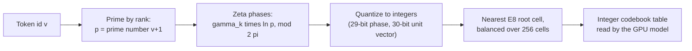

# Notebook: prime and zeta starting codebook (M1)

This notebook records tests of one idea: give every token a fixed starting vector built from numbers rather than from random noise. Each token gets a prime number by its rank, and the phases of the Riemann zeta zeros, read at the logarithm of that prime, turn the prime into an eight-dimensional integer vector. The one result so far shows that the vectors are distinct and the GPU code accepts them. It does not show that the vectors help the model read.

*How one token becomes one table row. The steps are the construction described in the record linked below; the table is built once, offline, on the host.*

Background: [primes and zeta](../../geometry/primes-and-zeta.md) explains the phases, and the [prime-zeta codebook](../../mechanisms/prime-zeta-codebook.md) page gives the mechanism's status. The line page for the model that reads this table is [discrete attention](./m1-discrete-attention.md).

## Results

Sources: the row comes from [`archive/catalog.jsonl`](../../../archive/catalog.jsonl); numbers and the bar were checked against the record and its pre-registration sheet (`docs/harness/prep/m1-prime-zeta-complex-routing-2026-10-14.md`, marked `TEST FITNESS: FIT`). Verdict words are defined on the [format page](./README.md#the-five-verdict-words).

| Date | What ran | Number | Bar | Verdict | Artifact |
|---|---|---|---|---|---|
| 2026-10-14 | Built the one-time prime-zeta codebook for a 4,096-token vocabulary, with matched null codebooks (a shifted-phase "tangent" null and a permuted-prime "normal" null). Host checks on macOS and Linux, then the GPU controls. No training. | 4,096 of 4,096 tokens get distinct vectors (0 collisions, 256 of 256 writer cells occupied); 17 of 17 base and 6 of 6 prime-zeta CUDA controls pass; 0 updates applied, 0 corpus rows | Bit-exact table across seeds 0, 1 and 2; no floating-point instruction in the GPU code; 0 collisions over all 4,096 tokens; 17 of 17 base controls; the codebook must separate structurally from both nulls | positive (construction only; the learned comparison against the nulls is deferred to a training sheet) | [prime-zeta-construction](../../../archive/labs/prime-zeta-construction-2026-10-14/README.md) |

## What the row says, in plain terms

- This is a **measurement** of a build, not of learning. Distinct vectors mean the table does not merge tokens. An earlier seeded table did merge them, and capped top-1 at 1,986 rows ([k16-outcome-call](../../labs/k16-outcome-call-2026-10-19/README.md)).
- Whether prime-zeta routing beats the permuted-prime null or the shifted-phase null on learned move selection or corpus loss is **not tested**. The pre-registration defers it to the first downstream training sheet, and training is held until the owner releases one.

## Later use in another notebook

The prime-zeta table became the *injective* starting table (one distinct vector per token) in the discrete-attention runs of 19 October. Those results are rows in the [discrete-attention notebook](./m1-discrete-attention.md), not here: the injective table alone admitted 127 of 3,847 copy-successor rows, below its bar of 500 ([injective-preflight-and-c2-qualify](../../labs/injective-preflight-and-c2-qualify-2026-10-19/README.md)), and placing the cells by address structure raised that to 1,351 ([address-cells-preflight](../../labs/address-cells-preflight-2026-10-19/README.md)).

## Go deeper

- [Primes and zeta](../../geometry/primes-and-zeta.md) and the [prime-zeta codebook mechanism](../../mechanisms/prime-zeta-codebook.md).
- [Format and verdict words](./README.md).
- [`archive/CATALOG.md`](../../../archive/CATALOG.md), filtered by line `m1-prime-zeta`.
