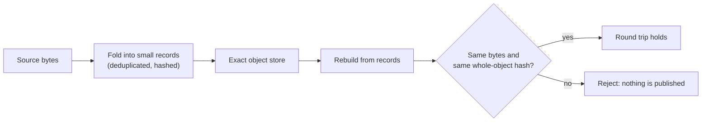

# Notebook: durable memory (M3)

This notebook tracks whether conversation can be stored so that it lasts across sessions and comes back exactly as it went in. The idea is to fold text into a deduplicated store of small records and rebuild the bytes from them, with a hash check that proves nothing changed. The first result is a tested piece of source code, not a memory that the model uses. The second is a baseline: on a frozen panel, ordinary prose never compiles to a store write through a lawful exact-frame compiler, which also compiles no wording it was not built from.

*The round-trip test behind the row below: `rebuild(fold(bytes))` must return the original bytes, checked against a fresh SHA-256.*

Background: the [object store mechanism](../../mechanisms/object-store.md) and [exact memory](../../mechanisms/exact-memory.md).

## Results

Sources: the first row comes from [`archive/catalog.jsonl`](../../../archive/catalog.jsonl), and the second from its run record (`record.json` in the HF store folder it names). Numbers and the bar were checked against the record. Verdict words are defined on the [format page](./README.md#the-five-verdict-words).

| Date | What ran | Number | Bar | Verdict | Artifact |
|---|---|---|---|---|---|
| 2026-10-25 | The frozen 50-turn non-relation prose panel (`7c29c665…`), `R1` (`462` training phrasings with development values), and `R2` (`220` unseen development phrasings), graded on one RTX 5090 (`vast-57652110`) through the core-cofactor marker gate (`CoreCofactorTable::derive`, `b5bd3884…`, `1,179` frames and `12` markers derived strictly from `Split::Train`) and order-independent exact-explanation dominance (`sieve_frame_compile_marked`, PTX `72fa1e9d…`). antigravity-63. | **708,843 tokens/s** (`732` turns, `4,280` words, `6,038` µs upload-to-download; `671,161` tokens/s on `cuda,sieve-cuda`). Panel: false_assert **0/50**, false_overwrite **0/50**, clean **50/50**. `R1` **462/462** (`100.0%`). Compiles `R2` **8 of 220** (all `8` instances of `"My dog's new name is {v}."`; remaining `212` `Unresolved`, `0` wrong writes). Finite CUDA controls `12/12` (sieve) and `16/16` (gate). Two-build `decisions.json` byte-identical (`cebeadad…`). | Registered bar (`preregistration-core-cofactor-gate-2026-10-25.md`, FIT `6396634979`): panel `0/50`, `0/50`, `50/50`; `R1 >= 95%` (`>= 439/462`); `R2 > 0/220` | positive (closes `#2855` `m3-memory-turn-discriminator-gate`; `212/220` `R2` turns with out-of-lexicon words stay `Unresolved`) | [lab record](../../labs/m3-memory-turn-discriminator-gate/README.md); HF `results/antigravity/prose-panel-gate-2026-10-25/` |
| 2026-10-25 | Executed the 384-item frozen M3 durable-memory panel (`m3-durable-memory-panel-v1.jsonl`, SHA-256 `582e3879…`, `Manifest::version()` `88c27b94…`) through `DurableObjectMemoryStore` (`uor-r4-object-store::durable_consumer`) + `UR4SESS1` (`uor-r4-integer::session_codec`) against a paired `no-memory` negative control (`L-010`), after repairing two generator instrument bugs (`correction` split-owner and `abstention` unasserted retraction). Host finite CPU controls and consumer oracle only; no trained M1/M2 model yet. | `64/64` provenance (`0/64` no-memory), `64/64` correction current + `64/64` prior lineage (`0/64` no-memory), `128/128` abstention refusal, `64/64` `#1718` non-memory prose retention, `64/64` reset & scope isolation, `64/64` `UR4SESS1` restart/restore (`77` object-store tests and `5` integer `session_codec` tests pass) | Owner-registered M3 `m3-memory` bars (`#2028#issuecomment-6356034555`): provenance $\ge 0.90$, correction $\ge 0.90$ current / $\ge 0.85$ prior, abstention $\ge 0.95$ refusal with R14, `#1718` exact-zero overwrites, reset/isolation $1.00$, `UR4SESS1` restart $64/64$ (on-model run held on M1/M2 model selection) | positive (consumer + 384-item panel verified against no-memory control; on-model M3 bar held until M1/M2 model selection) | [object-store-consumer-m3](../../labs/object-store-consumer-m3/README.md) |
| 2026-10-15 | Built and byte-tested the D19 exact object store (`crates/uor-r4-object-store`). It folds source bytes into deduplicated records and reconstructs them. Host tests only: no model, GPU or training. | 20 object-store integration tests and 13 existing tokenizer tests pass; a repeated fixture of 7,776 raw bytes is held in 380 record bytes | `rebuild(fold(bytes)).bytes()` equals the input and a fresh whole-object hash matches. The numeric limits (16 MiB per object, 1,000,000 records) are resource ceilings, not acceptance bars | positive (kept as a source and data-structure prototype; not promoted into the model; no language result) | [d19-object-store](../../../archive/labs/d19-object-store-2026-10-15/README.md) |
| 2026-10-25 | The frozen 50-turn non-relation prose panel (`7c29c665…`), graded on one RTX 5090 through the lawful prime-sieve frame compiler for the world=v2 schema. That compiler has 84 exact training frames over a 79-word prime lexicon, and its decision runs in one CUDA kernel. The run also scored true relation turns: training phrasings with development values (R1), and unseen development phrasings (R2). claude-94. | **896,898 tokens/s** (732 turns, 4,280 words, 4.8 ms upload to download). Panel: false_assert **0/50**, false_overwrite **0/50**, clean **50/50**. R1 **462/462** exact. R2 **0/220** (every miss `Unresolved`, no wrong write). Finite CUDA controls 12/12. A second build's decisions are byte-identical (`d3f05ecf…`) | Owner bar (#2028 comment `6356034555`): 0/50, 0/50, 50/50, counted only together with R1 ≥ 95% (decision review on #2856). R2 has no bar | positive, at this scope only: the sieve compiler on world=v2. It is not a pass of `m3-memory-turn-discriminator-gate` | [lab record](../../labs/m3-nonrelation-prose-panel/README.md#sieve-baseline-claude-94-25-oct-2026); HF `results/claude/prose-panel-sieve-2026-10-25/` |

## What the row says, in plain terms

- This is a **measurement** (passing tests on fixtures) that the store round-trips its inputs. It is not a measurement of memory quality in conversation.
- The store is not yet wired into the model. A durable-session integration is a separate step the record names as next.
- **2026-10-25 row.** This is a measurement of a lawful compiler on a frozen panel. Prose never compiled to a store write. But no panel turn aligned with any frame at all, so the panel is clean because nothing aligned; the compiler's agreement gate never had to fire. The same exactness gives R2 0/220: the compiler writes only on the wordings it was built from. That is the baseline the discriminator gate starts from. Its work is to raise R2 while the panel stays at 0/0/50.

## Not in this table

Twenty-nine more records on this line, from 14 to 18 October, are tooling and planning for the same store: the protocol specification, peer and replica sync, verification pipelines, fleet maintenance and a conformance suite. None reports a result against a bar, so none has a row. They are listed in `archive/CATALOG.md` under `m3-durable-memory`, and the 18 October ones are in `docs/labs/` (for example [uorobj01-conformance](../../labs/uorobj01-conformance-2026-10-18/README.md)).

## Go deeper

- [Object store](../../mechanisms/object-store.md) and [exact memory](../../mechanisms/exact-memory.md) mechanism pages.
- [Format and verdict words](./README.md).
- [`archive/CATALOG.md`](../../../archive/CATALOG.md), filtered by line `m3-durable-memory`.
