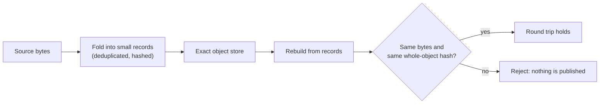

# Notebook: durable memory (M3)

This notebook tracks whether conversation can be stored so that it lasts across sessions and comes back exactly as it went in. The idea is to fold text into a deduplicated store of small records and rebuild the bytes from them, with a hash check that proves nothing changed. The one result so far is a tested piece of source code, not a memory that the model uses.

*The round-trip test behind the row below: `rebuild(fold(bytes))` must return the original bytes, checked against a fresh SHA-256.*

Background: the [object store mechanism](../../mechanisms/object-store.md) and [exact memory](../../mechanisms/exact-memory.md).

## Results

Sources: the row comes from `local/renorm/audit/catalog.jsonl`; numbers and the bar were checked against the record. Verdict words are defined on the [format page](./README.md#the-five-verdict-words).

| Date | What ran | Number | Bar | Verdict | Artifact |
|---|---|---|---|---|---|
| 2026-10-15 | Built and byte-tested the D19 exact object store (`crates/uor-r4-object-store`). It folds source bytes into deduplicated records and reconstructs them. Host tests only: no model, GPU or training. | 20 object-store integration tests and 13 existing tokenizer tests pass; a repeated fixture of 7,776 raw bytes is held in 380 record bytes | `rebuild(fold(bytes)).bytes()` equals the input and a fresh whole-object hash matches. The numeric limits (16 MiB per object, 1,000,000 records) are resource ceilings, not acceptance bars | positive (kept as a source and data-structure prototype; not promoted into the model; no language result) | [d19-object-store](../../../archive/labs/d19-object-store-2026-10-15/README.md) |

## What the row says, in plain terms

- This is a **measurement** (passing tests on fixtures) that the store round-trips its inputs. It is not a measurement of memory quality in conversation.
- The store is not yet wired into the model. A durable-session integration is a separate step the record names as next.

## Not in this table

Twenty-nine more records on this line, from 14 to 18 October, are tooling and planning for the same store: the protocol specification, peer and replica sync, verification pipelines, fleet maintenance and a conformance suite. None reports a result against a bar, so none has a row. They are listed in `archive/CATALOG.md` under `m3-durable-memory`, and the 18 October ones are in `docs/labs/` (for example [uorobj01-conformance](../../labs/uorobj01-conformance-2026-10-18/README.md)).

## Go deeper

- [Object store](../../mechanisms/object-store.md) and [exact memory](../../mechanisms/exact-memory.md) mechanism pages.
- [Format and verdict words](./README.md).
- [`archive/CATALOG.md`](../../../archive/CATALOG.md), filtered by line `m3-durable-memory`.
