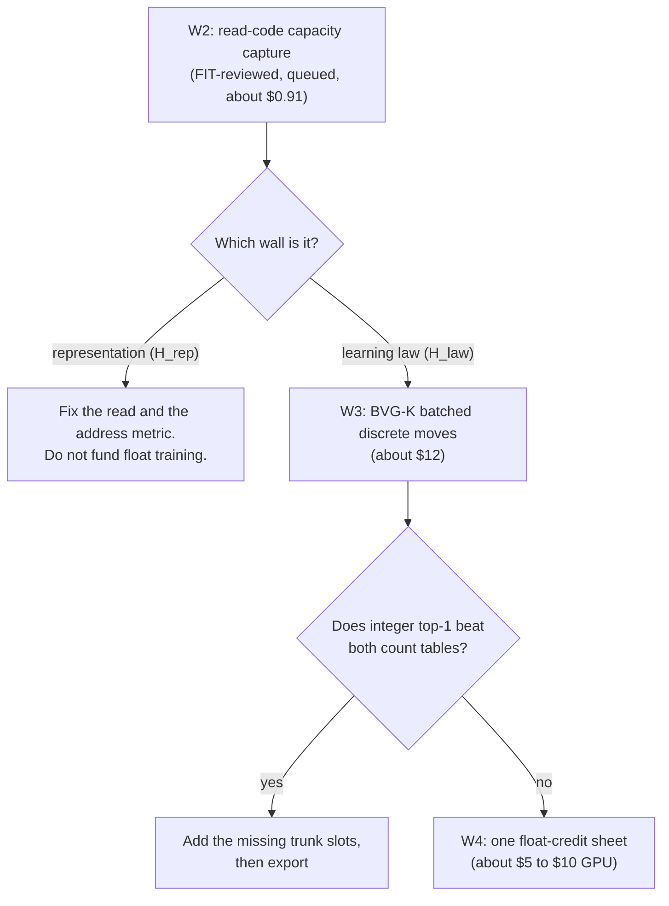

# What is still open

The project has built and tested many of the parts of a language model. The few it has trained together (the discrete writer, the reads and the ranking loss) have not yet beaten a simple count table, and a full trunk of lawful parts has never been trained. The biggest open question is simple to state: can a model that uses no softmax learn to rank the right word above the wrong ones? Nobody knows yet. Beside it sits a list of tests that were never run, or that failed only because the test was set up badly. Most of them are cheap, and the cheapest decisive one is FIT-reviewed and queued, not yet released.

*The order of the next decisive tests in the sequence the owner approved (D39 item 4); each is FIT-reviewed, none is released. W1, the K16 run, has already finished with no KEEP.*

Terms follow the [glossary](../start/glossary.md). Claims are labelled **proof**, **measurement** or **hypothesis** as in [`formal_vocabulary.md`](../formal_vocabulary.md). Dollar figures are the chief architect's estimates, not recorded costs.

## How the output head works, in two lines

The model first picks a shortlist of candidate cells, the nearest K of 256 by address. A row counts as *admitted* if the right token survives that cut. It then ranks the shortlist and takes the nearest token. So a model can fail at admission, at ranking, or at both. Source: `docs/labs/repo-renormalization-2026-10-19/audit/synthesis.md` section 1 and [K16 outcome](../labs/k16-outcome-call-2026-10-19/README.md).

## The central unknown

**Can a softmax-free read learn ranking? This is a hypothesis, and the biggest one.** Every float read that learned had softmax helping it somewhere in training. The best read without softmax, arm W, is a recorded REJECT. It was worse by 0.0172 BPB (bits per byte) and ran 15% slower, and its gradient came from a softmax-shaped surrogate. The starling read reached recall 0.329 where softmax reached 0.999. Both verdicts close those configurations only (decision D22), not the idea. See [findings](./findings.md) for the numbers and [flock read](../mechanisms/flock-read.md) for the discrete read that replaces them.

What we know today: in the 4-table K16 runs, the best trained discrete model scored top-1 of 65 and 463 of 14,287 development rows, below a unigram count table (1,226) and a context-free successor table (6,300) (**measurement**, [K16 outcome](../labs/k16-outcome-call-2026-10-19/README.md)). After Stage T `BVG-K` (`K = 16`, `#2836`) and the Stage 3 post-rotation joint-pointer Hamilton trunk exported to the 19-table `UORLUT01` (`uor-r4.lut-discrete-trunk/1`) container (`trunk-joint-pointer-v1-d11`, `#2837`, `#2841`), the two-seed integer artifact scores `7,002` and `7,001` of `14,287` on `ft/dev` (beating `1,226` unigram and `6,300` `T2`, with `P_succ = 1,779` and `1,770 > 1,245`) and transfers on the sealed `Fresh V2` panel at `7,215` and `7,228` of `14,479` (beating `1,279` unigram and `6,582` `T2`, with `P_succ = 1,713` and `1,711 > 1,240`) at `0` export gap and `11,026` / `10,573 tok/s` laptop decode (`183,206` / `181,086 tok/s` RTX 5090 response) (**measurement**, [m1-fresh-panel-transfer](../labs/m1-fresh-panel-transfer/README.md), [m1-close-saved-model](../labs/m1-close-saved-model/README.md)).

## FIT-reviewed and queued

These are the closest to a decision. A FIT review is not an owner release: spending waits for the owner (charter §5.1).

1. **W2, the read-code capacity capture** (about $0.91, already reviewed as FIT, same lease). It decides whether the wall is the *representation* (H_rep: the stored code cannot separate the answers) or the *learning law* (H_law: the code could, but the update rule does not find it). It also adds the count-table arms that the headline bars lacked. Source: architect review section 6, `docs/labs/course-correction-2026-10-18/audits/d37-reactivation-architect.md`.
2. **The admission-preserving rerun of A8.** Pre-registered and reviewed FIT, never run. Its controller and a separate finite qualification producer are merged. The qualification is NOT_RUN. Source: [admission-anchor controller](../labs/admission-anchor-controller-2026-10-19/README.md).

Every step that trains also needs an owner release (charter §5.1), and training stays HELD until the owner releases it.

## Never fairly tested, and cheap

| Test | What it would tell us | Source |
|---|---|---|
| Full-vector or interior-block address metric, at zero training | The architect's likely lever. The address key takes only 5 values to order up to 256 cells (**proof**, read from `discrete.cu`) | architect review §3.2 |
| A wider carrier (more roots or blocks) | Whether 16 bits per vector limits capacity. Needs new kernel code and a fresh CUDA qualification, so not free | [discrete learning](../mechanisms/discrete-learning.md) |
| Read-off against read-on for Route and Flock, on existing checkpoints | Whether the reads add anything at all. Route got 20 proposals in 16,404 batches | [Route read](../mechanisms/route-read.md); [attention state](../labs/attention-state-2026-10-18/README.md) |
| The prime-zeta code against random and quota-only injective nulls, at zero updates | Whether its structure matters or only its uniqueness | [prime-zeta codebook](../mechanisms/prime-zeta-codebook.md) |
| Whether a secant surrogate gives descent for the recurrence gates and SpiralCore/FBS | A small float check before any larger run | [recurrence gates](../mechanisms/recurrence-gates.md); [SpiralCore/FBS](../mechanisms/spiralcore-fbs.md) |
| 4,096 against 16,384 tokenizer pieces | Whether vocabulary size is a lever. The trainer exists | [tokenizer](../mechanisms/tokenizer.md) |

## Never tested, moderate cost

- **Ranking with admission intact.** No run has had admission intact and then failed or succeeded at ranking ([admission](../mechanisms/admission.md)).
- **A rank objective that keeps cells occupied.** The registered route after the K16-R run collapsed to 19 or 20 occupied cells ([rank margin](../mechanisms/rank-margin.md)).
- **Full-epoch and frequent-token revisit schedules.** One pass sees 43.3% of the training targets (**proof**, by arithmetic, [model training](../model/training.md)).
- **The finite relational head.** K16-A reached its 16,404 batches and can satisfy the prerequisite for the next stage (architect review §5; [relation read](../mechanisms/relation-read.md)).
- **Discrete Hamming binding (VSA) on the current writer** ([VSA](../mechanisms/vsa.md)).

## Never tested, expensive or blocked

- **A trunk built only from lawful parts.** Train it with float in a new scanned module, then export. The 24-kernel extract has passed finite controls only ([geometric stack](../mechanisms/geometric-stack.md)). No exporter exists for it.
- **The forced-copy oracle for the pointer.** The cheapest decisive pointer test. It needs a lawful pointer first, because running it on the old softmax pointer would execute a banned model ([pointer key](../mechanisms/pointer-key.md)).

## Failed only on configuration

A negative closes the configuration, never the mechanism. These tests were flawed as set up, so they say little about the mechanism.

| Test | What was wrong with it |
|---|---|
| A2 pilot, Dose 1, K16-A and K16-R | All started from a seeded codebook with at most 16 distinct vectors |
| P8 (127 of 3,847) | Uniform placement at K = 8 |
| A8 first dose | Ran without the admission guard |
| Starling and rank-table reads | Used softmax-tuned recipes and softmax-surrogate gradients |
| E8 memory | Used a sigmoid gate and 2,000 CPU steps |
| Spin weights | Met its bars (1.5148 BPB, level with dense) but only through a dense contraction, which D25 bans; PARKED |
| M2 reply model, 437 of 512 then 0 of 128 | Panel fitting on rows already seen |
| Read binding | Measured on a softmax read |
| VSA | Used the banned CPU learner |

Source: `docs/labs/repo-renormalization-2026-10-19/audit/synthesis.md` section 2, which cites each mechanism's dossier in `docs/labs/repo-renormalization-2026-10-19/audit/mechanisms/`.

## Not yet buildable

The map of lawful parts still has gaps that no test can fill until someone builds them (`docs/labs/repo-renormalization-2026-10-19/audit/synthesis.md` section 1).

- **Position.** No mechanism is assigned. The only related result is about recurrent state, and it is confounded (see [findings](./findings.md)).
- **Normalization.** None is designed.
- **Address as the read.** Never built, and nothing yet consumes the object store.
- **A lawful exporter** for any trained trunk, so the export gap is unmeasured.
- **A faster writer.** The writer scans the whole vocabulary, about 5 million comparisons per row, which breaks the per-token sparsity goal at larger vocabularies (**proof**, by count, architect review §3.5).

## Open claims

| Claim | Kind | Source |
|---|---|---|
| Quaternion transport helps order in a lawful model | **Hypothesis**. The only result is confounded | [findings](./findings.md) |
| Float training of the table beats discrete moves | **Hypothesis**. W4 is conditional on W2 and W3 | architect review §6 |
| The export gap of a float-trained model is small | **Hypothesis**. The architect expects a structurally non-zero gap | architect review §3.3 |
| A norm-preserving Hamilton gate can suppress a signal | **Hypothesis**, a reading of the dossier only | [Hamilton gate](../mechanisms/hamilton-gate.md) |
| Near-frontier capability needs more data than any trained stack used | **Measurement** for the past ([#437](https://github.com/UOR-Foundation/uor-r4/issues/437), [#1913](https://github.com/UOR-Foundation/uor-r4/issues/1913)), **hypothesis** for the future | [findings](./findings.md) |

## What counts as success for the first milestone

The charter sets the M1 closing bar: integer top-1 through the D11 export beats both count tables on the same development panel, on each of two seeds, with tokens per second reported. A bits-per-byte bar returns later, once a lawful likelihood exists (charter §4.8). That settles the old open question about scoring a model with no likelihood, for M1 only. A lawful likelihood is still unbuilt. A conversation bar (M2) is further off, and a float student would need a new owner decision (`docs/labs/repo-renormalization-2026-10-19/audit/synthesis.md` section 4, stage 5).

## Go deeper

- [What the project knows](./findings.md) and [how it got here](./history.md).
- The audit's shortest-path plan: `docs/labs/repo-renormalization-2026-10-19/audit/synthesis.md` section 4.
- [Mechanism board](../mechanisms/README.md) and [`NOW.md`](../integration/NOW.md) for the live plan.
