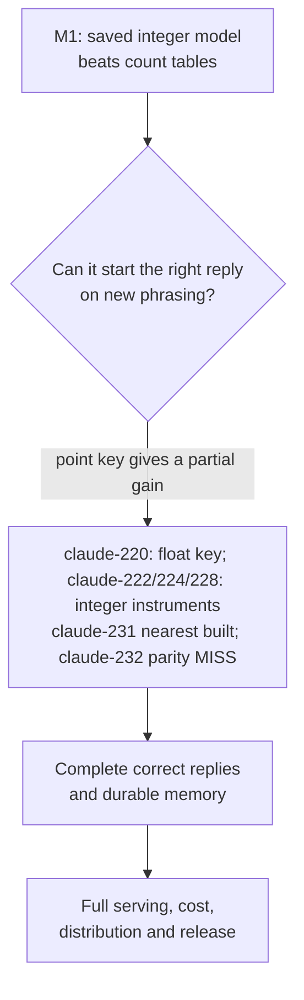

# What is still open

M1 answered a narrow question: can a saved discrete geometric model beat two simple count tables on
next-token prediction, through its integer export and at two seeds? **Yes, at the registered panel
bars.** The larger open question is whether one joined model can start and complete correct replies
on new phrasing, remember across sessions, and run as one product. That remains unproven.

*M1 is complete. The current blocker is reply opening on new phrasing, not the count-table bar.*

Terms follow the [glossary](../start/glossary.md). Claims are **proof**, **measurement** or
**hypothesis**.

## Answered at M1's scope

The saved 19-table `uor-r4.lut-discrete-trunk/1` model passes all six bars on two seeds:

- self-contained `UORLUT01` artifacts load in the clean-room D11 reader;
- DEV **7,002 / 7,001** of 14,287 against unigram 1,226 and T2 6,300;
- Fresh V2 **7,215 / 7,228** of 14,479 against unigram 1,279 and T2 6,582;
- p-f **7,850 / 7,872** of 15,953 against unigram 1,409 and T2 7,375, beyond paired band 81;
- exact 14,287-row DEV export/reference agreement and B4;
- Apple M1 decode **10,876 / 10,566 tok/s** under the bar-f protocol.

p-f has no prompt value-masked templates in TRAIN at K = 1,024, so it tests new phrasings. But
62.5% of its reference replies are verbatim TRAIN replies: M1 reads new prompts into known reply
kinds, not new reply kinds or useful conversation
([M1 close](../labs/m1-close-saved-model/README.md), [Fresh V2](../labs/m1-fresh-panel-transfer/README.md), [bar-f report](../loop/tasks/m1-heldout-phrasing-transfer/claude-211/REPORT.md)).

## The central unknown: correct reply opening on new phrasing

Claude-217 gives the sharpest current measurement:

- Teacher-forced p-s reply openings are **17.4%, 13.7% and 18.6%** at three seeds, against **80.8%, 80.2% and
  79.9%** on later tokens.
- Exact-reference replies are only 3, 1 and 4 of 256, against 38–40 on DEV.
- Exact turn memory keys on the turn's exact first token ids. It adds 322–337 of 1,226 openings on
  DEV but only 14–16 of 1,400 on p-s.
- The cycle step ends every registered loop, yet every content decision is underpowered and greedy
  remains the decode.

So a loop-free reply is not necessarily a correct reply. Claude-218 found trunk-state keys that
improved openings offline. [Claude-219](../loop/tasks/one-model-end-to-end/claude-219/REPORT.md)
then served the point key for the first reply token in free generation on fresh p-v: templates
improve by +13/+8/+12 and exact replies by +9/+8/+12 at three seeds. It reaches only 12–18% of the
forced-opening lift; the sign key is inconclusive at this panel size. [Claude-220](../loop/tasks/one-model-end-to-end/claude-220/REPORT.md)
then served the point key inside one float model on fresh p-w: templates improve by +41/+40/+42 at
three seeds with exact claude-219 parity, while recalling TRAIN replies rather than generalizing.
[Claude-222](../loop/tasks/point-key-integer/claude-222/REPORT.md) has built the integer point table,
search and `/8` record, with 380 library tests and a full serving audit. [Claude-224](../loop/tasks/point-key-integer/claude-224/REPORT.md)
has built the panel decode and grade. [Claude-227](../loop/tasks/integer-retention-rates/claude-227/REPORT.md) passed retention GPU parity
within the 3% bar; [claude-228](../loop/tasks/point-key-integer/claude-228/REPORT.md) built the run's reference/read-back/BOS checks; [claude-229](../loop/tasks/point-key-integer/claude-229/REPORT.md) found an instrument fault: the
integer session uses the native writer instead of the trained whole-table nearest readout, so all grade
pairs are (0, 0). [Claude-231](../loop/tasks/integer-nearest-readout/claude-231/REPORT.md) built the nearest readout and export on native and browser paths; [claude-232](../loop/tasks/integer-nearest-readout/claude-232/REPORT.md) then missed greedy parity in every cell, so the mismatch must be localized before the p-x rerun. Useful conversation remains unproven.

## What remains open beyond that key

1. **Complete correct replies and durable memory (M2/M3).** Can one unified model answer from exact
   memory on DEV and fresh prompts, preserve provenance, accept corrections, abstain, reset and
   restart with token-identical continuation?
2. **Independent mechanism effects.** Which read, gate, route, pointer and memory choice causes the
   M1 result? A whole-model pass is not an ablation for each mechanism.
3. **A joined model and full serving (M4).** Can the accepted model pass its full `UORLUT01` export,
   quality, CLI, session and audit path? `PRLL` is built and registered, but GPU held-out scoring is open.
4. **Cost and scale (M5 and beyond).** What are the full-path latency, memory traffic and energy per
   token? Arithmetic counts do not answer them. How does ability scale with data, width and context?
5. **Distribution (M7).** Do library, CLI and browser produce bit-identical tokens and sessions on
   the accepted model, with a truthful client-only Studio?
6. **Generalisation beyond known reply kinds.** p-f holds out prompt phrasing but shares most
   reference replies with TRAIN. A stronger test needs novel reply kinds and correct content, not
   just new n-grams or loop suppression.

## Older questions, now closed at their declared scopes

These should not be repeated as if untouched:

- **Can a discrete model beat unigram and T2 through D11?** Yes, at M1's two-seed bars.
- **Does a table-native discrete exporter exist, and is the M1 export exact?** Yes: 14,287-row
  DEV agreement at both seeds and B4 pass.
- **Does a lawful likelihood exist for later BPB scoring?** `PRLL` is built and registered. Its GPU
  held-out scoring is the open part.
- **Does the Studio connect to the integer engine?** Yes. It verifies a synthetic stand-in and also
  serves the publicly released M1 trunk as top-8 next-token prediction, not chat. Accepted-model
  parity is still open.
- **Does every training step need a typed owner release?** No. D67 uses the lab's own pre-run review;
  D41's donor pass is the named owner-at-dispatch exception.
- **Does BVG-K only have construction tests?** No. Stage T training and the M1 lineage used it.
- **Does exact storage prove learned memory?** No. The true-address 80/80 result remains oracle scope,
  not learned address formation.

## Failed configurations, not closed mechanisms

K16-A's 65 and 463, K16-R's 19 or 20 cells, A8's admission erosion, banned softmax/matmul recipes,
panel fitting, and the older dense table-serving energy result remain useful negative evidence. They
close configurations, not mechanism families, and they do not erase the M1 close. Read the original
records before re-running any of them.

## Go deeper

- [What the project knows](./findings.md) and [how it got here](./history.md).
- [M1 close](../labs/m1-close-saved-model/README.md), [bar-f](../loop/tasks/m1-heldout-phrasing-transfer/claude-211/REPORT.md), and [claude-217](../loop/tasks/one-model-end-to-end/claude-217/REPORT.md).
- [Mechanism board](../mechanisms/README.md) and the one [PLAN](../../PLAN.md).
