# Roadmap

<!-- Generated by `cargo xtask roadmap render` from items/*.md. Do not edit by hand. -->

This page lists every documented gap between the project today and its eight milestones. Each item is tracked as one GitHub issue. The files in `items/` are the source, and this page is generated from them.

Each item's GitHub issue is generated from its file by `cargo xtask roadmap sync`: the title, body, roadmap labels (`roadmap:item`, `area:*`, `help wanted`, `good first issue`, `status:held`, `owner-decision`) and milestone follow the file, so change the file in a PR rather than the issue.

## How this roadmap works

- Each gap has one file in `items/`, and those files are the source of truth.
- `cargo xtask roadmap sync` creates or updates one GitHub issue per item.
- Claim an issue with a comment before you start work on it.
- A pull request that finishes an item says `Closes #N` for its issue.
- A new gap is a new item file, added in a pull request.
- The PM runs `sync` and `render` once a week.
- Outside contributors can take items marked "anyone". They may run GPU steps on their own GPU and attach the hardware specs to the PR. When the hardware differs from the RTX 5090 baseline, a maintainer re-runs the step (owner, 20 Oct 2026).

## Counts

| Status | Items |
|---|---|
| ready | 23 |
| held | 16 |
| decision | 1 |
| done | 53 |
| total | 93 |

## Start here

These items are ready and open to anyone.

| Item | Milestone | Issue |
|---|---|---|
| [Build the address-as-read mechanism and an object-store consumer](items/m1-address-as-read.md) | M1 | [#2833](https://github.com/UOR-Foundation/uor-r4/issues/2833) |
| [Design a lawful position mechanism](items/m1-position-mechanism.md) | M1 | [#2843](https://github.com/UOR-Foundation/uor-r4/issues/2843) |
| [Measure M1-class laptop cost on the accepted served model](items/m5-laptop-full-path-measurement.md) | M5 | [#2862](https://github.com/UOR-Foundation/uor-r4/issues/2862) |
| [Build the library, CLI and browser bit-identity parity harness](items/m7-parity-library-cli-browser.md) | M7 | [#2867](https://github.com/UOR-Foundation/uor-r4/issues/2867) |
| [Independently verify the alpha on consumer hardware](items/m8-independent-verification.md) | M8 | [#2869](https://github.com/UOR-Foundation/uor-r4/issues/2869) |
| [Prepare the checksummed alpha release package and install path](items/m8-release-packaging.md) | M8 | [#2870](https://github.com/UOR-Foundation/uor-r4/issues/2870) |

## M1

| Item | Status | Who can take it | GPU | Depends on | Issue |
|---|---|---|---|---|---|
| [Build the address-as-read mechanism and an object-store consumer](items/m1-address-as-read.md) | ready | anyone | no | [m1-trunk-assembly-and-training](items/m1-trunk-assembly-and-training.md) | [#2833](https://github.com/UOR-Foundation/uor-r4/issues/2833) |
| [Train the BVG-K batched-coordinate law on two seeds](items/m1-bvg-k-stage-t-training.md) | ready | a lab | yes | [m1-w2-capacity-capture](items/m1-w2-capacity-capture.md), [m1-bvg-k-block-apply-c2](items/m1-bvg-k-block-apply-c2.md), [m1-a8-full-dose-rerun](items/m1-a8-full-dose-rerun.md), [m1-w2-code-utilization](items/m1-w2-code-utilization.md), [m1-address-key-full-vector](items/m1-address-key-full-vector.md) | [#2836](https://github.com/UOR-Foundation/uor-r4/issues/2836) |
| [Close M1 with one saved discrete model passing all five bars](items/m1-close-saved-model.md) | ready | a lab | yes | [m1-a8-full-dose-rerun](items/m1-a8-full-dose-rerun.md), [m1-bvg-k-stage-t-training](items/m1-bvg-k-stage-t-training.md), [m1-export-gap-and-toks](items/m1-export-gap-and-toks.md), [m1-fresh-panel-transfer](items/m1-fresh-panel-transfer.md) | [#2837](https://github.com/UOR-Foundation/uor-r4/issues/2837) |
| [Replace the full-vocabulary writer scan](items/m1-faster-writer.md) | ready | a lab | yes | none | [#2840](https://github.com/UOR-Foundation/uor-r4/issues/2840) |
| [Evaluate the gain on the fresh sealed panel](items/m1-fresh-panel-transfer.md) | ready | a lab | yes | [m1-export-gap-and-toks](items/m1-export-gap-and-toks.md) | [#2841](https://github.com/UOR-Foundation/uor-r4/issues/2841) |
| [Design a lawful position mechanism](items/m1-position-mechanism.md) | ready | anyone | no | none | [#2843](https://github.com/UOR-Foundation/uor-r4/issues/2843) |
| [Register and run one float-credit training sheet (W4)](items/m1-w4-float-credit-sheet.md) | ready | a lab | yes | [m1-w2-capacity-capture](items/m1-w2-capacity-capture.md), [m1-bvg-k-stage-t-training](items/m1-bvg-k-stage-t-training.md) | [#2846](https://github.com/UOR-Foundation/uor-r4/issues/2846) |
| [Prototype a wider code carrier (more roots or blocks)](items/m1-wider-code-carrier.md) | ready | a lab | yes | [m1-address-key-full-vector](items/m1-address-key-full-vector.md) | [#2847](https://github.com/UOR-Foundation/uor-r4/issues/2847) |
| [Measure export gap and tokens per second on a trained model](items/m1-export-gap-and-toks.md) | held | a lab | yes | [m1-d11-exporter-discrete](items/m1-d11-exporter-discrete.md) | [#2839](https://github.com/UOR-Foundation/uor-r4/issues/2839) |
| [Diagnose A8 reach erosion from retained checkpoints](items/m1-a8-erosion-diagnosis.md) | done | a lab | no | none | [#2829](https://github.com/UOR-Foundation/uor-r4/issues/2829) |
| [Run A8 admission-anchor controller CUDA qualification and restoration](items/m1-a8-finite-cuda-qualification.md) | done | a lab | yes | [m1-a8-registration-and-runbook-staging](items/m1-a8-registration-and-runbook-staging.md) | [#2830](https://github.com/UOR-Foundation/uor-r4/issues/2830) |
| [Run the full A8 dose with reach protected](items/m1-a8-full-dose-rerun.md) | done | a lab | yes | [m1-a8-finite-cuda-qualification](items/m1-a8-finite-cuda-qualification.md) | [#2831](https://github.com/UOR-Foundation/uor-r4/issues/2831) |
| [Register the finite qualification and stage the admission-preserving A8 runbook](items/m1-a8-registration-and-runbook-staging.md) | done | anyone | no | none | [#2832](https://github.com/UOR-Foundation/uor-r4/issues/2832) |
| [Replace the 5-value address key with a full-vector metric](items/m1-address-key-full-vector.md) | done | a lab | yes | [m1-w2-capacity-capture](items/m1-w2-capacity-capture.md) | [#2834](https://github.com/UOR-Foundation/uor-r4/issues/2834) |
| [Draft the BVG-K Stage T pre-registration sheet (C2 has passed)](items/m1-bvg-k-block-apply-c2.md) | done | a lab | no | [m1-a8-full-dose-rerun](items/m1-a8-full-dose-rerun.md), [m1-w2-code-utilization](items/m1-w2-code-utilization.md) | [#2835](https://github.com/UOR-Foundation/uor-r4/issues/2835) |
| [Build the D11 exporter CLI, GPU panel scorer and tok/s harness for step 6](items/m1-d11-artifact-scorer.md) | done | a lab | yes | [m1-d11-exporter-discrete](items/m1-d11-exporter-discrete.md) | [#3248](https://github.com/UOR-Foundation/uor-r4/issues/3248) |
| [Write the exporter from a trained discrete model to a D11 file](items/m1-d11-exporter-discrete.md) | done | anyone | no | none | [#2838](https://github.com/UOR-Foundation/uor-r4/issues/2838) |
| [Design a lawful normalization mechanism](items/m1-normalization-mechanism.md) | done | anyone | no | none | [#2842](https://github.com/UOR-Foundation/uor-r4/issues/2842) |
| [Run the W2 read-code capacity capture](items/m1-w2-capacity-capture.md) | done | a lab | yes | none | [#2845](https://github.com/UOR-Foundation/uor-r4/issues/2845) |
| [Run the W2 code-utilization diagnostic on the stored capture](items/m1-w2-code-utilization.md) | done | a lab | no | [m1-w2-capacity-capture](items/m1-w2-capacity-capture.md) | [#3179](https://github.com/UOR-Foundation/uor-r4/issues/3179) |
| [Train a number-aware tokenizer and pin its identity](items/number-aware-tokenizer.md) | done | a lab | no | none | [#2872](https://github.com/UOR-Foundation/uor-r4/issues/2872) |
| [Decide whether a float (D37) path may count toward M1, M2 and the product](items/owner-decision-float-path-scope.md) | done | a lab | no | none | [#2875](https://github.com/UOR-Foundation/uor-r4/issues/2875) |

## M2

| Item | Status | Who can take it | GPU | Depends on | Issue |
|---|---|---|---|---|---|
| [Assemble and train the full lawful trunk (Stage 3)](items/m1-trunk-assembly-and-training.md) | ready | a lab | yes | [m1-position-mechanism](items/m1-position-mechanism.md), [m1-normalization-mechanism](items/m1-normalization-mechanism.md), [m1-bvg-k-stage-t-training](items/m1-bvg-k-stage-t-training.md), [m1-d11-exporter-discrete](items/m1-d11-exporter-discrete.md) | [#2844](https://github.com/UOR-Foundation/uor-r4/issues/2844) |
| [Train the student for grounded replies from exact memory](items/m2-train-grounded-replies.md) | ready | a lab | yes | [m2-donor-corpus-generation](items/m2-donor-corpus-generation.md), [m2-fresh-heldout-panel](items/m2-fresh-heldout-panel.md), [m2-pin-train-mask-sheet](items/m2-pin-train-mask-sheet.md), [m1-close-saved-model](items/m1-close-saved-model.md), [m1-d11-exporter-discrete](items/m1-d11-exporter-discrete.md) | [#2853](https://github.com/UOR-Foundation/uor-r4/issues/2853) |
| [Optimize the driver math and run the ~1M-token pilot (D41 item 3)](items/d41-driver-math-pilot.md) | held | a lab | yes | none | [#2821](https://github.com/UOR-Foundation/uor-r4/issues/2821) |
| [Generate the one-time offline donor answer corpus (distill-d1)](items/m2-donor-corpus-generation.md) | held | a lab | yes | [d41-driver-math-pilot](items/d41-driver-math-pilot.md) | [#2848](https://github.com/UOR-Foundation/uor-r4/issues/2848) |
| [Settle whether the pinned M2 TRAIN-mask sheet is live after D37, and re-pin it](items/m2-pin-train-mask-sheet.md) | held | anyone | no | none | [#2851](https://github.com/UOR-Foundation/uor-r4/issues/2851) |
| [Register a number for the multi-turn reply bar blocked under R14](items/m2-multi-turn-bar-number.md) | decision | a lab | no | none | [#2850](https://github.com/UOR-Foundation/uor-r4/issues/2850) |
| [Build a genuinely fresh held-out reply panel for M2](items/m2-fresh-heldout-panel.md) | done | anyone | no | none | [#2849](https://github.com/UOR-Foundation/uor-r4/issues/2849) |
| [Close the remaining R14 gaps in the deterministic reply grader](items/m2-reply-grading-instrument-r14.md) | done | anyone | no | none | [#2852](https://github.com/UOR-Foundation/uor-r4/issues/2852) |

## M3

| Item | Status | Who can take it | GPU | Depends on | Issue |
|---|---|---|---|---|---|
| [Qualify durable memory on the selected native model](items/m3-qualify-memory.md) | ready | a lab | yes | [m2-train-grounded-replies](items/m2-train-grounded-replies.md), [m3-memory-turn-discriminator-gate](items/m3-memory-turn-discriminator-gate.md), [m3-policy-precedence-and-sieve-tests](items/m3-policy-precedence-and-sieve-tests.md) | [#2858](https://github.com/UOR-Foundation/uor-r4/issues/2858) |
| [Wire the object store into the model and run the durable-memory bars](items/object-store-consumer-m3.md) | held | anyone | no | none | [#2873](https://github.com/UOR-Foundation/uor-r4/issues/2873) |
| [Retire or complete legacy width-576 ChatSession persistence](items/m3-legacy-chatsession-persistence.md) | done | anyone | no | none | [#2854](https://github.com/UOR-Foundation/uor-r4/issues/2854) |
| [Add a memory-turn discriminator or margin gate](items/m3-memory-turn-discriminator-gate.md) | done | a lab | yes | [m3-nonrelation-prose-panel](items/m3-nonrelation-prose-panel.md) | [#2855](https://github.com/UOR-Foundation/uor-r4/issues/2855) |
| [Build a pre-registered non-relation prose panel](items/m3-nonrelation-prose-panel.md) | done | anyone | no | none | [#2856](https://github.com/UOR-Foundation/uor-r4/issues/2856) |
| [Pin OpPolicy precedence and store-miss sieve coupling with tests](items/m3-policy-precedence-and-sieve-tests.md) | done | anyone | no | none | [#2857](https://github.com/UOR-Foundation/uor-r4/issues/2857) |

## M4

| Item | Status | Who can take it | GPU | Depends on | Issue |
|---|---|---|---|---|---|
| [Serve the chosen model as UORLUT01 through the uor-chat CLI](items/m4-export-uorlut01-cli.md) | ready | a lab | yes | [m1-d11-exporter-discrete](items/m1-d11-exporter-discrete.md), [m4-lawful-likelihood-bpb](items/m4-lawful-likelihood-bpb.md), [m1-close-saved-model](items/m1-close-saved-model.md), [m3-qualify-memory](items/m3-qualify-memory.md) | [#2859](https://github.com/UOR-Foundation/uor-r4/issues/2859) |
| [Build a lawful likelihood so bits per byte can be scored](items/m4-lawful-likelihood-bpb.md) | ready | a lab | no | none | [#2861](https://github.com/UOR-Foundation/uor-r4/issues/2861) |
| [Write the D11 exporter for a D37 float trunk](items/d11-exporter-float-trunk.md) | held | a lab | no | [float-training-module](items/float-training-module.md), [m1-d11-exporter-discrete](items/m1-d11-exporter-discrete.md), [owner-decision-float-path-scope](items/owner-decision-float-path-scope.md) | [#2820](https://github.com/UOR-Foundation/uor-r4/issues/2820) |
| [Finish the flock-coupling pre-registration](items/m4-flock-coupling-prereg.md) | done | anyone | no | none | [#2860](https://github.com/UOR-Foundation/uor-r4/issues/2860) |

## M5

| Item | Status | Who can take it | GPU | Depends on | Issue |
|---|---|---|---|---|---|
| [Measure M1-class laptop cost on the accepted served model](items/m5-laptop-full-path-measurement.md) | ready | anyone | no | [m4-export-uorlut01-cli](items/m4-export-uorlut01-cli.md) | [#2862](https://github.com/UOR-Foundation/uor-r4/issues/2862) |

## M6

| Item | Status | Who can take it | GPU | Depends on | Issue |
|---|---|---|---|---|---|
| [Qualify reasoning and coding on the served model](items/m6-qualify-reasoning-coding.md) | ready | a lab | yes | [m4-export-uorlut01-cli](items/m4-export-uorlut01-cli.md), [m6-reasoning-panel-freeze](items/m6-reasoning-panel-freeze.md), [m6-causal-ablation-instrument](items/m6-causal-ablation-instrument.md), [m6-exact-arithmetic-mechanism](items/m6-exact-arithmetic-mechanism.md) | [#2865](https://github.com/UOR-Foundation/uor-r4/issues/2865) |
| [Build the intermediate-state ablation instrument for M6](items/m6-causal-ablation-instrument.md) | done | a lab | no | [m6-reasoning-panel-freeze](items/m6-reasoning-panel-freeze.md), [m1-trunk-assembly-and-training](items/m1-trunk-assembly-and-training.md) | [#2863](https://github.com/UOR-Foundation/uor-r4/issues/2863) |
| [Design exact arithmetic on the geometric path](items/m6-exact-arithmetic-mechanism.md) | done | anyone | no | none | [#2864](https://github.com/UOR-Foundation/uor-r4/issues/2864) |
| [Build and freeze the m6-reasoning panel and oracles](items/m6-reasoning-panel-freeze.md) | done | anyone | no | none | [#2866](https://github.com/UOR-Foundation/uor-r4/issues/2866) |

## M7

| Item | Status | Who can take it | GPU | Depends on | Issue |
|---|---|---|---|---|---|
| [Build the library, CLI and browser bit-identity parity harness](items/m7-parity-library-cli-browser.md) | ready | anyone | no | [m7-studio-connect-wasm-engine](items/m7-studio-connect-wasm-engine.md), [m4-export-uorlut01-cli](items/m4-export-uorlut01-cli.md) | [#2867](https://github.com/UOR-Foundation/uor-r4/issues/2867) |
| [Connect the Studio to the browser WASM engine](items/m7-studio-connect-wasm-engine.md) | done | anyone | no | none | [#2868](https://github.com/UOR-Foundation/uor-r4/issues/2868) |
| [Verify the Studio's offline claim, retire the demo CDNs, bundle tokenizer](items/m7-studio-self-host-page-assets.md) | done | anyone | no | none | [#3075](https://github.com/UOR-Foundation/uor-r4/issues/3075) |

## M8

| Item | Status | Who can take it | GPU | Depends on | Issue |
|---|---|---|---|---|---|
| [Independently verify the alpha on consumer hardware](items/m8-independent-verification.md) | ready | anyone | yes | [m8-release-packaging](items/m8-release-packaging.md) | [#2869](https://github.com/UOR-Foundation/uor-r4/issues/2869) |
| [Prepare the checksummed alpha release package and install path](items/m8-release-packaging.md) | ready | anyone | no | [m4-export-uorlut01-cli](items/m4-export-uorlut01-cli.md), [m5-laptop-full-path-measurement](items/m5-laptop-full-path-measurement.md), [m6-qualify-reasoning-coding](items/m6-qualify-reasoning-coding.md), [m7-parity-library-cli-browser](items/m7-parity-library-cli-browser.md) | [#2870](https://github.com/UOR-Foundation/uor-r4/issues/2870) |

## Research

| Item | Status | Who can take it | GPU | Depends on | Issue |
|---|---|---|---|---|---|
| [De-confound the quaternion-transport ordering result](items/r-quaternion-transport-order.md) | ready | a lab | yes | [m1-position-mechanism](items/m1-position-mechanism.md) | [#2882](https://github.com/UOR-Foundation/uor-r4/issues/2882) |
| [Compare 4,096 and 16,384 tokenizer pieces](items/r-vocab-4096-vs-16384.md) | ready | a lab | yes | [m1-faster-writer](items/m1-faster-writer.md) | [#2887](https://github.com/UOR-Foundation/uor-r4/issues/2887) |
| [Run the six-recurrence fit for the recurrence gates](items/recurrence-gates-six-recurrence-fit.md) | ready | a lab | yes | [float-training-module](items/float-training-module.md), [r-secant-surrogate-descent](items/r-secant-surrogate-descent.md) | [#2890](https://github.com/UOR-Foundation/uor-r4/issues/2890) |
| [Measure SpiralCore/FBS descent and tokens per second in a float sheet](items/spiralcore-fbs-offline-float-sheet.md) | ready | a lab | yes | [float-training-module](items/float-training-module.md), [r-secant-surrogate-descent](items/r-secant-surrogate-descent.md) | [#2891](https://github.com/UOR-Foundation/uor-r4/issues/2891) |
| [Build a sigmoid-free gate for E8 orbit memory and rerun it on GPU](items/e8-orbit-memory-sigmoid-free-iteration.md) | held | a lab | yes | [float-training-module](items/float-training-module.md) | [#2822](https://github.com/UOR-Foundation/uor-r4/issues/2822) |
| [Run the Hopf retained-fibre language test](items/hopf-retained-fibre-test.md) | held | a lab | yes | none | [#2825](https://github.com/UOR-Foundation/uor-r4/issues/2825) |
| [Re-register the native geometric engine with the hinge loss](items/native-geometric-reregister-hinge.md) | held | a lab | yes | none | [#2871](https://github.com/UOR-Foundation/uor-r4/issues/2871) |
| [Train the finite relational head](items/r-finite-relational-head.md) | held | a lab | yes | [m1-a8-full-dose-rerun](items/m1-a8-full-dose-rerun.md) | [#2877](https://github.com/UOR-Foundation/uor-r4/issues/2877) |
| [Test full-epoch and frequent-token revisit schedules](items/r-full-epoch-revisit-schedules.md) | held | a lab | yes | none | [#2878](https://github.com/UOR-Foundation/uor-r4/issues/2878) |
| [Build a lawful pointer, then run the forced-copy oracle](items/r-lawful-pointer-forced-copy-oracle.md) | held | a lab | yes | none | [#2880](https://github.com/UOR-Foundation/uor-r4/issues/2880) |
| [Design a rank objective that keeps cells occupied](items/r-rank-objective-keeps-cells.md) | held | a lab | yes | [m1-a8-full-dose-rerun](items/m1-a8-full-dose-rerun.md) | [#2883](https://github.com/UOR-Foundation/uor-r4/issues/2883) |
| [Test ranking with admission intact](items/r-ranking-with-admission-intact.md) | held | a lab | yes | [m1-a8-full-dose-rerun](items/m1-a8-full-dose-rerun.md) | [#2884](https://github.com/UOR-Foundation/uor-r4/issues/2884) |
| [Test discrete Hamming binding (VSA) on the current writer](items/r-vsa-hamming-binding.md) | held | a lab | yes | none | [#2888](https://github.com/UOR-Foundation/uor-r4/issues/2888) |
| [Port read binding to a Flock or Relation read](items/read-binding-on-lawful-read.md) | held | a lab | yes | none | [#2889](https://github.com/UOR-Foundation/uor-r4/issues/2889) |
| [Build a hard-selection step for carrier credit](items/carrier-credit-hard-selection.md) | done | a lab | yes | none | [#2819](https://github.com/UOR-Foundation/uor-r4/issues/2819) |
| [Run a Hamilton gate offline-float sheet with language fit and export gap](items/hamilton-gate-offline-float-sheet.md) | done | a lab | yes | [float-training-module](items/float-training-module.md), [r-secant-surrogate-descent](items/r-secant-surrogate-descent.md) | [#2824](https://github.com/UOR-Foundation/uor-r4/issues/2824) |
| [Solve the saved legal-construction case in exact arithmetic](items/legal-construction-exact-solve.md) | done | anyone | no | none | [#2828](https://github.com/UOR-Foundation/uor-r4/issues/2828) |
| [Rule on spin-native weights and ternary/XOR, or build a geometric alphabet](items/owner-ruling-spin-ternary-arithmetic.md) | done | a lab | no | none | [#2876](https://github.com/UOR-Foundation/uor-r4/issues/2876) |
| [Settle whether a norm-preserving Hamilton gate can suppress a signal](items/r-hamilton-gate-suppression.md) | done | anyone | no | none | [#2879](https://github.com/UOR-Foundation/uor-r4/issues/2879) |
| [Test the prime-zeta code against injective nulls at zero updates](items/r-prime-zeta-vs-nulls.md) | done | a lab | yes | none | [#2881](https://github.com/UOR-Foundation/uor-r4/issues/2881) |
| [Compare read-off and read-on for Route and Flock on checkpoints](items/r-read-off-vs-read-on.md) | done | a lab | yes | none | [#2885](https://github.com/UOR-Foundation/uor-r4/issues/2885) |
| [Check whether a secant surrogate gives descent for recurrence gates](items/r-secant-surrogate-descent.md) | done | a lab | yes | [float-training-module](items/float-training-module.md) | [#2886](https://github.com/UOR-Foundation/uor-r4/issues/2886) |

## Infrastructure

| Item | Status | Who can take it | GPU | Depends on | Issue |
|---|---|---|---|---|---|
| [Build the five-lab loop harness (the loop subcommands of uor-harness)](items/infra-loop-harness.md) | ready | a lab | no | none | [#2904](https://github.com/UOR-Foundation/uor-r4/issues/2904) |
| [Create the separate scanned D37 float training module](items/float-training-module.md) | done | a lab | no | [owner-decision-float-path-scope](items/owner-decision-float-path-scope.md) | [#2823](https://github.com/UOR-Foundation/uor-r4/issues/2823) |
| [Bench inbox rule: each lab reads the bench messages addressed to it](items/infra-bench-inbox-rule.md) | done | a lab | no | none | [#2955](https://github.com/UOR-Foundation/uor-r4/issues/2955) |
| [Build the Tauri desktop client against the synthetic stand-in](items/infra-desktop-client-tauri.md) | done | anyone | no | [m7-studio-connect-wasm-engine](items/m7-studio-connect-wasm-engine.md) | [#2826](https://github.com/UOR-Foundation/uor-r4/issues/2826) |
| [Record K16 normal close and final resource accounting](items/infra-k16-normal-close-accounting.md) | done | a lab | no | none | [#2827](https://github.com/UOR-Foundation/uor-r4/issues/2827) |
| [Loop PR 2: item keys, Cancel if, done-when class and validator](items/infra-loop-pr02-item-keys.md) | done | a lab | no | none | [#2905](https://github.com/UOR-Foundation/uor-r4/issues/2905) |
| [Loop PR 3: loop render for every view, with --check at the stamp](items/infra-loop-pr03-render.md) | done | a lab | no | [infra-loop-pr02-item-keys](items/infra-loop-pr02-item-keys.md) | [#2906](https://github.com/UOR-Foundation/uor-r4/issues/2906) |
| [Loop PR 4: loop gates runner, gates.json, ledger and breaks](items/infra-loop-pr04-gates.md) | done | a lab | no | none | [#2907](https://github.com/UOR-Foundation/uor-r4/issues/2907) |
| [Loop PR 5: loop pr-check and a policy job feeding the required checks](items/infra-loop-pr05-policy-check.md) | done | a lab | no | [infra-loop-pr02-item-keys](items/infra-loop-pr02-item-keys.md), [infra-loop-pr03-render](items/infra-loop-pr03-render.md), [infra-loop-pr04-gates](items/infra-loop-pr04-gates.md) | [#2908](https://github.com/UOR-Foundation/uor-r4/issues/2908) |
| [Loop PR 6: loop review with tagged review records](items/infra-loop-pr06-review-records.md) | done | a lab | no | [infra-loop-pr05-policy-check](items/infra-loop-pr05-policy-check.md) | [#2909](https://github.com/UOR-Foundation/uor-r4/issues/2909) |
| [Loop PR 7a: loop claim, suborder and ask](items/infra-loop-pr07a-claim.md) | done | a lab | no | [infra-loop-pr02-item-keys](items/infra-loop-pr02-item-keys.md) | [#2910](https://github.com/UOR-Foundation/uor-r4/issues/2910) |
| [Loop PR 7b: loop next, arrive, report and close](items/infra-loop-pr07b-session.md) | done | a lab | no | [infra-loop-pr03-render](items/infra-loop-pr03-render.md), [infra-loop-pr07a-claim](items/infra-loop-pr07a-claim.md) | [#2911](https://github.com/UOR-Foundation/uor-r4/issues/2911) |
| [Loop PR 7c: loop queue and loop board](items/infra-loop-pr07c-queue-board.md) | done | a lab | no | [infra-loop-pr05-policy-check](items/infra-loop-pr05-policy-check.md), [infra-loop-pr06-review-records](items/infra-loop-pr06-review-records.md) | [#2912](https://github.com/UOR-Foundation/uor-r4/issues/2912) |
| [Loop PR 8: migrate the notes to STATE, HANDOFF and PLAN](items/infra-loop-pr08-migration.md) | done | a lab | no | [infra-loop-pr03-render](items/infra-loop-pr03-render.md) | [#2913](https://github.com/UOR-Foundation/uor-r4/issues/2913) |
| [Loop PR 9: loop guard, install and onboard for each client](items/infra-loop-pr09-client-adapters.md) | done | a lab | no | [infra-loop-pr07b-session](items/infra-loop-pr07b-session.md) | [#2914](https://github.com/UOR-Foundation/uor-r4/issues/2914) |
| [Loop PR 10: loop drive, watchers, kill switch and the soft check-in](items/infra-loop-pr10-supervisor.md) | done | a lab | no | [infra-loop-pr07b-session](items/infra-loop-pr07b-session.md), [infra-loop-pr07c-queue-board](items/infra-loop-pr07c-queue-board.md), [infra-loop-pr09-client-adapters](items/infra-loop-pr09-client-adapters.md) | [#2915](https://github.com/UOR-Foundation/uor-r4/issues/2915) |
| [Loop PR 11: loop gates --watch and warnings raised to errors](items/infra-loop-pr11-progress-window.md) | done | a lab | no | [infra-loop-pr04-gates](items/infra-loop-pr04-gates.md) | [#2916](https://github.com/UOR-Foundation/uor-r4/issues/2916) |
| [Loop PR 12: git hooks, pr-check before push, Lab and Order trailers](items/infra-loop-pr12-git-hooks.md) | done | a lab | no | [infra-loop-pr05-policy-check](items/infra-loop-pr05-policy-check.md), [infra-loop-pr06-review-records](items/infra-loop-pr06-review-records.md) | [#2917](https://github.com/UOR-Foundation/uor-r4/issues/2917) |
| [Let loop review count the render PR (or exempt it at the queue)](items/infra-loop-render-review.md) | done | a lab | no | [infra-loop-harness](items/infra-loop-harness.md) | [#3036](https://github.com/UOR-Foundation/uor-r4/issues/3036) |
| [Harden the render-PR review path](items/loop-render-review-hardening.md) | done | a lab | no | [infra-loop-render-review](items/infra-loop-render-review.md) | [#3044](https://github.com/UOR-Foundation/uor-r4/issues/3044) |
| [Settle the disputed D11 and Hopf observation statuses on the board](items/owner-decision-board-status-disputes.md) | done | a lab | no | none | [#2874](https://github.com/UOR-Foundation/uor-r4/issues/2874) |

## Waiting on the owner

These items need an owner decision before work can start.

- [Register a number for the multi-turn reply bar blocked under R14](items/m2-multi-turn-bar-number.md) (M2)

## Dependencies

An arrow points from an item to the item that depends on it.

```mermaid
flowchart LR
  n_d11_exporter_float_trunk["d11-exporter-float-trunk"]
  n_d41_driver_math_pilot["d41-driver-math-pilot"]
  n_e8_orbit_memory_sigmoid_free_iteration["e8-orbit-memory-sigmoid-free-iteration"]
  n_float_training_module["float-training-module"]
  n_hamilton_gate_offline_float_sheet["hamilton-gate-offline-float-sheet"]
  n_infra_desktop_client_tauri["infra-desktop-client-tauri"]
  n_infra_loop_harness["infra-loop-harness"]
  n_infra_loop_pr02_item_keys["infra-loop-pr02-item-keys"]
  n_infra_loop_pr03_render["infra-loop-pr03-render"]
  n_infra_loop_pr04_gates["infra-loop-pr04-gates"]
  n_infra_loop_pr05_policy_check["infra-loop-pr05-policy-check"]
  n_infra_loop_pr06_review_records["infra-loop-pr06-review-records"]
  n_infra_loop_pr07a_claim["infra-loop-pr07a-claim"]
  n_infra_loop_pr07b_session["infra-loop-pr07b-session"]
  n_infra_loop_pr07c_queue_board["infra-loop-pr07c-queue-board"]
  n_infra_loop_pr08_migration["infra-loop-pr08-migration"]
  n_infra_loop_pr09_client_adapters["infra-loop-pr09-client-adapters"]
  n_infra_loop_pr10_supervisor["infra-loop-pr10-supervisor"]
  n_infra_loop_pr11_progress_window["infra-loop-pr11-progress-window"]
  n_infra_loop_pr12_git_hooks["infra-loop-pr12-git-hooks"]
  n_infra_loop_render_review["infra-loop-render-review"]
  n_loop_render_review_hardening["loop-render-review-hardening"]
  n_m1_a8_finite_cuda_qualification["m1-a8-finite-cuda-qualification"]
  n_m1_a8_full_dose_rerun["m1-a8-full-dose-rerun"]
  n_m1_a8_registration_and_runbook_staging["m1-a8-registration-and-runbook-staging"]
  n_m1_address_as_read["m1-address-as-read"]
  n_m1_address_key_full_vector["m1-address-key-full-vector"]
  n_m1_bvg_k_block_apply_c2["m1-bvg-k-block-apply-c2"]
  n_m1_bvg_k_stage_t_training["m1-bvg-k-stage-t-training"]
  n_m1_close_saved_model["m1-close-saved-model"]
  n_m1_d11_artifact_scorer["m1-d11-artifact-scorer"]
  n_m1_d11_exporter_discrete["m1-d11-exporter-discrete"]
  n_m1_export_gap_and_toks["m1-export-gap-and-toks"]
  n_m1_faster_writer["m1-faster-writer"]
  n_m1_fresh_panel_transfer["m1-fresh-panel-transfer"]
  n_m1_normalization_mechanism["m1-normalization-mechanism"]
  n_m1_position_mechanism["m1-position-mechanism"]
  n_m1_trunk_assembly_and_training["m1-trunk-assembly-and-training"]
  n_m1_w2_capacity_capture["m1-w2-capacity-capture"]
  n_m1_w2_code_utilization["m1-w2-code-utilization"]
  n_m1_w4_float_credit_sheet["m1-w4-float-credit-sheet"]
  n_m1_wider_code_carrier["m1-wider-code-carrier"]
  n_m2_donor_corpus_generation["m2-donor-corpus-generation"]
  n_m2_fresh_heldout_panel["m2-fresh-heldout-panel"]
  n_m2_pin_train_mask_sheet["m2-pin-train-mask-sheet"]
  n_m2_train_grounded_replies["m2-train-grounded-replies"]
  n_m3_memory_turn_discriminator_gate["m3-memory-turn-discriminator-gate"]
  n_m3_nonrelation_prose_panel["m3-nonrelation-prose-panel"]
  n_m3_policy_precedence_and_sieve_tests["m3-policy-precedence-and-sieve-tests"]
  n_m3_qualify_memory["m3-qualify-memory"]
  n_m4_export_uorlut01_cli["m4-export-uorlut01-cli"]
  n_m4_lawful_likelihood_bpb["m4-lawful-likelihood-bpb"]
  n_m5_laptop_full_path_measurement["m5-laptop-full-path-measurement"]
  n_m6_causal_ablation_instrument["m6-causal-ablation-instrument"]
  n_m6_exact_arithmetic_mechanism["m6-exact-arithmetic-mechanism"]
  n_m6_qualify_reasoning_coding["m6-qualify-reasoning-coding"]
  n_m6_reasoning_panel_freeze["m6-reasoning-panel-freeze"]
  n_m7_parity_library_cli_browser["m7-parity-library-cli-browser"]
  n_m7_studio_connect_wasm_engine["m7-studio-connect-wasm-engine"]
  n_m8_independent_verification["m8-independent-verification"]
  n_m8_release_packaging["m8-release-packaging"]
  n_owner_decision_float_path_scope["owner-decision-float-path-scope"]
  n_r_finite_relational_head["r-finite-relational-head"]
  n_r_quaternion_transport_order["r-quaternion-transport-order"]
  n_r_rank_objective_keeps_cells["r-rank-objective-keeps-cells"]
  n_r_ranking_with_admission_intact["r-ranking-with-admission-intact"]
  n_r_secant_surrogate_descent["r-secant-surrogate-descent"]
  n_r_vocab_4096_vs_16384["r-vocab-4096-vs-16384"]
  n_recurrence_gates_six_recurrence_fit["recurrence-gates-six-recurrence-fit"]
  n_spiralcore_fbs_offline_float_sheet["spiralcore-fbs-offline-float-sheet"]
  n_d41_driver_math_pilot --> n_m2_donor_corpus_generation
  n_float_training_module --> n_d11_exporter_float_trunk
  n_float_training_module --> n_e8_orbit_memory_sigmoid_free_iteration
  n_float_training_module --> n_hamilton_gate_offline_float_sheet
  n_float_training_module --> n_r_secant_surrogate_descent
  n_float_training_module --> n_recurrence_gates_six_recurrence_fit
  n_float_training_module --> n_spiralcore_fbs_offline_float_sheet
  n_infra_loop_harness --> n_infra_loop_render_review
  n_infra_loop_pr02_item_keys --> n_infra_loop_pr03_render
  n_infra_loop_pr02_item_keys --> n_infra_loop_pr05_policy_check
  n_infra_loop_pr02_item_keys --> n_infra_loop_pr07a_claim
  n_infra_loop_pr03_render --> n_infra_loop_pr05_policy_check
  n_infra_loop_pr03_render --> n_infra_loop_pr07b_session
  n_infra_loop_pr03_render --> n_infra_loop_pr08_migration
  n_infra_loop_pr04_gates --> n_infra_loop_pr05_policy_check
  n_infra_loop_pr04_gates --> n_infra_loop_pr11_progress_window
  n_infra_loop_pr05_policy_check --> n_infra_loop_pr06_review_records
  n_infra_loop_pr05_policy_check --> n_infra_loop_pr07c_queue_board
  n_infra_loop_pr05_policy_check --> n_infra_loop_pr12_git_hooks
  n_infra_loop_pr06_review_records --> n_infra_loop_pr07c_queue_board
  n_infra_loop_pr06_review_records --> n_infra_loop_pr12_git_hooks
  n_infra_loop_pr07a_claim --> n_infra_loop_pr07b_session
  n_infra_loop_pr07b_session --> n_infra_loop_pr09_client_adapters
  n_infra_loop_pr07b_session --> n_infra_loop_pr10_supervisor
  n_infra_loop_pr07c_queue_board --> n_infra_loop_pr10_supervisor
  n_infra_loop_pr09_client_adapters --> n_infra_loop_pr10_supervisor
  n_infra_loop_render_review --> n_loop_render_review_hardening
  n_m1_a8_finite_cuda_qualification --> n_m1_a8_full_dose_rerun
  n_m1_a8_full_dose_rerun --> n_m1_bvg_k_block_apply_c2
  n_m1_a8_full_dose_rerun --> n_m1_bvg_k_stage_t_training
  n_m1_a8_full_dose_rerun --> n_m1_close_saved_model
  n_m1_a8_full_dose_rerun --> n_r_finite_relational_head
  n_m1_a8_full_dose_rerun --> n_r_rank_objective_keeps_cells
  n_m1_a8_full_dose_rerun --> n_r_ranking_with_admission_intact
  n_m1_a8_registration_and_runbook_staging --> n_m1_a8_finite_cuda_qualification
  n_m1_address_key_full_vector --> n_m1_bvg_k_stage_t_training
  n_m1_address_key_full_vector --> n_m1_wider_code_carrier
  n_m1_bvg_k_block_apply_c2 --> n_m1_bvg_k_stage_t_training
  n_m1_bvg_k_stage_t_training --> n_m1_close_saved_model
  n_m1_bvg_k_stage_t_training --> n_m1_trunk_assembly_and_training
  n_m1_bvg_k_stage_t_training --> n_m1_w4_float_credit_sheet
  n_m1_close_saved_model --> n_m2_train_grounded_replies
  n_m1_close_saved_model --> n_m4_export_uorlut01_cli
  n_m1_d11_exporter_discrete --> n_d11_exporter_float_trunk
  n_m1_d11_exporter_discrete --> n_m1_d11_artifact_scorer
  n_m1_d11_exporter_discrete --> n_m1_export_gap_and_toks
  n_m1_d11_exporter_discrete --> n_m1_trunk_assembly_and_training
  n_m1_d11_exporter_discrete --> n_m2_train_grounded_replies
  n_m1_d11_exporter_discrete --> n_m4_export_uorlut01_cli
  n_m1_export_gap_and_toks --> n_m1_close_saved_model
  n_m1_export_gap_and_toks --> n_m1_fresh_panel_transfer
  n_m1_faster_writer --> n_r_vocab_4096_vs_16384
  n_m1_fresh_panel_transfer --> n_m1_close_saved_model
  n_m1_normalization_mechanism --> n_m1_trunk_assembly_and_training
  n_m1_position_mechanism --> n_m1_trunk_assembly_and_training
  n_m1_position_mechanism --> n_r_quaternion_transport_order
  n_m1_trunk_assembly_and_training --> n_m1_address_as_read
  n_m1_trunk_assembly_and_training --> n_m6_causal_ablation_instrument
  n_m1_w2_capacity_capture --> n_m1_address_key_full_vector
  n_m1_w2_capacity_capture --> n_m1_bvg_k_stage_t_training
  n_m1_w2_capacity_capture --> n_m1_w2_code_utilization
  n_m1_w2_capacity_capture --> n_m1_w4_float_credit_sheet
  n_m1_w2_code_utilization --> n_m1_bvg_k_block_apply_c2
  n_m1_w2_code_utilization --> n_m1_bvg_k_stage_t_training
  n_m2_donor_corpus_generation --> n_m2_train_grounded_replies
  n_m2_fresh_heldout_panel --> n_m2_train_grounded_replies
  n_m2_pin_train_mask_sheet --> n_m2_train_grounded_replies
  n_m2_train_grounded_replies --> n_m3_qualify_memory
  n_m3_memory_turn_discriminator_gate --> n_m3_qualify_memory
  n_m3_nonrelation_prose_panel --> n_m3_memory_turn_discriminator_gate
  n_m3_policy_precedence_and_sieve_tests --> n_m3_qualify_memory
  n_m3_qualify_memory --> n_m4_export_uorlut01_cli
  n_m4_export_uorlut01_cli --> n_m5_laptop_full_path_measurement
  n_m4_export_uorlut01_cli --> n_m6_qualify_reasoning_coding
  n_m4_export_uorlut01_cli --> n_m7_parity_library_cli_browser
  n_m4_export_uorlut01_cli --> n_m8_release_packaging
  n_m4_lawful_likelihood_bpb --> n_m4_export_uorlut01_cli
  n_m5_laptop_full_path_measurement --> n_m8_release_packaging
  n_m6_causal_ablation_instrument --> n_m6_qualify_reasoning_coding
  n_m6_exact_arithmetic_mechanism --> n_m6_qualify_reasoning_coding
  n_m6_qualify_reasoning_coding --> n_m8_release_packaging
  n_m6_reasoning_panel_freeze --> n_m6_causal_ablation_instrument
  n_m6_reasoning_panel_freeze --> n_m6_qualify_reasoning_coding
  n_m7_parity_library_cli_browser --> n_m8_release_packaging
  n_m7_studio_connect_wasm_engine --> n_infra_desktop_client_tauri
  n_m7_studio_connect_wasm_engine --> n_m7_parity_library_cli_browser
  n_m8_release_packaging --> n_m8_independent_verification
  n_owner_decision_float_path_scope --> n_d11_exporter_float_trunk
  n_owner_decision_float_path_scope --> n_float_training_module
  n_r_secant_surrogate_descent --> n_hamilton_gate_offline_float_sheet
  n_r_secant_surrogate_descent --> n_recurrence_gates_six_recurrence_fit
  n_r_secant_surrogate_descent --> n_spiralcore_fbs_offline_float_sheet
```

