# Roadmap

<!-- Generated by `cargo xtask roadmap render` from items/*.md. Do not edit by hand. -->

This page lists every documented gap between the project today and its eight milestones. Each item is tracked as one GitHub issue. The files in `items/` are the source, and this page is generated from them.

Each item's GitHub issue is generated from its file by `cargo xtask roadmap sync`: the title, body, roadmap labels (`roadmap:item`, `area:*`, `help wanted`, `good first issue`, `status:held`, `owner-decision`) and milestone follow the file, so change the file in a PR rather than the issue.

## How this roadmap works

- Each gap has one file in `items/`, and those files are the source of truth.
- `cargo xtask roadmap sync` creates or updates one GitHub issue per item.
- Claim an issue with a comment before you start work on it.
- A pull request that finishes an item says `Closes #N` for its issue.
- A new gap is a new item file, added in a pull request.
- The PM runs `sync` and `render` once a week.
- Outside contributors can take items marked "anyone". They may run GPU steps on their own GPU and attach the hardware specs to the PR. When the hardware differs from the RTX 5090 baseline, a maintainer re-runs the step (owner, 20 Oct 2026).

## Counts

| Status | Items |
|---|---|
| ready | 43 |
| held | 26 |
| decision | 4 |
| done | 0 |
| total | 73 |

## Start here

These items are ready and open to anyone.

| Item | Milestone | Issue |
|---|---|---|
| [Build the Tauri desktop client against the synthetic stand-in](items/infra-desktop-client-tauri.md) | infra | not yet synced |
| [Solve the saved legal-construction case in exact arithmetic](items/legal-construction-exact-solve.md) | research | not yet synced |
| [Register the finite qualification and stage the admission-preserving A8 runbook](items/m1-a8-registration-and-runbook-staging.md) | M1 | not yet synced |
| [Build the address-as-read mechanism and an object-store consumer](items/m1-address-as-read.md) | M1 | not yet synced |
| [Write the exporter from a trained discrete model to a D11 file](items/m1-d11-exporter-discrete.md) | M1 | not yet synced |
| [Design a lawful normalization mechanism](items/m1-normalization-mechanism.md) | M1 | not yet synced |
| [Design a lawful position mechanism](items/m1-position-mechanism.md) | M1 | not yet synced |
| [Build a genuinely fresh held-out reply panel for M2](items/m2-fresh-heldout-panel.md) | M2 | not yet synced |
| [Settle whether the pinned M2 TRAIN-mask sheet is live after D37, and re-pin it](items/m2-pin-train-mask-sheet.md) | M2 | not yet synced |
| [Close the remaining R14 gaps in the deterministic reply grader](items/m2-reply-grading-instrument-r14.md) | M2 | not yet synced |
| [Retire or complete legacy width-576 ChatSession persistence](items/m3-legacy-chatsession-persistence.md) | M3 | not yet synced |
| [Build a pre-registered non-relation prose panel](items/m3-nonrelation-prose-panel.md) | M3 | not yet synced |
| [Pin OpPolicy precedence and store-miss sieve coupling with tests](items/m3-policy-precedence-and-sieve-tests.md) | M3 | not yet synced |
| [Finish the flock-coupling pre-registration](items/m4-flock-coupling-prereg.md) | M4 | not yet synced |
| [Measure M1-class laptop cost on the accepted served model](items/m5-laptop-full-path-measurement.md) | M5 | not yet synced |
| [Design exact arithmetic on the geometric path](items/m6-exact-arithmetic-mechanism.md) | M6 | not yet synced |
| [Build and freeze the m6-reasoning panel and oracles](items/m6-reasoning-panel-freeze.md) | M6 | not yet synced |
| [Build the library, CLI and browser bit-identity parity harness](items/m7-parity-library-cli-browser.md) | M7 | not yet synced |
| [Connect the Studio to the browser WASM engine](items/m7-studio-connect-wasm-engine.md) | M7 | not yet synced |
| [Independently verify the alpha on consumer hardware](items/m8-independent-verification.md) | M8 | not yet synced |
| [Prepare the checksummed alpha release package and install path](items/m8-release-packaging.md) | M8 | not yet synced |
| [Wire the object store into the model and run the durable-memory bars](items/object-store-consumer-m3.md) | M3 | not yet synced |
| [Settle whether a norm-preserving Hamilton gate can suppress a signal](items/r-hamilton-gate-suppression.md) | research | not yet synced |

## M1

| Item | Status | Who can take it | GPU | Depends on | Issue |
|---|---|---|---|---|---|
| [Diagnose A8 reach erosion from retained checkpoints](items/m1-a8-erosion-diagnosis.md) | ready | a lab | no | none | not yet synced |
| [Register the finite qualification and stage the admission-preserving A8 runbook](items/m1-a8-registration-and-runbook-staging.md) | ready | anyone | no | none | not yet synced |
| [Build the address-as-read mechanism and an object-store consumer](items/m1-address-as-read.md) | ready | anyone | no | none | not yet synced |
| [Replace the 5-value address key with a full-vector metric](items/m1-address-key-full-vector.md) | ready | a lab | yes | [m1-w2-capacity-capture](items/m1-w2-capacity-capture.md) | not yet synced |
| [Draft the BVG-K Stage T pre-registration sheet (C2 has passed)](items/m1-bvg-k-block-apply-c2.md) | ready | a lab | yes | none | not yet synced |
| [Write the exporter from a trained discrete model to a D11 file](items/m1-d11-exporter-discrete.md) | ready | anyone | no | none | not yet synced |
| [Measure export gap and tokens per second on a trained model](items/m1-export-gap-and-toks.md) | ready | a lab | yes | [m1-d11-exporter-discrete](items/m1-d11-exporter-discrete.md) | not yet synced |
| [Replace the full-vocabulary writer scan](items/m1-faster-writer.md) | ready | a lab | yes | none | not yet synced |
| [Evaluate the gain on the fresh sealed panel](items/m1-fresh-panel-transfer.md) | ready | a lab | yes | [m1-export-gap-and-toks](items/m1-export-gap-and-toks.md) | not yet synced |
| [Design a lawful normalization mechanism](items/m1-normalization-mechanism.md) | ready | anyone | no | none | not yet synced |
| [Design a lawful position mechanism](items/m1-position-mechanism.md) | ready | anyone | no | none | not yet synced |
| [Prototype a wider code carrier (more roots or blocks)](items/m1-wider-code-carrier.md) | ready | a lab | yes | [m1-address-key-full-vector](items/m1-address-key-full-vector.md) | not yet synced |
| [Train a number-aware tokenizer and pin its identity](items/number-aware-tokenizer.md) | ready | a lab | no | none | not yet synced |
| [Run A8 admission-anchor controller CUDA qualification and restoration](items/m1-a8-finite-cuda-qualification.md) | held | a lab | yes | [m1-a8-registration-and-runbook-staging](items/m1-a8-registration-and-runbook-staging.md) | not yet synced |
| [Run the full A8 dose with reach protected](items/m1-a8-full-dose-rerun.md) | held | a lab | yes | [m1-a8-finite-cuda-qualification](items/m1-a8-finite-cuda-qualification.md) | not yet synced |
| [Train the BVG-K batched-coordinate law on two seeds](items/m1-bvg-k-stage-t-training.md) | held | a lab | yes | [m1-w2-capacity-capture](items/m1-w2-capacity-capture.md), [m1-bvg-k-block-apply-c2](items/m1-bvg-k-block-apply-c2.md) | not yet synced |
| [Close M1 with one saved discrete model passing all five bars](items/m1-close-saved-model.md) | held | a lab | yes | [m1-a8-full-dose-rerun](items/m1-a8-full-dose-rerun.md), [m1-bvg-k-stage-t-training](items/m1-bvg-k-stage-t-training.md), [m1-export-gap-and-toks](items/m1-export-gap-and-toks.md), [m1-fresh-panel-transfer](items/m1-fresh-panel-transfer.md) | not yet synced |
| [Assemble and train the full lawful trunk (Stage 3)](items/m1-trunk-assembly-and-training.md) | held | a lab | yes | [m1-position-mechanism](items/m1-position-mechanism.md), [m1-normalization-mechanism](items/m1-normalization-mechanism.md), [m1-bvg-k-stage-t-training](items/m1-bvg-k-stage-t-training.md), [m1-d11-exporter-discrete](items/m1-d11-exporter-discrete.md) | not yet synced |
| [Run the W2 read-code capacity capture](items/m1-w2-capacity-capture.md) | held | a lab | yes | none | not yet synced |
| [Register and run one float-credit training sheet (W4)](items/m1-w4-float-credit-sheet.md) | held | a lab | yes | [m1-w2-capacity-capture](items/m1-w2-capacity-capture.md), [m1-bvg-k-stage-t-training](items/m1-bvg-k-stage-t-training.md) | not yet synced |
| [Decide whether a float (D37) path may count toward M1, M2 and the product](items/owner-decision-float-path-scope.md) | decision | a lab | no | none | not yet synced |

## M2

| Item | Status | Who can take it | GPU | Depends on | Issue |
|---|---|---|---|---|---|
| [Build a genuinely fresh held-out reply panel for M2](items/m2-fresh-heldout-panel.md) | ready | anyone | no | none | not yet synced |
| [Settle whether the pinned M2 TRAIN-mask sheet is live after D37, and re-pin it](items/m2-pin-train-mask-sheet.md) | ready | anyone | no | none | not yet synced |
| [Close the remaining R14 gaps in the deterministic reply grader](items/m2-reply-grading-instrument-r14.md) | ready | anyone | no | none | not yet synced |
| [Optimize the driver math and run the ~1M-token pilot (D41 item 3)](items/d41-driver-math-pilot.md) | held | a lab | yes | none | not yet synced |
| [Generate the one-time offline donor answer corpus (distill-d1)](items/m2-donor-corpus-generation.md) | held | a lab | yes | [d41-driver-math-pilot](items/d41-driver-math-pilot.md) | not yet synced |
| [Train the student for grounded replies from exact memory](items/m2-train-grounded-replies.md) | held | a lab | yes | [m2-donor-corpus-generation](items/m2-donor-corpus-generation.md), [m2-fresh-heldout-panel](items/m2-fresh-heldout-panel.md), [m2-pin-train-mask-sheet](items/m2-pin-train-mask-sheet.md), [m1-close-saved-model](items/m1-close-saved-model.md), [m1-d11-exporter-discrete](items/m1-d11-exporter-discrete.md) | not yet synced |
| [Register a number for the multi-turn reply bar blocked under R14](items/m2-multi-turn-bar-number.md) | decision | a lab | no | none | not yet synced |

## M3

| Item | Status | Who can take it | GPU | Depends on | Issue |
|---|---|---|---|---|---|
| [Retire or complete legacy width-576 ChatSession persistence](items/m3-legacy-chatsession-persistence.md) | ready | anyone | no | none | not yet synced |
| [Add a memory-turn discriminator or margin gate](items/m3-memory-turn-discriminator-gate.md) | ready | a lab | yes | [m3-nonrelation-prose-panel](items/m3-nonrelation-prose-panel.md) | not yet synced |
| [Build a pre-registered non-relation prose panel](items/m3-nonrelation-prose-panel.md) | ready | anyone | no | none | not yet synced |
| [Pin OpPolicy precedence and store-miss sieve coupling with tests](items/m3-policy-precedence-and-sieve-tests.md) | ready | anyone | no | none | not yet synced |
| [Qualify durable memory on the selected native model](items/m3-qualify-memory.md) | ready | a lab | yes | [m2-train-grounded-replies](items/m2-train-grounded-replies.md), [m3-memory-turn-discriminator-gate](items/m3-memory-turn-discriminator-gate.md), [m3-policy-precedence-and-sieve-tests](items/m3-policy-precedence-and-sieve-tests.md) | not yet synced |
| [Wire the object store into the model and run the durable-memory bars](items/object-store-consumer-m3.md) | ready | anyone | no | none | not yet synced |

## M4

| Item | Status | Who can take it | GPU | Depends on | Issue |
|---|---|---|---|---|---|
| [Write the D11 exporter for a D37 float trunk](items/d11-exporter-float-trunk.md) | ready | a lab | no | [float-training-module](items/float-training-module.md), [m1-d11-exporter-discrete](items/m1-d11-exporter-discrete.md), [owner-decision-float-path-scope](items/owner-decision-float-path-scope.md) | not yet synced |
| [Serve the chosen model as UORLUT01 through the uor-chat CLI](items/m4-export-uorlut01-cli.md) | ready | a lab | yes | [m1-d11-exporter-discrete](items/m1-d11-exporter-discrete.md), [m4-lawful-likelihood-bpb](items/m4-lawful-likelihood-bpb.md), [m1-close-saved-model](items/m1-close-saved-model.md), [m3-qualify-memory](items/m3-qualify-memory.md) | not yet synced |
| [Finish the flock-coupling pre-registration](items/m4-flock-coupling-prereg.md) | ready | anyone | no | none | not yet synced |
| [Build a lawful likelihood so bits per byte can be scored](items/m4-lawful-likelihood-bpb.md) | ready | a lab | no | none | not yet synced |

## M5

| Item | Status | Who can take it | GPU | Depends on | Issue |
|---|---|---|---|---|---|
| [Measure M1-class laptop cost on the accepted served model](items/m5-laptop-full-path-measurement.md) | ready | anyone | no | [m4-export-uorlut01-cli](items/m4-export-uorlut01-cli.md) | not yet synced |

## M6

| Item | Status | Who can take it | GPU | Depends on | Issue |
|---|---|---|---|---|---|
| [Build the intermediate-state ablation instrument for M6](items/m6-causal-ablation-instrument.md) | ready | a lab | no | [m6-reasoning-panel-freeze](items/m6-reasoning-panel-freeze.md), [m1-trunk-assembly-and-training](items/m1-trunk-assembly-and-training.md) | not yet synced |
| [Design exact arithmetic on the geometric path](items/m6-exact-arithmetic-mechanism.md) | ready | anyone | no | none | not yet synced |
| [Qualify reasoning and coding on the served model](items/m6-qualify-reasoning-coding.md) | ready | a lab | yes | [m4-export-uorlut01-cli](items/m4-export-uorlut01-cli.md), [m6-reasoning-panel-freeze](items/m6-reasoning-panel-freeze.md), [m6-causal-ablation-instrument](items/m6-causal-ablation-instrument.md), [m6-exact-arithmetic-mechanism](items/m6-exact-arithmetic-mechanism.md) | not yet synced |
| [Build and freeze the m6-reasoning panel and oracles](items/m6-reasoning-panel-freeze.md) | ready | anyone | no | none | not yet synced |

## M7

| Item | Status | Who can take it | GPU | Depends on | Issue |
|---|---|---|---|---|---|
| [Build the library, CLI and browser bit-identity parity harness](items/m7-parity-library-cli-browser.md) | ready | anyone | no | [m7-studio-connect-wasm-engine](items/m7-studio-connect-wasm-engine.md), [m4-export-uorlut01-cli](items/m4-export-uorlut01-cli.md) | not yet synced |
| [Connect the Studio to the browser WASM engine](items/m7-studio-connect-wasm-engine.md) | ready | anyone | no | none | not yet synced |

## M8

| Item | Status | Who can take it | GPU | Depends on | Issue |
|---|---|---|---|---|---|
| [Independently verify the alpha on consumer hardware](items/m8-independent-verification.md) | ready | anyone | yes | [m8-release-packaging](items/m8-release-packaging.md) | not yet synced |
| [Prepare the checksummed alpha release package and install path](items/m8-release-packaging.md) | ready | anyone | no | [m4-export-uorlut01-cli](items/m4-export-uorlut01-cli.md), [m5-laptop-full-path-measurement](items/m5-laptop-full-path-measurement.md), [m6-qualify-reasoning-coding](items/m6-qualify-reasoning-coding.md), [m7-parity-library-cli-browser](items/m7-parity-library-cli-browser.md) | not yet synced |

## Research

| Item | Status | Who can take it | GPU | Depends on | Issue |
|---|---|---|---|---|---|
| [Solve the saved legal-construction case in exact arithmetic](items/legal-construction-exact-solve.md) | ready | anyone | no | none | not yet synced |
| [Settle whether a norm-preserving Hamilton gate can suppress a signal](items/r-hamilton-gate-suppression.md) | ready | anyone | no | none | not yet synced |
| [Build a lawful pointer, then run the forced-copy oracle](items/r-lawful-pointer-forced-copy-oracle.md) | ready | a lab | yes | none | not yet synced |
| [Test the prime-zeta code against injective nulls at zero updates](items/r-prime-zeta-vs-nulls.md) | ready | a lab | yes | none | not yet synced |
| [Compare read-off and read-on for Route and Flock on checkpoints](items/r-read-off-vs-read-on.md) | ready | a lab | yes | none | not yet synced |
| [Build a hard-selection step for carrier credit](items/carrier-credit-hard-selection.md) | held | a lab | yes | none | not yet synced |
| [Build a sigmoid-free gate for E8 orbit memory and rerun it on GPU](items/e8-orbit-memory-sigmoid-free-iteration.md) | held | a lab | yes | [float-training-module](items/float-training-module.md) | not yet synced |
| [Run a Hamilton gate offline-float sheet with language fit and export gap](items/hamilton-gate-offline-float-sheet.md) | held | a lab | yes | [float-training-module](items/float-training-module.md), [r-secant-surrogate-descent](items/r-secant-surrogate-descent.md) | not yet synced |
| [Run the Hopf retained-fibre language test](items/hopf-retained-fibre-test.md) | held | a lab | yes | none | not yet synced |
| [Re-register the native geometric engine with the hinge loss](items/native-geometric-reregister-hinge.md) | held | a lab | yes | none | not yet synced |
| [Train the finite relational head](items/r-finite-relational-head.md) | held | a lab | yes | [m1-a8-full-dose-rerun](items/m1-a8-full-dose-rerun.md) | not yet synced |
| [Test full-epoch and frequent-token revisit schedules](items/r-full-epoch-revisit-schedules.md) | held | a lab | yes | none | not yet synced |
| [De-confound the quaternion-transport ordering result](items/r-quaternion-transport-order.md) | held | a lab | yes | [m1-position-mechanism](items/m1-position-mechanism.md) | not yet synced |
| [Design a rank objective that keeps cells occupied](items/r-rank-objective-keeps-cells.md) | held | a lab | yes | [m1-a8-full-dose-rerun](items/m1-a8-full-dose-rerun.md) | not yet synced |
| [Test ranking with admission intact](items/r-ranking-with-admission-intact.md) | held | a lab | yes | [m1-a8-full-dose-rerun](items/m1-a8-full-dose-rerun.md) | not yet synced |
| [Check whether a secant surrogate gives descent for recurrence gates](items/r-secant-surrogate-descent.md) | held | a lab | yes | none | not yet synced |
| [Compare 4,096 and 16,384 tokenizer pieces](items/r-vocab-4096-vs-16384.md) | held | a lab | yes | [m1-faster-writer](items/m1-faster-writer.md) | not yet synced |
| [Test discrete Hamming binding (VSA) on the current writer](items/r-vsa-hamming-binding.md) | held | a lab | yes | none | not yet synced |
| [Port read binding to a Flock or Relation read](items/read-binding-on-lawful-read.md) | held | a lab | yes | none | not yet synced |
| [Run the six-recurrence fit for the recurrence gates](items/recurrence-gates-six-recurrence-fit.md) | held | a lab | yes | [r-secant-surrogate-descent](items/r-secant-surrogate-descent.md) | not yet synced |
| [Measure SpiralCore/FBS descent and tokens per second in a float sheet](items/spiralcore-fbs-offline-float-sheet.md) | held | a lab | yes | [float-training-module](items/float-training-module.md), [r-secant-surrogate-descent](items/r-secant-surrogate-descent.md) | not yet synced |
| [Rule on spin-native weights and ternary/XOR, or build a geometric alphabet](items/owner-ruling-spin-ternary-arithmetic.md) | decision | a lab | no | none | not yet synced |

## Infrastructure

| Item | Status | Who can take it | GPU | Depends on | Issue |
|---|---|---|---|---|---|
| [Create the separate scanned D37 float training module](items/float-training-module.md) | ready | a lab | no | [owner-decision-float-path-scope](items/owner-decision-float-path-scope.md) | not yet synced |
| [Build the Tauri desktop client against the synthetic stand-in](items/infra-desktop-client-tauri.md) | ready | anyone | no | [m7-studio-connect-wasm-engine](items/m7-studio-connect-wasm-engine.md) | not yet synced |
| [Record K16 normal close and final resource accounting](items/infra-k16-normal-close-accounting.md) | ready | a lab | no | none | not yet synced |
| [Settle the disputed D11 and Hopf observation statuses on the board](items/owner-decision-board-status-disputes.md) | decision | a lab | no | none | not yet synced |

## Waiting on the owner

These items need an owner decision before work can start.

- [Register a number for the multi-turn reply bar blocked under R14](items/m2-multi-turn-bar-number.md) (M2)
- [Settle the disputed D11 and Hopf observation statuses on the board](items/owner-decision-board-status-disputes.md) (infra)
- [Decide whether a float (D37) path may count toward M1, M2 and the product](items/owner-decision-float-path-scope.md) (M1)
- [Rule on spin-native weights and ternary/XOR, or build a geometric alphabet](items/owner-ruling-spin-ternary-arithmetic.md) (research)

## Dependencies

An arrow points from an item to the item that depends on it.

```mermaid
flowchart LR
  n_d11_exporter_float_trunk["d11-exporter-float-trunk"]
  n_d41_driver_math_pilot["d41-driver-math-pilot"]
  n_e8_orbit_memory_sigmoid_free_iteration["e8-orbit-memory-sigmoid-free-iteration"]
  n_float_training_module["float-training-module"]
  n_hamilton_gate_offline_float_sheet["hamilton-gate-offline-float-sheet"]
  n_infra_desktop_client_tauri["infra-desktop-client-tauri"]
  n_m1_a8_finite_cuda_qualification["m1-a8-finite-cuda-qualification"]
  n_m1_a8_full_dose_rerun["m1-a8-full-dose-rerun"]
  n_m1_a8_registration_and_runbook_staging["m1-a8-registration-and-runbook-staging"]
  n_m1_address_key_full_vector["m1-address-key-full-vector"]
  n_m1_bvg_k_block_apply_c2["m1-bvg-k-block-apply-c2"]
  n_m1_bvg_k_stage_t_training["m1-bvg-k-stage-t-training"]
  n_m1_close_saved_model["m1-close-saved-model"]
  n_m1_d11_exporter_discrete["m1-d11-exporter-discrete"]
  n_m1_export_gap_and_toks["m1-export-gap-and-toks"]
  n_m1_faster_writer["m1-faster-writer"]
  n_m1_fresh_panel_transfer["m1-fresh-panel-transfer"]
  n_m1_normalization_mechanism["m1-normalization-mechanism"]
  n_m1_position_mechanism["m1-position-mechanism"]
  n_m1_trunk_assembly_and_training["m1-trunk-assembly-and-training"]
  n_m1_w2_capacity_capture["m1-w2-capacity-capture"]
  n_m1_w4_float_credit_sheet["m1-w4-float-credit-sheet"]
  n_m1_wider_code_carrier["m1-wider-code-carrier"]
  n_m2_donor_corpus_generation["m2-donor-corpus-generation"]
  n_m2_fresh_heldout_panel["m2-fresh-heldout-panel"]
  n_m2_pin_train_mask_sheet["m2-pin-train-mask-sheet"]
  n_m2_train_grounded_replies["m2-train-grounded-replies"]
  n_m3_memory_turn_discriminator_gate["m3-memory-turn-discriminator-gate"]
  n_m3_nonrelation_prose_panel["m3-nonrelation-prose-panel"]
  n_m3_policy_precedence_and_sieve_tests["m3-policy-precedence-and-sieve-tests"]
  n_m3_qualify_memory["m3-qualify-memory"]
  n_m4_export_uorlut01_cli["m4-export-uorlut01-cli"]
  n_m4_lawful_likelihood_bpb["m4-lawful-likelihood-bpb"]
  n_m5_laptop_full_path_measurement["m5-laptop-full-path-measurement"]
  n_m6_causal_ablation_instrument["m6-causal-ablation-instrument"]
  n_m6_exact_arithmetic_mechanism["m6-exact-arithmetic-mechanism"]
  n_m6_qualify_reasoning_coding["m6-qualify-reasoning-coding"]
  n_m6_reasoning_panel_freeze["m6-reasoning-panel-freeze"]
  n_m7_parity_library_cli_browser["m7-parity-library-cli-browser"]
  n_m7_studio_connect_wasm_engine["m7-studio-connect-wasm-engine"]
  n_m8_independent_verification["m8-independent-verification"]
  n_m8_release_packaging["m8-release-packaging"]
  n_owner_decision_float_path_scope["owner-decision-float-path-scope"]
  n_r_finite_relational_head["r-finite-relational-head"]
  n_r_quaternion_transport_order["r-quaternion-transport-order"]
  n_r_rank_objective_keeps_cells["r-rank-objective-keeps-cells"]
  n_r_ranking_with_admission_intact["r-ranking-with-admission-intact"]
  n_r_secant_surrogate_descent["r-secant-surrogate-descent"]
  n_r_vocab_4096_vs_16384["r-vocab-4096-vs-16384"]
  n_recurrence_gates_six_recurrence_fit["recurrence-gates-six-recurrence-fit"]
  n_spiralcore_fbs_offline_float_sheet["spiralcore-fbs-offline-float-sheet"]
  n_d41_driver_math_pilot --> n_m2_donor_corpus_generation
  n_float_training_module --> n_d11_exporter_float_trunk
  n_float_training_module --> n_e8_orbit_memory_sigmoid_free_iteration
  n_float_training_module --> n_hamilton_gate_offline_float_sheet
  n_float_training_module --> n_spiralcore_fbs_offline_float_sheet
  n_m1_a8_finite_cuda_qualification --> n_m1_a8_full_dose_rerun
  n_m1_a8_full_dose_rerun --> n_m1_close_saved_model
  n_m1_a8_full_dose_rerun --> n_r_finite_relational_head
  n_m1_a8_full_dose_rerun --> n_r_rank_objective_keeps_cells
  n_m1_a8_full_dose_rerun --> n_r_ranking_with_admission_intact
  n_m1_a8_registration_and_runbook_staging --> n_m1_a8_finite_cuda_qualification
  n_m1_address_key_full_vector --> n_m1_wider_code_carrier
  n_m1_bvg_k_block_apply_c2 --> n_m1_bvg_k_stage_t_training
  n_m1_bvg_k_stage_t_training --> n_m1_close_saved_model
  n_m1_bvg_k_stage_t_training --> n_m1_trunk_assembly_and_training
  n_m1_bvg_k_stage_t_training --> n_m1_w4_float_credit_sheet
  n_m1_close_saved_model --> n_m2_train_grounded_replies
  n_m1_close_saved_model --> n_m4_export_uorlut01_cli
  n_m1_d11_exporter_discrete --> n_d11_exporter_float_trunk
  n_m1_d11_exporter_discrete --> n_m1_export_gap_and_toks
  n_m1_d11_exporter_discrete --> n_m1_trunk_assembly_and_training
  n_m1_d11_exporter_discrete --> n_m2_train_grounded_replies
  n_m1_d11_exporter_discrete --> n_m4_export_uorlut01_cli
  n_m1_export_gap_and_toks --> n_m1_close_saved_model
  n_m1_export_gap_and_toks --> n_m1_fresh_panel_transfer
  n_m1_faster_writer --> n_r_vocab_4096_vs_16384
  n_m1_fresh_panel_transfer --> n_m1_close_saved_model
  n_m1_normalization_mechanism --> n_m1_trunk_assembly_and_training
  n_m1_position_mechanism --> n_m1_trunk_assembly_and_training
  n_m1_position_mechanism --> n_r_quaternion_transport_order
  n_m1_trunk_assembly_and_training --> n_m6_causal_ablation_instrument
  n_m1_w2_capacity_capture --> n_m1_address_key_full_vector
  n_m1_w2_capacity_capture --> n_m1_bvg_k_stage_t_training
  n_m1_w2_capacity_capture --> n_m1_w4_float_credit_sheet
  n_m2_donor_corpus_generation --> n_m2_train_grounded_replies
  n_m2_fresh_heldout_panel --> n_m2_train_grounded_replies
  n_m2_pin_train_mask_sheet --> n_m2_train_grounded_replies
  n_m2_train_grounded_replies --> n_m3_qualify_memory
  n_m3_memory_turn_discriminator_gate --> n_m3_qualify_memory
  n_m3_nonrelation_prose_panel --> n_m3_memory_turn_discriminator_gate
  n_m3_policy_precedence_and_sieve_tests --> n_m3_qualify_memory
  n_m3_qualify_memory --> n_m4_export_uorlut01_cli
  n_m4_export_uorlut01_cli --> n_m5_laptop_full_path_measurement
  n_m4_export_uorlut01_cli --> n_m6_qualify_reasoning_coding
  n_m4_export_uorlut01_cli --> n_m7_parity_library_cli_browser
  n_m4_export_uorlut01_cli --> n_m8_release_packaging
  n_m4_lawful_likelihood_bpb --> n_m4_export_uorlut01_cli
  n_m5_laptop_full_path_measurement --> n_m8_release_packaging
  n_m6_causal_ablation_instrument --> n_m6_qualify_reasoning_coding
  n_m6_exact_arithmetic_mechanism --> n_m6_qualify_reasoning_coding
  n_m6_qualify_reasoning_coding --> n_m8_release_packaging
  n_m6_reasoning_panel_freeze --> n_m6_causal_ablation_instrument
  n_m6_reasoning_panel_freeze --> n_m6_qualify_reasoning_coding
  n_m7_parity_library_cli_browser --> n_m8_release_packaging
  n_m7_studio_connect_wasm_engine --> n_infra_desktop_client_tauri
  n_m7_studio_connect_wasm_engine --> n_m7_parity_library_cli_browser
  n_m8_release_packaging --> n_m8_independent_verification
  n_owner_decision_float_path_scope --> n_d11_exporter_float_trunk
  n_owner_decision_float_path_scope --> n_float_training_module
  n_r_secant_surrogate_descent --> n_hamilton_gate_offline_float_sheet
  n_r_secant_surrogate_descent --> n_recurrence_gates_six_recurrence_fit
  n_r_secant_surrogate_descent --> n_spiralcore_fbs_offline_float_sheet
```

