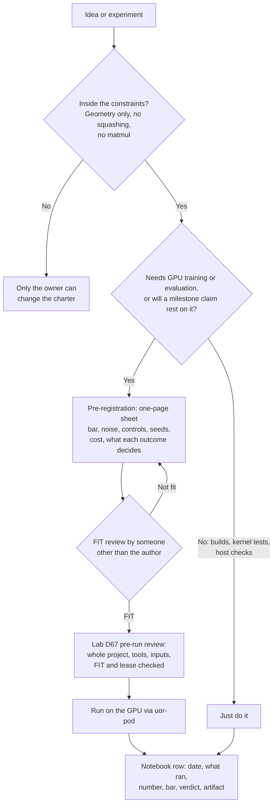

# The rules of the project, in plain language

UOR-R4 is trying to build a fast language model that runs on an ordinary laptop and does not use the expensive machinery inside today's chat AIs. A short rulebook, the [charter](../../CHARTER.md), keeps every contributor pointed at that goal. This page explains what the charter says, why each rule exists, what the project's labs may and may not do, and who makes which decision. It is a guide to the charter, not a replacement: if the two ever disagree, the charter wins.

*How work moves from an idea to a recorded result. Only the Yes branch that needs GPU spend or a milestone claim goes through a sheet, a FIT review and the lab's pre-run review.*

## Why there are rules at all

The owner's stated goal behind every ban, in his own words from 18 October 2026, is "to ban expensive operations" and to optimise for "fast local ai that can train fast and run fast" and reaches "almost frontier level capability" (`CHARTER.md` §1, from decision D37). Each rule removes a cost that a dense neural network pays, or protects the evidence that tells the project whether its geometric replacement works. When a case is unclear, the charter says to choose what trains and serves fastest on a laptop through the geometric path, and to write the choice down.

The project's headline metric is tokens per second: how fast the model reads and writes text, with decode speed and context speed measured separately. A small quality gap is acceptable (`CHARTER.md` §1). The project is pre-alpha, 1 of its 8 milestones is complete, and no model holds a useful conversation yet ([PLAN](../../PLAN.md) and rendered [STATE](../../STATE.md); see [the mechanism board](../mechanisms/README.md)).

These are rules, so the labels "proof", "measurement" and "hypothesis" from `docs/formal_vocabulary.md` do not apply to them. The "why" given for each rule below is the reason the charter itself states. It is not a measured result.

## The constraints and the reason for each

The charter's section 3 lists thirteen technical constraints. Here they are in everyday terms. Terms are defined in the [glossary](../start/glossary.md).

| # | Rule | What it means in practice | Why the charter gives |
|---|---|---|---|
| 3.1 | Geometry only | Every mechanism, training signal and fix comes from the project's geometry (prime addresses, rotations, E8/H4 structures). The flock rule for attention looks at about 7 nearest neighbours, not a dense teacher. | The bet is that geometry replaces expensive dense operations. |
| 3.2 | No squashing functions | No softmax, log-softmax, cross-entropy, softplus, sigmoid, tanh or GELU anywhere, including in losses, sampling and comparators, and including renamed or lookup-table versions. | They are expensive and hide a dense global normalisation. |
| 3.3 | No matrix multiplication | No dense matmul in training, evaluation, tooling or serving, including wrappers and hand-written loops. A geometric feed-forward block is allowed; a dense MLP is not. | Matmul is the cost the project exists to remove. |
| 3.4 | Presence counts | Banned code may not sit in any compiled or loaded module. NVRTC (runtime GPU compilation) is banned. The checks `uor-harness ratchet d23` and `d25` only ever tighten. | Code that is present eventually runs. |
| 3.5 | Research compute is GPU-only | Training, evaluation, qualification and reference runs use the GPU. Spend GPU only where a run can change a decision. | Host runs gave wrong timing and wrong evidence, and the GPU is where the speed is. |
| 3.6 | Serving is integer, on your device | The shipped model uses no float or transcendental instruction. Since D80 and D81 (28 Oct 2026) it may use the hardware integer multiply and divide, which give exact products and quotients. Running it on a laptop CPU, in a browser (WebAssembly) or on Apple silicon is allowed, and so is measuring its speed and energy. Panel scoring, qualification and milestone evaluation of an exported artifact remain GPU research compute; only product serving and measuring its tokens/s and energy run on client devices. | The product is fast local AI on ordinary hardware. |
| 3.7 | Float only offline, with an export gap | Float training is legal offline in a separately scanned module. Every float candidate reports how much accuracy it loses when exported to integers; a loss above the two-seed noise band disqualifies it. | Float trains faster, but only the integer artifact ships. |
| 3.8 | Zeta exception | Float is allowed for complex-plane zeta-zero parts and prime log-phases. Everything downstream is discrete. | Zeta phases are complex numbers by nature. |
| 3.9 | Efficiency is measured | Report sparse access, bytes per token, bounded candidates and exact memory together. | Unmeasured efficiency is not efficiency. |
| 3.10 | No neural comparisons | No neural comparators, controls, teachers or graders until the owner says the model works end to end. Panels are graded by deterministic checks. The one exception is a one-time donor pass (D41) with binding conditions. | A neural comparator would hide a dense model behind the geometry. |
| 3.11 | Rust first | New code is Rust, built on the uor-foundation crates. Python only where Rust cannot do the job. | One fast, checked language keeps training and serving on one path. |
| 3.12 | Exact identity stays separate from address | One shared vector writer serves input, carry and output. Every artifact binds its data, seed, configuration and parameters. | One representation avoids translation costs, and exact identity cannot be recovered from a geometric address. |
| 3.13 | Hygiene | Typed errors instead of panics, no committed binaries, corpora or secrets, and API keys are never read or printed. | It keeps the repository small and the keys out of it. |

Source: `CHARTER.md` §3; the first column gives its clause numbers.

## What labs may do, and what they may not

A **lab** is any contributor, human or AI, working under the charter. The rules in sections 3 and 5 give these limits.

**Labs may:**
- Choose their own work from `PLAN.md`, post a one-line intent note, claim a branch and carry on unless redirected (`CHARTER.md` §5.3).
- Build, run finite kernel tests and run host checks without any pre-registration (§4.5).
- Train in float offline with a sheet, a non-author FIT and the lab's own whole-project pre-run review under D67, and report the export gap on the same evaluator (§3.7, §4.5, §5.1).
- Serve the integer model on a user's device and measure it (§3.6).
- Review their own pull request at the exact head, from a fresh context (§5.5), and use a fresh-context subagent as the non-author FIT reviewer (§4.5).

**Labs may not:**
- Use a banned operation anywhere, including in comparators, or in renamed form (§3.2, §3.3).
- Run research compute on the CPU, or spend GPU on work that cannot change a decision (§3.5).
- Start GPU training or a milestone-bearing run without a sheet, a non-author FIT and the lab's own pre-run review (§4.5, §5.1). D41's donor pass is the named exception that also needs the owner at dispatch.
- Use a neural comparator, teacher or grader, apart from the single D41 donor pass (§3.10).
- Cancel a healthy run because a self-set budget ran out, or touch another session's GPU or files (§5.4).
- Stop a mechanism. That needs the owner (§4.1).
- Delete research. Negatives, unique source and other labs' work go to the archive unchanged (§4.7).
- Exceed 4 pods or $8 per hour across all labs (§5.4).

## Who decides what

| Who | Decides | Source |
|---|---|---|
| The owner (Casey) | The charter, technical constraints and GPU caps; stopping a mechanism; the D41 donor-pass release. | `CHARTER.md` §5.1, §5.2 |
| The project-manager seat (Kimi, with a cover lab named by the owner when Kimi is offline) | The order of work from `PLAN.md`. Operating notes may never contradict the charter. | `CHARTER.md` §5.2 |
| Labs | Which task to pick from `PLAN.md`, how to implement it, their own pre-run and decision reviews, and the exact-head review of pull requests. | `CHARTER.md` §5.1, §5.3, §5.5 |
| Subagents | Reviews, adversarial tests and research. They never make critical decisions: a change to a bar, status, scope or stop rule belongs to the top lab session after its decision review; §3 and the caps stay with the owner. | `CHARTER.md` §5.1, §5.2 |

Two rules guard the owner's role without creating a wait. An unanswered ask becomes the lab's own decision review under D68, and Casey's own words beat any written acceptance text, with his directions recorded verbatim the same day (`CHARTER.md` §5.1). The old blanket Training, M2 and Stage B holds are released; D41's donor pass is the named owner-at-dispatch exception.

## How evidence is judged

Section 4 of the charter is about not fooling ourselves.

- **A negative closes one configuration, never a mechanism.** Mechanisms carry one of three statuses: ACTIVE (on the model path), READY (built and tested, not yet trained in) or PARKED (a tested form failed or broke a rule; the reopen conditions are listed). There is no "retired" status for a mechanism (§4.1). Rules can be retired; mechanisms cannot.
- **Instrument before verdict.** If a check fails, first ask whether the measuring tool or the mechanism is at fault. A broken instrument is a fix, not a negative (§4.2).
- **Power.** A decisive run uses at least 2 seeds or at least 200 fresh rows, with bars no narrower than the measured noise, and reports a fresh transfer number with every development gain (§4.3).
- **Controls and pivots.** Compare against lawful non-neural baselines such as count tables. After three results on one line that do not move its headline number, write a pivot note: stop, or run one decisive experiment (§4.4).
- **Claims.** Write "measured X on Y against Z". A test pass is not trained capability, and `NOT_RUN` is not a pass (§4.6).
- **The first-milestone closing bars.** The close-grade maps (a) self-contained D11 loading, (b) exact export agreement and B4, (c) tokens/s, (d) DEV integer top-1 above unigram (1,226 of 14,287) and T2 (6,300), with the close-grade target 6,324 = T2 + 24, and (e) Fresh V2 transfer; `panel-score.json` adds (f) held-out phrasing. The upstream D39 G-Pre/G-Adm/G-Occ evidence is retained in the M1 item and dated records. [Decision log 6515151261](https://github.com/UOR-Foundation/uor-r4/issues/2029#issuecomment-6515151261) approves this close-grade contract and marks the old criteria superseded; it is the authority for the close, not a silent relabelling.

## Where it stands

| Item | State | Source |
|---|---|---|
| Charter | Adopted 19 October 2026 by the owner at checkpoint 1 of the repository renormalisation. | `CHARTER.md`; [change log](changes.md) |
| Old rules D0 to D41 and the long `AGENTS.md` | Replaced by the charter. Each decision keeps its heading and a one-sentence fate in the live index; full text is preserved unchanged in the archive. | [`decision-map.md`](decision-map.md); [archived original](../../archive/integration/DECISIONS-2026-10-19.md) |
| Training, M2 and Stage B | Go through the lab's own whole-project pre-run review under D67; D41's donor pass is the named owner-at-dispatch exception. | `CHARTER.md` §5.1, §5.10 |
| Pre-alpha status | 1 of 8 milestones complete (M1); no useful conversation yet. | `PLAN.md`, rendered `STATE.md` |

## Go deeper

- The rulebook: [`CHARTER.md`](../../CHARTER.md). What happened to each old decision: [decision map](decision-map.md). When the rules changed: [change log](changes.md).
- Live index of decisions with one-line fates: [`docs/integration/DECISIONS.md`](../integration/DECISIONS.md).
- Original full decision text: [archive](../../archive/integration/DECISIONS-2026-10-19.md).
- Where the mechanisms stand: [mechanism board](../mechanisms/README.md).
- Term definitions: [glossary](../start/glossary.md).
